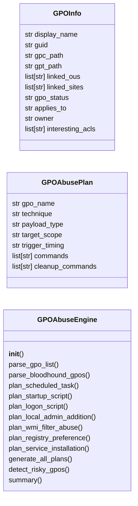
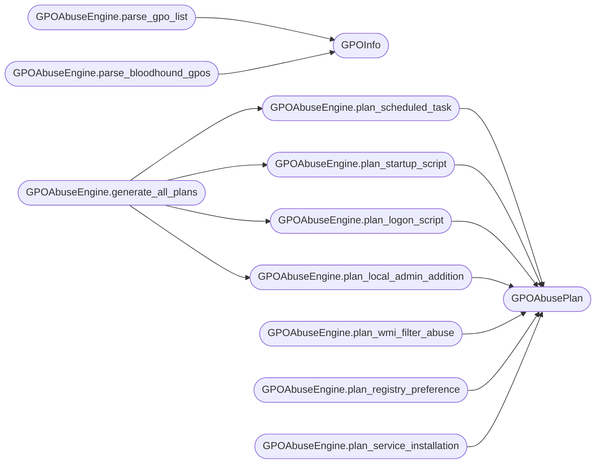

# `modules.gpo_abuse`

> Source: [modules/gpo_abuse.py:1](../../modules/gpo_abuse.py#L1) | language `py` | coverage 94.1% | [API index](../index.md)

GPO abuse module — Group Policy Object manipulation for AD persistence and privilege escalation.

Exploits Group Policy Objects through multiple vectors: GPO link enumeration,
SYSVOL file modification (immediate scheduled tasks), WMI filter abuse,
GPO ACL manipulation, and GPO-based software deployment.

GPO modifications propagate to all scoped computers/users — a single
compromised GPO can provide domain-wide persistence or privilege escalation.

## Contents

- **Classes:** [`GPOInfo`](#gpoinfo), [`GPOAbusePlan`](#gpoabuseplan), [`GPOAbuseEngine`](#gpoabuseengine)
- **Constants:** [`GPO_ABUSE_TECHNIQUES`](#gpo_abuse_techniques), [`GPO_COMPONENTS`](#gpo_components), [`GPO_DEPLOYMENT_STATE`](#gpo_deployment_state)

## Type Diagram



## Call Graph

Solid arrows stay in this module, dashed arrows leave it.



## Classes

<a id="gpoinfo"></a>

### `GPOInfo`

`class` `dataclass` | [modules/gpo_abuse.py:54](../../modules/gpo_abuse.py#L54)

Decorators: `@dataclass`

```python
class GPOInfo
```

Information about a Group Policy Object.

**Attributes**

| Name | Type | Default | Description |
|---|---|---|---|
| [`display_name`](#gpoinfo-display_name) | `str` | `''` | GPO display name. |
| [`guid`](#gpoinfo-guid) | `str` | `''` | GPO GUID. |
| [`gpc_path`](#gpoinfo-gpc_path) | `str` | `''` | Group Policy Container path in AD. |
| [`gpt_path`](#gpoinfo-gpt_path) | `str` | `''` | Group Policy Template path in SYSVOL. |
| [`linked_ous`](#gpoinfo-linked_ous) | `list[str]` | `field(default_factory=list)` | List of OUs this GPO is linked to. |
| [`linked_sites`](#gpoinfo-linked_sites) | `list[str]` | `field(default_factory=list)` | List of AD sites this GPO applies to. |
| [`gpo_status`](#gpoinfo-gpo_status) | `str` | `'Enabled'` | Enabled/Disabled/Enforced. |
| [`applies_to`](#gpoinfo-applies_to) | `str` | `'Computers'` | Computers or Users (or both). |
| [`owner`](#gpoinfo-owner) | `str` | `''` | Security principal that owns the GPO. |
| [`interesting_acls`](#gpoinfo-interesting_acls) | `list[str]` | `field(default_factory=list)` | Non-default ACLs on the GPO. |

---

<a id="gpoabuseplan"></a>

### `GPOAbusePlan`

`class` `dataclass` | [modules/gpo_abuse.py:83](../../modules/gpo_abuse.py#L83)

Decorators: `@dataclass`

```python
class GPOAbusePlan
```

Exploitation plan for an abusable GPO.

**Attributes**

| Name | Type | Default | Description |
|---|---|---|---|
| [`gpo_name`](#gpoabuseplan-gpo_name) | `str` | `''` | Target GPO display name. |
| [`technique`](#gpoabuseplan-technique) | `str` | `''` | Abuse technique from GPO_ABUSE_TECHNIQUES. |
| [`payload_type`](#gpoabuseplan-payload_type) | `str` | `''` | Type of payload to inject (command, script, registry, etc.). |
| [`target_scope`](#gpoabuseplan-target_scope) | `str` | `''` | Which computers/users will be affected. |
| [`trigger_timing`](#gpoabuseplan-trigger_timing) | `str` | `'Next gpupdate (90-120 min) or reboot'` | When the GPO change takes effect (reboot, gpupdate, logon). |
| [`commands`](#gpoabuseplan-commands) | `list[str]` | `field(default_factory=list)` | PowerShell/command-line exploitation commands. |
| [`cleanup_commands`](#gpoabuseplan-cleanup_commands) | `list[str]` | `field(default_factory=list)` | Commands to revert the abuse. |

---

<a id="gpoabuseengine"></a>

### `GPOAbuseEngine`

`class` | [modules/gpo_abuse.py:105](../../modules/gpo_abuse.py#L105)

```python
class GPOAbuseEngine
```

Enumerate and exploit Group Policy Objects for AD compromise.

Provides plans for GPO-based privilege escalation, persistence,
lateral movement, and code execution across domain-joined hosts.

**Members**

| Member | Kind | Summary |
|---|---|---|
| [`__init__`](#gpoabuseengine-__init__) | constructor |  |
| [`parse_gpo_list`](#gpoabuseengine-parse_gpo_list) | method | Parse Get-GPO or ldapsearch output for GPO information. |
| [`parse_bloodhound_gpos`](#gpoabuseengine-parse_bloodhound_gpos) | method | Parse BloodHound GPO nodes for abusable policies. |
| [`plan_scheduled_task`](#gpoabuseengine-plan_scheduled_task) | method | Plan a GPO-backed scheduled task for immediate code execution. |
| [`plan_startup_script`](#gpoabuseengine-plan_startup_script) | method | Plan a GPO startup script for persistence via SYSVOL. |
| [`plan_logon_script`](#gpoabuseengine-plan_logon_script) | method | Plan a GPO user logon script for user-triggered code execution. |
| [`plan_local_admin_addition`](#gpoabuseengine-plan_local_admin_addition) | method | Plan adding a user to the local Administrators group via GPO preferences. |
| [`plan_wmi_filter_abuse`](#gpoabuseengine-plan_wmi_filter_abuse) | method | Plan WMI filter abuse for targeted GPO scope control. |
| [`plan_registry_preference`](#gpoabuseengine-plan_registry_preference) | method | Plan a registry modification via GPO preferences. |
| [`plan_service_installation`](#gpoabuseengine-plan_service_installation) | method | Plan a service installation via GPO for SYSTEM-level persistence. |
| [`generate_all_plans`](#gpoabuseengine-generate_all_plans) | method | Generate all abuse plans for the discovered GPOs. |
| [`detect_risky_gpos`](#gpoabuseengine-detect_risky_gpos) | method | Identify GPOs with risky configurations for post-compromise cleanup. |
| [`summary`](#gpoabuseengine-summary) | method | Return a summary of GPO abuse capabilities. |

<a id="gpoabuseengine-__init__"></a>

#### `GPOAbuseEngine.__init__`

`constructor` | [modules/gpo_abuse.py:118](../../modules/gpo_abuse.py#L118)

```python
def __init__(self, domain: str = '', dc_ip: str = '')
```

**Parameters**

| Name | Type | Default | Description |
|---|---|---|---|
| `domain` | `str` | `''` |  |
| `dc_ip` | `str` | `''` |  |

*Called by:* [`ActiveDirectoryCommandSet.do_gpo_abuse`](cli.commands.active_directory.py.md#activedirectorycommandset-do_gpo_abuse)

<a id="gpoabuseengine-parse_gpo_list"></a>

#### `GPOAbuseEngine.parse_gpo_list`

`method` | [modules/gpo_abuse.py:124](../../modules/gpo_abuse.py#L124)

```python
def parse_gpo_list(self, raw_gpo_output: str) -> list[GPOInfo]
```

Parse Get-GPO or ldapsearch output for GPO information.

**Parameters**

| Name | Type | Default | Description |
|---|---|---|---|
| `raw_gpo_output` | `str` |  | Text output from GPO enumeration tools. |

**Returns:** `list[GPOInfo]` - List of parsed GPOInfo objects.

*Calls:* [`GPOInfo`](#gpoinfo)

<a id="gpoabuseengine-parse_bloodhound_gpos"></a>

#### `GPOAbuseEngine.parse_bloodhound_gpos`

`method` | [modules/gpo_abuse.py:160](../../modules/gpo_abuse.py#L160)

```python
def parse_bloodhound_gpos(self, bloodhound_nodes: list[dict[str, Any]]) -> list[GPOInfo]
```

Parse BloodHound GPO nodes for abusable policies.

**Parameters**

| Name | Type | Default | Description |
|---|---|---|---|
| `bloodhound_nodes` | `list[dict[str, Any]]` |  | List of BloodHound GPO node dicts. |

**Returns:** `list[GPOInfo]` - List of GPOInfo objects.

*Calls:* [`GPOInfo`](#gpoinfo)

<a id="gpoabuseengine-plan_scheduled_task"></a>

#### `GPOAbuseEngine.plan_scheduled_task`

`method` | [modules/gpo_abuse.py:182](../../modules/gpo_abuse.py#L182)

```python
def plan_scheduled_task(self, gpo: GPOInfo, command: str, task_name: str = 'SystemUpdate') -> GPOAbusePlan
```

Plan a GPO-backed scheduled task for immediate code execution.

**Parameters**

| Name | Type | Default | Description |
|---|---|---|---|
| `gpo` | `GPOInfo` |  | Target GPO. |
| `command` | `str` |  | Command to execute on target machines. |
| `task_name` | `str` | `'SystemUpdate'` | Task name in Task Scheduler. |

**Returns:** `GPOAbusePlan` - GPOAbusePlan with scheduled task deployment instructions.

*Calls:* [`GPOAbusePlan`](#gpoabuseplan)

*Called by:* [`ActiveDirectoryCommandSet.do_gpo_abuse`](cli.commands.active_directory.py.md#activedirectorycommandset-do_gpo_abuse), [`GPOAbuseEngine.generate_all_plans`](#gpoabuseengine-generate_all_plans)

<a id="gpoabuseengine-plan_startup_script"></a>

#### `GPOAbuseEngine.plan_startup_script`

`method` | [modules/gpo_abuse.py:208](../../modules/gpo_abuse.py#L208)

```python
def plan_startup_script(self, gpo: GPOInfo, script_content: str, script_name: str = 'update.ps1') -> GPOAbusePlan
```

Plan a GPO startup script for persistence via SYSVOL.

**Parameters**

| Name | Type | Default | Description |
|---|---|---|---|
| `gpo` | `GPOInfo` |  | Target GPO. |
| `script_content` | `str` |  | PowerShell script content to deploy. |
| `script_name` | `str` | `'update.ps1'` | Script filename in SYSVOL. |

**Returns:** `GPOAbusePlan` - GPOAbusePlan with startup script deployment.

*Calls:* [`GPOAbusePlan`](#gpoabuseplan)

*Called by:* [`GPOAbuseEngine.generate_all_plans`](#gpoabuseengine-generate_all_plans)

<a id="gpoabuseengine-plan_logon_script"></a>

#### `GPOAbuseEngine.plan_logon_script`

`method` | [modules/gpo_abuse.py:238](../../modules/gpo_abuse.py#L238)

```python
def plan_logon_script(self, gpo: GPOInfo, command: str) -> GPOAbusePlan
```

Plan a GPO user logon script for user-triggered code execution.

**Parameters**

| Name | Type | Default | Description |
|---|---|---|---|
| `gpo` | `GPOInfo` |  | Target GPO. |
| `command` | `str` |  | Command to execute on user logon. |

**Returns:** `GPOAbusePlan` - GPOAbusePlan with logon script configuration.

*Calls:* [`GPOAbusePlan`](#gpoabuseplan)

*Called by:* [`GPOAbuseEngine.generate_all_plans`](#gpoabuseengine-generate_all_plans)

<a id="gpoabuseengine-plan_local_admin_addition"></a>

#### `GPOAbuseEngine.plan_local_admin_addition`

`method` | [modules/gpo_abuse.py:266](../../modules/gpo_abuse.py#L266)

```python
def plan_local_admin_addition(self, gpo: GPOInfo, username: str, group: str = 'Administrators') -> GPOAbusePlan
```

Plan adding a user to the local Administrators group via GPO preferences.

**Parameters**

| Name | Type | Default | Description |
|---|---|---|---|
| `gpo` | `GPOInfo` |  | Target GPO. |
| `username` | `str` |  | Username to add. |
| `group` | `str` | `'Administrators'` | Local group to add to (default: Administrators). |

**Returns:** `GPOAbusePlan` - GPOAbusePlan with local group modification.

*Calls:* [`GPOAbusePlan`](#gpoabuseplan)

*Called by:* [`GPOAbuseEngine.generate_all_plans`](#gpoabuseengine-generate_all_plans)

<a id="gpoabuseengine-plan_wmi_filter_abuse"></a>

#### `GPOAbuseEngine.plan_wmi_filter_abuse`

`method` | [modules/gpo_abuse.py:293](../../modules/gpo_abuse.py#L293)

```python
def plan_wmi_filter_abuse(self, gpo: GPOInfo, wmi_query: str) -> GPOAbusePlan
```

Plan WMI filter abuse for targeted GPO scope control.

Abusive WMI filters can scope a GPO to specific hosts dynamically.

**Parameters**

| Name | Type | Default | Description |
|---|---|---|---|
| `gpo` | `GPOInfo` |  | Target GPO. |
| `wmi_query` | `str` |  | WQL query for host targeting. |

**Returns:** `GPOAbusePlan` - GPOAbusePlan with WMI filter configuration.

*Calls:* [`GPOAbusePlan`](#gpoabuseplan)

<a id="gpoabuseengine-plan_registry_preference"></a>

#### `GPOAbuseEngine.plan_registry_preference`

`method` | [modules/gpo_abuse.py:322](../../modules/gpo_abuse.py#L322)

```python
def plan_registry_preference(self, gpo: GPOInfo, registry_path: str, value_name: str, value_data: str, value_type: str = 'REG_SZ') -> GPOAbusePlan
```

Plan a registry modification via GPO preferences.

Can enable RDP, disable firewall, add autorun entries, etc.

**Parameters**

| Name | Type | Default | Description |
|---|---|---|---|
| `gpo` | `GPOInfo` |  | Target GPO. |
| `registry_path` | `str` |  | Full registry key path. |
| `value_name` | `str` |  | Value name to set. |
| `value_data` | `str` |  | Value data. |
| `value_type` | `str` | `'REG_SZ'` | Registry value type. |

**Returns:** `GPOAbusePlan` - GPOAbusePlan with registry preference commands.

*Calls:* [`GPOAbusePlan`](#gpoabuseplan)

<a id="gpoabuseengine-plan_service_installation"></a>

#### `GPOAbuseEngine.plan_service_installation`

`method` | [modules/gpo_abuse.py:356](../../modules/gpo_abuse.py#L356)

```python
def plan_service_installation(self, gpo: GPOInfo, service_name: str, binary_path: str) -> GPOAbusePlan
```

Plan a service installation via GPO for SYSTEM-level persistence.

**Parameters**

| Name | Type | Default | Description |
|---|---|---|---|
| `gpo` | `GPOInfo` |  | Target GPO. |
| `service_name` | `str` |  | Display name for the service. |
| `binary_path` | `str` |  | Path to the service binary. |

**Returns:** `GPOAbusePlan` - GPOAbusePlan with service installation commands.

*Calls:* [`GPOAbusePlan`](#gpoabuseplan)

<a id="gpoabuseengine-generate_all_plans"></a>

#### `GPOAbuseEngine.generate_all_plans`

`method` | [modules/gpo_abuse.py:382](../../modules/gpo_abuse.py#L382)

```python
def generate_all_plans(self, command: str, username: str = 'ATTACKER') -> list[GPOAbusePlan]
```

Generate all abuse plans for the discovered GPOs.

**Parameters**

| Name | Type | Default | Description |
|---|---|---|---|
| `command` | `str` |  | Payload command to execute. |
| `username` | `str` | `'ATTACKER'` | Attacker username for local admin addition. |

**Returns:** `list[GPOAbusePlan]` - List of GPOAbusePlan for all GPOs and techniques.

*Calls:* [`GPOAbuseEngine.plan_local_admin_addition`](#gpoabuseengine-plan_local_admin_addition), [`GPOAbuseEngine.plan_logon_script`](#gpoabuseengine-plan_logon_script), [`GPOAbuseEngine.plan_scheduled_task`](#gpoabuseengine-plan_scheduled_task), [`GPOAbuseEngine.plan_startup_script`](#gpoabuseengine-plan_startup_script)

<a id="gpoabuseengine-detect_risky_gpos"></a>

#### `GPOAbuseEngine.detect_risky_gpos`

`method` | [modules/gpo_abuse.py:406](../../modules/gpo_abuse.py#L406)

```python
def detect_risky_gpos(self) -> list[dict[str, Any]]
```

Identify GPOs with risky configurations for post-compromise cleanup.

Scans for startup scripts, scheduled tasks, software installs,
and other GPO settings that might indicate adversary persistence.

**Returns:** `list[dict[str, Any]]` - List of risky GPO findings.

<a id="gpoabuseengine-summary"></a>

#### `GPOAbuseEngine.summary`

`method` | [modules/gpo_abuse.py:434](../../modules/gpo_abuse.py#L434)

```python
def summary(self) -> dict[str, Any]
```

Return a summary of GPO abuse capabilities.

**Returns:** `dict[str, Any]` - Dict with GPO count, techniques, and abuse plans.

*Called by:* [`ActiveDirectoryCommandSet.do_gpo_abuse`](cli.commands.active_directory.py.md#activedirectorycommandset-do_gpo_abuse)

---

## Constants

<a id="gpo_abuse_techniques"></a>

### `GPO_ABUSE_TECHNIQUES`

`constant` | [modules/gpo_abuse.py:16](../../modules/gpo_abuse.py#L16)

```python
GPO_ABUSE_TECHNIQUES
```

---

<a id="gpo_components"></a>

### `GPO_COMPONENTS`

`constant` | [modules/gpo_abuse.py:33](../../modules/gpo_abuse.py#L33)

```python
GPO_COMPONENTS
```

---

<a id="gpo_deployment_state"></a>

### `GPO_DEPLOYMENT_STATE`

`constant` | [modules/gpo_abuse.py:46](../../modules/gpo_abuse.py#L46)

```python
GPO_DEPLOYMENT_STATE = {0: 'Disabled', 1: 'Enabled', 2: 'Enforced'}
```

---
