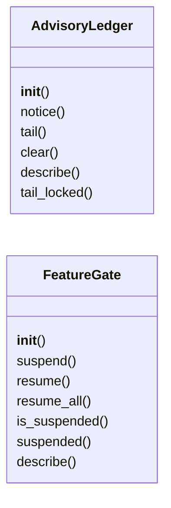

# `modules.guardrails.advisories`

> Source: [modules/guardrails/advisories.py:1](../../modules/guardrails/advisories.py#L1) | language `py` | coverage 100.0% | [API index](../index.md)

Non-blocking advisories and feature degradation.

Advisories notify supervisors without interrupting the running logic.
The feature gate drops optional work first when capacity degrades and
restores it only after an explicit re-arm or a clean restart.

## Contents

- **Classes:** [`AdvisoryLedger`](#advisoryledger), [`FeatureGate`](#featuregate)
- **Constants:** [`ADVISORY_LIMIT`](#advisory_limit), [`SUSPENDABLE_FEATURES`](#suspendable_features)

## Type Diagram



## Call Graph

Solid arrows stay in this module, dashed arrows leave it.


## Classes

<a id="advisoryledger"></a>

### `AdvisoryLedger`

`class` | [modules/guardrails/advisories.py:17](../../modules/guardrails/advisories.py#L17)

```python
class AdvisoryLedger
```

Bounded non-blocking notice stream (newest first).

**Members**

| Member | Kind | Summary |
|---|---|---|
| [`__init__`](#advisoryledger-__init__) | constructor | Create an empty ledger. |
| [`notice`](#advisoryledger-notice) | method | Record one advisory without blocking the caller. |
| [`tail`](#advisoryledger-tail) | method | Return the newest notices up to the limit. |
| [`clear`](#advisoryledger-clear) | method | Drop every notice, returning the discarded count. |
| [`describe`](#advisoryledger-describe) | method | Return the ledger summary for the admin console. |
| [`tail_locked`](#advisoryledger-tail_locked) | method | Tail helper used by describe; caller holds the lock. |

<a id="advisoryledger-__init__"></a>

#### `AdvisoryLedger.__init__`

`constructor` | [modules/guardrails/advisories.py:20](../../modules/guardrails/advisories.py#L20)

```python
def __init__(self, limit: int = ADVISORY_LIMIT) -> None
```

Create an empty ledger.

**Parameters**

| Name | Type | Default | Description |
|---|---|---|---|
| `limit` | `int` | `ADVISORY_LIMIT` | Maximum retained notices (oldest dropped). |

*Called by:* [`GuardHarness.__init__`](modules.guardrails.harness.py.md#guardharness-__init__)

<a id="advisoryledger-notice"></a>

#### `AdvisoryLedger.notice`

`method` | [modules/guardrails/advisories.py:31](../../modules/guardrails/advisories.py#L31)

```python
def notice(self, code: str, message: str = '') -> dict[str, Any]
```

Record one advisory without blocking the caller.

**Parameters**

| Name | Type | Default | Description |
|---|---|---|---|
| `code` | `str` |  | Short machine tag (for example ``tier_saturated``). |
| `message` | `str` | `''` | Optional human detail. |

**Returns:** `dict[str, Any]` - The stored advisory entry.

*Called by:* [`GuardHarness.run_guarded`](modules.guardrails.harness.py.md#guardharness-run_guarded), [`GuardHarness.suspend`](modules.guardrails.harness.py.md#guardharness-suspend), [`GuardHarness.warm_restart`](modules.guardrails.harness.py.md#guardharness-warm_restart)

<a id="advisoryledger-tail"></a>

#### `AdvisoryLedger.tail`

`method` | [modules/guardrails/advisories.py:49](../../modules/guardrails/advisories.py#L49)

```python
def tail(self, limit: int = 10) -> list[dict[str, Any]]
```

Return the newest notices up to the limit.

**Parameters**

| Name | Type | Default | Description |
|---|---|---|---|
| `limit` | `int` | `10` |  |

**Returns:** `list[dict[str, Any]]`

<a id="advisoryledger-clear"></a>

#### `AdvisoryLedger.clear`

`method` | [modules/guardrails/advisories.py:54](../../modules/guardrails/advisories.py#L54)

```python
def clear(self) -> int
```

Drop every notice, returning the discarded count.

**Returns:** `int`

*Called by:* [`GuardHarness.rearm`](modules.guardrails.harness.py.md#guardharness-rearm)

<a id="advisoryledger-describe"></a>

#### `AdvisoryLedger.describe`

`method` | [modules/guardrails/advisories.py:61](../../modules/guardrails/advisories.py#L61)

```python
def describe(self) -> dict[str, Any]
```

Return the ledger summary for the admin console.

**Returns:** `dict[str, Any]`

*Calls:* [`AdvisoryLedger.tail_locked`](#advisoryledger-tail_locked)

<a id="advisoryledger-tail_locked"></a>

#### `AdvisoryLedger.tail_locked`

`method` | [modules/guardrails/advisories.py:66](../../modules/guardrails/advisories.py#L66)

```python
def tail_locked(self, limit: int) -> list[dict[str, Any]]
```

Tail helper used by describe; caller holds the lock.

**Parameters**

| Name | Type | Default | Description |
|---|---|---|---|
| `limit` | `int` |  |  |

**Returns:** `list[dict[str, Any]]`

*Called by:* [`AdvisoryLedger.describe`](#advisoryledger-describe)

---

<a id="featuregate"></a>

### `FeatureGate`

`class` | [modules/guardrails/advisories.py:71](../../modules/guardrails/advisories.py#L71)

```python
class FeatureGate
```

Optional-feature suspension registry for graceful degradation.

**Members**

| Member | Kind | Summary |
|---|---|---|
| [`__init__`](#featuregate-__init__) | constructor | Create a gate limited to the known optional features. |
| [`suspend`](#featuregate-suspend) | method | Suspend one optional feature. |
| [`resume`](#featuregate-resume) | method | Resume one suspended feature, returning True when it changed. |
| [`resume_all`](#featuregate-resume_all) | method | Resume every suspended feature, returning the resumed count. |
| [`is_suspended`](#featuregate-is_suspended) | method | Return True when the feature is currently suspended. |
| [`suspended`](#featuregate-suspended) | method | Return the suspended feature map (feature -> reason). |
| [`describe`](#featuregate-describe) | method | Return the gate state for the admin console. |

<a id="featuregate-__init__"></a>

#### `FeatureGate.__init__`

`constructor` | [modules/guardrails/advisories.py:74](../../modules/guardrails/advisories.py#L74)

```python
def __init__(self, features: frozenset[str] = SUSPENDABLE_FEATURES) -> None
```

Create a gate limited to the known optional features.

**Parameters**

| Name | Type | Default | Description |
|---|---|---|---|
| `features` | `frozenset[str]` | `SUSPENDABLE_FEATURES` | Suspendable feature names. |

*Called by:* [`GuardHarness.__init__`](modules.guardrails.harness.py.md#guardharness-__init__)

<a id="featuregate-suspend"></a>

#### `FeatureGate.suspend`

`method` | [modules/guardrails/advisories.py:84](../../modules/guardrails/advisories.py#L84)

```python
def suspend(self, feature: str, reason: str = '') -> bool
```

Suspend one optional feature.

**Parameters**

| Name | Type | Default | Description |
|---|---|---|---|
| `feature` | `str` |  | Feature name from [`SUSPENDABLE_FEATURES`](#suspendable_features). |
| `reason` | `str` | `''` | Optional operator-facing detail. |

**Returns:** `bool` - True when the feature is now suspended; False for unknown
features (core features can never degrade).

*Called by:* [`GuardHarness.suspend`](modules.guardrails.harness.py.md#guardharness-suspend)

<a id="featuregate-resume"></a>

#### `FeatureGate.resume`

`method` | [modules/guardrails/advisories.py:102](../../modules/guardrails/advisories.py#L102)

```python
def resume(self, feature: str) -> bool
```

Resume one suspended feature, returning True when it changed.

**Parameters**

| Name | Type | Default | Description |
|---|---|---|---|
| `feature` | `str` |  |  |

**Returns:** `bool`

<a id="featuregate-resume_all"></a>

#### `FeatureGate.resume_all`

`method` | [modules/guardrails/advisories.py:108](../../modules/guardrails/advisories.py#L108)

```python
def resume_all(self) -> int
```

Resume every suspended feature, returning the resumed count.

**Returns:** `int`

*Called by:* [`GuardHarness.rearm`](modules.guardrails.harness.py.md#guardharness-rearm)

<a id="featuregate-is_suspended"></a>

#### `FeatureGate.is_suspended`

`method` | [modules/guardrails/advisories.py:115](../../modules/guardrails/advisories.py#L115)

```python
def is_suspended(self, feature: str) -> bool
```

Return True when the feature is currently suspended.

**Parameters**

| Name | Type | Default | Description |
|---|---|---|---|
| `feature` | `str` |  |  |

**Returns:** `bool`

*Called by:* [`GuardHarness.run_guarded`](modules.guardrails.harness.py.md#guardharness-run_guarded)

<a id="featuregate-suspended"></a>

#### `FeatureGate.suspended`

`method` | [modules/guardrails/advisories.py:120](../../modules/guardrails/advisories.py#L120)

```python
def suspended(self) -> dict[str, str]
```

Return the suspended feature map (feature -> reason).

**Returns:** `dict[str, str]`

<a id="featuregate-describe"></a>

#### `FeatureGate.describe`

`method` | [modules/guardrails/advisories.py:125](../../modules/guardrails/advisories.py#L125)

```python
def describe(self) -> dict[str, Any]
```

Return the gate state for the admin console.

**Returns:** `dict[str, Any]`

---

## Constants

<a id="advisory_limit"></a>

### `ADVISORY_LIMIT`

`constant` | [modules/guardrails/advisories.py:13](../../modules/guardrails/advisories.py#L13)

```python
ADVISORY_LIMIT: int = 128
```

---

<a id="suspendable_features"></a>

### `SUSPENDABLE_FEATURES`

`constant` | [modules/guardrails/advisories.py:14](../../modules/guardrails/advisories.py#L14)

```python
SUSPENDABLE_FEATURES: frozenset[str] = frozenset({'render', 'enrich', 'llm_stream', 'swan'})
```

---
