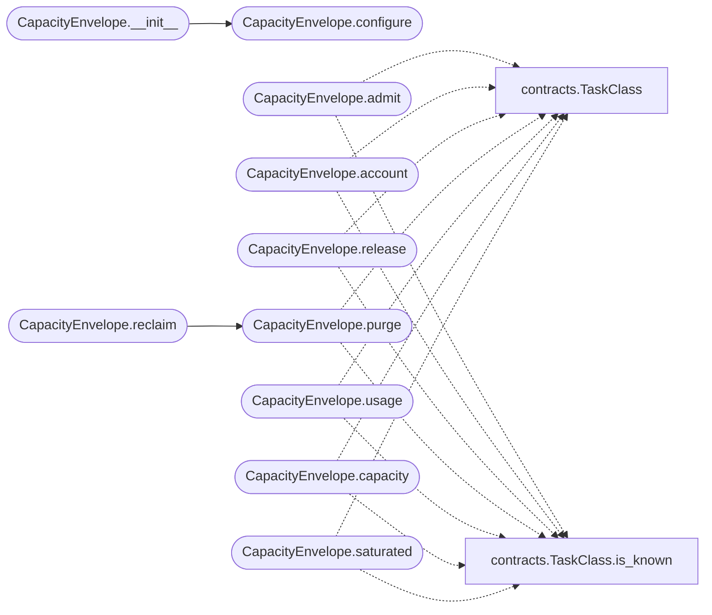

# `modules.guardrails.budget`

> Source: [modules/guardrails/budget.py:1](../../modules/guardrails/budget.py#L1) | language `py` | coverage 100.0% | [API index](../index.md)

Bounded capacity accounting with strict priority reservation.

Every execution tier owns a fixed capacity. A tier may only consume
capacity while every higher tier keeps a reserve below the saturation
threshold, so a class N task can never starve class N-1. When a tier
saturates the reclaim step drops SUPPORT work and resumes only when the
operator re-arms or usage drains.

## Contents

- **Classes:** [`CapacityEnvelope`](#capacityenvelope)
- **Constants:** [`DEFAULT_SATURATION_THRESHOLD`](#default_saturation_threshold), [`DEFAULT_CAPACITY_CORE`](#default_capacity_core), [`DEFAULT_CAPACITY_MISSION`](#default_capacity_mission), [`DEFAULT_CAPACITY_SUPPORT`](#default_capacity_support)

## Call Graph

Solid arrows stay in this module, dashed arrows leave it.



## Classes

<a id="capacityenvelope"></a>

### `CapacityEnvelope`

`class` | [modules/guardrails/budget.py:25](../../modules/guardrails/budget.py#L25)

```python
class CapacityEnvelope
```

Fixed-capacity ledger per task class with priority reservation.

**Members**

| Member | Kind | Summary |
|---|---|---|
| [`__init__`](#capacityenvelope-__init__) | constructor | Seed capacities and the saturation threshold. |
| [`configure`](#capacityenvelope-configure) | method | Apply capacity and threshold settings, clamping invalid values. |
| [`admit`](#capacityenvelope-admit) | method | Reserve units for one tier honouring the priority contract. |
| [`account`](#capacityenvelope-account) | method | Record consumed units for one tier (idempotent on refusal). |
| [`release`](#capacityenvelope-release) | method | Return units to a tier ledger once an execution finishes. |
| [`purge`](#capacityenvelope-purge) | method | Zero one tier ledger, returning the freed unit count. |
| [`reclaim`](#capacityenvelope-reclaim) | method | Purge SUPPORT allocations, returning the freed unit count. |
| [`usage`](#capacityenvelope-usage) | method | Return current consumed units for one tier. |
| [`capacity`](#capacityenvelope-capacity) | method | Return configured capacity for one tier. |
| [`saturated`](#capacityenvelope-saturated) | method | Return True when the tier usage ratio reaches the threshold. |
| [`threshold`](#capacityenvelope-threshold) | method | Return the configured saturation threshold. |
| [`describe`](#capacityenvelope-describe) | method | Return a per-tier usage snapshot for the admin console. |

<a id="capacityenvelope-__init__"></a>

#### `CapacityEnvelope.__init__`

`constructor` | [modules/guardrails/budget.py:28](../../modules/guardrails/budget.py#L28)

```python
def __init__(self, capacities: dict[TaskClass, int] | None = None, threshold: float | None = None) -> None
```

Seed capacities and the saturation threshold.

**Parameters**

| Name | Type | Default | Description |
|---|---|---|---|
| `capacities` | `dict[TaskClass, int] \| None` | `None` | Optional per-class capacity override. |
| `threshold` | `float \| None` | `None` | Optional saturation threshold (0 < t <= 0.99). |

*Calls:* [`CapacityEnvelope.configure`](#capacityenvelope-configure)

*Called by:* [`GuardHarness.__init__`](modules.guardrails.harness.py.md#guardharness-__init__)

<a id="capacityenvelope-configure"></a>

#### `CapacityEnvelope.configure`

`method` | [modules/guardrails/budget.py:50](../../modules/guardrails/budget.py#L50)

```python
def configure(self, capacities: dict[TaskClass, int] | dict[str, int] | None = None, threshold: float | None = None) -> dict[str, Any]
```

Apply capacity and threshold settings, clamping invalid values.

**Parameters**

| Name | Type | Default | Description |
|---|---|---|---|
| `capacities` | `dict[TaskClass, int] \| dict[str, int] \| None` | `None` | Per-class capacity overrides keyed by TaskClass or by the enum name string. |
| `threshold` | `float \| None` | `None` | Saturation threshold in (0, 0.99]. |

**Returns:** `dict[str, Any]` - The effective settings snapshot.

*Called by:* [`CapacityEnvelope.__init__`](#capacityenvelope-__init__), [`GuardHarness.__init__`](modules.guardrails.harness.py.md#guardharness-__init__), [`GuardHarness.configure`](modules.guardrails.harness.py.md#guardharness-configure)

<a id="capacityenvelope-admit"></a>

#### `CapacityEnvelope.admit`

`method` | [modules/guardrails/budget.py:78](../../modules/guardrails/budget.py#L78)

```python
def admit(self, task_class: TaskClass, units: int = 1) -> bool
```

Reserve units for one tier honouring the priority contract.

Core is survival: only hard capacity can refuse it. Mission is
refused while core saturates; support is refused while core or
mission saturates; any tier over its own capacity is refused.

**Parameters**

| Name | Type | Default | Description |
|---|---|---|---|
| `task_class` | `TaskClass` |  | Tier requesting admission. |
| `units` | `int` | `1` | Capacity units the execution will account. |

**Returns:** `bool` - False when refused by the priority contract or capacity;
True when admitted.

*Calls:* [`TaskClass`](modules.guardrails.contracts.py.md#taskclass), [`TaskClass.is_known`](modules.guardrails.contracts.py.md#taskclass-is_known)

*Called by:* [`GuardHarness.run_guarded`](modules.guardrails.harness.py.md#guardharness-run_guarded)

<a id="capacityenvelope-account"></a>

#### `CapacityEnvelope.account`

`method` | [modules/guardrails/budget.py:109](../../modules/guardrails/budget.py#L109)

```python
def account(self, task_class: TaskClass, units: int = 1) -> None
```

Record consumed units for one tier (idempotent on refusal).

**Parameters**

| Name | Type | Default | Description |
|---|---|---|---|
| `task_class` | `TaskClass` |  |  |
| `units` | `int` | `1` |  |

*Calls:* [`TaskClass`](modules.guardrails.contracts.py.md#taskclass), [`TaskClass.is_known`](modules.guardrails.contracts.py.md#taskclass-is_known)

*Called by:* [`GuardHarness.run_guarded`](modules.guardrails.harness.py.md#guardharness-run_guarded)

<a id="capacityenvelope-release"></a>

#### `CapacityEnvelope.release`

`method` | [modules/guardrails/budget.py:118](../../modules/guardrails/budget.py#L118)

```python
def release(self, task_class: TaskClass, units: int = 1) -> None
```

Return units to a tier ledger once an execution finishes.

**Parameters**

| Name | Type | Default | Description |
|---|---|---|---|
| `task_class` | `TaskClass` |  |  |
| `units` | `int` | `1` |  |

*Calls:* [`TaskClass`](modules.guardrails.contracts.py.md#taskclass), [`TaskClass.is_known`](modules.guardrails.contracts.py.md#taskclass-is_known)

<a id="capacityenvelope-purge"></a>

#### `CapacityEnvelope.purge`

`method` | [modules/guardrails/budget.py:126](../../modules/guardrails/budget.py#L126)

```python
def purge(self, task_class: TaskClass) -> int
```

Zero one tier ledger, returning the freed unit count.

**Parameters**

| Name | Type | Default | Description |
|---|---|---|---|
| `task_class` | `TaskClass` |  |  |

**Returns:** `int`

*Calls:* [`TaskClass`](modules.guardrails.contracts.py.md#taskclass), [`TaskClass.is_known`](modules.guardrails.contracts.py.md#taskclass-is_known)

*Called by:* [`CapacityEnvelope.reclaim`](#capacityenvelope-reclaim), [`GuardHarness.rearm`](modules.guardrails.harness.py.md#guardharness-rearm)

<a id="capacityenvelope-reclaim"></a>

#### `CapacityEnvelope.reclaim`

`method` | [modules/guardrails/budget.py:136](../../modules/guardrails/budget.py#L136)

```python
def reclaim(self) -> int
```

Purge SUPPORT allocations, returning the freed unit count.

**Returns:** `int`

*Calls:* [`CapacityEnvelope.purge`](#capacityenvelope-purge)

*Called by:* [`GuardHarness.warm_restart`](modules.guardrails.harness.py.md#guardharness-warm_restart)

<a id="capacityenvelope-usage"></a>

#### `CapacityEnvelope.usage`

`method` | [modules/guardrails/budget.py:140](../../modules/guardrails/budget.py#L140)

```python
def usage(self, task_class: TaskClass) -> int
```

Return current consumed units for one tier.

**Parameters**

| Name | Type | Default | Description |
|---|---|---|---|
| `task_class` | `TaskClass` |  |  |

**Returns:** `int`

*Calls:* [`TaskClass`](modules.guardrails.contracts.py.md#taskclass), [`TaskClass.is_known`](modules.guardrails.contracts.py.md#taskclass-is_known)

<a id="capacityenvelope-capacity"></a>

#### `CapacityEnvelope.capacity`

`method` | [modules/guardrails/budget.py:147](../../modules/guardrails/budget.py#L147)

```python
def capacity(self, task_class: TaskClass) -> int
```

Return configured capacity for one tier.

**Parameters**

| Name | Type | Default | Description |
|---|---|---|---|
| `task_class` | `TaskClass` |  |  |

**Returns:** `int`

*Calls:* [`TaskClass`](modules.guardrails.contracts.py.md#taskclass), [`TaskClass.is_known`](modules.guardrails.contracts.py.md#taskclass-is_known)

<a id="capacityenvelope-saturated"></a>

#### `CapacityEnvelope.saturated`

`method` | [modules/guardrails/budget.py:154](../../modules/guardrails/budget.py#L154)

```python
def saturated(self, task_class: TaskClass) -> bool
```

Return True when the tier usage ratio reaches the threshold.

**Parameters**

| Name | Type | Default | Description |
|---|---|---|---|
| `task_class` | `TaskClass` |  |  |

**Returns:** `bool`

*Calls:* [`TaskClass`](modules.guardrails.contracts.py.md#taskclass), [`TaskClass.is_known`](modules.guardrails.contracts.py.md#taskclass-is_known)

<a id="capacityenvelope-threshold"></a>

#### `CapacityEnvelope.threshold`

`method` | [modules/guardrails/budget.py:161](../../modules/guardrails/budget.py#L161)

```python
def threshold(self) -> float
```

Return the configured saturation threshold.

**Returns:** `float`

<a id="capacityenvelope-describe"></a>

#### `CapacityEnvelope.describe`

`method` | [modules/guardrails/budget.py:166](../../modules/guardrails/budget.py#L166)

```python
def describe(self) -> dict[str, Any]
```

Return a per-tier usage snapshot for the admin console.

**Returns:** `dict[str, Any]`

---

## Constants

<a id="default_saturation_threshold"></a>

### `DEFAULT_SATURATION_THRESHOLD`

`constant` | [modules/guardrails/budget.py:17](../../modules/guardrails/budget.py#L17)

```python
DEFAULT_SATURATION_THRESHOLD: float = 0.85
```

---

<a id="default_capacity_core"></a>

### `DEFAULT_CAPACITY_CORE`

`constant` | [modules/guardrails/budget.py:18](../../modules/guardrails/budget.py#L18)

```python
DEFAULT_CAPACITY_CORE: int = 10000
```

---

<a id="default_capacity_mission"></a>

### `DEFAULT_CAPACITY_MISSION`

`constant` | [modules/guardrails/budget.py:19](../../modules/guardrails/budget.py#L19)

```python
DEFAULT_CAPACITY_MISSION: int = 2000
```

---

<a id="default_capacity_support"></a>

### `DEFAULT_CAPACITY_SUPPORT`

`constant` | [modules/guardrails/budget.py:20](../../modules/guardrails/budget.py#L20)

```python
DEFAULT_CAPACITY_SUPPORT: int = 512
```

---
