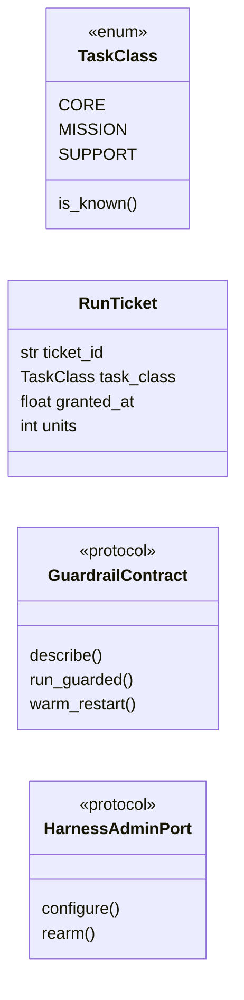

# `modules.guardrails.contracts`

> Source: [modules/guardrails/contracts.py:1](../../modules/guardrails/contracts.py#L1) | language `py` | coverage 100.0% | [API index](../index.md)

Contracts for the execution guardrail harness.

The harness protects the operator and the machine from degradation:
every execution is classified into an immutable task class, bounded
capacity is accounted per class, failures warm-restart from the last
checkpoint instead of crashing, and secondary features degrade first.

## Contents

- **Classes:** [`RunTicket`](#runticket)
- **Enums:** [`TaskClass`](#taskclass)
- **Protocols:** [`GuardrailContract`](#guardrailcontract), [`HarnessAdminPort`](#harnessadminport)
- **Constants:** [`CONFIG_SECTION`](#config_section)

## Type Diagram



## Classes

<a id="runticket"></a>

### `RunTicket`

`class` `dataclass` | [modules/guardrails/contracts.py:40](../../modules/guardrails/contracts.py#L40)

Decorators: `@dataclass(frozen=True)`

```python
class RunTicket
```

One admitted execution reservation.

**Attributes**

| Name | Type | Default | Description |
|---|---|---|---|
| [`ticket_id`](#runticket-ticket_id) | `str` |  |  |
| [`task_class`](#runticket-task_class) | `TaskClass` |  |  |
| [`granted_at`](#runticket-granted_at) | `float` |  |  |
| [`units`](#runticket-units) | `int` |  |  |

---

## Enums

<a id="taskclass"></a>

### `TaskClass`

`enum` | [modules/guardrails/contracts.py:19](../../modules/guardrails/contracts.py#L19)

```python
class TaskClass(IntEnum)
```

Bases: `IntEnum`

Immutable execution tier.

A class N task never blocks or consumes capacity reserved for class
N-1; when capacity saturates the lowest classes are refused first.

**Attributes**

| Name | Type | Default | Description |
|---|---|---|---|
| [`CORE`](#taskclass-core) |  | `0` |  |
| [`MISSION`](#taskclass-mission) |  | `1` |  |
| [`SUPPORT`](#taskclass-support) |  | `2` |  |

**Members**

| Member | Kind | Summary |
|---|---|---|
| [`is_known`](#taskclass-is_known) | classmethod | Return True when the value names a registered class. |

<a id="taskclass-is_known"></a>

#### `TaskClass.is_known`

`classmethod` | [modules/guardrails/contracts.py:31](../../modules/guardrails/contracts.py#L31)

Decorators: `@classmethod`

```python
def is_known(cls, value: object) -> bool
```

Return True when the value names a registered class.

**Parameters**

| Name | Type | Default | Description |
|---|---|---|---|
| `value` | `object` |  |  |

**Returns:** `bool`

*Called by:* [`CapacityEnvelope.account`](modules.guardrails.budget.py.md#capacityenvelope-account), [`CapacityEnvelope.admit`](modules.guardrails.budget.py.md#capacityenvelope-admit), [`CapacityEnvelope.capacity`](modules.guardrails.budget.py.md#capacityenvelope-capacity), [`CapacityEnvelope.purge`](modules.guardrails.budget.py.md#capacityenvelope-purge), [`CapacityEnvelope.release`](modules.guardrails.budget.py.md#capacityenvelope-release), [`CapacityEnvelope.saturated`](modules.guardrails.budget.py.md#capacityenvelope-saturated), [`CapacityEnvelope.usage`](modules.guardrails.budget.py.md#capacityenvelope-usage)

---

## Protocols

<a id="guardrailcontract"></a>

### `GuardrailContract`

`protocol` | [modules/guardrails/contracts.py:49](../../modules/guardrails/contracts.py#L49)

```python
class GuardrailContract(Protocol)
```

Bases: `Protocol`

Public surface every harness implementation must expose.

**Members**

| Member | Kind | Summary |
|---|---|---|
| [`describe`](#guardrailcontract-describe) | method | Return tier usage, advisories, suspended features and checkpoints. |
| [`run_guarded`](#guardrailcontract-run_guarded) | method | Execute fn under capacity accounting and warm-restart policy. |
| [`warm_restart`](#guardrailcontract-warm_restart) | method | Purge non-critical contexts and restore the last checkpoint. |

<a id="guardrailcontract-describe"></a>

#### `GuardrailContract.describe`

`method` | [modules/guardrails/contracts.py:52](../../modules/guardrails/contracts.py#L52)

```python
def describe(self) -> dict[str, Any]
```

Return tier usage, advisories, suspended features and checkpoints.

**Returns:** `dict[str, Any]`

<a id="guardrailcontract-run_guarded"></a>

#### `GuardrailContract.run_guarded`

`method` | [modules/guardrails/contracts.py:56](../../modules/guardrails/contracts.py#L56)

```python
def run_guarded(self, task_class: TaskClass, fn: Callable[..., Any], *args: Any, key: str = '', state: Any = None, **kwargs: Any) -> Any
```

Execute fn under capacity accounting and warm-restart policy.

**Parameters**

| Name | Type | Default | Description |
|---|---|---|---|
| `task_class` | `TaskClass` |  |  |
| `fn` | `Callable[..., Any]` |  |  |
| `*args` | `Any` |  |  |
| `key` | `str` | `''` |  |
| `state` | `Any` | `None` |  |
| `**kwargs` | `Any` |  |  |

**Returns:** `Any`

<a id="guardrailcontract-warm_restart"></a>

#### `GuardrailContract.warm_restart`

`method` | [modules/guardrails/contracts.py:68](../../modules/guardrails/contracts.py#L68)

```python
def warm_restart(self) -> dict[str, Any]
```

Purge non-critical contexts and restore the last checkpoint.

**Returns:** `dict[str, Any]`

---

<a id="harnessadminport"></a>

### `HarnessAdminPort`

`protocol` | [modules/guardrails/contracts.py:73](../../modules/guardrails/contracts.py#L73)

```python
class HarnessAdminPort(Protocol)
```

Bases: `Protocol`

Administration surface consumed by the orchestrator console.

**Members**

| Member | Kind | Summary |
|---|---|---|
| [`configure`](#harnessadminport-configure) | method | Apply capacity and threshold settings from the payload. |
| [`rearm`](#harnessadminport-rearm) | method | Clear advisories and resume suspended features after an operator review. |

<a id="harnessadminport-configure"></a>

#### `HarnessAdminPort.configure`

`method` | [modules/guardrails/contracts.py:76](../../modules/guardrails/contracts.py#L76)

```python
def configure(self, settings: dict[str, Any]) -> dict[str, Any]
```

Apply capacity and threshold settings from the payload.

**Parameters**

| Name | Type | Default | Description |
|---|---|---|---|
| `settings` | `dict[str, Any]` |  |  |

**Returns:** `dict[str, Any]`

<a id="harnessadminport-rearm"></a>

#### `HarnessAdminPort.rearm`

`method` | [modules/guardrails/contracts.py:80](../../modules/guardrails/contracts.py#L80)

```python
def rearm(self) -> dict[str, Any]
```

Clear advisories and resume suspended features after an operator review.

**Returns:** `dict[str, Any]`

---

## Constants

<a id="config_section"></a>

### `CONFIG_SECTION`

`constant` | [modules/guardrails/contracts.py:16](../../modules/guardrails/contracts.py#L16)

```python
CONFIG_SECTION: str = 'orchestrator.guardrails'
```

---
