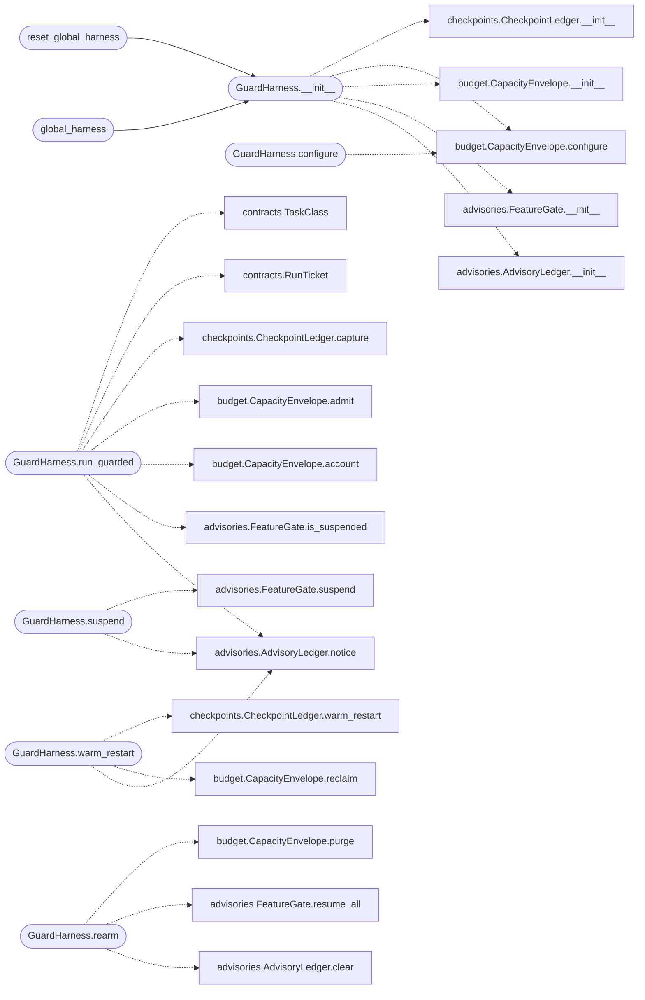

# `modules.guardrails.harness`

> Source: [modules/guardrails/harness.py:1](../../modules/guardrails/harness.py#L1) | language `py` | coverage 100.0% | [API index](../index.md)

Execution harness facade: guarded runs, warm restart, degradation.

`[`run_guarded`](#guardharness-run_guarded)` classifies one execution into a task class, reserves
capacity, and applies the failure policy: core executions warm-restart
from the latest checkpoint and retry once; mission and support
executions degrade with a non-blocking advisory. The process keeps its
control cycle alive instead of crashing.

## Contents

- **Classes:** [`GuardHarness`](#guardharness)
- **Functions:** [`global_harness`](#global_harness), [`reset_global_harness`](#reset_global_harness)

## Call Graph

Solid arrows stay in this module, dashed arrows leave it.



## Classes

<a id="guardharness"></a>

### `GuardHarness`

`class` | [modules/guardrails/harness.py:25](../../modules/guardrails/harness.py#L25)

```python
class GuardHarness
```

Facade binding capacity, checkpoints and degradation policies.

**Members**

| Member | Kind | Summary |
|---|---|---|
| [`__init__`](#guardharness-__init__) | constructor | Create a harness with payload-driven or default settings. |
| [`configure`](#guardharness-configure) | method | Apply settings from the payload guardrails section. |
| [`run_guarded`](#guardharness-run_guarded) | method | Execute fn under the tier policy, degrading instead of crashing. |
| [`warm_restart`](#guardharness-warm_restart) | method | Purge non-critical contexts and restore the core checkpoint. |
| [`suspend`](#guardharness-suspend) | method | Suspend one optional feature until re-arm. |
| [`rearm`](#guardharness-rearm) | method | Resume suspended features, clear advisories and refresh budgets. |
| [`describe`](#guardharness-describe) | method | Return the full harness snapshot for the admin console. |

<a id="guardharness-__init__"></a>

#### `GuardHarness.__init__`

`constructor` | [modules/guardrails/harness.py:28](../../modules/guardrails/harness.py#L28)

```python
def __init__(self, threshold: float | None = None, capacities: dict[str, int] | None = None) -> None
```

Create a harness with payload-driven or default settings.

**Parameters**

| Name | Type | Default | Description |
|---|---|---|---|
| `threshold` | `float \| None` | `None` | Optional saturation threshold override. |
| `capacities` | `dict[str, int] \| None` | `None` | Optional per-tier capacity overrides keyed by tier name. |

*Calls:* [`AdvisoryLedger.__init__`](modules.guardrails.advisories.py.md#advisoryledger-__init__), [`FeatureGate.__init__`](modules.guardrails.advisories.py.md#featuregate-__init__), [`CapacityEnvelope.__init__`](modules.guardrails.budget.py.md#capacityenvelope-__init__), [`CapacityEnvelope.configure`](modules.guardrails.budget.py.md#capacityenvelope-configure), [`CheckpointLedger.__init__`](modules.guardrails.checkpoints.py.md#checkpointledger-__init__)

*Called by:* [`global_harness`](#global_harness), [`reset_global_harness`](#reset_global_harness)

<a id="guardharness-configure"></a>

#### `GuardHarness.configure`

`method` | [modules/guardrails/harness.py:48](../../modules/guardrails/harness.py#L48)

```python
def configure(self, settings: dict[str, Any] | None = None) -> dict[str, Any]
```

Apply settings from the payload guardrails section.

**Parameters**

| Name | Type | Default | Description |
|---|---|---|---|
| `settings` | `dict[str, Any] \| None` | `None` | Mapping with optional ``saturation_threshold`` and ``capacity`` (per-tier name to integer). |

**Returns:** `dict[str, Any]` - The effective harness description after configuration.

*Calls:* [`CapacityEnvelope.configure`](modules.guardrails.budget.py.md#capacityenvelope-configure)

<a id="guardharness-run_guarded"></a>

#### `GuardHarness.run_guarded`

`method` | [modules/guardrails/harness.py:63](../../modules/guardrails/harness.py#L63)

```python
def run_guarded(self, task_class: TaskClass, fn: Callable[..., Any], *args: Any, key: str = '', state: Any = None, **kwargs: Any) -> Any
```

Execute fn under the tier policy, degrading instead of crashing.

Core executions capture a checkpoint first and warm-restart with
one retry on failure. Mission and support executions record a
non-blocking advisory and return None; suspended support
features are refused outright.

**Parameters**

| Name | Type | Default | Description |
|---|---|---|---|
| `task_class` | `TaskClass` |  | Execution tier. |
| `fn` | `Callable[..., Any]` |  | Callable to execute. |
| `*args` | `Any` |  | Positional arguments for fn. |
| `key` | `str` | `''` | Optional checkpoint key (core retries restore it). |
| `state` | `Any` | `None` | Optional checkpoint snapshot captured before execution. |
| `**kwargs` | `Any` |  | Keyword arguments for fn. |

**Returns:** `Any` - The callable result, the warm-restart retry result, or None
when refused or degraded. KeyboardInterrupt and SystemExit
always propagate.

**Raises**

- `KeyboardInterrupt`: When the operator interrupts execution.
- `SystemExit`: When the interpreter is shutting down.

*Calls:* [`AdvisoryLedger.notice`](modules.guardrails.advisories.py.md#advisoryledger-notice), [`FeatureGate.is_suspended`](modules.guardrails.advisories.py.md#featuregate-is_suspended), [`CapacityEnvelope.account`](modules.guardrails.budget.py.md#capacityenvelope-account), [`CapacityEnvelope.admit`](modules.guardrails.budget.py.md#capacityenvelope-admit), [`CheckpointLedger.capture`](modules.guardrails.checkpoints.py.md#checkpointledger-capture), [`RunTicket`](modules.guardrails.contracts.py.md#runticket), [`TaskClass`](modules.guardrails.contracts.py.md#taskclass)

<a id="guardharness-warm_restart"></a>

#### `GuardHarness.warm_restart`

`method` | [modules/guardrails/harness.py:124](../../modules/guardrails/harness.py#L124)

```python
def warm_restart(self, core_key: str = '') -> dict[str, Any]
```

Purge non-critical contexts and restore the core checkpoint.

**Parameters**

| Name | Type | Default | Description |
|---|---|---|---|
| `core_key` | `str` | `''` | Optional checkpoint key to restore. |

**Returns:** `dict[str, Any]` - The warm-restart summary from the checkpoint ledger.

*Calls:* [`AdvisoryLedger.notice`](modules.guardrails.advisories.py.md#advisoryledger-notice), [`CapacityEnvelope.reclaim`](modules.guardrails.budget.py.md#capacityenvelope-reclaim), [`CheckpointLedger.warm_restart`](modules.guardrails.checkpoints.py.md#checkpointledger-warm_restart)

<a id="guardharness-suspend"></a>

#### `GuardHarness.suspend`

`method` | [modules/guardrails/harness.py:138](../../modules/guardrails/harness.py#L138)

```python
def suspend(self, feature: str, reason: str = '') -> bool
```

Suspend one optional feature until re-arm.

**Parameters**

| Name | Type | Default | Description |
|---|---|---|---|
| `feature` | `str` |  | Feature name from [`SUSPENDABLE_FEATURES`](modules.guardrails.advisories.py.md#suspendable_features). |
| `reason` | `str` | `''` | Optional operator-facing detail. |

**Returns:** `bool` - True when the feature is now suspended.

*Calls:* [`AdvisoryLedger.notice`](modules.guardrails.advisories.py.md#advisoryledger-notice), [`FeatureGate.suspend`](modules.guardrails.advisories.py.md#featuregate-suspend)

<a id="guardharness-rearm"></a>

#### `GuardHarness.rearm`

`method` | [modules/guardrails/harness.py:153](../../modules/guardrails/harness.py#L153)

```python
def rearm(self) -> dict[str, Any]
```

Resume suspended features, clear advisories and refresh budgets.

**Returns:** `dict[str, Any]` - Summary with resumed feature count and cleared notices.

*Calls:* [`AdvisoryLedger.clear`](modules.guardrails.advisories.py.md#advisoryledger-clear), [`FeatureGate.resume_all`](modules.guardrails.advisories.py.md#featuregate-resume_all), [`CapacityEnvelope.purge`](modules.guardrails.budget.py.md#capacityenvelope-purge)

<a id="guardharness-describe"></a>

#### `GuardHarness.describe`

`method` | [modules/guardrails/harness.py:165](../../modules/guardrails/harness.py#L165)

```python
def describe(self) -> dict[str, Any]
```

Return the full harness snapshot for the admin console.

**Returns:** `dict[str, Any]`

---

## Functions

<a id="global_harness"></a>

### `global_harness`

`function` | [modules/guardrails/harness.py:232](../../modules/guardrails/harness.py#L232)

```python
def global_harness() -> GuardHarness
```

Return the process-wide harness, creating it on first use.

**Returns:** `GuardHarness`

*Calls:* [`GuardHarness.__init__`](#guardharness-__init__)

*Called by:* [`build_llm_recovery_chain`](cli.apt_chain_support.py.md#build_llm_recovery_chain), [`OrchestratorAssetsMixin.rearm_harness`](cli.orchestrator_assets_tabs.py.md#orchestratorassetsmixin-rearm_harness), [`OrchestratorAssetsMixin.save_guardrails`](cli.orchestrator_assets_tabs.py.md#orchestratorassetsmixin-save_guardrails), [`OrchestratorAssetsMixin.warm_restart_harness`](cli.orchestrator_assets_tabs.py.md#orchestratorassetsmixin-warm_restart_harness)

---

<a id="reset_global_harness"></a>

### `reset_global_harness`

`function` | [modules/guardrails/harness.py:241](../../modules/guardrails/harness.py#L241)

```python
def reset_global_harness() -> GuardHarness
```

Replace the process-wide harness (tests and warm reloads only).

**Returns:** `GuardHarness` - The fresh harness instance.

*Calls:* [`GuardHarness.__init__`](#guardharness-__init__)

---
