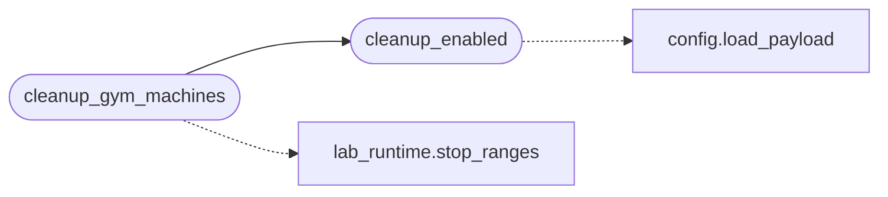

# `modules.gym_cleanup`

> Source: [modules/gym_cleanup.py:1](../../modules/gym_cleanup.py#L1) | language `py` | coverage 100.0% | [API index](../index.md)

Gym machine cleanup on LazyOwn exit.

Lab scenario containers (``lazyown-lab-*``) and cyber range containers
(``lazyown-range-*``) hold real memory and CPU on the operator host.
When LazyOwn closes through any path (quit, EOF, SIGTERM, SIGHUP,
atexit) every running gym machine is stopped so nothing keeps leasing
resources after the session. Operators can disable the behaviour with
``"gym_cleanup_on_exit": false`` in ``payload.json``.

## Contents

- **Functions:** [`cleanup_enabled`](#cleanup_enabled), [`cleanup_gym_machines`](#cleanup_gym_machines)
- **Constants:** [`CONFIG_KEY`](#config_key)

## Call Graph

Solid arrows stay in this module, dashed arrows leave it.



## Functions

<a id="cleanup_enabled"></a>

### `cleanup_enabled`

`function` | [modules/gym_cleanup.py:21](../../modules/gym_cleanup.py#L21)

```python
def cleanup_enabled() -> bool
```

Return whether exit cleanup is enabled (default on).

**Returns:** `bool`

*Calls:* [`load_payload`](core.config.py.md#load_payload)

*Called by:* [`cleanup_gym_machines`](#cleanup_gym_machines)

---

<a id="cleanup_gym_machines"></a>

### `cleanup_gym_machines`

`function` | [modules/gym_cleanup.py:35](../../modules/gym_cleanup.py#L35)

```python
def cleanup_gym_machines(verbose: bool = False) -> dict[str, Any]
```

Stop every running lab and range machine.

**Parameters**

| Name | Type | Default | Description |
|---|---|---|---|
| `verbose` | `bool` | `False` | When True, print one line per stopped machine group. |

**Returns:** `dict[str, Any]` - Mapping with ``enabled``, ``labs`` and ``ranges`` stop results.

*Calls:* [`cleanup_enabled`](#cleanup_enabled), [`stop_ranges`](modules.lab_runtime.py.md#stop_ranges)

---

## Constants

<a id="config_key"></a>

### `CONFIG_KEY`

`constant` | [modules/gym_cleanup.py:18](../../modules/gym_cleanup.py#L18)

```python
CONFIG_KEY = 'gym_cleanup_on_exit'
```

---
