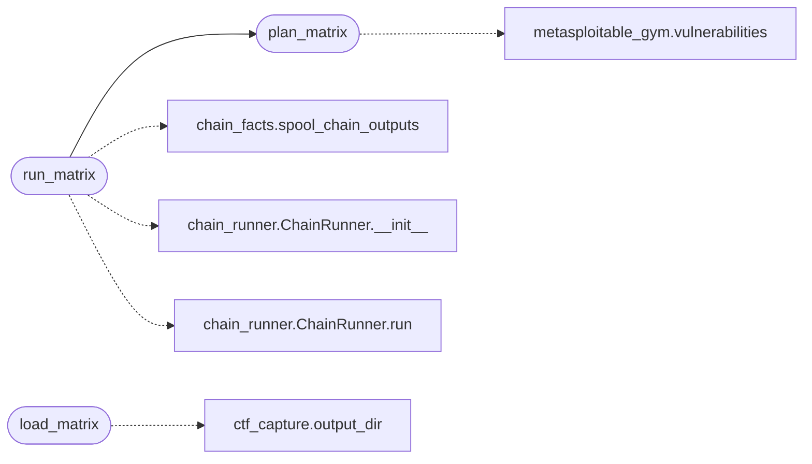

# `modules.gym_matrix_runner`

> Source: [modules/gym_matrix_runner.py:1](../../modules/gym_matrix_runner.py#L1) | language `py` | coverage 100.0% | [API index](../index.md)

Ordered Metasploitable 2 gym matrix runner.

Walks the indexed gym vulnerabilities in severity order, executes one
chain per vector, and stores the structured run plus its CTF capture
under ``sessions/ctf/<vuln_id>/`` and ``sessions/ctf/matrix_run.json``.

## Contents

- **Functions:** [`plan_matrix`](#plan_matrix), [`run_matrix`](#run_matrix), [`load_matrix`](#load_matrix)
- **Constants:** [`MATRIX_ARTIFACT_NAME`](#matrix_artifact_name), [`SEVERITY_ORDER`](#severity_order), [`MAX_MATRIX_OUTPUT_CHARS`](#max_matrix_output_chars)

## Call Graph

Solid arrows stay in this module, dashed arrows leave it.



## Functions

<a id="plan_matrix"></a>

### `plan_matrix`

`function` | [modules/gym_matrix_runner.py:36](../../modules/gym_matrix_runner.py#L36)

```python
def plan_matrix(target: str, sessions_dir: str | Path | None = None, only: list[str] | None = None, top_k: int = 0) -> list[dict]
```

Build the ordered execution plan for the gym matrix.

**Parameters**

| Name | Type | Default | Description |
|---|---|---|---|
| `target` | `str` |  | Victim host IP. |
| `sessions_dir` | `str \| Path \| None` | `None` | Sessions directory override. |
| `only` | `list[str] \| None` | `None` | Restrict to these vulnerability ids. |
| `top_k` | `int` | `0` | Cap the plan to the first N entries (0 keeps all). |

**Returns:** `list[dict]` - Ordered plan entries with `[`vuln_id`](skills.lazyown_facts.py.md#vulnerabilityfact-vuln_id)`, ``chain_name`` and
metadata; entries without a chain carry ``chain_name: ""``.

**Raises**

- `ValueError`: (raised in the body, not documented)

*Calls:* [`vulnerabilities`](modules.metasploitable_gym.py.md#vulnerabilities)

*Called by:* [`run_matrix`](#run_matrix)

---

<a id="run_matrix"></a>

### `run_matrix`

`function` | [modules/gym_matrix_runner.py:89](../../modules/gym_matrix_runner.py#L89)

```python
def run_matrix(target: str, *, executor: Callable[[str], str] | None = None, shell: Any = None, dry_run: bool = False, approver: Callable[[str, str], bool] | None = None, on_step: Callable[[Any], None] | None = None, sessions_dir: str | Path | None = None, only: list[str] | None = None, top_k: int = 0, lhost: str = '', lport: str = '') -> dict
```

Execute every planned chain and verify its CTF capture.

Each vector runs in sequence; a capture is verified from the
aggregate step outputs and one outcome is published per capture.

**Parameters**

| Name | Type | Default | Description |
|---|---|---|---|
| `target` | `str` |  | Victim host IP. |
| `executor` | `Callable[[str], str] \| None` | `None` | Optional execution primitive for chain steps. |
| `shell` | `Any` | `None` | Optional live shell for verb steps. |
| `dry_run` | `bool` | `False` | Resolve the plan without executing anything. |
| `approver` | `Callable[[str, str], bool] \| None` | `None` | Callback for confirm steps. |
| `on_step` | `Callable[[Any], None] \| None` | `None` | Per-step observer shared across chains. |
| `sessions_dir` | `str \| Path \| None` | `None` | Sessions directory override. |
| `only` | `list[str] \| None` | `None` | Restrict to these vulnerability ids. |
| `top_k` | `int` | `0` | Cap the plan to the first N entries. |
| `lhost` | `str` | `''` | Attacker host token. |
| `lport` | `str` | `''` | Attacker port token. |

**Returns:** `dict` - The matrix summary dict persisted to
``sessions/ctf/matrix_run.json``.

*Calls:* [`spool_chain_outputs`](modules.chain_facts.py.md#spool_chain_outputs), [`ChainRunner.__init__`](modules.chain_runner.py.md#chainrunner-__init__), [`ChainRunner.run`](modules.chain_runner.py.md#chainrunner-run), [`plan_matrix`](#plan_matrix)

---

<a id="load_matrix"></a>

### `load_matrix`

`function` | [modules/gym_matrix_runner.py:233](../../modules/gym_matrix_runner.py#L233)

```python
def load_matrix(sessions_dir: str | Path | None = None) -> dict
```

Read the persisted matrix summary.

**Parameters**

| Name | Type | Default | Description |
|---|---|---|---|
| `sessions_dir` | `str \| Path \| None` | `None` | Sessions directory override. |

**Returns:** `dict` - Stored summary dict, or ``{"runs": []}`` when missing.

*Calls:* [`output_dir`](modules.ctf_capture.py.md#output_dir)

---

## Constants

<a id="matrix_artifact_name"></a>

### `MATRIX_ARTIFACT_NAME`

`constant` | [modules/gym_matrix_runner.py:23](../../modules/gym_matrix_runner.py#L23)

```python
MATRIX_ARTIFACT_NAME = 'matrix_run.json'
```

---

<a id="severity_order"></a>

### `SEVERITY_ORDER`

`constant` | [modules/gym_matrix_runner.py:25](../../modules/gym_matrix_runner.py#L25)

```python
SEVERITY_ORDER: dict[str, int] = {'critical': 0, 'high': 1, 'medium': 2, 'low': 3, 'info': 4}
```

---

<a id="max_matrix_output_chars"></a>

### `MAX_MATRIX_OUTPUT_CHARS`

`constant` | [modules/gym_matrix_runner.py:33](../../modules/gym_matrix_runner.py#L33)

```python
MAX_MATRIX_OUTPUT_CHARS = 20000
```

---
