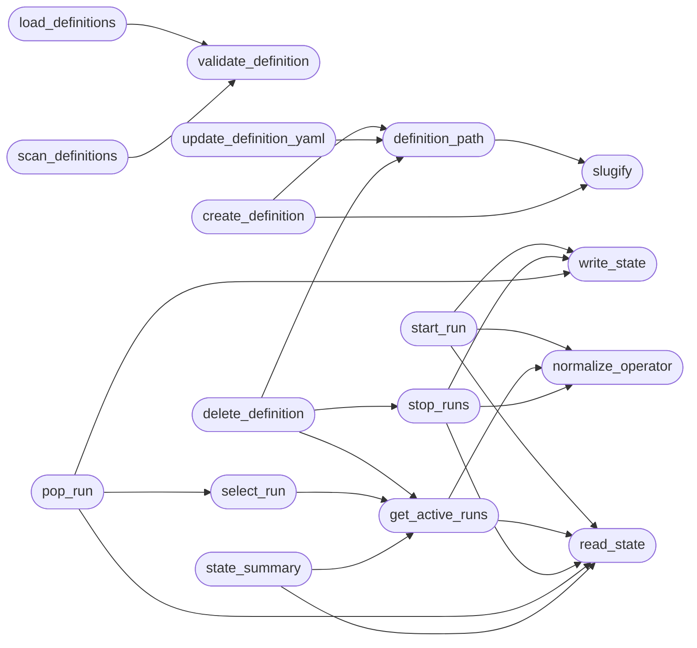

# `modules.gym_registry`

> Source: [modules/gym_registry.py:1](../../modules/gym_registry.py#L1) | language `py` | coverage 100.0% | [API index](../index.md)

Gym definitions and persistent run state.

Gym challenges are YAML files under ``gyms/``. Runtime runs are stored in
the world model under the allowlisted ``gyms`` section, so ``gym status``,
``gym stop`` and the orchestrator Gyms tab all read the same state across
sessions.

State contract::

    {
      "version": 1,
      "next_id": 4,
      "active": {
        "gym0001": {
          "run_id": "gym0001",
          "challenge_id": "first_blood_web",
          "name": "First Blood - Web",
          "operator": "grisun0",
          "started_at": 1710000000.0,
          "target": "172.17.0.2",
          "status": "active"
        }
      },
      "legacy_imported": ["active_grisun0.json"]
    }

The module never accepts paths from operators: definitions are addressed
by slug and confined to [`GYMS_DIR`](#gyms_dir). Writes are atomic and YAML is
validated before it reaches disk.

## Contents

- **Functions:** [`slugify`](#slugify), [`validate_definition`](#validate_definition), [`definition_path`](#definition_path), [`load_definitions`](#load_definitions), [`scan_definitions`](#scan_definitions), [`create_definition`](#create_definition), [`update_definition_yaml`](#update_definition_yaml), [`delete_definition`](#delete_definition), [`normalize_operator`](#normalize_operator), [`read_state`](#read_state), [`write_state`](#write_state), [`start_run`](#start_run), [`get_active_runs`](#get_active_runs), [`select_run`](#select_run), [`stop_runs`](#stop_runs), [`pop_run`](#pop_run), [`state_summary`](#state_summary), [`new_run_token`](#new_run_token)
- **Constants:** [`GYMS_DIR`](#gyms_dir), [`GYM_DIR`](#gym_dir), [`STATE_KEY`](#state_key)

## Call Graph

Solid arrows stay in this module, dashed arrows leave it.



## Functions

<a id="slugify"></a>

### `slugify`

`function` | [modules/gym_registry.py:92](../../modules/gym_registry.py#L92)

```python
def slugify(value: str) -> str
```

Return a safe gym identifier.

**Parameters**

| Name | Type | Default | Description |
|---|---|---|---|
| `value` | `str` |  | Operator-supplied identifier. |

**Returns:** `str` - Lowercase ``[a-z0-9_-]`` slug capped at 64 characters.

*Called by:* [`create_definition`](#create_definition), [`definition_path`](#definition_path)

---

<a id="validate_definition"></a>

### `validate_definition`

`function` | [modules/gym_registry.py:110](../../modules/gym_registry.py#L110)

```python
def validate_definition(data: Any, filename: str = '') -> list[str]
```

Validate one gym definition mapping.

**Parameters**

| Name | Type | Default | Description |
|---|---|---|---|
| `data` | `Any` |  | Parsed YAML document. |
| `filename` | `str` | `''` | File stem; when present it must equal the definition id. |

**Returns:** `list[str]` - Human-readable errors; an empty list means valid.

*Called by:* [`load_definitions`](#load_definitions), [`scan_definitions`](#scan_definitions)

---

<a id="definition_path"></a>

### `definition_path`

`function` | [modules/gym_registry.py:155](../../modules/gym_registry.py#L155)

```python
def definition_path(gym_id: str, directory: Path | str | None = None) -> Path
```

Resolve one gym YAML file inside the gyms directory.

**Parameters**

| Name | Type | Default | Description |
|---|---|---|---|
| `gym_id` | `str` |  | Gym identifier or file name. |
| `directory` | `Path \| str \| None` | `None` | Override for tests; defaults to [`GYMS_DIR`](#gyms_dir). |

**Returns:** `Path` - The confined path.

**Raises**

- `ValueError`: Invalid or escaping identifier.

*Calls:* [`slugify`](#slugify)

*Called by:* [`LazyOrchestratorApp.gym_preview`](cli.lazy_orchestrator.py.md#lazyorchestratorapp-gym_preview), [`create_definition`](#create_definition), [`delete_definition`](#delete_definition), [`update_definition_yaml`](#update_definition_yaml)

---

<a id="load_definitions"></a>

### `load_definitions`

`function` | [modules/gym_registry.py:207](../../modules/gym_registry.py#L207)

```python
def load_definitions(directory: Path | str | None = None) -> dict[str, dict[str, Any]]
```

Load every valid gym definition.

**Parameters**

| Name | Type | Default | Description |
|---|---|---|---|
| `directory` | `Path \| str \| None` | `None` | Override for tests; defaults to [`GYMS_DIR`](#gyms_dir). |

**Returns:** `dict[str, dict[str, Any]]` - Mapping of gym id to normalized definition. Invalid files are
logged and skipped, never raised.

*Calls:* [`validate_definition`](#validate_definition)

*Called by:* [`reload_challenge_definitions`](modules.redteam_gym.py.md#reload_challenge_definitions)

---

<a id="scan_definitions"></a>

### `scan_definitions`

`function` | [modules/gym_registry.py:239](../../modules/gym_registry.py#L239)

```python
def scan_definitions(directory: Path | str | None = None) -> list[dict[str, Any]]
```

Return one row per YAML file, including invalid files.

**Parameters**

| Name | Type | Default | Description |
|---|---|---|---|
| `directory` | `Path \| str \| None` | `None` | Override for tests; defaults to [`GYMS_DIR`](#gyms_dir). |

**Returns:** `list[dict[str, Any]]` - Rows with `[`file`](modules.playbook_admin.py.md#playbookentry-file)`, ``path``, ``id``, ``name`` and ``error``.

*Calls:* [`validate_definition`](#validate_definition)

*Called by:* [`LazyOrchestratorApp.gym_rows`](cli.lazy_orchestrator.py.md#lazyorchestratorapp-gym_rows), [`definition_rows`](modules.redteam_gym.py.md#definition_rows)

---

<a id="create_definition"></a>

### `create_definition`

`function` | [modules/gym_registry.py:300](../../modules/gym_registry.py#L300)

```python
def create_definition(gym_id: str, *, name: str = '', scenario: str = 'metasploitable', objective: str = '', description: str = '', difficulty: str = 'easy', chain: str = '', phases: list[str] | None = None, hints: list[str] | None = None, max_points: int = 1000, elo_bonus: int = 100, directory: Path | str | None = None, overwrite: bool = False) -> Path
```

Create one gym definition YAML.

**Parameters**

| Name | Type | Default | Description |
|---|---|---|---|
| `gym_id` | `str` |  | Identifier and file stem. |
| `name` | `str` | `''` | Display name. |
| `scenario` | `str` | `'metasploitable'` | Lab scenario or range. |
| `objective` | `str` | `''` | Operator-facing goal. |
| `description` | `str` | `''` | Long description. |
| `difficulty` | `str` | `'easy'` | ``easy``, ``medium`` or ``hard``. |
| `chain` | `str` | `''` | Optional APT chain run by the gym. |
| `phases` | `list[str] \| None` | `None` | Kill-chain phases covered. |
| `hints` | `list[str] \| None` | `None` | Progressive hints. |
| `max_points` | `int` | `1000` | Score ceiling. |
| `elo_bonus` | `int` | `100` | ELO awarded on success. |
| `directory` | `Path \| str \| None` | `None` | Override for tests. |
| `overwrite` | `bool` | `False` | Replace an existing definition. |

**Returns:** `Path` - The created path.

**Raises**

- `FileExistsError`: The definition exists and ``overwrite`` is False.
- `ValueError`: Invalid identifier or document.

*Calls:* [`definition_path`](#definition_path), [`slugify`](#slugify)

*Called by:* [`create_gym`](modules.redteam_gym.py.md#create_gym)

---

<a id="update_definition_yaml"></a>

### `update_definition_yaml`

`function` | [modules/gym_registry.py:369](../../modules/gym_registry.py#L369)

```python
def update_definition_yaml(gym_id: str, text: str, directory: Path | str | None = None) -> Path
```

Parse, validate and atomically rewrite one definition.

**Parameters**

| Name | Type | Default | Description |
|---|---|---|---|
| `gym_id` | `str` |  | Existing definition id or file stem. |
| `text` | `str` |  | Raw YAML. |
| `directory` | `Path \| str \| None` | `None` | Override for tests. |

**Returns:** `Path` - The written path.

**Raises**

- `FileNotFoundError`: The definition does not exist.
- `ValueError`: Invalid YAML or invalid definition.

*Calls:* [`definition_path`](#definition_path)

*Called by:* [`save_gym_yaml`](modules.redteam_gym.py.md#save_gym_yaml)

---

<a id="delete_definition"></a>

### `delete_definition`

`function` | [modules/gym_registry.py:402](../../modules/gym_registry.py#L402)

```python
def delete_definition(gym_id: str, directory: Path | str | None = None, *, allow_active: bool = False) -> dict[str, Any]
```

Delete one definition unless it has active runs.

**Parameters**

| Name | Type | Default | Description |
|---|---|---|---|
| `gym_id` | `str` |  | Definition id. |
| `directory` | `Path \| str \| None` | `None` | Override for tests. |
| `allow_active` | `bool` | `False` | Stop runs before deleting when True. |

**Returns:** `dict[str, Any]` - Dict with ``success`` and either ``deleted`` or ``error``.

*Calls:* [`definition_path`](#definition_path), [`get_active_runs`](#get_active_runs), [`stop_runs`](#stop_runs)

*Called by:* [`delete_gym`](modules.redteam_gym.py.md#delete_gym)

---

<a id="normalize_operator"></a>

### `normalize_operator`

`function` | [modules/gym_registry.py:495](../../modules/gym_registry.py#L495)

```python
def normalize_operator(value: Any) -> str
```

Return a bounded operator label.

**Parameters**

| Name | Type | Default | Description |
|---|---|---|---|
| `value` | `Any` |  |  |

**Returns:** `str`

*Called by:* [`get_active_runs`](#get_active_runs), [`start_run`](#start_run), [`stop_runs`](#stop_runs)

---

<a id="read_state"></a>

### `read_state`

`function` | [modules/gym_registry.py:501](../../modules/gym_registry.py#L501)

```python
def read_state() -> dict[str, Any]
```

Read the persistent gym state from the world model.

Legacy ``sessions/gym/active_<operator>.json`` files are imported in
memory until the next write marks them as migrated.

**Returns:** `dict[str, Any]` - Sanitized state document.

*Called by:* [`get_active_runs`](#get_active_runs), [`pop_run`](#pop_run), [`start_run`](#start_run), [`state_summary`](#state_summary), [`stop_runs`](#stop_runs)

---

<a id="write_state"></a>

### `write_state`

`function` | [modules/gym_registry.py:520](../../modules/gym_registry.py#L520)

```python
def write_state(state: dict[str, Any]) -> bool
```

Persist one state document to the world model.

**Parameters**

| Name | Type | Default | Description |
|---|---|---|---|
| `state` | `dict[str, Any]` |  |  |

**Returns:** `bool`

*Called by:* [`pop_run`](#pop_run), [`start_run`](#start_run), [`stop_runs`](#stop_runs)

---

<a id="start_run"></a>

### `start_run`

`function` | [modules/gym_registry.py:579](../../modules/gym_registry.py#L579)

```python
def start_run(challenge_id: str, definitions: dict[str, dict[str, Any]], *, target: str = '', operator: str = '') -> dict[str, Any]
```

Start one run and persist it.

**Parameters**

| Name | Type | Default | Description |
|---|---|---|---|
| `challenge_id` | `str` |  | Definition id. |
| `definitions` | `dict[str, dict[str, Any]]` |  | Loaded definitions. |
| `target` | `str` | `''` | Optional engagement target. |
| `operator` | `str` | `''` | Operator label. |

**Returns:** `dict[str, Any]` - Dict with ``success``, ``run`` and ``definition``; an existing
active run for the same operator/challenge is returned instead of
creating a duplicate.

*Calls:* [`normalize_operator`](#normalize_operator), [`read_state`](#read_state), [`write_state`](#write_state)

*Called by:* [`start_challenge`](modules.redteam_gym.py.md#start_challenge)

---

<a id="get_active_runs"></a>

### `get_active_runs`

`function` | [modules/gym_registry.py:637](../../modules/gym_registry.py#L637)

```python
def get_active_runs(selector: str = '', operator: str = '') -> list[dict[str, Any]]
```

Return active runs, enriched with elapsed time.

**Parameters**

| Name | Type | Default | Description |
|---|---|---|---|
| `selector` | `str` | `''` | Optional run id, challenge id or gym name. |
| `operator` | `str` | `''` | Optional operator filter. |

**Returns:** `list[dict[str, Any]]` - Active run rows sorted by start time.

*Calls:* [`normalize_operator`](#normalize_operator), [`read_state`](#read_state)

*Called by:* [`delete_definition`](#delete_definition), [`select_run`](#select_run), [`state_summary`](#state_summary), [`get_active_challenges`](modules.redteam_gym.py.md#get_active_challenges), [`start_challenge`](modules.redteam_gym.py.md#start_challenge)

---

<a id="select_run"></a>

### `select_run`

`function` | [modules/gym_registry.py:663](../../modules/gym_registry.py#L663)

```python
def select_run(selector: str = '', *, operator: str = '', definitions: dict[str, dict[str, Any]] | None = None) -> tuple[dict[str, Any] | None, str]
```

Resolve one active run.

**Parameters**

| Name | Type | Default | Description |
|---|---|---|---|
| `selector` | `str` | `''` | Optional run id, challenge id or gym name. |
| `operator` | `str` | `''` | Optional operator filter. |
| `definitions` | `dict[str, dict[str, Any]] \| None` | `None` | Loaded definitions used to fill missing names. |

**Returns:** `tuple[dict[str, Any] | None, str]` - Tuple of the run and an error string. When no selector is given
and more than one run is active for the operator, the caller must
disambiguate with a run id.

*Calls:* [`get_active_runs`](#get_active_runs)

*Called by:* [`pop_run`](#pop_run)

---

<a id="stop_runs"></a>

### `stop_runs`

`function` | [modules/gym_registry.py:695](../../modules/gym_registry.py#L695)

```python
def stop_runs(selector: str = '', *, operator: str = '') -> dict[str, Any]
```

Stop one or every active run.

**Parameters**

| Name | Type | Default | Description |
|---|---|---|---|
| `selector` | `str` | `''` | Optional run id, challenge id or gym name. Empty stops every active run. |
| `operator` | `str` | `''` | Optional operator filter. |

**Returns:** `dict[str, Any]` - Dict with ``success``, ``count`` and the ``stopped`` rows.

*Calls:* [`normalize_operator`](#normalize_operator), [`read_state`](#read_state), [`write_state`](#write_state)

*Called by:* [`delete_definition`](#delete_definition), [`stop_challenges`](modules.redteam_gym.py.md#stop_challenges), [`submit_challenge`](modules.redteam_gym.py.md#submit_challenge)

---

<a id="pop_run"></a>

### `pop_run`

`function` | [modules/gym_registry.py:724](../../modules/gym_registry.py#L724)

```python
def pop_run(selector: str = '', *, operator: str = '', definitions: dict[str, dict[str, Any]] | None = None) -> tuple[dict[str, Any] | None, str]
```

Resolve and remove one run, returning its final state.

**Parameters**

| Name | Type | Default | Description |
|---|---|---|---|
| `selector` | `str` | `''` | Optional run id, challenge id or gym name. |
| `operator` | `str` | `''` | Optional operator filter. |
| `definitions` | `dict[str, dict[str, Any]] \| None` | `None` | Loaded definitions. |

**Returns:** `tuple[dict[str, Any] | None, str]` - Tuple of the removed run and an error string.

*Calls:* [`read_state`](#read_state), [`select_run`](#select_run), [`write_state`](#write_state)

*Called by:* [`submit_challenge`](modules.redteam_gym.py.md#submit_challenge)

---

<a id="state_summary"></a>

### `state_summary`

`function` | [modules/gym_registry.py:751](../../modules/gym_registry.py#L751)

```python
def state_summary() -> dict[str, Any]
```

Return counters used by status output and the TUI.

**Returns:** `dict[str, Any]`

*Calls:* [`get_active_runs`](#get_active_runs), [`read_state`](#read_state)

---

<a id="new_run_token"></a>

### `new_run_token`

`function` | [modules/gym_registry.py:761](../../modules/gym_registry.py#L761)

```python
def new_run_token() -> str
```

Return an unguessable token for external integrations.

**Returns:** `str`

---

## Constants

<a id="gyms_dir"></a>

### `GYMS_DIR`

`constant` | [modules/gym_registry.py:55](../../modules/gym_registry.py#L55)

```python
GYMS_DIR = BASE_DIR / 'gyms'
```

---

<a id="gym_dir"></a>

### `GYM_DIR`

`constant` | [modules/gym_registry.py:56](../../modules/gym_registry.py#L56)

```python
GYM_DIR = BASE_DIR / 'sessions' / 'gym'
```

---

<a id="state_key"></a>

### `STATE_KEY`

`constant` | [modules/gym_registry.py:57](../../modules/gym_registry.py#L57)

```python
STATE_KEY = 'gyms'
```

---
