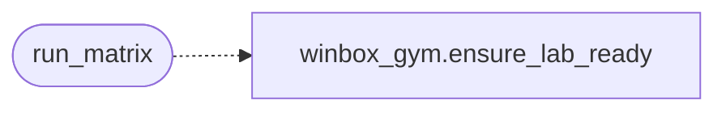

# `modules.gym_winbox_runner`

> Source: [modules/gym_winbox_runner.py:1](../../modules/gym_winbox_runner.py#L1) | language `py` | coverage 100.0% | [API index](../index.md)

Ordered WinBox gym matrix runner.

Ensures the lab VM is reachable, then reuses the generic gym matrix
engine ([`modules.gym_matrix_runner`](modules.gym_matrix_runner.py.md)) with the WinBox catalogue
([`modules.winbox_gym`](modules.winbox_gym.py.md)): one chain per indexed vector in severity
order, captures verified under ``sessions/ctf/``.

## Contents

- **Functions:** [`plan_matrix`](#plan_matrix), [`run_matrix`](#run_matrix), [`report`](#report), [`chain_available`](#chain_available)

## Call Graph

Solid arrows stay in this module, dashed arrows leave it.



## Functions

<a id="plan_matrix"></a>

### `plan_matrix`

`function` | [modules/gym_winbox_runner.py:21](../../modules/gym_winbox_runner.py#L21)

```python
def plan_matrix(target: str, sessions_dir: str | Path | None = None, only: list[str] | None = None, top_k: int = 0) -> list[dict]
```

Build the ordered execution plan for the WinBox gym matrix.

**Parameters**

| Name | Type | Default | Description |
|---|---|---|---|
| `target` | `str` |  | Victim host IP (the lab VM). |
| `sessions_dir` | `str \| Path \| None` | `None` | Sessions directory override. |
| `only` | `list[str] \| None` | `None` | Restrict to these vector ids. |
| `top_k` | `int` | `0` | Cap the plan to the first N entries (0 keeps all). |

**Returns:** `list[dict]` - Ordered plan entries with `[`vuln_id`](skills.lazyown_facts.py.md#vulnerabilityfact-vuln_id)`, ``chain_name`` and
metadata.

**Raises**

- `ValueError`: When no target is provided.

---

<a id="run_matrix"></a>

### `run_matrix`

`function` | [modules/gym_winbox_runner.py:51](../../modules/gym_winbox_runner.py#L51)

```python
def run_matrix(target: str, *, executor=None, shell: Any = None, dry_run: bool = False, approver=None, on_step=None, sessions_dir: str | Path | None = None, only: list[str] | None = None, top_k: int = 0, lhost: str = '', lport: str = '', ensure_vm: bool = True) -> dict
```

Execute every planned WinBox chain and verify its capture.

**Parameters**

| Name | Type | Default | Description |
|---|---|---|---|
| `target` | `str` |  | Victim host IP (the lab VM). |
| `executor` |  | `None` | Optional execution primitive for chain steps. |
| `shell` | `Any` | `None` | Optional live shell for verb steps. |
| `dry_run` | `bool` | `False` | Resolve the plan without executing anything. |
| `approver` |  | `None` | Callback for confirm steps. |
| `on_step` |  | `None` | Per-step observer shared across chains. |
| `sessions_dir` | `str \| Path \| None` | `None` | Sessions directory override. |
| `only` | `list[str] \| None` | `None` | Restrict to these vector ids. |
| `top_k` | `int` | `0` | Cap the plan to the first N entries. |
| `lhost` | `str` | `''` | Attacker host token. |
| `lport` | `str` | `''` | Attacker port token. |
| `ensure_vm` | `bool` | `True` | Bring the lab VM up before running (skipped in dry-run mode and when the target is already bound). |

**Returns:** `dict` - The matrix summary dict persisted to ``sessions/ctf/matrix_run.json``.

**Raises**

- `ValueError`: (raised in the body, not documented)

*Calls:* [`ensure_lab_ready`](modules.winbox_gym.py.md#ensure_lab_ready)

---

<a id="report"></a>

### `report`

`function` | [modules/gym_winbox_runner.py:118](../../modules/gym_winbox_runner.py#L118)

```python
def report(sessions_dir: str | Path | None = None) -> dict
```

Aggregate WinBox CTF captures for the report pipeline.

**Parameters**

| Name | Type | Default | Description |
|---|---|---|---|
| `sessions_dir` | `str \| Path \| None` | `None` | Sessions directory override. |

**Returns:** `dict` - The [`modules.ctf_capture.summary`](modules.ctf_capture.py.md#summary) mapping.

---

<a id="chain_available"></a>

### `chain_available`

`function` | [modules/gym_winbox_runner.py:130](../../modules/gym_winbox_runner.py#L130)

```python
def chain_available(vuln_id: str) -> Any | None
```

Return the resolved chain for one WinBox vector, or None.

**Parameters**

| Name | Type | Default | Description |
|---|---|---|---|
| `vuln_id` | `str` |  | Vector id from the WinBox index playbook. |

**Returns:** `Any | None` - The chain object, or None.

---
