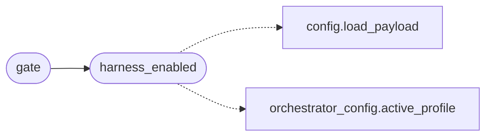

# `modules.harness`

> Source: [modules/harness.py:1](../../modules/harness.py#L1) | language `py` | coverage 100.0% | [API index](../index.md)

Deterministic harness gate for the LazyOwn loop.

When the harness is active the loop refuses every non-deterministic
decision path: planner LLM candidates, worker tool-calling agents,
worker LLM step suggestions, SWAN ensemble ensemble planning and LLM
streaming. Objectives and golden paths drive the loop instead.

## Contents

- **Functions:** [`harness_enabled`](#harness_enabled), [`gate`](#gate)
- **Constants:** [`HARNESS_ENV_FLAG`](#harness_env_flag), [`GATE_NAMES`](#gate_names)

## Call Graph

Solid arrows stay in this module, dashed arrows leave it.



## Functions

<a id="harness_enabled"></a>

### `harness_enabled`

`function` | [modules/harness.py:30](../../modules/harness.py#L30)

```python
def harness_enabled() -> bool
```

Return True when the deterministic harness is active.

Sources (in order): the ``LAZYOWN_HARNESS`` environment flag, the
``orchestrator.harness`` payload key and the active orchestrator
profile named ``harness``.

**Returns:** `bool` - True when the harness profile is engaged.

*Calls:* [`load_payload`](core.config.py.md#load_payload), [`active_profile`](modules.orchestrator_config.py.md#active_profile)

*Called by:* [`gate`](#gate)

---

<a id="gate"></a>

### `gate`

`function` | [modules/harness.py:65](../../modules/harness.py#L65)

```python
def gate(name: str) -> bool
```

Return whether one decision surface may remain stochastic.

**Parameters**

| Name | Type | Default | Description |
|---|---|---|---|
| `name` | `str` |  | Gate name from [`GATE_NAMES`](#gate_names). |

**Returns:** `bool` - False whenever the harness is active (deterministic-only
regime); True otherwise, regardless of the gate name.

*Calls:* [`harness_enabled`](#harness_enabled)

---

## Constants

<a id="harness_env_flag"></a>

### `HARNESS_ENV_FLAG`

`constant` | [modules/harness.py:16](../../modules/harness.py#L16)

```python
HARNESS_ENV_FLAG = 'LAZYOWN_HARNESS'
```

---

<a id="gate_names"></a>

### `GATE_NAMES`

`constant` | [modules/harness.py:18](../../modules/harness.py#L18)

```python
GATE_NAMES: frozenset[str]
```

---
