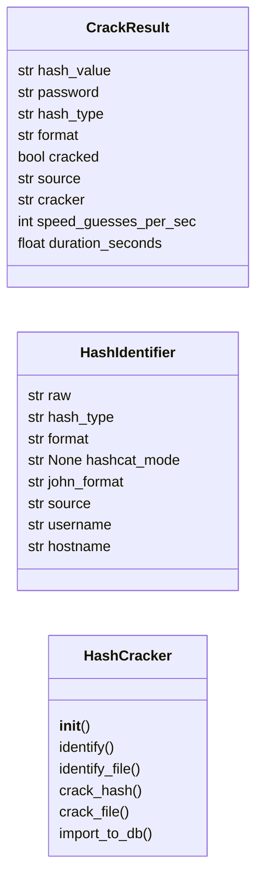
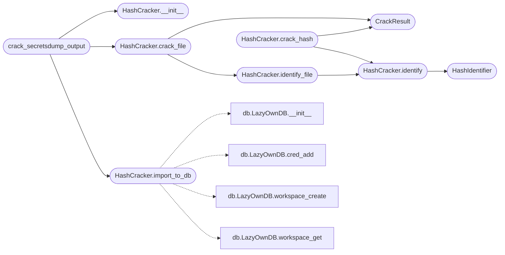

# `modules.hash_cracker`

> Source: [modules/hash_cracker.py:1](../../modules/hash_cracker.py#L1) | language `py` | coverage 72.7% | [API index](../index.md)

Hash cracking pipeline — John the Ripper and Hashcat integration.

Parses hash formats from secretsdump output, identifies hash types, and
runs the appropriate cracker. Results feed back into the LazyOwnDB
credentials table.

Design (SOLID):
- Single Responsibility: HashCracker only cracks hashes.
- Open/Closed: new hash formats added via HASH_FORMATS dict.
- Liskov: any cracker (John, Hashcat) implements CrackBackend protocol.
- Interface Segregation: identify(), crack(), and import_results().
- Dependency Inversion: depends on abstract backend, not concrete binary.

Usage:
    from modules.hash_cracker import HashCracker

    cracker = HashCracker(wordlist="/usr/share/wordlists/rockyou.txt")
    results = cracker.crack_file("sessions/hashes_10.10.11.5.txt")
    cracker.import_to_db(results, rhost="10.10.11.5")

## Contents

- **Classes:** [`CrackResult`](#crackresult), [`HashIdentifier`](#hashidentifier), [`HashCracker`](#hashcracker)
- **Functions:** [`crack_secretsdump_output`](#crack_secretsdump_output)
- **Constants:** [`HASH_PATTERNS`](#hash_patterns), [`COMMON_WORDLISTS`](#common_wordlists)

## Type Diagram



## Call Graph

Solid arrows stay in this module, dashed arrows leave it.



## Classes

<a id="crackresult"></a>

### `CrackResult`

`class` `dataclass` | [modules/hash_cracker.py:127](../../modules/hash_cracker.py#L127)

Decorators: `@dataclass`

```python
class CrackResult
```

**Attributes**

| Name | Type | Default | Description |
|---|---|---|---|
| [`hash_value`](#crackresult-hash_value) | `str` |  |  |
| [`password`](#crackresult-password) | `str` |  |  |
| [`hash_type`](#crackresult-hash_type) | `str` |  |  |
| [`format`](#crackresult-format) | `str` |  |  |
| [`cracked`](#crackresult-cracked) | `bool` | `False` |  |
| [`source`](#crackresult-source) | `str` | `''` |  |
| [`cracker`](#crackresult-cracker) | `str` | `''` |  |
| [`speed_guesses_per_sec`](#crackresult-speed_guesses_per_sec) | `int` | `0` |  |
| [`duration_seconds`](#crackresult-duration_seconds) | `float` | `0.0` |  |

---

<a id="hashidentifier"></a>

### `HashIdentifier`

`class` `dataclass` | [modules/hash_cracker.py:140](../../modules/hash_cracker.py#L140)

Decorators: `@dataclass`

```python
class HashIdentifier
```

**Attributes**

| Name | Type | Default | Description |
|---|---|---|---|
| [`raw`](#hashidentifier-raw) | `str` |  |  |
| [`hash_type`](#hashidentifier-hash_type) | `str` |  |  |
| [`format`](#hashidentifier-format) | `str` |  |  |
| [`hashcat_mode`](#hashidentifier-hashcat_mode) | `str \| None` | `None` |  |
| [`john_format`](#hashidentifier-john_format) | `str` | `''` |  |
| [`source`](#hashidentifier-source) | `str` | `''` |  |
| [`username`](#hashidentifier-username) | `str` | `''` |  |
| [`hostname`](#hashidentifier-hostname) | `str` | `''` |  |

---

<a id="hashcracker"></a>

### `HashCracker`

`class` | [modules/hash_cracker.py:151](../../modules/hash_cracker.py#L151)

```python
class HashCracker
```

Pipeline for identifying and cracking password hashes.

Supports John the Ripper and Hashcat backends. Automatically selects
the best available cracker per hash format.

**Members**

| Member | Kind | Summary |
|---|---|---|
| [`__init__`](#hashcracker-__init__) | constructor |  |
| [`identify`](#hashcracker-identify) | method | Identify the hash type of a single line. |
| [`identify_file`](#hashcracker-identify_file) | method | Parse a hash file and group hashes by type. |
| [`crack_hash`](#hashcracker-crack_hash) | method | Attempt to crack a single hash. |
| [`crack_file`](#hashcracker-crack_file) | method | Crack all hashes in a file. |
| [`import_to_db`](#hashcracker-import_to_db) | method | Import cracked results into the LazyOwnDB credentials table. |

<a id="hashcracker-__init__"></a>

#### `HashCracker.__init__`

`constructor` | [modules/hash_cracker.py:164](../../modules/hash_cracker.py#L164)

```python
def __init__(self, wordlist: str | None = None, rules: str = 'best64', use_hashcat: bool = True, timeout: int = 1800) -> None
```

**Parameters**

| Name | Type | Default | Description |
|---|---|---|---|
| `wordlist` | `str \| None` | `None` |  |
| `rules` | `str` | `'best64'` |  |
| `use_hashcat` | `bool` | `True` |  |
| `timeout` | `int` | `1800` |  |

*Called by:* [`SecurityCommandSet.do_crack_hashes`](cli.commands.security.py.md#securitycommandset-do_crack_hashes), [`crack_secretsdump_output`](#crack_secretsdump_output)

<a id="hashcracker-identify"></a>

#### `HashCracker.identify`

`method` | [modules/hash_cracker.py:186](../../modules/hash_cracker.py#L186)

```python
def identify(self, line: str) -> HashIdentifier | None
```

Identify the hash type of a single line.

**Parameters**

| Name | Type | Default | Description |
|---|---|---|---|
| `line` | `str` |  | A hash string (with or without username prefix). |

**Returns:** `HashIdentifier | None` - HashIdentifier if recognized, None otherwise.

*Calls:* [`HashIdentifier`](#hashidentifier)

*Called by:* [`HashCracker.crack_hash`](#hashcracker-crack_hash), [`HashCracker.identify_file`](#hashcracker-identify_file)

<a id="hashcracker-identify_file"></a>

#### `HashCracker.identify_file`

`method` | [modules/hash_cracker.py:273](../../modules/hash_cracker.py#L273)

```python
def identify_file(self, filepath: str | Path) -> dict[str, list[HashIdentifier]]
```

Parse a hash file and group hashes by type.

**Parameters**

| Name | Type | Default | Description |
|---|---|---|---|
| `filepath` | `str \| Path` |  | Path to file containing hashes (e.g. secretsdump output). |

**Returns:** `dict[str, list[HashIdentifier]]` - Dict mapping hash_type -> list of HashIdentifier.

*Calls:* [`HashCracker.identify`](#hashcracker-identify)

*Called by:* [`SecurityCommandSet.do_crack_hashes`](cli.commands.security.py.md#securitycommandset-do_crack_hashes), [`HashCracker.crack_file`](#hashcracker-crack_file)

<a id="hashcracker-crack_hash"></a>

#### `HashCracker.crack_hash`

`method` | [modules/hash_cracker.py:295](../../modules/hash_cracker.py#L295)

```python
def crack_hash(self, hash_value: str, hash_type: str | None = None, wordlist: str | None = None) -> CrackResult
```

Attempt to crack a single hash.

**Parameters**

| Name | Type | Default | Description |
|---|---|---|---|
| `hash_value` | `str` |  | The hash string to crack. |
| `hash_type` | `str \| None` | `None` | Known hash type (auto-detected if None). |
| `wordlist` | `str \| None` | `None` | Override wordlist path. |

**Returns:** `CrackResult` - CrackResult with cracked password if successful.

*Calls:* [`CrackResult`](#crackresult), [`HashCracker.identify`](#hashcracker-identify)

<a id="hashcracker-crack_file"></a>

#### `HashCracker.crack_file`

`method` | [modules/hash_cracker.py:349](../../modules/hash_cracker.py#L349)

```python
def crack_file(self, filepath: str | Path, wordlist: str | None = None, hash_types: list[str] | None = None) -> list[CrackResult]
```

Crack all hashes in a file.

**Parameters**

| Name | Type | Default | Description |
|---|---|---|---|
| `filepath` | `str \| Path` |  | Path to file containing hashes. |
| `wordlist` | `str \| None` | `None` | Override wordlist path. |
| `hash_types` | `list[str] \| None` | `None` | Filter to only crack specific hash types. |

**Returns:** `list[CrackResult]` - List of CrackResult with cracked passwords.

*Calls:* [`CrackResult`](#crackresult), [`HashCracker.identify_file`](#hashcracker-identify_file)

*Called by:* [`SecurityCommandSet.do_crack_hashes`](cli.commands.security.py.md#securitycommandset-do_crack_hashes), [`crack_secretsdump_output`](#crack_secretsdump_output)

<a id="hashcracker-import_to_db"></a>

#### `HashCracker.import_to_db`

`method` | [modules/hash_cracker.py:405](../../modules/hash_cracker.py#L405)

```python
def import_to_db(self, results: list[CrackResult], rhost: str = '', workspace_name: str = 'default') -> int
```

Import cracked results into the LazyOwnDB credentials table.

**Parameters**

| Name | Type | Default | Description |
|---|---|---|---|
| `results` | `list[CrackResult]` |  | Crack results from crack_file(). |
| `rhost` | `str` | `''` | Target IP for associating credentials. |
| `workspace_name` | `str` | `'default'` | DB workspace to use. |

**Returns:** `int` - Number of credentials imported.

*Calls:* [`LazyOwnDB.__init__`](modules.db.py.md#lazyowndb-__init__), [`LazyOwnDB.cred_add`](modules.db.py.md#lazyowndb-cred_add), [`LazyOwnDB.workspace_create`](modules.db.py.md#lazyowndb-workspace_create), [`LazyOwnDB.workspace_get`](modules.db.py.md#lazyowndb-workspace_get)

*Called by:* [`SecurityCommandSet.do_crack_hashes`](cli.commands.security.py.md#securitycommandset-do_crack_hashes), [`crack_secretsdump_output`](#crack_secretsdump_output)

---

## Functions

<a id="crack_secretsdump_output"></a>

### `crack_secretsdump_output`

`function` | [modules/hash_cracker.py:695](../../modules/hash_cracker.py#L695)

```python
def crack_secretsdump_output(filepath: str | Path, wordlist: str | None = None, rhost: str = '') -> list[CrackResult]
```

Convenience function: crack a secretsdump output file and import results.

**Parameters**

| Name | Type | Default | Description |
|---|---|---|---|
| `filepath` | `str \| Path` |  | Path to secretsdump output with hashes. |
| `wordlist` | `str \| None` | `None` | Override wordlist path. |
| `rhost` | `str` | `''` | Target IP for DB import. |

**Returns:** `list[CrackResult]` - List of CrackResult.

*Calls:* [`HashCracker.__init__`](#hashcracker-__init__), [`HashCracker.crack_file`](#hashcracker-crack_file), [`HashCracker.import_to_db`](#hashcracker-import_to_db)

---

## Constants

<a id="hash_patterns"></a>

### `HASH_PATTERNS`

`constant` | [modules/hash_cracker.py:36](../../modules/hash_cracker.py#L36)

```python
HASH_PATTERNS: dict[str, dict[str, Any]]
```

---

<a id="common_wordlists"></a>

### `COMMON_WORDLISTS`

`constant` | [modules/hash_cracker.py:123](../../modules/hash_cracker.py#L123)

```python
COMMON_WORDLISTS: list[str] = common_wordlists()
```

---
