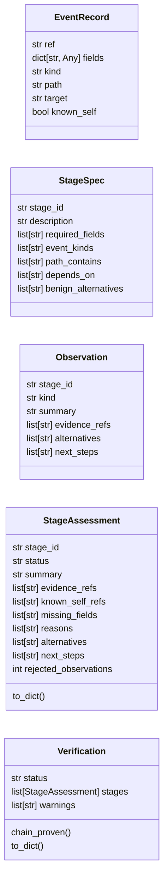
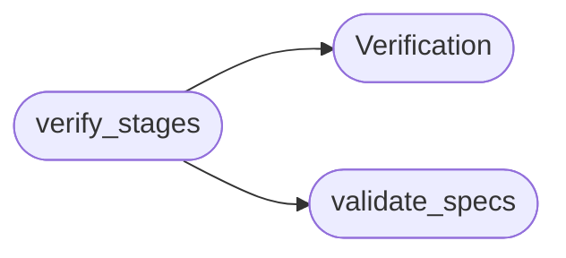

# `modules.hunt_verify`

> Source: [modules/hunt_verify.py:1](../../modules/hunt_verify.py#L1) | language `py` | coverage 100.0% | [API index](../index.md)

Evidence verdict verification for hunting and chain stages.

Verifies that AI observations stand on in-scope, retained evidence
with the required fields present. The verdict taxonomy is deliberately
strict: ``evidence_observed`` means an observation cites in-scope
events whose required fields exist; it never means an exploit or
impact is proven. ``not_observed`` requires confirmed scope coverage
so a narrowed search cannot conclude absence. Dependency gating marks
any attack chain whose predecessor stages lack observed evidence.

Adapted from the ARTEX ``hunting`` verification engine (AGPL-3.0).

## Contents

- **Classes:** [`EventRecord`](#eventrecord), [`StageSpec`](#stagespec), [`Observation`](#observation), [`StageAssessment`](#stageassessment), [`Verification`](#verification)
- **Functions:** [`field_present`](#field_present), [`validate_specs`](#validate_specs), [`verify_stages`](#verify_stages)
- **Constants:** [`STATUS_COMPLETED`](#status_completed), [`STATUS_INSUFFICIENT`](#status_insufficient), [`VERDICT_OBSERVED`](#verdict_observed), [`VERDICT_INFERRED`](#verdict_inferred), [`VERDICT_NOT_OBSERVED`](#verdict_not_observed), [`VERDICT_INSUFFICIENT`](#verdict_insufficient), [`KIND_OBSERVED`](#kind_observed), [`KIND_INFERRED`](#kind_inferred), [`KIND_INSUFFICIENT`](#kind_insufficient)

## Type Diagram



## Call Graph

Solid arrows stay in this module, dashed arrows leave it.



## Classes

<a id="eventrecord"></a>

### `EventRecord`

`class` `dataclass` | [modules/hunt_verify.py:48](../../modules/hunt_verify.py#L48)

Decorators: `@dataclass`

```python
class EventRecord
```

One retained, normalized evidence event.

**Attributes**

| Name | Type | Default | Description |
|---|---|---|---|
| [`ref`](#eventrecord-ref) | `str` |  |  |
| [`fields`](#eventrecord-fields) | `dict[str, Any]` | `field(default_factory=dict)` |  |
| [`kind`](#eventrecord-kind) | `str` | `''` |  |
| [`path`](#eventrecord-path) | `str` | `''` |  |
| [`target`](#eventrecord-target) | `str` | `''` |  |
| [`known_self`](#eventrecord-known_self) | `bool` | `False` |  |

---

<a id="stagespec"></a>

### `StageSpec`

`class` `dataclass` | [modules/hunt_verify.py:60](../../modules/hunt_verify.py#L60)

Decorators: `@dataclass`

```python
class StageSpec
```

One hunting stage: what happened, what to look for, what depends on it.

**Attributes**

| Name | Type | Default | Description |
|---|---|---|---|
| [`stage_id`](#stagespec-stage_id) | `str` |  |  |
| [`description`](#stagespec-description) | `str` | `''` |  |
| [`required_fields`](#stagespec-required_fields) | `list[str]` | `field(default_factory=list)` |  |
| [`event_kinds`](#stagespec-event_kinds) | `list[str]` | `field(default_factory=list)` |  |
| [`path_contains`](#stagespec-path_contains) | `list[str]` | `field(default_factory=list)` |  |
| [`depends_on`](#stagespec-depends_on) | `list[str]` | `field(default_factory=list)` |  |
| [`benign_alternatives`](#stagespec-benign_alternatives) | `list[str]` | `field(default_factory=list)` |  |

---

<a id="observation"></a>

### `Observation`

`class` `dataclass` | [modules/hunt_verify.py:73](../../modules/hunt_verify.py#L73)

Decorators: `@dataclass`

```python
class Observation
```

One AI observation linked to a stage and evidence refs.

**Attributes**

| Name | Type | Default | Description |
|---|---|---|---|
| [`stage_id`](#observation-stage_id) | `str` |  |  |
| [`kind`](#observation-kind) | `str` |  |  |
| [`summary`](#observation-summary) | `str` | `''` |  |
| [`evidence_refs`](#observation-evidence_refs) | `list[str]` | `field(default_factory=list)` |  |
| [`alternatives`](#observation-alternatives) | `list[str]` | `field(default_factory=list)` |  |
| [`next_steps`](#observation-next_steps) | `list[str]` | `field(default_factory=list)` |  |

---

<a id="stageassessment"></a>

### `StageAssessment`

`class` `dataclass` | [modules/hunt_verify.py:85](../../modules/hunt_verify.py#L85)

Decorators: `@dataclass`

```python
class StageAssessment
```

Verified verdict for one stage.

**Attributes**

| Name | Type | Default | Description |
|---|---|---|---|
| [`stage_id`](#stageassessment-stage_id) | `str` |  |  |
| [`status`](#stageassessment-status) | `str` | `VERDICT_INSUFFICIENT` |  |
| [`summary`](#stageassessment-summary) | `str` | `''` |  |
| [`evidence_refs`](#stageassessment-evidence_refs) | `list[str]` | `field(default_factory=list)` |  |
| [`known_self_refs`](#stageassessment-known_self_refs) | `list[str]` | `field(default_factory=list)` |  |
| [`missing_fields`](#stageassessment-missing_fields) | `list[str]` | `field(default_factory=list)` |  |
| [`reasons`](#stageassessment-reasons) | `list[str]` | `field(default_factory=list)` |  |
| [`alternatives`](#stageassessment-alternatives) | `list[str]` | `field(default_factory=list)` |  |
| [`next_steps`](#stageassessment-next_steps) | `list[str]` | `field(default_factory=list)` |  |
| [`rejected_observations`](#stageassessment-rejected_observations) | `int` | `0` |  |

**Members**

| Member | Kind | Summary |
|---|---|---|
| [`to_dict`](#stageassessment-to_dict) | method | Return a JSON-serializable view. |

<a id="stageassessment-to_dict"></a>

#### `StageAssessment.to_dict`

`method` | [modules/hunt_verify.py:99](../../modules/hunt_verify.py#L99)

```python
def to_dict(self) -> dict[str, Any]
```

Return a JSON-serializable view.

**Returns:** `dict[str, Any]`

---

<a id="verification"></a>

### `Verification`

`class` `dataclass` | [modules/hunt_verify.py:116](../../modules/hunt_verify.py#L116)

Decorators: `@dataclass`

```python
class Verification
```

Whole-run verdict across stages.

**Attributes**

| Name | Type | Default | Description |
|---|---|---|---|
| [`status`](#verification-status) | `str` | `STATUS_INSUFFICIENT` |  |
| [`stages`](#verification-stages) | `list[StageAssessment]` | `field(default_factory=list)` |  |
| [`warnings`](#verification-warnings) | `list[str]` | `field(default_factory=list)` |  |

**Members**

| Member | Kind | Summary |
|---|---|---|
| [`chain_proven`](#verification-chain_proven) | property | Return whether every stage has observed evidence. |
| [`to_dict`](#verification-to_dict) | method | Return a JSON-serializable view. |

<a id="verification-chain_proven"></a>

#### `Verification.chain_proven`

`property` | [modules/hunt_verify.py:124](../../modules/hunt_verify.py#L124)

Decorators: `@property`

```python
def chain_proven(self) -> bool
```

Return whether every stage has observed evidence.

**Returns:** `bool`

<a id="verification-to_dict"></a>

#### `Verification.to_dict`

`method` | [modules/hunt_verify.py:130](../../modules/hunt_verify.py#L130)

```python
def to_dict(self) -> dict[str, Any]
```

Return a JSON-serializable view.

**Returns:** `dict[str, Any]`

---

## Functions

<a id="field_present"></a>

### `field_present`

`function` | [modules/hunt_verify.py:152](../../modules/hunt_verify.py#L152)

```python
def field_present(fields: dict[str, Any], field_name: str) -> bool
```

Return whether one required field exists with a present scalar value.

**Parameters**

| Name | Type | Default | Description |
|---|---|---|---|
| `fields` | `dict[str, Any]` |  | Normalized event field mapping. |
| `field_name` | `str` |  | Canonical name or exact dotted raw path. |

**Returns:** `bool` - True when the field exists and holds a present scalar.

---

<a id="validate_specs"></a>

### `validate_specs`

`function` | [modules/hunt_verify.py:197](../../modules/hunt_verify.py#L197)

```python
def validate_specs(specs: list[StageSpec]) -> list[str]
```

Validate stage structure: caps, unique ids and known dependencies.

**Parameters**

| Name | Type | Default | Description |
|---|---|---|---|
| `specs` | `list[StageSpec]` |  | Stage specifications. |

**Returns:** `list[str]` - Human-readable errors; empty means the design is valid.

*Called by:* [`verify_stages`](#verify_stages)

---

<a id="verify_stages"></a>

### `verify_stages`

`function` | [modules/hunt_verify.py:232](../../modules/hunt_verify.py#L232)

```python
def verify_stages(specs: list[StageSpec], observations: list[Observation], events: list[EventRecord], scope_covered: bool = False) -> Verification
```

Verify AI observations against retained events per stage.

**Parameters**

| Name | Type | Default | Description |
|---|---|---|---|
| `specs` | `list[StageSpec]` |  | Stage specifications (max `MAX_STAGES`). |
| `observations` | `list[Observation]` |  | AI observations to verify. |
| `events` | `list[EventRecord]` |  | Retained, normalized evidence events. |
| `scope_covered` | `bool` | `False` | True only when the collection provably covered the whole requested scope; ``not_observed`` verdicts require this. |

**Returns:** `Verification` - A [`Verification`](#verification) with per-stage assessments.

**Raises**

- `ValueError`: When stage structure or counts exceed the caps.

*Calls:* [`Verification`](#verification), [`validate_specs`](#validate_specs)

*Called by:* [`run_hunt_verify`](modules.defense_stages.py.md#run_hunt_verify)

---

## Constants

<a id="status_completed"></a>

### `STATUS_COMPLETED`

`constant` | [modules/hunt_verify.py:19](../../modules/hunt_verify.py#L19)

```python
STATUS_COMPLETED = 'completed'
```

---

<a id="status_insufficient"></a>

### `STATUS_INSUFFICIENT`

`constant` | [modules/hunt_verify.py:20](../../modules/hunt_verify.py#L20)

```python
STATUS_INSUFFICIENT = 'insufficient_data'
```

---

<a id="verdict_observed"></a>

### `VERDICT_OBSERVED`

`constant` | [modules/hunt_verify.py:22](../../modules/hunt_verify.py#L22)

```python
VERDICT_OBSERVED = 'evidence_observed'
```

---

<a id="verdict_inferred"></a>

### `VERDICT_INFERRED`

`constant` | [modules/hunt_verify.py:23](../../modules/hunt_verify.py#L23)

```python
VERDICT_INFERRED = 'inferred'
```

---

<a id="verdict_not_observed"></a>

### `VERDICT_NOT_OBSERVED`

`constant` | [modules/hunt_verify.py:24](../../modules/hunt_verify.py#L24)

```python
VERDICT_NOT_OBSERVED = 'not_observed'
```

---

<a id="verdict_insufficient"></a>

### `VERDICT_INSUFFICIENT`

`constant` | [modules/hunt_verify.py:25](../../modules/hunt_verify.py#L25)

```python
VERDICT_INSUFFICIENT = 'insufficient_data'
```

---

<a id="kind_observed"></a>

### `KIND_OBSERVED`

`constant` | [modules/hunt_verify.py:28](../../modules/hunt_verify.py#L28)

```python
KIND_OBSERVED = 'observed'
```

---

<a id="kind_inferred"></a>

### `KIND_INFERRED`

`constant` | [modules/hunt_verify.py:29](../../modules/hunt_verify.py#L29)

```python
KIND_INFERRED = 'inferred'
```

---

<a id="kind_insufficient"></a>

### `KIND_INSUFFICIENT`

`constant` | [modules/hunt_verify.py:30](../../modules/hunt_verify.py#L30)

```python
KIND_INSUFFICIENT = 'insufficient_data'
```

---
