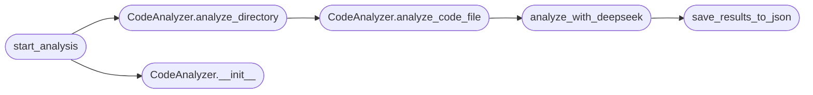

# `modules.ia_code_analysis`

> Source: [modules/ia_code_analysis.py:1](../../modules/ia_code_analysis.py#L1) | language `py` | coverage 66.7% | [API index](../index.md)

## Contents

- **Classes:** [`CodeAnalyzer`](#codeanalyzer)
- **Functions:** [`analyze_with_deepseek`](#analyze_with_deepseek), [`save_results_to_json`](#save_results_to_json), [`start_analysis`](#start_analysis), [`parse_args`](#parse_args)
- **Constants:** [`DEEPSEEK_API_URL`](#deepseek_api_url), [`DEEPSEEK_MODEL`](#deepseek_model), [`SOURCE_FILE_EXTENSIONS`](#source_file_extensions)

## Call Graph

Solid arrows stay in this module, dashed arrows leave it.



## Classes

<a id="codeanalyzer"></a>

### `CodeAnalyzer`

`class` | [modules/ia_code_analysis.py:28](../../modules/ia_code_analysis.py#L28)

```python
class CodeAnalyzer
```

Analyzes source code in a directory and its subdirectories.

**Members**

| Member | Kind | Summary |
|---|---|---|
| [`__init__`](#codeanalyzer-__init__) | constructor |  |
| [`analyze_directory`](#codeanalyzer-analyze_directory) | method | Recursively analyzes all source code files in the specified directory. |
| [`analyze_code_file`](#codeanalyzer-analyze_code_file) | method | Analyzes the content of the source code file. |

<a id="codeanalyzer-__init__"></a>

#### `CodeAnalyzer.__init__`

`constructor` | [modules/ia_code_analysis.py:33](../../modules/ia_code_analysis.py#L33)

```python
def __init__(self, mode='console')
```

**Parameters**

| Name | Type | Default | Description |
|---|---|---|---|
| `mode` |  | `'console'` |  |

*Called by:* [`start_analysis`](#start_analysis)

<a id="codeanalyzer-analyze_directory"></a>

#### `CodeAnalyzer.analyze_directory`

`method` | [modules/ia_code_analysis.py:37](../../modules/ia_code_analysis.py#L37)

```python
def analyze_directory(self, directory)
```

Recursively analyzes all source code files in the specified directory.

**Parameters**

| Name | Type | Default | Description |
|---|---|---|---|
| `directory` |  |  |  |

*Calls:* [`CodeAnalyzer.analyze_code_file`](#codeanalyzer-analyze_code_file)

*Called by:* [`start_analysis`](#start_analysis)

<a id="codeanalyzer-analyze_code_file"></a>

#### `CodeAnalyzer.analyze_code_file`

`method` | [modules/ia_code_analysis.py:49](../../modules/ia_code_analysis.py#L49)

```python
def analyze_code_file(self, file_path)
```

Analyzes the content of the source code file.

**Parameters**

| Name | Type | Default | Description |
|---|---|---|---|
| `file_path` |  |  |  |

*Calls:* [`analyze_with_deepseek`](#analyze_with_deepseek)

*Called by:* [`CodeAnalyzer.analyze_directory`](#codeanalyzer-analyze_directory)

---

## Functions

<a id="analyze_with_deepseek"></a>

### `analyze_with_deepseek`

`function` | [modules/ia_code_analysis.py:66](../../modules/ia_code_analysis.py#L66)

```python
def analyze_with_deepseek(code_content, file_path, mode='console')
```

Sends the code content to DeepSeek for analysis.

Devuelve la respuesta del modelo en fragmentos.

**Parameters**

| Name | Type | Default | Description |
|---|---|---|---|
| `code_content` |  |  |  |
| `file_path` |  |  |  |
| `mode` |  | `'console'` |  |

*Calls:* [`save_results_to_json`](#save_results_to_json)

*Called by:* [`CodeAnalyzer.analyze_code_file`](#codeanalyzer-analyze_code_file)

---

<a id="save_results_to_json"></a>

### `save_results_to_json`

`function` | [modules/ia_code_analysis.py:123](../../modules/ia_code_analysis.py#L123)

```python
def save_results_to_json(results, file_path)
```

Saves the analysis results to JSON files.

**Parameters**

| Name | Type | Default | Description |
|---|---|---|---|
| `results` |  |  |  |
| `file_path` |  |  |  |

*Called by:* [`analyze_with_deepseek`](#analyze_with_deepseek)

---

<a id="start_analysis"></a>

### `start_analysis`

`function` | [modules/ia_code_analysis.py:169](../../modules/ia_code_analysis.py#L169)

```python
def start_analysis(code_dir='/path/to/code', mode='console')
```

Starts the analysis of the specified code directory.

**Parameters**

| Name | Type | Default | Description |
|---|---|---|---|
| `code_dir` |  | `'/path/to/code'` |  |
| `mode` |  | `'console'` |  |

*Calls:* [`CodeAnalyzer.__init__`](#codeanalyzer-__init__), [`CodeAnalyzer.analyze_directory`](#codeanalyzer-analyze_directory)

---

<a id="parse_args"></a>

### `parse_args`

`function` | [modules/ia_code_analysis.py:178](../../modules/ia_code_analysis.py#L178)

```python
def parse_args()
```

---

## Constants

<a id="deepseek_api_url"></a>

### `DEEPSEEK_API_URL`

`constant` | [modules/ia_code_analysis.py:19](../../modules/ia_code_analysis.py#L19)

```python
DEEPSEEK_API_URL = 'http://localhost:11434/api/generate'
```

---

<a id="deepseek_model"></a>

### `DEEPSEEK_MODEL`

`constant` | [modules/ia_code_analysis.py:20](../../modules/ia_code_analysis.py#L20)

```python
DEEPSEEK_MODEL = 'deepseek-r1:1.5b'
```

---

<a id="source_file_extensions"></a>

### `SOURCE_FILE_EXTENSIONS`

`constant` | [modules/ia_code_analysis.py:25](../../modules/ia_code_analysis.py#L25)

```python
SOURCE_FILE_EXTENSIONS = ['.py', '.c', '.go', '.rs']
```

---
