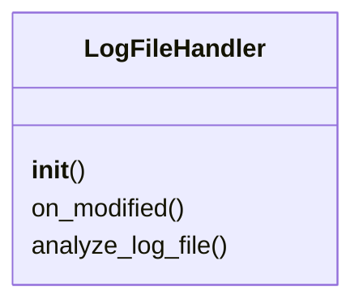
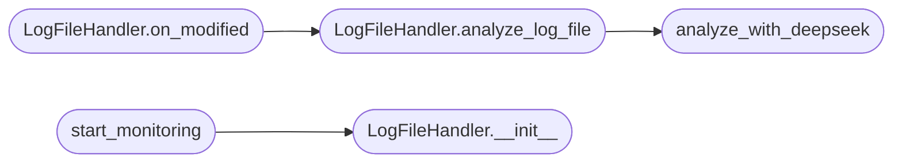

# `modules.ia_logs_analysis`

> Source: [modules/ia_logs_analysis.py:1](../../modules/ia_logs_analysis.py#L1) | language `py` | coverage 75.0% | [API index](../index.md)

log_monitor_bot.py

Author: Your Name
Email: youremail@example.com
Creation Date: 10/06/2024
License: AGPL v3

Description: Real-time log monitoring bot for Linux systems.
             Monitors logs in /var/log (e.g., SSH, Apache2, Nginx) and uses DeepSeek to detect suspicious activity.

## Contents

- **Classes:** [`LogFileHandler`](#logfilehandler)
- **Functions:** [`analyze_with_deepseek`](#analyze_with_deepseek), [`start_monitoring`](#start_monitoring), [`parse_args`](#parse_args)
- **Constants:** [`DEEPSEEK_API_URL`](#deepseek_api_url), [`DEEPSEEK_MODEL`](#deepseek_model), [`TEXT_LOG_FILES`](#text_log_files)

## Type Diagram



## Call Graph

Solid arrows stay in this module, dashed arrows leave it.



## Classes

<a id="logfilehandler"></a>

### `LogFileHandler`

`class` | [modules/ia_logs_analysis.py:54](../../modules/ia_logs_analysis.py#L54)

```python
class LogFileHandler(FileSystemEventHandler)
```

Bases: `FileSystemEventHandler`

Handles file system events for log files.

**Members**

| Member | Kind | Summary |
|---|---|---|
| [`__init__`](#logfilehandler-__init__) | constructor |  |
| [`on_modified`](#logfilehandler-on_modified) | method | Triggered when a log file is modified. |
| [`analyze_log_file`](#logfilehandler-analyze_log_file) | method | Analyzes the content of the modified log file. |

<a id="logfilehandler-__init__"></a>

#### `LogFileHandler.__init__`

`constructor` | [modules/ia_logs_analysis.py:59](../../modules/ia_logs_analysis.py#L59)

```python
def __init__(self, mode='console')
```

**Parameters**

| Name | Type | Default | Description |
|---|---|---|---|
| `mode` |  | `'console'` |  |

*Called by:* [`start_monitoring`](#start_monitoring), [`LogFileHandler.__init__`](modules.lilsplunky.py.md#logfilehandler-__init__)

<a id="logfilehandler-on_modified"></a>

#### `LogFileHandler.on_modified`

`method` | [modules/ia_logs_analysis.py:64](../../modules/ia_logs_analysis.py#L64)

```python
def on_modified(self, event)
```

Triggered when a log file is modified.

**Parameters**

| Name | Type | Default | Description |
|---|---|---|---|
| `event` |  |  |  |

*Calls:* [`LogFileHandler.analyze_log_file`](#logfilehandler-analyze_log_file)

<a id="logfilehandler-analyze_log_file"></a>

#### `LogFileHandler.analyze_log_file`

`method` | [modules/ia_logs_analysis.py:75](../../modules/ia_logs_analysis.py#L75)

```python
def analyze_log_file(self, file_path)
```

Analyzes the content of the modified log file.

**Parameters**

| Name | Type | Default | Description |
|---|---|---|---|
| `file_path` |  |  |  |

*Calls:* [`analyze_with_deepseek`](#analyze_with_deepseek)

*Called by:* [`LogFileHandler.on_modified`](#logfilehandler-on_modified)

---

## Functions

<a id="analyze_with_deepseek"></a>

### `analyze_with_deepseek`

`function` | [modules/ia_logs_analysis.py:94](../../modules/ia_logs_analysis.py#L94)

```python
def analyze_with_deepseek(log_content, mode='console')
```

Sends log content to DeepSeek for advanced analysis.

Returns the model's response in chunks.

**Parameters**

| Name | Type | Default | Description |
|---|---|---|---|
| `log_content` |  |  |  |
| `mode` |  | `'console'` |  |

*Called by:* [`LogFileHandler.analyze_log_file`](#logfilehandler-analyze_log_file)

---

<a id="start_monitoring"></a>

### `start_monitoring`

`function` | [modules/ia_logs_analysis.py:147](../../modules/ia_logs_analysis.py#L147)

```python
def start_monitoring(log_dir='/var/log', mode='console')
```

Starts monitoring the specified log directory.

**Parameters**

| Name | Type | Default | Description |
|---|---|---|---|
| `log_dir` |  | `'/var/log'` |  |
| `mode` |  | `'console'` |  |

*Calls:* [`LogFileHandler.__init__`](#logfilehandler-__init__)

---

<a id="parse_args"></a>

### `parse_args`

`function` | [modules/ia_logs_analysis.py:168](../../modules/ia_logs_analysis.py#L168)

```python
def parse_args()
```

---

## Constants

<a id="deepseek_api_url"></a>

### `DEEPSEEK_API_URL`

`constant` | [modules/ia_logs_analysis.py:35](../../modules/ia_logs_analysis.py#L35)

```python
DEEPSEEK_API_URL = 'http://localhost:11434/api/generate'
```

---

<a id="deepseek_model"></a>

### `DEEPSEEK_MODEL`

`constant` | [modules/ia_logs_analysis.py:36](../../modules/ia_logs_analysis.py#L36)

```python
DEEPSEEK_MODEL = 'deepseek-r1:1.5b'
```

---

<a id="text_log_files"></a>

### `TEXT_LOG_FILES`

`constant` | [modules/ia_logs_analysis.py:41](../../modules/ia_logs_analysis.py#L41)

```python
TEXT_LOG_FILES
```

---
