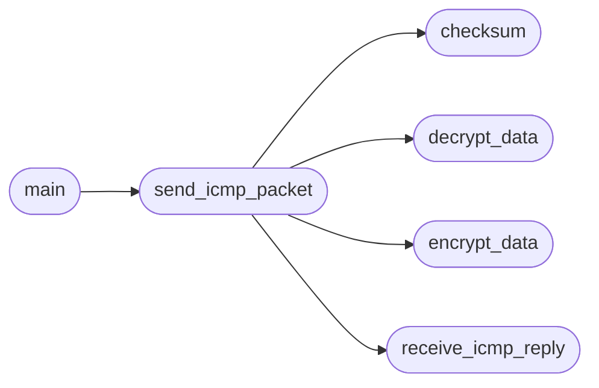

# `modules.icmp_client`

> Source: [modules/icmp_client.py:1](../../modules/icmp_client.py#L1) | language `py` | coverage 25.0% | [API index](../index.md)

## Contents

- **Functions:** [`encrypt_data`](#encrypt_data), [`decrypt_data`](#decrypt_data), [`check_sudo`](#check_sudo), [`checksum`](#checksum), [`send_icmp_packet`](#send_icmp_packet), [`receive_icmp_reply`](#receive_icmp_reply), [`main`](#main)
- **Constants:** [`ICMP_ECHO_REQUEST`](#icmp_echo_request), [`ICMP_BUFFER_SIZE`](#icmp_buffer_size), [`AES_NONCE_LENGTH`](#aes_nonce_length), [`AES_TAG_LENGTH`](#aes_tag_length)

## Call Graph

Solid arrows stay in this module, dashed arrows leave it.



## Functions

<a id="encrypt_data"></a>

### `encrypt_data`

`function` | [modules/icmp_client.py:18](../../modules/icmp_client.py#L18)

```python
def encrypt_data(data, key)
```

Encrypt bytes with AES-256-GCM returning ``nonce || ciphertext || tag``.

**Parameters**

| Name | Type | Default | Description |
|---|---|---|---|
| `data` |  |  | Plaintext bytes to encrypt. |
| `key` |  |  | 32-byte AES-256 key. |

**Returns:** Concatenated nonce, ciphertext and authentication tag.

*Called by:* [`send_icmp_packet`](#send_icmp_packet)

---

<a id="decrypt_data"></a>

### `decrypt_data`

`function` | [modules/icmp_client.py:34](../../modules/icmp_client.py#L34)

```python
def decrypt_data(data, key)
```

Decrypt bytes produced by `[`encrypt_data`](#encrypt_data)` after authenticating them.

**Parameters**

| Name | Type | Default | Description |
|---|---|---|---|
| `data` |  |  | ``nonce \|\| ciphertext \|\| tag`` payload. |
| `key` |  |  | 32-byte AES-256 key. |

**Returns:** Decrypted plaintext bytes.

**Raises**

- `ValueError`: If the payload is malformed or the tag fails to verify.

*Called by:* [`send_icmp_packet`](#send_icmp_packet)

---

<a id="check_sudo"></a>

### `check_sudo`

`function` | [modules/icmp_client.py:57](../../modules/icmp_client.py#L57)

```python
def check_sudo()
```

---

<a id="checksum"></a>

### `checksum`

`function` | [modules/icmp_client.py:64](../../modules/icmp_client.py#L64)

```python
def checksum(source_string)
```

**Parameters**

| Name | Type | Default | Description |
|---|---|---|---|
| `source_string` |  |  |  |

*Called by:* [`send_icmp_packet`](#send_icmp_packet)

---

<a id="send_icmp_packet"></a>

### `send_icmp_packet`

`function` | [modules/icmp_client.py:82](../../modules/icmp_client.py#L82)

```python
def send_icmp_packet(dest_addr, data, key)
```

**Parameters**

| Name | Type | Default | Description |
|---|---|---|---|
| `dest_addr` |  |  |  |
| `data` |  |  |  |
| `key` |  |  |  |

*Calls:* [`checksum`](#checksum), [`decrypt_data`](#decrypt_data), [`encrypt_data`](#encrypt_data), [`receive_icmp_reply`](#receive_icmp_reply)

*Called by:* [`main`](#main)

---

<a id="receive_icmp_reply"></a>

### `receive_icmp_reply`

`function` | [modules/icmp_client.py:117](../../modules/icmp_client.py#L117)

```python
def receive_icmp_reply(sock)
```

**Parameters**

| Name | Type | Default | Description |
|---|---|---|---|
| `sock` |  |  |  |

*Called by:* [`send_icmp_packet`](#send_icmp_packet)

---

<a id="main"></a>

### `main`

`function` | [modules/icmp_client.py:130](../../modules/icmp_client.py#L130)

```python
def main()
```

*Calls:* [`send_icmp_packet`](#send_icmp_packet)

---

## Constants

<a id="icmp_echo_request"></a>

### `ICMP_ECHO_REQUEST`

`constant` | [modules/icmp_client.py:12](../../modules/icmp_client.py#L12)

```python
ICMP_ECHO_REQUEST = 8
```

---

<a id="icmp_buffer_size"></a>

### `ICMP_BUFFER_SIZE`

`constant` | [modules/icmp_client.py:13](../../modules/icmp_client.py#L13)

```python
ICMP_BUFFER_SIZE = 4096
```

---

<a id="aes_nonce_length"></a>

### `AES_NONCE_LENGTH`

`constant` | [modules/icmp_client.py:14](../../modules/icmp_client.py#L14)

```python
AES_NONCE_LENGTH = 12
```

---

<a id="aes_tag_length"></a>

### `AES_TAG_LENGTH`

`constant` | [modules/icmp_client.py:15](../../modules/icmp_client.py#L15)

```python
AES_TAG_LENGTH = 16
```

---
