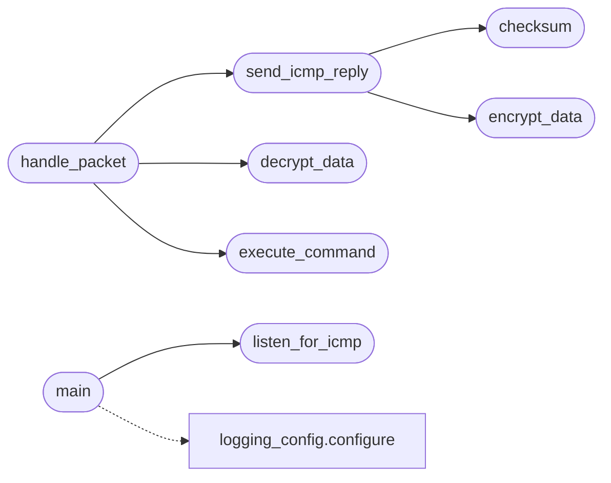

# `modules.icmp_server`

> Source: [modules/icmp_server.py:1](../../modules/icmp_server.py#L1) | language `py` | coverage 20.0% | [API index](../index.md)

## Contents

- **Functions:** [`check_sudo`](#check_sudo), [`encrypt_data`](#encrypt_data), [`decrypt_data`](#decrypt_data), [`execute_command`](#execute_command), [`send_icmp_reply`](#send_icmp_reply), [`checksum`](#checksum), [`handle_packet`](#handle_packet), [`listen_for_icmp`](#listen_for_icmp), [`main`](#main)
- **Constants:** [`ICMP_COMMAND_TIMEOUT`](#icmp_command_timeout), [`ICMP_BUFFER_SIZE`](#icmp_buffer_size), [`AES_NONCE_LENGTH`](#aes_nonce_length), [`AES_TAG_LENGTH`](#aes_tag_length), [`ALLOWED_ICMP_COMMANDS`](#allowed_icmp_commands)

## Call Graph

Solid arrows stay in this module, dashed arrows leave it.



## Functions

<a id="check_sudo"></a>

### `check_sudo`

`function` | [modules/icmp_server.py:44](../../modules/icmp_server.py#L44)

```python
def check_sudo()
```

---

<a id="encrypt_data"></a>

### `encrypt_data`

`function` | [modules/icmp_server.py:55](../../modules/icmp_server.py#L55)

```python
def encrypt_data(data, key)
```

Encrypt bytes with AES-256-GCM returning ``nonce || ciphertext || tag``.

**Parameters**

| Name | Type | Default | Description |
|---|---|---|---|
| `data` |  |  | Plaintext bytes to encrypt. |
| `key` |  |  | 32-byte AES-256 key. |

**Returns:** Concatenated nonce, ciphertext and authentication tag.

*Called by:* [`send_icmp_reply`](#send_icmp_reply)

---

<a id="decrypt_data"></a>

### `decrypt_data`

`function` | [modules/icmp_server.py:71](../../modules/icmp_server.py#L71)

```python
def decrypt_data(data, key)
```

Decrypt bytes produced by `[`encrypt_data`](#encrypt_data)` after authenticating them.

**Parameters**

| Name | Type | Default | Description |
|---|---|---|---|
| `data` |  |  | ``nonce \|\| ciphertext \|\| tag`` payload. |
| `key` |  |  | 32-byte AES-256 key. |

**Returns:** Decrypted plaintext bytes.

**Raises**

- `ValueError`: If the payload is malformed or the tag fails to verify.

*Called by:* [`handle_packet`](#handle_packet)

---

<a id="execute_command"></a>

### `execute_command`

`function` | [modules/icmp_server.py:93](../../modules/icmp_server.py#L93)

```python
def execute_command(command)
```

**Parameters**

| Name | Type | Default | Description |
|---|---|---|---|
| `command` |  |  |  |

*Called by:* [`handle_packet`](#handle_packet)

---

<a id="send_icmp_reply"></a>

### `send_icmp_reply`

`function` | [modules/icmp_server.py:112](../../modules/icmp_server.py#L112)

```python
def send_icmp_reply(sock, addr, data, key)
```

**Parameters**

| Name | Type | Default | Description |
|---|---|---|---|
| `sock` |  |  |  |
| `addr` |  |  |  |
| `data` |  |  |  |
| `key` |  |  |  |

*Calls:* [`checksum`](#checksum), [`encrypt_data`](#encrypt_data)

*Called by:* [`handle_packet`](#handle_packet)

---

<a id="checksum"></a>

### `checksum`

`function` | [modules/icmp_server.py:132](../../modules/icmp_server.py#L132)

```python
def checksum(source_string)
```

**Parameters**

| Name | Type | Default | Description |
|---|---|---|---|
| `source_string` |  |  |  |

*Called by:* [`send_icmp_reply`](#send_icmp_reply)

---

<a id="handle_packet"></a>

### `handle_packet`

`function` | [modules/icmp_server.py:150](../../modules/icmp_server.py#L150)

```python
def handle_packet(packet, addr, key, sock)
```

**Parameters**

| Name | Type | Default | Description |
|---|---|---|---|
| `packet` |  |  |  |
| `addr` |  |  |  |
| `key` |  |  |  |
| `sock` |  |  |  |

*Calls:* [`decrypt_data`](#decrypt_data), [`execute_command`](#execute_command), [`send_icmp_reply`](#send_icmp_reply)

---

<a id="listen_for_icmp"></a>

### `listen_for_icmp`

`function` | [modules/icmp_server.py:175](../../modules/icmp_server.py#L175)

```python
def listen_for_icmp(interface, key)
```

**Parameters**

| Name | Type | Default | Description |
|---|---|---|---|
| `interface` |  |  |  |
| `key` |  |  |  |

*Called by:* [`main`](#main)

---

<a id="main"></a>

### `main`

`function` | [modules/icmp_server.py:202](../../modules/icmp_server.py#L202)

```python
def main()
```

*Calls:* [`listen_for_icmp`](#listen_for_icmp), [`configure`](modules.logging_config.py.md#configure)

---

## Constants

<a id="icmp_command_timeout"></a>

### `ICMP_COMMAND_TIMEOUT`

`constant` | [modules/icmp_server.py:20](../../modules/icmp_server.py#L20)

```python
ICMP_COMMAND_TIMEOUT = 5
```

---

<a id="icmp_buffer_size"></a>

### `ICMP_BUFFER_SIZE`

`constant` | [modules/icmp_server.py:21](../../modules/icmp_server.py#L21)

```python
ICMP_BUFFER_SIZE = 4096
```

---

<a id="aes_nonce_length"></a>

### `AES_NONCE_LENGTH`

`constant` | [modules/icmp_server.py:22](../../modules/icmp_server.py#L22)

```python
AES_NONCE_LENGTH = 12
```

---

<a id="aes_tag_length"></a>

### `AES_TAG_LENGTH`

`constant` | [modules/icmp_server.py:23](../../modules/icmp_server.py#L23)

```python
AES_TAG_LENGTH = 16
```

---

<a id="allowed_icmp_commands"></a>

### `ALLOWED_ICMP_COMMANDS`

`constant` | [modules/icmp_server.py:24](../../modules/icmp_server.py#L24)

```python
ALLOWED_ICMP_COMMANDS
```

---
