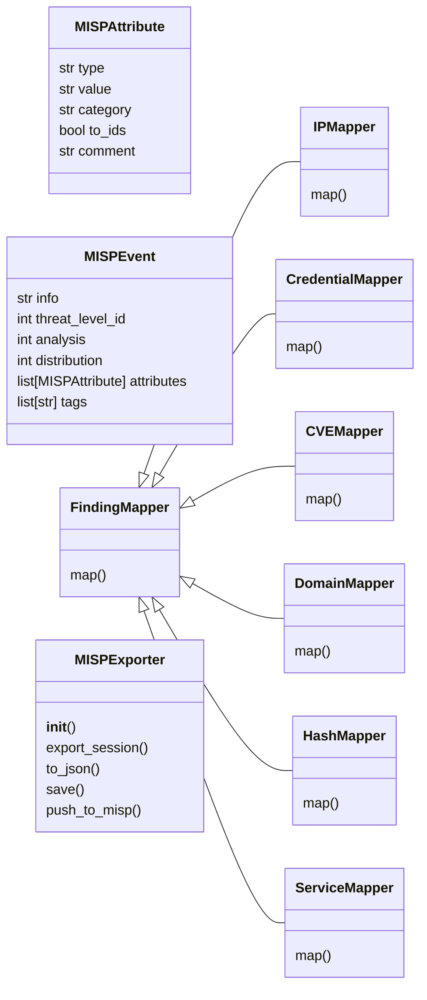
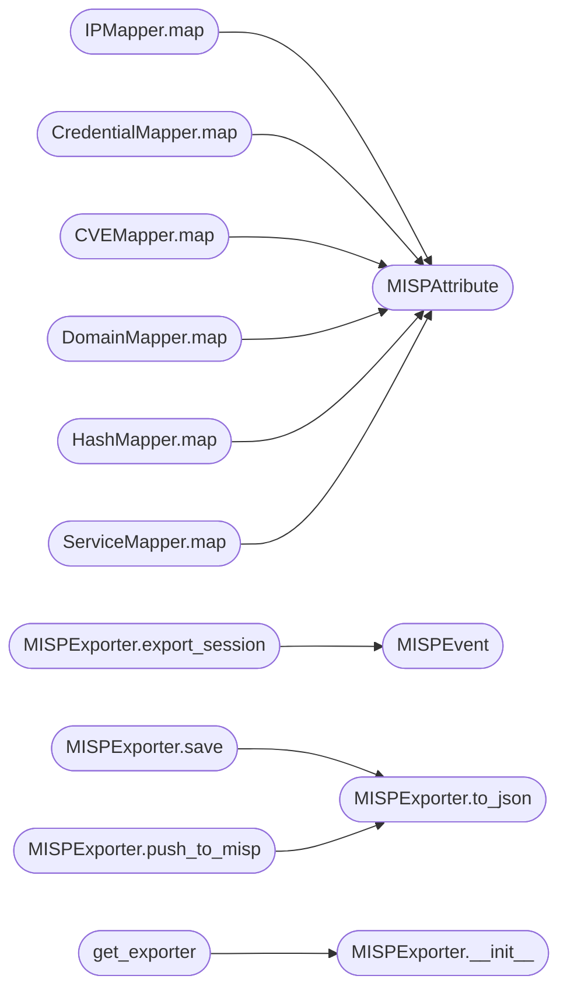

# `modules.integrations.misp_export`

> Source: [modules/integrations/misp_export.py:1](../../modules/integrations/misp_export.py#L1) | language `py` | coverage 100.0% | [API index](../index.md)

modules/integrations/misp_export.py ===================================== Exports LazyOwn session findings as MISP-compatible events (JSON format).

Design (SOLID)
--------------
- Single Responsibility : each FindingMapper handles exactly one FindingType
- Open/Closed           : new types via new FindingMapper subclass, no edits needed
- Liskov                : all mappers honour Optional[MISPAttribute] return contract
- Interface Segregation : consumers see only FindingMapper; exporter is separate
- Dependency Inversion  : MISPExporter depends on FindingMapper abstraction

Usage
-----
    from modules.integrations.misp_export import get_exporter

    exporter = get_exporter()
    event = exporter.export_session("sessions/")
    path  = exporter.save(event, "sessions/misp_event.json")

    # CLI:
    python3 modules/integrations/misp_export.py --output sessions/misp_event.json
    python3 modules/integrations/misp_export.py --output sessions/misp_event.json \
        --misp-url https://misp.example.com --misp-key <API_KEY>

## Contents

- **Classes:** [`MISPAttribute`](#mispattribute), [`MISPEvent`](#mispevent), [`FindingMapper`](#findingmapper), [`IPMapper`](#ipmapper), [`CredentialMapper`](#credentialmapper), [`CVEMapper`](#cvemapper), [`DomainMapper`](#domainmapper), [`HashMapper`](#hashmapper), [`ServiceMapper`](#servicemapper), [`MISPExporter`](#mispexporter)
- **Functions:** [`get_exporter`](#get_exporter)

## Type Diagram



## Call Graph

Solid arrows stay in this module, dashed arrows leave it.



## Classes

<a id="mispattribute"></a>

### `MISPAttribute`

`class` `dataclass` | [modules/integrations/misp_export.py:59](../../modules/integrations/misp_export.py#L59)

Decorators: `@dataclass`

```python
class MISPAttribute
```

A single MISP attribute inside an event.

**Attributes**

| Name | Type | Default | Description |
|---|---|---|---|
| [`type`](#mispattribute-type) | `str` |  |  |
| [`value`](#mispattribute-value) | `str` |  |  |
| [`category`](#mispattribute-category) | `str` | `'External analysis'` |  |
| [`to_ids`](#mispattribute-to_ids) | `bool` | `False` |  |
| [`comment`](#mispattribute-comment) | `str` | `''` |  |

---

<a id="mispevent"></a>

### `MISPEvent`

`class` `dataclass` | [modules/integrations/misp_export.py:70](../../modules/integrations/misp_export.py#L70)

Decorators: `@dataclass`

```python
class MISPEvent
```

A complete MISP event ready for JSON serialisation or API push.

**Attributes**

| Name | Type | Default | Description |
|---|---|---|---|
| [`info`](#mispevent-info) | `str` |  |  |
| [`threat_level_id`](#mispevent-threat_level_id) | `int` | `2` |  |
| [`analysis`](#mispevent-analysis) | `int` | `0` |  |
| [`distribution`](#mispevent-distribution) | `int` | `0` |  |
| [`attributes`](#mispevent-attributes) | `list[MISPAttribute]` | `field(default_factory=list)` |  |
| [`tags`](#mispevent-tags) | `list[str]` | `field(default_factory=list)` |  |

---

<a id="findingmapper"></a>

### `FindingMapper`

`class` `abstract` | [modules/integrations/misp_export.py:86](../../modules/integrations/misp_export.py#L86)

```python
class FindingMapper(ABC)
```

Bases: `ABC`

Subclasses: [`CVEMapper`](#cvemapper), [`CredentialMapper`](#credentialmapper), [`DomainMapper`](#domainmapper), [`HashMapper`](#hashmapper), [`IPMapper`](#ipmapper), [`ServiceMapper`](#servicemapper)

Maps a single Finding to a MISPAttribute (or None when not applicable).

**Members**

| Member | Kind | Summary |
|---|---|---|
| [`map`](#findingmapper-map) | method | Convert *finding* to a MISPAttribute. |

<a id="findingmapper-map"></a>

#### `FindingMapper.map`

`method` `abstract` | [modules/integrations/misp_export.py:90](../../modules/integrations/misp_export.py#L90)

Decorators: `@abstractmethod`

```python
def map(self, finding: Any) -> MISPAttribute | None
```

Convert *finding* to a MISPAttribute.

Returns None if the finding is not relevant to this mapper.

**Parameters**

| Name | Type | Default | Description |
|---|---|---|---|
| `finding` | `Any` |  |  |

**Returns:** `MISPAttribute | None`

---

<a id="ipmapper"></a>

### `IPMapper`

`class` | [modules/integrations/misp_export.py:103](../../modules/integrations/misp_export.py#L103)

```python
class IPMapper(FindingMapper)
```

Bases: [`FindingMapper`](#findingmapper)

Maps IP findings to MISP ip-dst attributes.

**Members**

| Member | Kind | Summary |
|---|---|---|
| [`map`](#ipmapper-map) | method | Convert *finding* to a MISPAttribute. |

<a id="ipmapper-map"></a>

#### `IPMapper.map`

`method` | [modules/integrations/misp_export.py:106](../../modules/integrations/misp_export.py#L106)

```python
def map(self, finding: Any) -> MISPAttribute | None
```

Convert *finding* to a MISPAttribute.

Returns None if the finding is not relevant to this mapper.

**Parameters**

| Name | Type | Default | Description |
|---|---|---|---|
| `finding` | `Any` |  |  |

**Returns:** `MISPAttribute | None`

> **Inherited:** Documentation from [`FindingMapper.map`](#findingmapper-map) (modules/integrations/misp_export.py:90).

*Calls:* [`MISPAttribute`](#mispattribute)

---

<a id="credentialmapper"></a>

### `CredentialMapper`

`class` | [modules/integrations/misp_export.py:123](../../modules/integrations/misp_export.py#L123)

```python
class CredentialMapper(FindingMapper)
```

Bases: [`FindingMapper`](#findingmapper)

Maps credential findings to MISP text attributes.

**Members**

| Member | Kind | Summary |
|---|---|---|
| [`map`](#credentialmapper-map) | method | Convert *finding* to a MISPAttribute. |

<a id="credentialmapper-map"></a>

#### `CredentialMapper.map`

`method` | [modules/integrations/misp_export.py:126](../../modules/integrations/misp_export.py#L126)

```python
def map(self, finding: Any) -> MISPAttribute | None
```

Convert *finding* to a MISPAttribute.

Returns None if the finding is not relevant to this mapper.

**Parameters**

| Name | Type | Default | Description |
|---|---|---|---|
| `finding` | `Any` |  |  |

**Returns:** `MISPAttribute | None`

> **Inherited:** Documentation from [`FindingMapper.map`](#findingmapper-map) (modules/integrations/misp_export.py:90).

*Calls:* [`MISPAttribute`](#mispattribute)

---

<a id="cvemapper"></a>

### `CVEMapper`

`class` | [modules/integrations/misp_export.py:143](../../modules/integrations/misp_export.py#L143)

```python
class CVEMapper(FindingMapper)
```

Bases: [`FindingMapper`](#findingmapper)

Maps CVE findings to MISP vulnerability attributes.

**Members**

| Member | Kind | Summary |
|---|---|---|
| [`map`](#cvemapper-map) | method | Convert *finding* to a MISPAttribute. |

<a id="cvemapper-map"></a>

#### `CVEMapper.map`

`method` | [modules/integrations/misp_export.py:146](../../modules/integrations/misp_export.py#L146)

```python
def map(self, finding: Any) -> MISPAttribute | None
```

Convert *finding* to a MISPAttribute.

Returns None if the finding is not relevant to this mapper.

**Parameters**

| Name | Type | Default | Description |
|---|---|---|---|
| `finding` | `Any` |  |  |

**Returns:** `MISPAttribute | None`

> **Inherited:** Documentation from [`FindingMapper.map`](#findingmapper-map) (modules/integrations/misp_export.py:90).

*Calls:* [`MISPAttribute`](#mispattribute)

---

<a id="domainmapper"></a>

### `DomainMapper`

`class` | [modules/integrations/misp_export.py:163](../../modules/integrations/misp_export.py#L163)

```python
class DomainMapper(FindingMapper)
```

Bases: [`FindingMapper`](#findingmapper)

Maps domain findings to MISP domain attributes.

**Members**

| Member | Kind | Summary |
|---|---|---|
| [`map`](#domainmapper-map) | method | Convert *finding* to a MISPAttribute. |

<a id="domainmapper-map"></a>

#### `DomainMapper.map`

`method` | [modules/integrations/misp_export.py:166](../../modules/integrations/misp_export.py#L166)

```python
def map(self, finding: Any) -> MISPAttribute | None
```

Convert *finding* to a MISPAttribute.

Returns None if the finding is not relevant to this mapper.

**Parameters**

| Name | Type | Default | Description |
|---|---|---|---|
| `finding` | `Any` |  |  |

**Returns:** `MISPAttribute | None`

> **Inherited:** Documentation from [`FindingMapper.map`](#findingmapper-map) (modules/integrations/misp_export.py:90).

*Calls:* [`MISPAttribute`](#mispattribute)

---

<a id="hashmapper"></a>

### `HashMapper`

`class` | [modules/integrations/misp_export.py:183](../../modules/integrations/misp_export.py#L183)

```python
class HashMapper(FindingMapper)
```

Bases: [`FindingMapper`](#findingmapper)

Maps hash findings to MISP md5 or sha256 attributes.

Auto-detects hash type by length:
  32 chars -> md5
  64 chars -> sha256

**Members**

| Member | Kind | Summary |
|---|---|---|
| [`map`](#hashmapper-map) | method | Convert *finding* to a MISPAttribute. |

<a id="hashmapper-map"></a>

#### `HashMapper.map`

`method` | [modules/integrations/misp_export.py:192](../../modules/integrations/misp_export.py#L192)

```python
def map(self, finding: Any) -> MISPAttribute | None
```

Convert *finding* to a MISPAttribute.

Returns None if the finding is not relevant to this mapper.

**Parameters**

| Name | Type | Default | Description |
|---|---|---|---|
| `finding` | `Any` |  |  |

**Returns:** `MISPAttribute | None`

> **Inherited:** Documentation from [`FindingMapper.map`](#findingmapper-map) (modules/integrations/misp_export.py:90).

*Calls:* [`MISPAttribute`](#mispattribute)

---

<a id="servicemapper"></a>

### `ServiceMapper`

`class` | [modules/integrations/misp_export.py:218](../../modules/integrations/misp_export.py#L218)

```python
class ServiceMapper(FindingMapper)
```

Bases: [`FindingMapper`](#findingmapper)

Maps service_version findings to MISP text attributes.

**Members**

| Member | Kind | Summary |
|---|---|---|
| [`map`](#servicemapper-map) | method | Convert *finding* to a MISPAttribute. |

<a id="servicemapper-map"></a>

#### `ServiceMapper.map`

`method` | [modules/integrations/misp_export.py:221](../../modules/integrations/misp_export.py#L221)

```python
def map(self, finding: Any) -> MISPAttribute | None
```

Convert *finding* to a MISPAttribute.

Returns None if the finding is not relevant to this mapper.

**Parameters**

| Name | Type | Default | Description |
|---|---|---|---|
| `finding` | `Any` |  |  |

**Returns:** `MISPAttribute | None`

> **Inherited:** Documentation from [`FindingMapper.map`](#findingmapper-map) (modules/integrations/misp_export.py:90).

*Calls:* [`MISPAttribute`](#mispattribute)

---

<a id="mispexporter"></a>

### `MISPExporter`

`class` | [modules/integrations/misp_export.py:254](../../modules/integrations/misp_export.py#L254)

```python
class MISPExporter
```

Reads LazyOwn session artefacts and produces a MISPEvent.

**Parameters**

| Name | Type | Default | Description |
|---|---|---|---|
| `mappers` | `list of FindingMapper instances (injected for testability)` |  |  |

**Members**

| Member | Kind | Summary |
|---|---|---|
| [`__init__`](#mispexporter-__init__) | constructor |  |
| [`export_session`](#mispexporter-export_session) | method | Read policy_facts.json and events.jsonl from *sessions_dir*, map all findings, and return a populated MISPEvent. |
| [`to_json`](#mispexporter-to_json) | method | Serialise *event* to a MISP-compatible JSON string. |
| [`save`](#mispexporter-save) | method | Write the MISP event JSON to *path* and return the resolved path. |
| [`push_to_misp`](#mispexporter-push_to_misp) | method | HTTP-push the event to a live MISP instance. |

<a id="mispexporter-__init__"></a>

#### `MISPExporter.__init__`

`constructor` | [modules/integrations/misp_export.py:263](../../modules/integrations/misp_export.py#L263)

```python
def __init__(self, mappers: list[FindingMapper] | None = None) -> None
```

**Parameters**

| Name | Type | Default | Description |
|---|---|---|---|
| `mappers` | `list[FindingMapper] \| None` | `None` |  |

*Called by:* [`get_exporter`](#get_exporter)

<a id="mispexporter-export_session"></a>

#### `MISPExporter.export_session`

`method` | [modules/integrations/misp_export.py:268](../../modules/integrations/misp_export.py#L268)

```python
def export_session(self, sessions_dir: str | Path = _SESSIONS_DIR, target: str | None = None) -> MISPEvent
```

Read policy_facts.json and events.jsonl from *sessions_dir*, map all findings, and return a populated MISPEvent.

**Parameters**

| Name | Type | Default | Description |
|---|---|---|---|
| `sessions_dir` | `str \| Path` | `_SESSIONS_DIR` |  |
| `target` | `str \| None` | `None` |  |

**Returns:** `MISPEvent`

*Calls:* [`MISPEvent`](#mispevent)

<a id="mispexporter-to_json"></a>

#### `MISPExporter.to_json`

`method` | [modules/integrations/misp_export.py:299](../../modules/integrations/misp_export.py#L299)

```python
def to_json(self, event: MISPEvent) -> str
```

Serialise *event* to a MISP-compatible JSON string.

**Parameters**

| Name | Type | Default | Description |
|---|---|---|---|
| `event` | `MISPEvent` |  |  |

**Returns:** `str`

*Called by:* [`MISPExporter.push_to_misp`](#mispexporter-push_to_misp), [`MISPExporter.save`](#mispexporter-save)

<a id="mispexporter-save"></a>

#### `MISPExporter.save`

`method` | [modules/integrations/misp_export.py:322](../../modules/integrations/misp_export.py#L322)

```python
def save(self, event: MISPEvent, path: str | Path) -> Path
```

Write the MISP event JSON to *path* and return the resolved path.

**Parameters**

| Name | Type | Default | Description |
|---|---|---|---|
| `event` | `MISPEvent` |  |  |
| `path` | `str \| Path` |  |  |

**Returns:** `Path`

*Calls:* [`MISPExporter.to_json`](#mispexporter-to_json)

<a id="mispexporter-push_to_misp"></a>

#### `MISPExporter.push_to_misp`

`method` | [modules/integrations/misp_export.py:330](../../modules/integrations/misp_export.py#L330)

```python
def push_to_misp(self, event: MISPEvent, url: str, api_key: str) -> bool
```

HTTP-push the event to a live MISP instance.

Returns False gracefully if requests is not available or the push fails.

**Parameters**

| Name | Type | Default | Description |
|---|---|---|---|
| `event` | `MISPEvent` |  |  |
| `url` | `str` |  |  |
| `api_key` | `str` |  |  |

**Returns:** `bool`

*Calls:* [`MISPExporter.to_json`](#mispexporter-to_json)

---

## Functions

<a id="get_exporter"></a>

### `get_exporter`

`function` | [modules/integrations/misp_export.py:469](../../modules/integrations/misp_export.py#L469)

```python
def get_exporter() -> MISPExporter
```

Return the module-level MISPExporter singleton.

**Returns:** `MISPExporter`

*Calls:* [`MISPExporter.__init__`](#mispexporter-__init__)

---
