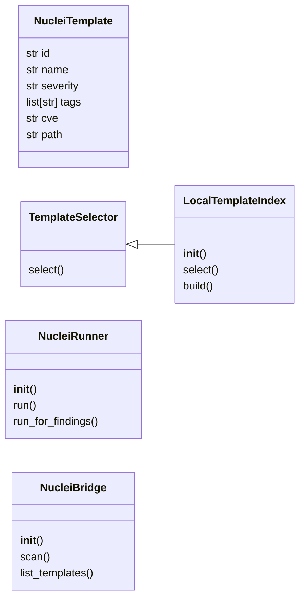
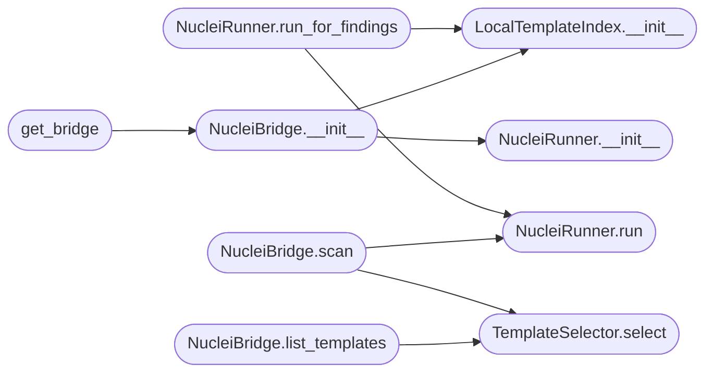

# `modules.integrations.nuclei_bridge`

> Source: [modules/integrations/nuclei_bridge.py:1](../../modules/integrations/nuclei_bridge.py#L1) | language `py` | coverage 82.4% | [API index](../index.md)

modules/integrations/nuclei_bridge.py ======================================= Selects and runs Nuclei templates based on discovered services and CVEs from WorldModel/ObsParser.

Design (SOLID)
--------------
- Single Responsibility : LocalTemplateIndex indexes templates; NucleiRunner executes
- Open/Closed           : new selectors via TemplateSelector subclass
- Liskov                : any TemplateSelector can replace LocalTemplateIndex
- Interface Segregation : NucleiRunner depends on List[NucleiTemplate], not on selectors
- Dependency Inversion  : NucleiBridge depends on TemplateSelector and NucleiRunner abstractions

Usage
-----
    from modules.integrations.nuclei_bridge import get_bridge

    bridge = get_bridge()
    output = bridge.scan("10.10.11.78", findings)

    # List matching templates without running:
    templates = bridge.list_templates(services=["apache"], cves=["CVE-2021-41773"])

    # CLI:
    python3 modules/integrations/nuclei_bridge.py --target 10.10.11.78 --cve CVE-2021-41773
    python3 modules/integrations/nuclei_bridge.py --target 10.10.11.78 --service apache --dry-run

## Contents

- **Classes:** [`NucleiTemplate`](#nucleitemplate), [`TemplateSelector`](#templateselector), [`LocalTemplateIndex`](#localtemplateindex), [`NucleiRunner`](#nucleirunner), [`NucleiBridge`](#nucleibridge)
- **Functions:** [`get_bridge`](#get_bridge)

## Type Diagram



## Call Graph

Solid arrows stay in this module, dashed arrows leave it.



## Classes

<a id="nucleitemplate"></a>

### `NucleiTemplate`

`class` `dataclass` | [modules/integrations/nuclei_bridge.py:71](../../modules/integrations/nuclei_bridge.py#L71)

Decorators: `@dataclass`

```python
class NucleiTemplate
```

Metadata extracted from a Nuclei template YAML file.

**Attributes**

| Name | Type | Default | Description |
|---|---|---|---|
| [`id`](#nucleitemplate-id) | `str` |  |  |
| [`name`](#nucleitemplate-name) | `str` |  |  |
| [`severity`](#nucleitemplate-severity) | `str` | `'info'` |  |
| [`tags`](#nucleitemplate-tags) | `list[str]` | `field(default_factory=list)` |  |
| [`cve`](#nucleitemplate-cve) | `str` | `''` |  |
| [`path`](#nucleitemplate-path) | `str` | `''` |  |

---

<a id="templateselector"></a>

### `TemplateSelector`

`class` `abstract` | [modules/integrations/nuclei_bridge.py:87](../../modules/integrations/nuclei_bridge.py#L87)

```python
class TemplateSelector(ABC)
```

Bases: `ABC`

Subclasses: [`LocalTemplateIndex`](#localtemplateindex)

Interface for selecting Nuclei templates given service/CVE context.

**Members**

| Member | Kind | Summary |
|---|---|---|
| [`select`](#templateselector-select) | method | Return templates relevant to the provided *services* and *cves*. |

<a id="templateselector-select"></a>

#### `TemplateSelector.select`

`method` `abstract` | [modules/integrations/nuclei_bridge.py:91](../../modules/integrations/nuclei_bridge.py#L91)

Decorators: `@abstractmethod`

```python
def select(self, services: list[str], cves: list[str]) -> list[NucleiTemplate]
```

Return templates relevant to the provided *services* and *cves*.

Results are sorted: critical > high > medium > low.

**Parameters**

| Name | Type | Default | Description |
|---|---|---|---|
| `services` | `list[str]` |  |  |
| `cves` | `list[str]` |  |  |

**Returns:** `list[NucleiTemplate]`

*Called by:* [`NucleiBridge.list_templates`](#nucleibridge-list_templates), [`NucleiBridge.scan`](#nucleibridge-scan)

---

<a id="localtemplateindex"></a>

### `LocalTemplateIndex`

`class` | [modules/integrations/nuclei_bridge.py:104](../../modules/integrations/nuclei_bridge.py#L104)

```python
class LocalTemplateIndex(TemplateSelector)
```

Bases: [`TemplateSelector`](#templateselector)

Scans the local nuclei-templates directory and builds an in-memory index.

Template metadata is parsed from YAML files under
``external/.exploit/nuclei-templates/``.  Falls back gracefully when the
directory does not exist or when PyYAML is not installed (uses regex
parsing instead).

**Members**

| Member | Kind | Summary |
|---|---|---|
| [`__init__`](#localtemplateindex-__init__) | constructor |  |
| [`select`](#localtemplateindex-select) | method | Return templates relevant to the provided *services* and *cves*. |
| [`build`](#localtemplateindex-build) | method | Force a (re)build of the template index. |

<a id="localtemplateindex-__init__"></a>

#### `LocalTemplateIndex.__init__`

`constructor` | [modules/integrations/nuclei_bridge.py:114](../../modules/integrations/nuclei_bridge.py#L114)

```python
def __init__(self, templates_dir: str | Path = _NUCLEI_TEMPLATES_DIR) -> None
```

**Parameters**

| Name | Type | Default | Description |
|---|---|---|---|
| `templates_dir` | `str \| Path` | `_NUCLEI_TEMPLATES_DIR` |  |

*Called by:* [`NucleiBridge.__init__`](#nucleibridge-__init__), [`NucleiRunner.run_for_findings`](#nucleirunner-run_for_findings), [`NucleiParser.scan_and_import`](modules.integrations.nuclei_parser.py.md#nucleiparser-scan_and_import)

<a id="localtemplateindex-select"></a>

#### `LocalTemplateIndex.select`

`method` | [modules/integrations/nuclei_bridge.py:121](../../modules/integrations/nuclei_bridge.py#L121)

```python
def select(self, services: list[str], cves: list[str]) -> list[NucleiTemplate]
```

Return templates relevant to the provided *services* and *cves*.

Results are sorted: critical > high > medium > low.

**Parameters**

| Name | Type | Default | Description |
|---|---|---|---|
| `services` | `list[str]` |  |  |
| `cves` | `list[str]` |  |  |

**Returns:** `list[NucleiTemplate]`

> **Inherited:** Documentation from [`TemplateSelector.select`](#templateselector-select) (modules/integrations/nuclei_bridge.py:91).

*Called by:* [`NucleiParser.scan_and_import`](modules.integrations.nuclei_parser.py.md#nucleiparser-scan_and_import)

<a id="localtemplateindex-build"></a>

#### `LocalTemplateIndex.build`

`method` | [modules/integrations/nuclei_bridge.py:141](../../modules/integrations/nuclei_bridge.py#L141)

```python
def build(self) -> None
```

Force a (re)build of the template index.

---

<a id="nucleirunner"></a>

### `NucleiRunner`

`class` | [modules/integrations/nuclei_bridge.py:279](../../modules/integrations/nuclei_bridge.py#L279)

```python
class NucleiRunner
```

Builds and executes nuclei commands via subprocess.

Falls back gracefully if nuclei is not installed.

**Members**

| Member | Kind | Summary |
|---|---|---|
| [`__init__`](#nucleirunner-__init__) | constructor |  |
| [`run`](#nucleirunner-run) | method | Execute nuclei against *target* using the provided *templates*. |
| [`run_for_findings`](#nucleirunner-run_for_findings) | method | Convenience: extract services/CVEs from *findings*, select templates, run. |

<a id="nucleirunner-__init__"></a>

#### `NucleiRunner.__init__`

`constructor` | [modules/integrations/nuclei_bridge.py:288](../../modules/integrations/nuclei_bridge.py#L288)

```python
def __init__(self) -> None
```

*Called by:* [`NucleiBridge.__init__`](#nucleibridge-__init__), [`NucleiParser.scan_and_import`](modules.integrations.nuclei_parser.py.md#nucleiparser-scan_and_import), [`IntelligenceEngine.collect_from_nuclei`](modules.intelligence_engine.py.md#intelligenceengine-collect_from_nuclei)

<a id="nucleirunner-run"></a>

#### `NucleiRunner.run`

`method` | [modules/integrations/nuclei_bridge.py:293](../../modules/integrations/nuclei_bridge.py#L293)

```python
def run(self, target: str, templates: list[NucleiTemplate], output_dir: str | Path | None = None) -> str
```

Execute nuclei against *target* using the provided *templates*.

Returns the combined stdout/stderr output, or an error string if
nuclei is not installed or execution fails.

**Parameters**

| Name | Type | Default | Description |
|---|---|---|---|
| `target` | `str` |  |  |
| `templates` | `list[NucleiTemplate]` |  |  |
| `output_dir` | `str \| Path \| None` | `None` |  |

**Returns:** `str`

*Called by:* [`NucleiBridge.scan`](#nucleibridge-scan), [`NucleiRunner.run_for_findings`](#nucleirunner-run_for_findings), [`IntelligenceEngine.collect_from_nuclei`](modules.intelligence_engine.py.md#intelligenceengine-collect_from_nuclei)

<a id="nucleirunner-run_for_findings"></a>

#### `NucleiRunner.run_for_findings`

`method` | [modules/integrations/nuclei_bridge.py:326](../../modules/integrations/nuclei_bridge.py#L326)

```python
def run_for_findings(self, target: str, findings: list, output_dir: str | Path | None = None, selector: TemplateSelector | None = None) -> str
```

Convenience: extract services/CVEs from *findings*, select templates, run.

**Parameters**

| Name | Type | Default | Description |
|---|---|---|---|
| `target` | `str` |  |  |
| `findings` | `list` |  |  |
| `output_dir` | `str \| Path \| None` | `None` |  |
| `selector` | `TemplateSelector \| None` | `None` |  |

**Returns:** `str`

*Calls:* [`LocalTemplateIndex.__init__`](#localtemplateindex-__init__), [`NucleiRunner.run`](#nucleirunner-run)

---

<a id="nucleibridge"></a>

### `NucleiBridge`

`class` | [modules/integrations/nuclei_bridge.py:389](../../modules/integrations/nuclei_bridge.py#L389)

```python
class NucleiBridge
```

Top-level facade combining TemplateSelector and NucleiRunner.

Injected dependencies allow easy testing without real nuclei.

**Members**

| Member | Kind | Summary |
|---|---|---|
| [`__init__`](#nucleibridge-__init__) | constructor |  |
| [`scan`](#nucleibridge-scan) | method | Select templates from *findings* and run nuclei against *target*. |
| [`list_templates`](#nucleibridge-list_templates) | method | Return matching templates without running nuclei. |

<a id="nucleibridge-__init__"></a>

#### `NucleiBridge.__init__`

`constructor` | [modules/integrations/nuclei_bridge.py:396](../../modules/integrations/nuclei_bridge.py#L396)

```python
def __init__(self, selector: TemplateSelector | None = None, runner: NucleiRunner | None = None) -> None
```

**Parameters**

| Name | Type | Default | Description |
|---|---|---|---|
| `selector` | `TemplateSelector \| None` | `None` |  |
| `runner` | `NucleiRunner \| None` | `None` |  |

*Calls:* [`LocalTemplateIndex.__init__`](#localtemplateindex-__init__), [`NucleiRunner.__init__`](#nucleirunner-__init__)

*Called by:* [`get_bridge`](#get_bridge)

<a id="nucleibridge-scan"></a>

#### `NucleiBridge.scan`

`method` | [modules/integrations/nuclei_bridge.py:404](../../modules/integrations/nuclei_bridge.py#L404)

```python
def scan(self, target: str, findings: list, dry_run: bool = False) -> str
```

Select templates from *findings* and run nuclei against *target*.

When *dry_run* is True, return the command string without executing.

**Parameters**

| Name | Type | Default | Description |
|---|---|---|---|
| `target` | `str` |  |  |
| `findings` | `list` |  |  |
| `dry_run` | `bool` | `False` |  |

**Returns:** `str`

*Calls:* [`NucleiRunner.run`](#nucleirunner-run), [`TemplateSelector.select`](#templateselector-select)

<a id="nucleibridge-list_templates"></a>

#### `NucleiBridge.list_templates`

`method` | [modules/integrations/nuclei_bridge.py:427](../../modules/integrations/nuclei_bridge.py#L427)

```python
def list_templates(self, services: list[str] | None = None, cves: list[str] | None = None) -> list[NucleiTemplate]
```

Return matching templates without running nuclei.

**Parameters**

| Name | Type | Default | Description |
|---|---|---|---|
| `services` | `list[str] \| None` | `None` |  |
| `cves` | `list[str] \| None` | `None` |  |

**Returns:** `list[NucleiTemplate]`

*Calls:* [`TemplateSelector.select`](#templateselector-select)

---

## Functions

<a id="get_bridge"></a>

### `get_bridge`

`function` | [modules/integrations/nuclei_bridge.py:443](../../modules/integrations/nuclei_bridge.py#L443)

```python
def get_bridge() -> NucleiBridge
```

Return the module-level NucleiBridge singleton.

**Returns:** `NucleiBridge`

*Calls:* [`NucleiBridge.__init__`](#nucleibridge-__init__)

---
