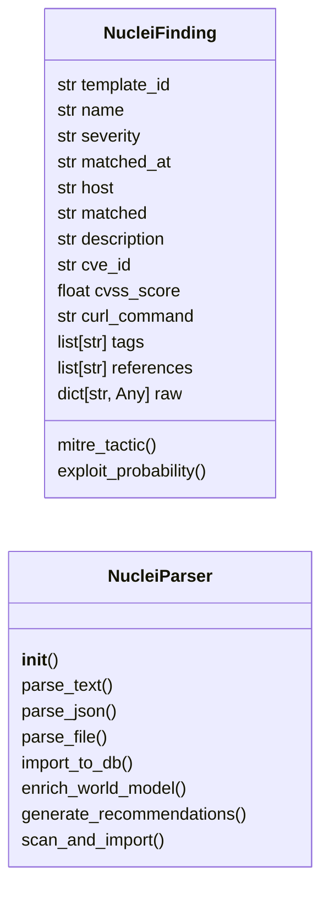
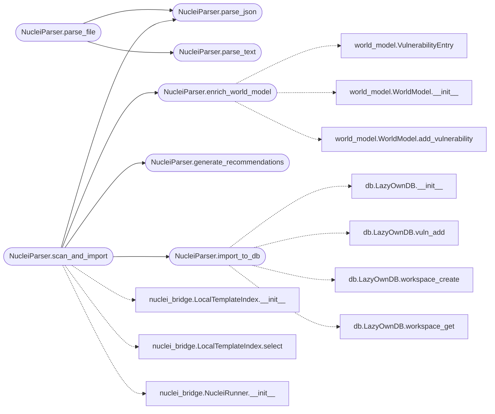

# `modules.integrations.nuclei_parser`

> Source: [modules/integrations/nuclei_parser.py:1](../../modules/integrations/nuclei_parser.py#L1) | language `py` | coverage 69.2% | [API index](../index.md)

Nuclei JSON output parser — feeds scan results into DB, WorldModel, and recommender.

Parses nuclei ``-json`` / ``-jsonl`` output and enriches the LazyOwn
campaign database (``modules/db.py``) and WorldModel
(``modules/world_model.py``) with discovered vulnerabilities.

Design (SOLID):
- Single Responsibility: NucleiParser only parses nuclei output.
- Open/Closed: new finding types via Finding subclass.
- Liskov: any DB interface can replace LazyOwnDB.
- Interface Segregation: parse(), import_findings(), enrich_world_model().
- Dependency Inversion: depends on abstract DB interface, not concrete SQLite.

Usage:
    from modules.integrations.nuclei_parser import NucleiParser

    parser = NucleiParser()
    findings = parser.parse_file("sessions/nuclei_10.10.11.5.json")
    imported = parser.import_to_db(findings, rhost="10.10.11.5")
    parser.enrich_world_model(findings, rhost="10.10.11.5")

## Contents

- **Classes:** [`NucleiFinding`](#nucleifinding), [`NucleiParser`](#nucleiparser)
- **Constants:** [`SEVERITY_MAP`](#severity_map), [`MITRE_TACTICS`](#mitre_tactics), [`EXPLOIT_PROBABILITY`](#exploit_probability)

## Type Diagram



## Call Graph

Solid arrows stay in this module, dashed arrows leave it.



## Classes

<a id="nucleifinding"></a>

### `NucleiFinding`

`class` `dataclass` | [modules/integrations/nuclei_parser.py:71](../../modules/integrations/nuclei_parser.py#L71)

Decorators: `@dataclass`

```python
class NucleiFinding
```

**Attributes**

| Name | Type | Default | Description |
|---|---|---|---|
| [`template_id`](#nucleifinding-template_id) | `str` |  |  |
| [`name`](#nucleifinding-name) | `str` |  |  |
| [`severity`](#nucleifinding-severity) | `str` |  |  |
| [`matched_at`](#nucleifinding-matched_at) | `str` |  |  |
| [`host`](#nucleifinding-host) | `str` |  |  |
| [`matched`](#nucleifinding-matched) | `str` | `''` |  |
| [`description`](#nucleifinding-description) | `str` | `''` |  |
| [`cve_id`](#nucleifinding-cve_id) | `str` | `''` |  |
| [`cvss_score`](#nucleifinding-cvss_score) | `float` | `0.0` |  |
| [`curl_command`](#nucleifinding-curl_command) | `str` | `''` |  |
| [`tags`](#nucleifinding-tags) | `list[str]` | `field(default_factory=list)` |  |
| [`references`](#nucleifinding-references) | `list[str]` | `field(default_factory=list)` |  |
| [`raw`](#nucleifinding-raw) | `dict[str, Any]` | `field(default_factory=dict)` |  |

**Members**

| Member | Kind | Summary |
|---|---|---|
| [`mitre_tactic`](#nucleifinding-mitre_tactic) | property |  |
| [`exploit_probability`](#nucleifinding-exploit_probability) | property |  |

<a id="nucleifinding-mitre_tactic"></a>

#### `NucleiFinding.mitre_tactic`

`property` | [modules/integrations/nuclei_parser.py:87](../../modules/integrations/nuclei_parser.py#L87)

Decorators: `@property`

```python
def mitre_tactic(self) -> str
```

**Returns:** `str`

<a id="nucleifinding-exploit_probability"></a>

#### `NucleiFinding.exploit_probability`

`property` | [modules/integrations/nuclei_parser.py:95](../../modules/integrations/nuclei_parser.py#L95)

Decorators: `@property`

```python
def exploit_probability(self) -> float
```

**Returns:** `float`

---

<a id="nucleiparser"></a>

### `NucleiParser`

`class` | [modules/integrations/nuclei_parser.py:99](../../modules/integrations/nuclei_parser.py#L99)

```python
class NucleiParser
```

Parses nuclei JSON/JSONL output and imports into LazyOwn.

Supports both single-line JSON objects per finding (``-jsonl``)
and arrays of JSON objects (``-json``).

**Members**

| Member | Kind | Summary |
|---|---|---|
| [`__init__`](#nucleiparser-__init__) | constructor |  |
| [`parse_text`](#nucleiparser-parse_text) | method | Parse raw nuclei text output (table format). |
| [`parse_json`](#nucleiparser-parse_json) | method | Parse nuclei JSON output (``-jsonl`` or ``-json`` format). |
| [`parse_file`](#nucleiparser-parse_file) | method | Parse nuclei output from a file (auto-detects format). |
| [`import_to_db`](#nucleiparser-import_to_db) | method | Import parsed findings into the LazyOwnDB vulnerabilities table. |
| [`enrich_world_model`](#nucleiparser-enrich_world_model) | method | Feed parsed findings into the WorldModel for autonomous decision-making. |
| [`generate_recommendations`](#nucleiparser-generate_recommendations) | method | Generate actionable LazyOwn command recommendations from findings. |
| [`scan_and_import`](#nucleiparser-scan_and_import) | method | Run nuclei scan against target, parse output, and import to DB/WorldModel. |

<a id="nucleiparser-__init__"></a>

#### `NucleiParser.__init__`

`constructor` | [modules/integrations/nuclei_parser.py:109](../../modules/integrations/nuclei_parser.py#L109)

```python
def __init__(self, sessions_dir: str | Path | None = None) -> None
```

**Parameters**

| Name | Type | Default | Description |
|---|---|---|---|
| `sessions_dir` | `str \| Path \| None` | `None` |  |

*Called by:* [`IntelligenceEngine.collect_from_nuclei`](modules.intelligence_engine.py.md#intelligenceengine-collect_from_nuclei)

<a id="nucleiparser-parse_text"></a>

#### `NucleiParser.parse_text`

`method` | [modules/integrations/nuclei_parser.py:115](../../modules/integrations/nuclei_parser.py#L115)

```python
def parse_text(self, text: str) -> list[NucleiFinding]
```

Parse raw nuclei text output (table format).

**Parameters**

| Name | Type | Default | Description |
|---|---|---|---|
| `text` | `str` |  | Raw text from nuclei stdout. |

**Returns:** `list[NucleiFinding]` - List of parsed NucleiFinding objects.

*Called by:* [`NucleiParser.parse_file`](#nucleiparser-parse_file)

<a id="nucleiparser-parse_json"></a>

#### `NucleiParser.parse_json`

`method` | [modules/integrations/nuclei_parser.py:134](../../modules/integrations/nuclei_parser.py#L134)

```python
def parse_json(self, json_text: str) -> list[NucleiFinding]
```

Parse nuclei JSON output (``-jsonl`` or ``-json`` format).

Supports both newline-delimited JSON (JSONL) and JSON arrays.

**Parameters**

| Name | Type | Default | Description |
|---|---|---|---|
| `json_text` | `str` |  | JSON or JSONL formatted nuclei output. |

**Returns:** `list[NucleiFinding]` - List of parsed NucleiFinding objects.

*Called by:* [`NucleiParser.parse_file`](#nucleiparser-parse_file), [`NucleiParser.scan_and_import`](#nucleiparser-scan_and_import)

<a id="nucleiparser-parse_file"></a>

#### `NucleiParser.parse_file`

`method` | [modules/integrations/nuclei_parser.py:177](../../modules/integrations/nuclei_parser.py#L177)

```python
def parse_file(self, filepath: str | Path) -> list[NucleiFinding]
```

Parse nuclei output from a file (auto-detects format).

**Parameters**

| Name | Type | Default | Description |
|---|---|---|---|
| `filepath` | `str \| Path` |  | Path to nuclei output file. |

**Returns:** `list[NucleiFinding]` - List of parsed NucleiFinding objects.

*Calls:* [`NucleiParser.parse_json`](#nucleiparser-parse_json), [`NucleiParser.parse_text`](#nucleiparser-parse_text)

<a id="nucleiparser-import_to_db"></a>

#### `NucleiParser.import_to_db`

`method` | [modules/integrations/nuclei_parser.py:196](../../modules/integrations/nuclei_parser.py#L196)

```python
def import_to_db(self, findings: list[NucleiFinding], rhost: str = '', workspace_name: str = 'default') -> int
```

Import parsed findings into the LazyOwnDB vulnerabilities table.

**Parameters**

| Name | Type | Default | Description |
|---|---|---|---|
| `findings` | `list[NucleiFinding]` |  | Parsed NucleiFinding list. |
| `rhost` | `str` | `''` | Target IP for host association. |
| `workspace_name` | `str` | `'default'` | DB workspace to use. |

**Returns:** `int` - Number of vulnerabilities imported.

*Calls:* [`LazyOwnDB.__init__`](modules.db.py.md#lazyowndb-__init__), [`LazyOwnDB.vuln_add`](modules.db.py.md#lazyowndb-vuln_add), [`LazyOwnDB.workspace_create`](modules.db.py.md#lazyowndb-workspace_create), [`LazyOwnDB.workspace_get`](modules.db.py.md#lazyowndb-workspace_get)

*Called by:* [`NucleiParser.scan_and_import`](#nucleiparser-scan_and_import)

<a id="nucleiparser-enrich_world_model"></a>

#### `NucleiParser.enrich_world_model`

`method` | [modules/integrations/nuclei_parser.py:262](../../modules/integrations/nuclei_parser.py#L262)

```python
def enrich_world_model(self, findings: list[NucleiFinding], rhost: str = '') -> int
```

Feed parsed findings into the WorldModel for autonomous decision-making.

**Parameters**

| Name | Type | Default | Description |
|---|---|---|---|
| `findings` | `list[NucleiFinding]` |  | Parsed NucleiFinding list. |
| `rhost` | `str` | `''` | Target IP. |

**Returns:** `int` - Number of findings added to the world model.

*Calls:* [`VulnerabilityEntry`](modules.world_model.py.md#vulnerabilityentry), [`WorldModel.__init__`](modules.world_model.py.md#worldmodel-__init__), [`WorldModel.add_vulnerability`](modules.world_model.py.md#worldmodel-add_vulnerability)

*Called by:* [`NucleiParser.scan_and_import`](#nucleiparser-scan_and_import)

<a id="nucleiparser-generate_recommendations"></a>

#### `NucleiParser.generate_recommendations`

`method` | [modules/integrations/nuclei_parser.py:300](../../modules/integrations/nuclei_parser.py#L300)

```python
def generate_recommendations(self, findings: list[NucleiFinding], rhost: str = '') -> list[dict[str, Any]]
```

Generate actionable LazyOwn command recommendations from findings.

**Parameters**

| Name | Type | Default | Description |
|---|---|---|---|
| `findings` | `list[NucleiFinding]` |  | Parsed NucleiFinding list. |
| `rhost` | `str` | `''` | Target IP for command placeholders. |

**Returns:** `list[dict[str, Any]]` - List of recommendation dicts with command, confidence, and reason.

*Called by:* [`NucleiParser.scan_and_import`](#nucleiparser-scan_and_import)

<a id="nucleiparser-scan_and_import"></a>

#### `NucleiParser.scan_and_import`

`method` | [modules/integrations/nuclei_parser.py:328](../../modules/integrations/nuclei_parser.py#L328)

```python
def scan_and_import(self, target: str, templates: list | None = None, services: list[str] | None = None, cves: list[str] | None = None, workspace_name: str = 'default') -> dict[str, Any]
```

Run nuclei scan against target, parse output, and import to DB/WorldModel.

This is the high-level entry point: run + parse + import + recommend
in a single call.

**Parameters**

| Name | Type | Default | Description |
|---|---|---|---|
| `target` | `str` |  | Host to scan. |
| `templates` | `list \| None` | `None` | Specific nuclei templates to run (auto-selects if None). |
| `services` | `list[str] \| None` | `None` | Service names to match templates against. |
| `cves` | `list[str] \| None` | `None` | CVE IDs to match templates against. |
| `workspace_name` | `str` | `'default'` | DB workspace. |

**Returns:** `dict[str, Any]` - Dict with keys: findings (list), imported (int), recommendations (list).

*Calls:* [`LocalTemplateIndex.__init__`](modules.integrations.nuclei_bridge.py.md#localtemplateindex-__init__), [`LocalTemplateIndex.select`](modules.integrations.nuclei_bridge.py.md#localtemplateindex-select), [`NucleiRunner.__init__`](modules.integrations.nuclei_bridge.py.md#nucleirunner-__init__), [`NucleiParser.enrich_world_model`](#nucleiparser-enrich_world_model), [`NucleiParser.generate_recommendations`](#nucleiparser-generate_recommendations), [`NucleiParser.import_to_db`](#nucleiparser-import_to_db), [`NucleiParser.parse_json`](#nucleiparser-parse_json)

---

## Constants

<a id="severity_map"></a>

### `SEVERITY_MAP`

`constant` | [modules/integrations/nuclei_parser.py:34](../../modules/integrations/nuclei_parser.py#L34)

```python
SEVERITY_MAP: dict[str, int] = {'critical': 10, 'high': 7, 'medium': 5, 'low': 3, 'info': 1, 'unknown': 0}
```

---

<a id="mitre_tactics"></a>

### `MITRE_TACTICS`

`constant` | [modules/integrations/nuclei_parser.py:43](../../modules/integrations/nuclei_parser.py#L43)

```python
MITRE_TACTICS: dict[str, str]
```

---

<a id="exploit_probability"></a>

### `EXPLOIT_PROBABILITY`

`constant` | [modules/integrations/nuclei_parser.py:60](../../modules/integrations/nuclei_parser.py#L60)

```python
EXPLOIT_PROBABILITY: dict[str, float]
```

---
