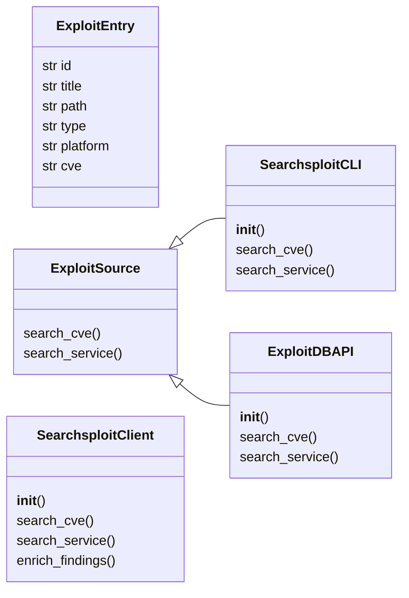
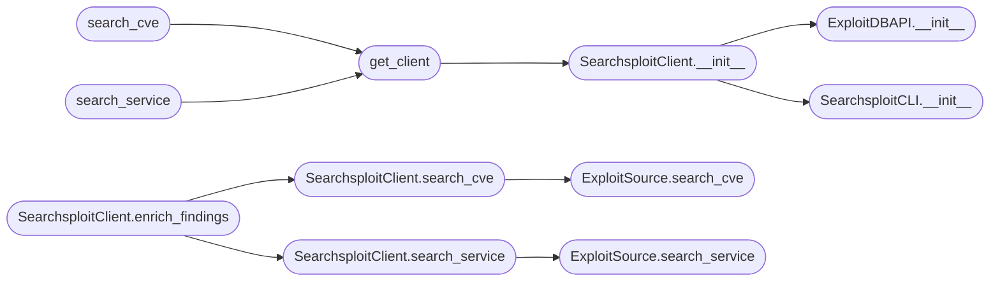

# `modules.integrations.searchsploit`

> Source: [modules/integrations/searchsploit.py:1](../../modules/integrations/searchsploit.py#L1) | language `py` | coverage 85.7% | [API index](../index.md)

modules/integrations/searchsploit.py ====================================== Bridges searchsploit CLI and ExploitDB with LazyOwn CVE/finding data.

Design (SOLID)
--------------
- Single Responsibility : each class owns one source or one operation
- Open/Closed           : new exploit sources via ExploitSource subclass
- Liskov                : SearchsploitCLI and ExploitDBAPI honour the same contract
- Interface Segregation : consumers import ExploitSource, not concrete types
- Dependency Inversion  : SearchsploitClient depends on ExploitSource abstraction

Usage
-----
    from modules.integrations.searchsploit import get_client, search_cve

    entries = search_cve("CVE-2021-41773")
    for e in entries:
        print(e.id, e.title)

    # CLI:
    python3 modules/integrations/searchsploit.py --cve CVE-2021-41773
    python3 modules/integrations/searchsploit.py --service apache --version 2.4.49

## Contents

- **Classes:** [`ExploitEntry`](#exploitentry), [`ExploitSource`](#exploitsource), [`SearchsploitCLI`](#searchsploitcli), [`ExploitDBAPI`](#exploitdbapi), [`SearchsploitClient`](#searchsploitclient)
- **Functions:** [`get_client`](#get_client), [`search_cve`](#search_cve), [`search_service`](#search_service)

## Type Diagram



## Call Graph

Solid arrows stay in this module, dashed arrows leave it.



## Classes

<a id="exploitentry"></a>

### `ExploitEntry`

`class` `dataclass` | [modules/integrations/searchsploit.py:60](../../modules/integrations/searchsploit.py#L60)

Decorators: `@dataclass`

```python
class ExploitEntry
```

Represents a single exploit found in ExploitDB or searchsploit.

**Attributes**

| Name | Type | Default | Description |
|---|---|---|---|
| [`id`](#exploitentry-id) | `str` |  |  |
| [`title`](#exploitentry-title) | `str` |  |  |
| [`path`](#exploitentry-path) | `str` |  |  |
| [`type`](#exploitentry-type) | `str` | `''` |  |
| [`platform`](#exploitentry-platform) | `str` | `''` |  |
| [`cve`](#exploitentry-cve) | `str` | `''` |  |

---

<a id="exploitsource"></a>

### `ExploitSource`

`class` `abstract` | [modules/integrations/searchsploit.py:76](../../modules/integrations/searchsploit.py#L76)

```python
class ExploitSource(ABC)
```

Bases: `ABC`

Subclasses: [`ExploitDBAPI`](#exploitdbapi), [`SearchsploitCLI`](#searchsploitcli)

Interface for any exploit lookup back-end.

**Members**

| Member | Kind | Summary |
|---|---|---|
| [`search_cve`](#exploitsource-search_cve) | method | Return exploits matching *cve_id* (e.g. |
| [`search_service`](#exploitsource-search_service) | method | Return exploits matching the service *name* and optional *version*. |

<a id="exploitsource-search_cve"></a>

#### `ExploitSource.search_cve`

`method` `abstract` | [modules/integrations/searchsploit.py:80](../../modules/integrations/searchsploit.py#L80)

Decorators: `@abstractmethod`

```python
def search_cve(self, cve_id: str) -> list[ExploitEntry]
```

Return exploits matching *cve_id* (e.g.

'CVE-2021-41773').

**Parameters**

| Name | Type | Default | Description |
|---|---|---|---|
| `cve_id` | `str` |  |  |

**Returns:** `list[ExploitEntry]`

*Called by:* [`SearchsploitClient.search_cve`](#searchsploitclient-search_cve)

<a id="exploitsource-search_service"></a>

#### `ExploitSource.search_service`

`method` `abstract` | [modules/integrations/searchsploit.py:84](../../modules/integrations/searchsploit.py#L84)

Decorators: `@abstractmethod`

```python
def search_service(self, name: str, version: str = '') -> list[ExploitEntry]
```

Return exploits matching the service *name* and optional *version*.

**Parameters**

| Name | Type | Default | Description |
|---|---|---|---|
| `name` | `str` |  |  |
| `version` | `str` | `''` |  |

**Returns:** `list[ExploitEntry]`

*Called by:* [`SearchsploitClient.search_service`](#searchsploitclient-search_service)

---

<a id="searchsploitcli"></a>

### `SearchsploitCLI`

`class` | [modules/integrations/searchsploit.py:93](../../modules/integrations/searchsploit.py#L93)

```python
class SearchsploitCLI(ExploitSource)
```

Bases: [`ExploitSource`](#exploitsource)

Runs ``searchsploit --json <query>`` and parses the result.

Falls back gracefully to an empty list if searchsploit is not installed.
Handles both the legacy (RESULTS_EXPLOIT / RESULTS_SHELLCODE) and
new (data) top-level key formats.

**Members**

| Member | Kind | Summary |
|---|---|---|
| [`__init__`](#searchsploitcli-__init__) | constructor |  |
| [`search_cve`](#searchsploitcli-search_cve) | method | Return exploits matching *cve_id* (e.g. |
| [`search_service`](#searchsploitcli-search_service) | method | Return exploits matching the service *name* and optional *version*. |

<a id="searchsploitcli-__init__"></a>

#### `SearchsploitCLI.__init__`

`constructor` | [modules/integrations/searchsploit.py:102](../../modules/integrations/searchsploit.py#L102)

```python
def __init__(self) -> None
```

*Called by:* [`SearchsploitClient.__init__`](#searchsploitclient-__init__)

<a id="searchsploitcli-search_cve"></a>

#### `SearchsploitCLI.search_cve`

`method` | [modules/integrations/searchsploit.py:109](../../modules/integrations/searchsploit.py#L109)

```python
def search_cve(self, cve_id: str) -> list[ExploitEntry]
```

Return exploits matching *cve_id* (e.g.

'CVE-2021-41773').

**Parameters**

| Name | Type | Default | Description |
|---|---|---|---|
| `cve_id` | `str` |  |  |

**Returns:** `list[ExploitEntry]`

> **Inherited:** Documentation from [`ExploitSource.search_cve`](#exploitsource-search_cve) (modules/integrations/searchsploit.py:80).

<a id="searchsploitcli-search_service"></a>

#### `SearchsploitCLI.search_service`

`method` | [modules/integrations/searchsploit.py:112](../../modules/integrations/searchsploit.py#L112)

```python
def search_service(self, name: str, version: str = '') -> list[ExploitEntry]
```

Return exploits matching the service *name* and optional *version*.

**Parameters**

| Name | Type | Default | Description |
|---|---|---|---|
| `name` | `str` |  |  |
| `version` | `str` | `''` |  |

**Returns:** `list[ExploitEntry]`

> **Inherited:** Documentation from [`ExploitSource.search_service`](#exploitsource-search_service) (modules/integrations/searchsploit.py:84).

---

<a id="exploitdbapi"></a>

### `ExploitDBAPI`

`class` | [modules/integrations/searchsploit.py:193](../../modules/integrations/searchsploit.py#L193)

```python
class ExploitDBAPI(ExploitSource)
```

Bases: [`ExploitSource`](#exploitsource)

Queries the ExploitDB search endpoint directly.

Disabled gracefully when *requests* is not available.
Enforces a 2-second rate limit between calls.

**Members**

| Member | Kind | Summary |
|---|---|---|
| [`__init__`](#exploitdbapi-__init__) | constructor |  |
| [`search_cve`](#exploitdbapi-search_cve) | method | Return exploits matching *cve_id* (e.g. |
| [`search_service`](#exploitdbapi-search_service) | method | Return exploits matching the service *name* and optional *version*. |

<a id="exploitdbapi-__init__"></a>

#### `ExploitDBAPI.__init__`

`constructor` | [modules/integrations/searchsploit.py:201](../../modules/integrations/searchsploit.py#L201)

```python
def __init__(self) -> None
```

*Called by:* [`SearchsploitClient.__init__`](#searchsploitclient-__init__)

<a id="exploitdbapi-search_cve"></a>

#### `ExploitDBAPI.search_cve`

`method` | [modules/integrations/searchsploit.py:207](../../modules/integrations/searchsploit.py#L207)

```python
def search_cve(self, cve_id: str) -> list[ExploitEntry]
```

Return exploits matching *cve_id* (e.g.

'CVE-2021-41773').

**Parameters**

| Name | Type | Default | Description |
|---|---|---|---|
| `cve_id` | `str` |  |  |

**Returns:** `list[ExploitEntry]`

> **Inherited:** Documentation from [`ExploitSource.search_cve`](#exploitsource-search_cve) (modules/integrations/searchsploit.py:80).

<a id="exploitdbapi-search_service"></a>

#### `ExploitDBAPI.search_service`

`method` | [modules/integrations/searchsploit.py:210](../../modules/integrations/searchsploit.py#L210)

```python
def search_service(self, name: str, version: str = '') -> list[ExploitEntry]
```

Return exploits matching the service *name* and optional *version*.

**Parameters**

| Name | Type | Default | Description |
|---|---|---|---|
| `name` | `str` |  |  |
| `version` | `str` | `''` |  |

**Returns:** `list[ExploitEntry]`

> **Inherited:** Documentation from [`ExploitSource.search_service`](#exploitsource-search_service) (modules/integrations/searchsploit.py:84).

---

<a id="searchsploitclient"></a>

### `SearchsploitClient`

`class` | [modules/integrations/searchsploit.py:271](../../modules/integrations/searchsploit.py#L271)

```python
class SearchsploitClient
```

Facade that tries SearchsploitCLI first, falls back to ExploitDBAPI.

Provides high-level helpers consumed by the rest of LazyOwn.

**Members**

| Member | Kind | Summary |
|---|---|---|
| [`__init__`](#searchsploitclient-__init__) | constructor |  |
| [`search_cve`](#searchsploitclient-search_cve) | method | Return exploits for *cve_id*, trying CLI then API. |
| [`search_service`](#searchsploitclient-search_service) | method | Return exploits for *name*/*version*, trying CLI then API. |
| [`enrich_findings`](#searchsploitclient-enrich_findings) | method | Takes an ObsParser Finding list, extracts CVEs and service_versions, returns ``{cve_or_service: [ExploitEntry, ...]}``. |

<a id="searchsploitclient-__init__"></a>

#### `SearchsploitClient.__init__`

`constructor` | [modules/integrations/searchsploit.py:278](../../modules/integrations/searchsploit.py#L278)

```python
def __init__(self, primary: ExploitSource | None = None, fallback: ExploitSource | None = None) -> None
```

**Parameters**

| Name | Type | Default | Description |
|---|---|---|---|
| `primary` | `ExploitSource \| None` | `None` |  |
| `fallback` | `ExploitSource \| None` | `None` |  |

*Calls:* [`ExploitDBAPI.__init__`](#exploitdbapi-__init__), [`SearchsploitCLI.__init__`](#searchsploitcli-__init__)

*Called by:* [`get_client`](#get_client)

<a id="searchsploitclient-search_cve"></a>

#### `SearchsploitClient.search_cve`

`method` | [modules/integrations/searchsploit.py:286](../../modules/integrations/searchsploit.py#L286)

```python
def search_cve(self, cve_id: str) -> list[ExploitEntry]
```

Return exploits for *cve_id*, trying CLI then API.

**Parameters**

| Name | Type | Default | Description |
|---|---|---|---|
| `cve_id` | `str` |  |  |

**Returns:** `list[ExploitEntry]`

*Calls:* [`ExploitSource.search_cve`](#exploitsource-search_cve)

*Called by:* [`SearchsploitClient.enrich_findings`](#searchsploitclient-enrich_findings)

<a id="searchsploitclient-search_service"></a>

#### `SearchsploitClient.search_service`

`method` | [modules/integrations/searchsploit.py:293](../../modules/integrations/searchsploit.py#L293)

```python
def search_service(self, name: str, version: str = '') -> list[ExploitEntry]
```

Return exploits for *name*/*version*, trying CLI then API.

**Parameters**

| Name | Type | Default | Description |
|---|---|---|---|
| `name` | `str` |  |  |
| `version` | `str` | `''` |  |

**Returns:** `list[ExploitEntry]`

*Calls:* [`ExploitSource.search_service`](#exploitsource-search_service)

*Called by:* [`SearchsploitClient.enrich_findings`](#searchsploitclient-enrich_findings)

<a id="searchsploitclient-enrich_findings"></a>

#### `SearchsploitClient.enrich_findings`

`method` | [modules/integrations/searchsploit.py:300](../../modules/integrations/searchsploit.py#L300)

```python
def enrich_findings(self, findings: list) -> dict[str, list[ExploitEntry]]
```

Takes an ObsParser Finding list, extracts CVEs and service_versions, returns ``{cve_or_service: [ExploitEntry, ...]}``.

**Parameters**

| Name | Type | Default | Description |
|---|---|---|---|
| `findings` | `list` |  |  |

**Returns:** `dict[str, list[ExploitEntry]]`

*Calls:* [`SearchsploitClient.search_cve`](#searchsploitclient-search_cve), [`SearchsploitClient.search_service`](#searchsploitclient-search_service)

---

## Functions

<a id="get_client"></a>

### `get_client`

`function` | [modules/integrations/searchsploit.py:333](../../modules/integrations/searchsploit.py#L333)

```python
def get_client() -> SearchsploitClient
```

Return the module-level SearchsploitClient singleton.

**Returns:** `SearchsploitClient`

*Calls:* [`SearchsploitClient.__init__`](#searchsploitclient-__init__)

*Called by:* [`search_cve`](#search_cve), [`search_service`](#search_service)

---

<a id="search_cve"></a>

### `search_cve`

`function` | [modules/integrations/searchsploit.py:341](../../modules/integrations/searchsploit.py#L341)

```python
def search_cve(cve_id: str) -> list[ExploitEntry]
```

Module-level convenience: search by CVE id.

**Parameters**

| Name | Type | Default | Description |
|---|---|---|---|
| `cve_id` | `str` |  |  |

**Returns:** `list[ExploitEntry]`

*Calls:* [`get_client`](#get_client)

---

<a id="search_service"></a>

### `search_service`

`function` | [modules/integrations/searchsploit.py:346](../../modules/integrations/searchsploit.py#L346)

```python
def search_service(name: str, version: str = '') -> list[ExploitEntry]
```

Module-level convenience: search by service name and version.

**Parameters**

| Name | Type | Default | Description |
|---|---|---|---|
| `name` | `str` |  |  |
| `version` | `str` | `''` |  |

**Returns:** `list[ExploitEntry]`

*Calls:* [`get_client`](#get_client)

---
