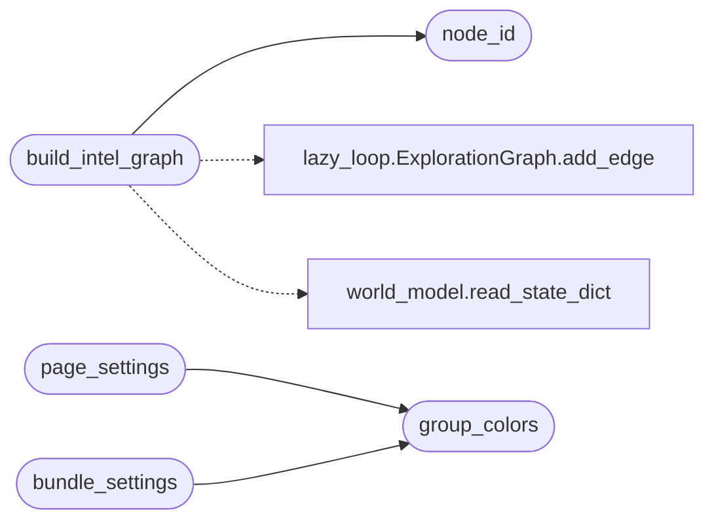

# `modules.intel_fusion`

> Source: [modules/intel_fusion.py:1](../../modules/intel_fusion.py#L1) | language `py` | coverage 100.0% | [API index](../index.md)

Sessions attack-intel fusion: data -> information -> intelligence.

Reads every campaign artefact under ``sessions/`` (world model, lazy loop
graphs, objectives, scans, event logs) and fuses them into ONE heterogeneous
graph centred on the LazyOwn C2: hosts, ports/services, findings, loop
tasks and objectives. Every node carries a deterministic id
(``sha1(kind:value)``) and every edge an ``evidence`` string naming the
source artefact, so each relation is traceable like a provenance-tracked
research graph.

Payload shape mirrors ReadMenator ``ForceGraphRenderer.build_payload`` so
``templates/intel.html`` (a clone of ReadMenator ``_forcegraph_page``) can
reuse the exact same engine, physics sizes, glyphs, colors, legend and
inspector: file nodes carry ``family``/``layer``/``language``/`[`rank`](modules.atomic_exploit_bridge.py.md#rank)`/
``doc``/``symbol_list``; community and layer hub nodes plus `[`member_of`](modules.kerberoasting.py.md#kerberoasttarget-member_of)` /
``layered_as`` structural edges are appended automatically.

## Contents

- **Functions:** [`node_id`](#node_id), [`build_intel_graph`](#build_intel_graph), [`group_colors`](#group_colors), [`page_settings`](#page_settings), [`build_analytics`](#build_analytics), [`build_bundle_payload`](#build_bundle_payload), [`bundle_settings`](#bundle_settings), [`assign_layout`](#assign_layout), [`write_summary`](#write_summary)
- **Constants:** [`NODE_COLORS`](#node_colors), [`EDGE_COLORS`](#edge_colors)

## Call Graph

Solid arrows stay in this module, dashed arrows leave it.



## Functions

<a id="node_id"></a>

### `node_id`

`function` | [modules/intel_fusion.py:173](../../modules/intel_fusion.py#L173)

```python
def node_id(kind: str, value: str) -> str
```

Deterministic node id from kind + normalized value.

**Parameters**

| Name | Type | Default | Description |
|---|---|---|---|
| `kind` | `str` |  |  |
| `value` | `str` |  |  |

**Returns:** `str`

*Called by:* [`build_intel_graph`](#build_intel_graph)

---

<a id="build_intel_graph"></a>

### `build_intel_graph`

`function` | [modules/intel_fusion.py:243](../../modules/intel_fusion.py#L243)

```python
def build_intel_graph(sessions_dir: str | Path = SESSIONS_DIR, est_cap: int = 300) -> dict
```

Fuse all session artefacts into one C2-centred intel graph.

**Parameters**

| Name | Type | Default | Description |
|---|---|---|---|
| `sessions_dir` | `str \| Path` | `SESSIONS_DIR` |  |
| `est_cap` | `int` | `300` |  |

**Returns:** `dict`

*Calls:* [`node_id`](#node_id), [`ExplorationGraph.add_edge`](modules.lazy_loop.py.md#explorationgraph-add_edge), [`read_state_dict`](modules.world_model.py.md#read_state_dict)

*Called by:* [`build_attack_graph`](modules.attack_surface3d.py.md#build_attack_graph), [`apply`](modules.sinks.intel_graph.py.md#apply)

---

<a id="group_colors"></a>

### `group_colors`

`function` | [modules/intel_fusion.py:692](../../modules/intel_fusion.py#L692)

```python
def group_colors(graph: dict) -> dict
```

Stable colors for layer/language groupings (ReadMenator contract).

**Parameters**

| Name | Type | Default | Description |
|---|---|---|---|
| `graph` | `dict` |  |  |

**Returns:** `dict`

*Called by:* [`bundle_settings`](#bundle_settings), [`page_settings`](#page_settings)

---

<a id="page_settings"></a>

### `page_settings`

`function` | [modules/intel_fusion.py:708](../../modules/intel_fusion.py#L708)

```python
def page_settings(graph: dict | None = None) -> dict
```

Explorer page settings with ReadMenator physics sizes (exact values).

**Parameters**

| Name | Type | Default | Description |
|---|---|---|---|
| `graph` | `dict \| None` | `None` |  |

**Returns:** `dict`

*Calls:* [`group_colors`](#group_colors)

---

<a id="build_analytics"></a>

### `build_analytics`

`function` | [modules/intel_fusion.py:765](../../modules/intel_fusion.py#L765)

```python
def build_analytics(graph: dict, summary: dict | None = None) -> dict
```

Side-panel analytics (attribution funnel + intel summary).

**Parameters**

| Name | Type | Default | Description |
|---|---|---|---|
| `graph` | `dict` |  |  |
| `summary` | `dict \| None` | `None` |  |

**Returns:** `dict`

---

<a id="build_bundle_payload"></a>

### `build_bundle_payload`

`function` | [modules/intel_fusion.py:852](../../modules/intel_fusion.py#L852)

```python
def build_bundle_payload(graph: dict) -> dict
```

Derive the circular/spherical bundle payload from a fused graph.

Communities keep size order (largest first); ``misc`` nodes form a
trailing unassigned group. Inside a group files are ordered by rank,
so hubs sit at the center of their arc and cap. Edges are distinct
directed file index pairs.

**Parameters**

| Name | Type | Default | Description |
|---|---|---|---|
| `graph` | `dict` |  |  |

**Returns:** `dict`

---

<a id="bundle_settings"></a>

### `bundle_settings`

`function` | [modules/intel_fusion.py:968](../../modules/intel_fusion.py#L968)

```python
def bundle_settings(graph: dict | None = None) -> dict
```

Bundle page settings with ReadMenator sizes (exact values).

**Parameters**

| Name | Type | Default | Description |
|---|---|---|---|
| `graph` | `dict \| None` | `None` |  |

**Returns:** `dict`

*Calls:* [`group_colors`](#group_colors)

---

<a id="assign_layout"></a>

### `assign_layout`

`function` | [modules/intel_fusion.py:999](../../modules/intel_fusion.py#L999)

```python
def assign_layout(graph: dict, mode: str = 'force') -> dict
```

Attach x/y/z for radial/spherical modes; force modes stay free.

Accepts ReadMenator layout names (`[`force`](cli.output_mode.py.md#outputmode-force)`, ``cluster``, ``radial``,
``dag``) plus legacy intel names (``force2d``, ``force3d``,
``circular``, ``spherical``). Force-family modes return without preset
positions so the client physics (charge -300, distance 120, 400 ticks
+ fit-to-view) places every graph on screen.

**Parameters**

| Name | Type | Default | Description |
|---|---|---|---|
| `graph` | `dict` |  |  |
| `mode` | `str` | `'force'` |  |

**Returns:** `dict`

---

<a id="write_summary"></a>

### `write_summary`

`function` | [modules/intel_fusion.py:1064](../../modules/intel_fusion.py#L1064)

```python
def write_summary(graph: dict, sessions_dir: str | Path = SESSIONS_DIR) -> dict
```

Score host exposure with a per-component breakdown.

Every point a host earns carries a label so the planner and the
operator can read why one host outranks another:

- connectivity: base 1 plus capped node degree;
- owned: the C2 controls the host;
- activity: recent log mentions;
- findings: severity and heat of attached findings (heat bonus hot
  +3, warm +1), capped at 20.

**Parameters**

| Name | Type | Default | Description |
|---|---|---|---|
| `graph` | `dict` |  | Intel graph from [`build_intel_graph`](#build_intel_graph). |
| `sessions_dir` | `str \| Path` | `SESSIONS_DIR` | Sessions directory for ``intel_summary.json``. |

**Returns:** `dict` - Summary dict; ``top_exposed`` rows gain ``score_detail``.

*Called by:* [`refresh_summary`](modules.attack_surface3d.py.md#refresh_summary), [`apply`](modules.sinks.intel_graph.py.md#apply)

---

## Constants

<a id="node_colors"></a>

### `NODE_COLORS`

`constant` | [modules/intel_fusion.py:32](../../modules/intel_fusion.py#L32)

```python
NODE_COLORS
```

---

<a id="edge_colors"></a>

### `EDGE_COLORS`

`constant` | [modules/intel_fusion.py:45](../../modules/intel_fusion.py#L45)

```python
EDGE_COLORS
```

---
