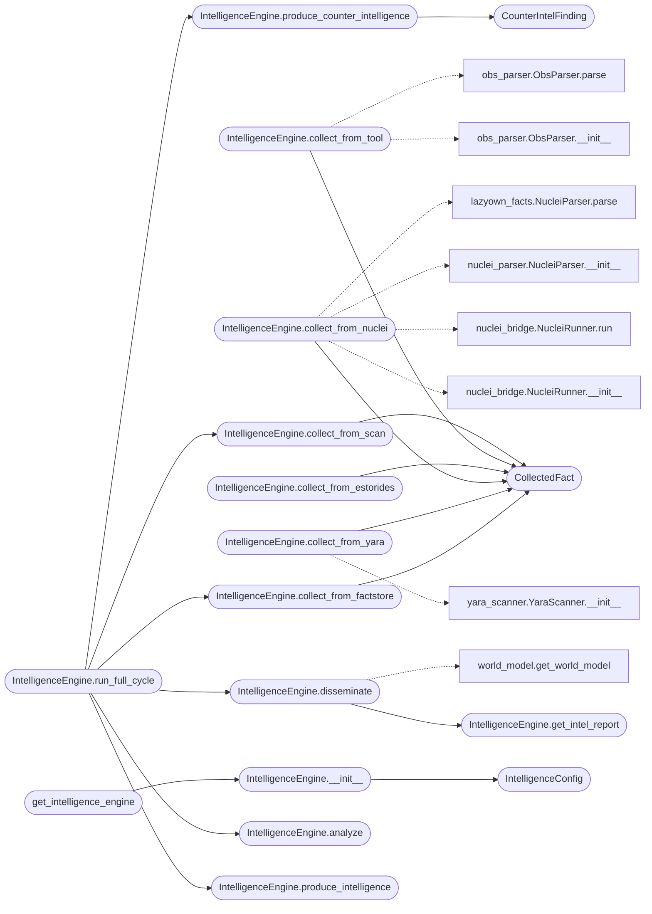

# `modules.intelligence_engine`

> Source: [modules/intelligence_engine.py:1](../../modules/intelligence_engine.py#L1) | language `py` | coverage 95.0% | [API index](../index.md)

IntelligenceEngine — unified collection→analysis→intelligence pipeline.

Transforms raw data from nmap, tool output, EStorides, Nuclei, YARA, and
the FactStore into graded intelligence that feeds the WorldModel and produces
actionable recommendations. Closes the gap between data collection and
operational decision-making.

Architecture
============
    Collection        →   Analysis          →   Intelligence
    (nmap, obs,       →   (correlate,       →   (grade, map to
     estorides,          rank, link)            MITRE, recommend)
     nuclei, yara,
     freedom, facts)

    CounterIntelligence                   Dissemination
    (exposure, detection, evasion)   →    (world model, killchain, MISP)

Design
======
- Single Responsibility : one file, one contract, one engine
- Config class owns all thresholds and paths — zero magic numbers
- Collection adapters are injected, not hardcoded
- WorldModel is written to directly via get_world_model()
- Thread-safe via the WorldModel's RLock

Usage
=====
    from modules.intelligence_engine import IntelligenceEngine

    engine = IntelligenceEngine()
    engine.collect_from_scan(target="10.10.11.78")
    engine.analyze()
    engine.produce_intelligence()
    engine.disseminate()

## Contents

- **Classes:** [`IntelligenceConfig`](#intelligenceconfig), [`CollectedFact`](#collectedfact), [`IntelligenceAssessment`](#intelligenceassessment), [`CounterIntelFinding`](#counterintelfinding), [`IntelligenceEngine`](#intelligenceengine)
- **Functions:** [`get_intelligence_engine`](#get_intelligence_engine)

## Type Diagram

```mermaid
classDiagram
    direction LR
    class IntelligenceConfig
    IntelligenceConfig : Path sessions_dir
    IntelligenceConfig : Path parquets_dir
    IntelligenceConfig : float confidence_floor
    IntelligenceConfig : float confidence_ceiling
    IntelligenceConfig : int min_corroboration_sources
    IntelligenceConfig : int max_recommendations
    IntelligenceConfig : bool auto_collect_on_scan
    IntelligenceConfig : bool auto_collect_on_tool_output
    IntelligenceConfig : bool auto_disseminate
    IntelligenceConfig : str intel_report_path
    IntelligenceConfig : tuple[str, ] placeholder_tokens
    class CollectedFact
    CollectedFact : str source
    CollectedFact : str fact_type
    CollectedFact : str value
    CollectedFact : str host
    CollectedFact : int port
    CollectedFact : float confidence
    CollectedFact : str raw
    CollectedFact : dict[str, Any] metadata
    CollectedFact : str collected_at
    class IntelligenceAssessment
    IntelligenceAssessment : str subject
    IntelligenceAssessment : str category
    IntelligenceAssessment : float confidence
    IntelligenceAssessment : str severity
    IntelligenceAssessment : str mitre_technique
    IntelligenceAssessment : list[str] source_facts
    IntelligenceAssessment : str recommendation
    IntelligenceAssessment : str impact
    IntelligenceAssessment : str created_at
    class CounterIntelFinding
    CounterIntelFinding : str finding_type
    CounterIntelFinding : str description
    CounterIntelFinding : str severity
    CounterIntelFinding : str host
    CounterIntelFinding : list[str] detectable_by
    CounterIntelFinding : str mitigation
    class IntelligenceEngine
    IntelligenceEngine : __init__()
    IntelligenceEngine : collect_from_scan()
    IntelligenceEngine : collect_from_tool()
    IntelligenceEngine : collect_from_estorides()
    IntelligenceEngine : collect_from_nuclei()
    IntelligenceEngine : collect_from_yara()
    IntelligenceEngine : collect_from_factstore()
    IntelligenceEngine : analyze()
    IntelligenceEngine : produce_intelligence()
    IntelligenceEngine : produce_counter_intelligence()
    IntelligenceEngine : disseminate()
    IntelligenceEngine : run_full_cycle()
    IntelligenceEngine : get_intel_report()
```



## Call Graph

Solid arrows stay in this module, dashed arrows leave it.



## Classes

<a id="intelligenceconfig"></a>

### `IntelligenceConfig`

`class` `dataclass` | [modules/intelligence_engine.py:57](../../modules/intelligence_engine.py#L57)

Decorators: `@dataclass(frozen=True)`

```python
class IntelligenceConfig
```

Centralized configuration for the intelligence pipeline.

**Attributes**

| Name | Type | Default | Description |
|---|---|---|---|
| [`sessions_dir`](#intelligenceconfig-sessions_dir) | `Path` | `_SESSIONS_DIR` |  |
| [`parquets_dir`](#intelligenceconfig-parquets_dir) | `Path` | `_PARQUETS_DIR` |  |
| [`confidence_floor`](#intelligenceconfig-confidence_floor) | `float` | `0.3` |  |
| [`confidence_ceiling`](#intelligenceconfig-confidence_ceiling) | `float` | `1.0` |  |
| [`min_corroboration_sources`](#intelligenceconfig-min_corroboration_sources) | `int` | `2` |  |
| [`max_recommendations`](#intelligenceconfig-max_recommendations) | `int` | `5` |  |
| [`auto_collect_on_scan`](#intelligenceconfig-auto_collect_on_scan) | `bool` | `True` |  |
| [`auto_collect_on_tool_output`](#intelligenceconfig-auto_collect_on_tool_output) | `bool` | `True` |  |
| [`auto_disseminate`](#intelligenceconfig-auto_disseminate) | `bool` | `True` |  |
| [`intel_report_path`](#intelligenceconfig-intel_report_path) | `str` | `'sessions/intel_report.json'` |  |
| [`placeholder_tokens`](#intelligenceconfig-placeholder_tokens) | `tuple[str, ...]` | `('CHANGE_ME', 'CHANGEME', 'YOUR_API_KEY_HERE')` |  |

---

<a id="collectedfact"></a>

### `CollectedFact`

`class` `dataclass` | [modules/intelligence_engine.py:78](../../modules/intelligence_engine.py#L78)

Decorators: `@dataclass`

```python
class CollectedFact
```

A single piece of raw data collected from any source.

**Attributes**

| Name | Type | Default | Description |
|---|---|---|---|
| [`source`](#collectedfact-source) | `str` |  |  |
| [`fact_type`](#collectedfact-fact_type) | `str` |  |  |
| [`value`](#collectedfact-value) | `str` |  |  |
| [`host`](#collectedfact-host) | `str` | `''` |  |
| [`port`](#collectedfact-port) | `int` | `0` |  |
| [`confidence`](#collectedfact-confidence) | `float` | `0.5` |  |
| [`raw`](#collectedfact-raw) | `str` | `''` |  |
| [`metadata`](#collectedfact-metadata) | `dict[str, Any]` | `field(default_factory=dict)` |  |
| [`collected_at`](#collectedfact-collected_at) | `str` | `field(default_factory=lambda: datetime.now().isoformat())` |  |

---

<a id="intelligenceassessment"></a>

### `IntelligenceAssessment`

`class` `dataclass` | [modules/intelligence_engine.py:93](../../modules/intelligence_engine.py#L93)

Decorators: `@dataclass`

```python
class IntelligenceAssessment
```

Graded intelligence produced from correlated facts.

**Attributes**

| Name | Type | Default | Description |
|---|---|---|---|
| [`subject`](#intelligenceassessment-subject) | `str` |  |  |
| [`category`](#intelligenceassessment-category) | `str` |  |  |
| [`confidence`](#intelligenceassessment-confidence) | `float` |  |  |
| [`severity`](#intelligenceassessment-severity) | `str` | `'MEDIUM'` |  |
| [`mitre_technique`](#intelligenceassessment-mitre_technique) | `str` | `''` |  |
| [`source_facts`](#intelligenceassessment-source_facts) | `list[str]` | `field(default_factory=list)` |  |
| [`recommendation`](#intelligenceassessment-recommendation) | `str` | `''` |  |
| [`impact`](#intelligenceassessment-impact) | `str` | `''` |  |
| [`created_at`](#intelligenceassessment-created_at) | `str` | `field(default_factory=lambda: datetime.now().isoformat())` |  |

---

<a id="counterintelfinding"></a>

### `CounterIntelFinding`

`class` `dataclass` | [modules/intelligence_engine.py:108](../../modules/intelligence_engine.py#L108)

Decorators: `@dataclass`

```python
class CounterIntelFinding
```

What we exposed, what detected us, how to evade.

**Attributes**

| Name | Type | Default | Description |
|---|---|---|---|
| [`finding_type`](#counterintelfinding-finding_type) | `str` |  |  |
| [`description`](#counterintelfinding-description) | `str` |  |  |
| [`severity`](#counterintelfinding-severity) | `str` | `'LOW'` |  |
| [`host`](#counterintelfinding-host) | `str` | `''` |  |
| [`detectable_by`](#counterintelfinding-detectable_by) | `list[str]` | `field(default_factory=list)` |  |
| [`mitigation`](#counterintelfinding-mitigation) | `str` | `''` |  |

---

<a id="intelligenceengine"></a>

### `IntelligenceEngine`

`class` | [modules/intelligence_engine.py:119](../../modules/intelligence_engine.py#L119)

```python
class IntelligenceEngine
```

Unified intelligence pipeline for the LazyOwn framework.

Collects raw data from all available sources, analyzes correlations,
produces graded intelligence with MITRE mappings, assesses counter-
intelligence exposure, and disseminates structured results to the
WorldModel and killchain.

Public API:
    collect_from_scan(target)      — parse nmap XML into facts
    collect_from_tool(output, ...) — parse tool output via ObsParser
    collect_from_estorides(target) — run estorides OSINT aggregator
    collect_from_nuclei(target)    — run nuclei vulnerability scan
    collect_from_yara(path)        — scan with YARA rules
    collect_from_factstore()       — ingest policy_facts.json
    analyze()                      — correlate and rank findings
    produce_intelligence()         — grade and map to MITRE
    produce_counter_intelligence() — assess exposure
    disseminate()                  — update WorldModel + killchain
    run_full_cycle(target)         — collect → analyze → intel → disseminate
    get_intel_report()             — structured JSON report

**Members**

| Member | Kind | Summary |
|---|---|---|
| [`__init__`](#intelligenceengine-__init__) | constructor |  |
| [`collect_from_scan`](#intelligenceengine-collect_from_scan) | method | Parse nmap XML into structured facts. |
| [`collect_from_tool`](#intelligenceengine-collect_from_tool) | method | Parse tool output into structured facts using ObsParser. |
| [`collect_from_estorides`](#intelligenceengine-collect_from_estorides) | method | Run estorides OSINT aggregator and collect findings. |
| [`collect_from_nuclei`](#intelligenceengine-collect_from_nuclei) | method | Run nuclei vulnerability scanner and collect findings. |
| [`collect_from_yara`](#intelligenceengine-collect_from_yara) | method | Scan with YARA rules and collect IOC matches. |
| [`collect_from_factstore`](#intelligenceengine-collect_from_factstore) | method | Ingest structured facts from FactStore policy_facts.json. |
| [`analyze`](#intelligenceengine-analyze) | method | Correlate collected facts into structured intelligence. |
| [`produce_intelligence`](#intelligenceengine-produce_intelligence) | method | Grade and enrich intelligence assessments with MITRE mappings. |
| [`produce_counter_intelligence`](#intelligenceengine-produce_counter_intelligence) | method | Assess what we exposed and what can detect us. |
| [`disseminate`](#intelligenceengine-disseminate) | method | Write intelligence to WorldModel, killchain, and report file. |
| [`run_full_cycle`](#intelligenceengine-run_full_cycle) | method | Execute the complete intelligence cycle for a target. |
| [`get_intel_report`](#intelligenceengine-get_intel_report) | method | Produce a structured JSON intelligence report. |

<a id="intelligenceengine-__init__"></a>

#### `IntelligenceEngine.__init__`

`constructor` | [modules/intelligence_engine.py:142](../../modules/intelligence_engine.py#L142)

```python
def __init__(self, config: IntelligenceConfig | None = None) -> None
```

**Parameters**

| Name | Type | Default | Description |
|---|---|---|---|
| `config` | `IntelligenceConfig \| None` | `None` |  |

*Calls:* [`IntelligenceConfig`](#intelligenceconfig)

*Called by:* [`get_intelligence_engine`](#get_intelligence_engine)

<a id="intelligenceengine-collect_from_scan"></a>

#### `IntelligenceEngine.collect_from_scan`

`method` | [modules/intelligence_engine.py:153](../../modules/intelligence_engine.py#L153)

```python
def collect_from_scan(self, target: str) -> list[CollectedFact]
```

Parse nmap XML into structured facts.

**Parameters**

| Name | Type | Default | Description |
|---|---|---|---|
| `target` | `str` |  | Target IP or hostname. |

**Returns:** `list[CollectedFact]` - List of collected facts.

*Calls:* [`CollectedFact`](#collectedfact)

*Called by:* [`IntelligenceEngine.run_full_cycle`](#intelligenceengine-run_full_cycle)

<a id="intelligenceengine-collect_from_tool"></a>

#### `IntelligenceEngine.collect_from_tool`

`method` | [modules/intelligence_engine.py:255](../../modules/intelligence_engine.py#L255)

```python
def collect_from_tool(self, output: str, tool: str, host: str = '') -> list[CollectedFact]
```

Parse tool output into structured facts using ObsParser.

**Parameters**

| Name | Type | Default | Description |
|---|---|---|---|
| `output` | `str` |  | Raw tool output text. |
| `tool` | `str` |  | Tool name that produced the output. |
| `host` | `str` | `''` | Target host. |

**Returns:** `list[CollectedFact]` - List of collected facts.

*Calls:* [`CollectedFact`](#collectedfact), [`ObsParser.__init__`](modules.obs_parser.py.md#obsparser-__init__), [`ObsParser.parse`](modules.obs_parser.py.md#obsparser-parse)

<a id="intelligenceengine-collect_from_estorides"></a>

#### `IntelligenceEngine.collect_from_estorides`

`method` | [modules/intelligence_engine.py:292](../../modules/intelligence_engine.py#L292)

```python
def collect_from_estorides(self, target: str) -> list[CollectedFact]
```

Run estorides OSINT aggregator and collect findings.

**Parameters**

| Name | Type | Default | Description |
|---|---|---|---|
| `target` | `str` |  | Domain or IP to investigate. |

**Returns:** `list[CollectedFact]` - List of collected OSINT facts.

*Calls:* [`CollectedFact`](#collectedfact)

<a id="intelligenceengine-collect_from_nuclei"></a>

#### `IntelligenceEngine.collect_from_nuclei`

`method` | [modules/intelligence_engine.py:334](../../modules/intelligence_engine.py#L334)

```python
def collect_from_nuclei(self, target: str) -> list[CollectedFact]
```

Run nuclei vulnerability scanner and collect findings.

**Parameters**

| Name | Type | Default | Description |
|---|---|---|---|
| `target` | `str` |  | Target URL or host. |

**Returns:** `list[CollectedFact]` - List of collected vulnerability facts.

*Calls:* [`NucleiRunner.__init__`](modules.integrations.nuclei_bridge.py.md#nucleirunner-__init__), [`NucleiRunner.run`](modules.integrations.nuclei_bridge.py.md#nucleirunner-run), [`NucleiParser.__init__`](modules.integrations.nuclei_parser.py.md#nucleiparser-__init__), [`CollectedFact`](#collectedfact), [`NucleiParser.parse`](skills.lazyown_facts.py.md#nucleiparser-parse)

<a id="intelligenceengine-collect_from_yara"></a>

#### `IntelligenceEngine.collect_from_yara`

`method` | [modules/intelligence_engine.py:376](../../modules/intelligence_engine.py#L376)

```python
def collect_from_yara(self, target_path: str) -> list[CollectedFact]
```

Scan with YARA rules and collect IOC matches.

**Parameters**

| Name | Type | Default | Description |
|---|---|---|---|
| `target_path` | `str` |  | File or directory to scan. |

**Returns:** `list[CollectedFact]` - List of collected IOC facts.

*Calls:* [`CollectedFact`](#collectedfact), [`YaraScanner.__init__`](modules.yara_scanner.py.md#yarascanner-__init__)

<a id="intelligenceengine-collect_from_factstore"></a>

#### `IntelligenceEngine.collect_from_factstore`

`method` | [modules/intelligence_engine.py:415](../../modules/intelligence_engine.py#L415)

```python
def collect_from_factstore(self) -> list[CollectedFact]
```

Ingest structured facts from FactStore policy_facts.json.

**Returns:** `list[CollectedFact]` - List of collected facts.

*Calls:* [`CollectedFact`](#collectedfact)

*Called by:* [`IntelligenceEngine.run_full_cycle`](#intelligenceengine-run_full_cycle)

<a id="intelligenceengine-analyze"></a>

#### `IntelligenceEngine.analyze`

`method` | [modules/intelligence_engine.py:477](../../modules/intelligence_engine.py#L477)

```python
def analyze(self) -> list[IntelligenceAssessment]
```

Correlate collected facts into structured intelligence.

Links services to known vulnerabilities, credentials to hosts,
domains to infrastructure, and ranks targets by value.

**Returns:** `list[IntelligenceAssessment]` - List of intelligence assessments.

*Called by:* [`IntelligenceEngine.run_full_cycle`](#intelligenceengine-run_full_cycle)

<a id="intelligenceengine-produce_intelligence"></a>

#### `IntelligenceEngine.produce_intelligence`

`method` | [modules/intelligence_engine.py:685](../../modules/intelligence_engine.py#L685)

```python
def produce_intelligence(self) -> list[IntelligenceAssessment]
```

Grade and enrich intelligence assessments with MITRE mappings.

**Returns:** `list[IntelligenceAssessment]` - Graded intelligence assessments.

*Called by:* [`IntelligenceEngine.run_full_cycle`](#intelligenceengine-run_full_cycle)

<a id="intelligenceengine-produce_counter_intelligence"></a>

#### `IntelligenceEngine.produce_counter_intelligence`

`method` | [modules/intelligence_engine.py:715](../../modules/intelligence_engine.py#L715)

```python
def produce_counter_intelligence(self) -> list[CounterIntelFinding]
```

Assess what we exposed and what can detect us.

**Returns:** `list[CounterIntelFinding]` - Counter-intelligence findings.

*Calls:* [`CounterIntelFinding`](#counterintelfinding)

*Called by:* [`IntelligenceEngine.run_full_cycle`](#intelligenceengine-run_full_cycle)

<a id="intelligenceengine-disseminate"></a>

#### `IntelligenceEngine.disseminate`

`method` | [modules/intelligence_engine.py:765](../../modules/intelligence_engine.py#L765)

```python
def disseminate(self) -> dict[str, Any]
```

Write intelligence to WorldModel, killchain, and report file.

**Returns:** `dict[str, Any]` - Dissemination summary.

*Calls:* [`IntelligenceEngine.get_intel_report`](#intelligenceengine-get_intel_report), [`get_world_model`](modules.world_model.py.md#get_world_model)

*Called by:* [`IntelligenceEngine.run_full_cycle`](#intelligenceengine-run_full_cycle)

<a id="intelligenceengine-run_full_cycle"></a>

#### `IntelligenceEngine.run_full_cycle`

`method` | [modules/intelligence_engine.py:845](../../modules/intelligence_engine.py#L845)

```python
def run_full_cycle(self, target: str) -> dict[str, Any]
```

Execute the complete intelligence cycle for a target.

Collects from all available sources, analyzes correlations, produces
graded intelligence, assesses counter-intelligence exposure, and
disseminates structured results to the WorldModel.

**Parameters**

| Name | Type | Default | Description |
|---|---|---|---|
| `target` | `str` |  | Target IP or hostname. |

**Returns:** `dict[str, Any]` - Full cycle summary with counts and warnings.

*Calls:* [`IntelligenceEngine.analyze`](#intelligenceengine-analyze), [`IntelligenceEngine.collect_from_factstore`](#intelligenceengine-collect_from_factstore), [`IntelligenceEngine.collect_from_scan`](#intelligenceengine-collect_from_scan), [`IntelligenceEngine.disseminate`](#intelligenceengine-disseminate), [`IntelligenceEngine.produce_counter_intelligence`](#intelligenceengine-produce_counter_intelligence), [`IntelligenceEngine.produce_intelligence`](#intelligenceengine-produce_intelligence)

<a id="intelligenceengine-get_intel_report"></a>

#### `IntelligenceEngine.get_intel_report`

`method` | [modules/intelligence_engine.py:874](../../modules/intelligence_engine.py#L874)

```python
def get_intel_report(self) -> dict[str, Any]
```

Produce a structured JSON intelligence report.

**Returns:** `dict[str, Any]` - Dict with facts, assessments, counter-intel, and warnings.

*Called by:* [`IntelligenceEngine.disseminate`](#intelligenceengine-disseminate)

---

## Functions

<a id="get_intelligence_engine"></a>

### `get_intelligence_engine`

`function` | [modules/intelligence_engine.py:931](../../modules/intelligence_engine.py#L931)

```python
def get_intelligence_engine(config: IntelligenceConfig | None = None) -> IntelligenceEngine
```

Return the module-level singleton IntelligenceEngine.

**Parameters**

| Name | Type | Default | Description |
|---|---|---|---|
| `config` | `IntelligenceConfig \| None` | `None` |  |

**Returns:** `IntelligenceEngine`

*Calls:* [`IntelligenceEngine.__init__`](#intelligenceengine-__init__)

*Called by:* [`McpBridgeCommandSet.do_auto_populate`](cli.commands.mcp_bridge.py.md#mcpbridgecommandset-do_auto_populate), [`ReconCommandSet.do_lazynmap`](cli.commands.recon.py.md#reconcommandset-do_lazynmap)

---
