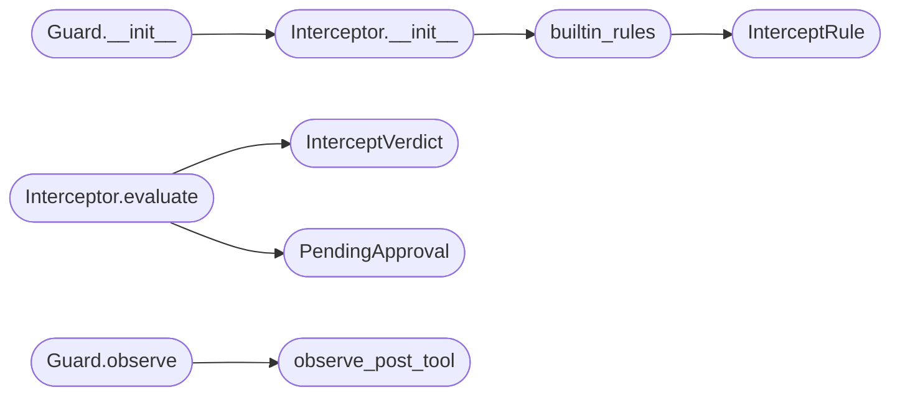

# `modules.intercept`

> Source: [modules/intercept.py:1](../../modules/intercept.py#L1) | language `py` | coverage 100.0% | [API index](../index.md)

User-configurable tool-call interception layer with human-in-loop approvals.

Ports the LAZY ``guard`` + ``intercept`` contracts to LazyOwn idioms:
every autonomous tool call passes through [`Interceptor.evaluate`](#interceptor-evaluate)
before execution. Three actions are supported: allow, deny, ask.
Ask creates a pending record that an operator approves or denies,
optionally with a timeout that resolves to a safe default.

## Contents

- **Classes:** [`InterceptConfig`](#interceptconfig), [`InterceptRule`](#interceptrule), [`PendingApproval`](#pendingapproval), [`InterceptVerdict`](#interceptverdict), [`Interceptor`](#interceptor), [`Guard`](#guard)
- **Enums:** [`InterceptAction`](#interceptaction)
- **Functions:** [`builtin_rules`](#builtin_rules), [`scope_blocked`](#scope_blocked), [`observe_post_tool`](#observe_post_tool)
- **Constants:** [`ALLOWED_ACTIONS`](#allowed_actions), [`CONFIG`](#config), [`DEFAULT_ASK_TIMEOUT_SEC`](#default_ask_timeout_sec), [`DEFAULT_DENY_MESSAGE`](#default_deny_message), [`DEFAULT_ASK_MESSAGE`](#default_ask_message), [`GLOBAL_SCOPE_DENY`](#global_scope_deny)

## Type Diagram

```mermaid
classDiagram
    direction LR
    class InterceptAction
    <<enum>> InterceptAction
    InterceptAction : ALLOW
    InterceptAction : DENY
    InterceptAction : ASK
    class InterceptConfig
    InterceptConfig : float ask_timeout_sec
    InterceptConfig : str deny_message
    InterceptConfig : str ask_message
    InterceptConfig : int audit_limit
    class InterceptRule
    InterceptRule : str pattern
    InterceptRule : str action
    InterceptRule : int priority
    InterceptRule : str message
    InterceptRule : bool is_regex
    InterceptRule : bool builtin
    InterceptRule : __post_init__()
    InterceptRule : matches()
    class PendingApproval
    PendingApproval : str approval_id
    PendingApproval : str tool
    PendingApproval : str command
    PendingApproval : str rule_pattern
    PendingApproval : float created_at
    PendingApproval : float timeout_sec
    PendingApproval : str status
    PendingApproval : str decision
    PendingApproval : float  None decided_at
    class InterceptVerdict
    InterceptVerdict : str action
    InterceptVerdict : str message
    InterceptVerdict : str approval_id
    InterceptVerdict : str rule_pattern
    class Interceptor
    Interceptor : __init__()
    Interceptor : rules()
    Interceptor : add_rule()
    Interceptor : remove_rule()
    Interceptor : evaluate()
    Interceptor : decide()
    Interceptor : pending_approvals()
    Interceptor : approval_status()
    class Guard
    Guard : __init__()
    Guard : interceptor()
    Guard : check()
    Guard : observe()
    Guard : record_failure()
    Guard : audit_log()
    Guard : attribution()
```



## Call Graph

Solid arrows stay in this module, dashed arrows leave it.



## Classes

<a id="interceptconfig"></a>

### `InterceptConfig`

`class` `dataclass` | [modules/intercept.py:33](../../modules/intercept.py#L33)

Decorators: `@dataclass(frozen=True, slots=True)`

```python
class InterceptConfig
```

Centralized constants for interception behavior.

**Attributes**

| Name | Type | Default | Description |
|---|---|---|---|
| [`ask_timeout_sec`](#interceptconfig-ask_timeout_sec) | `float` | `300.0` |  |
| [`deny_message`](#interceptconfig-deny_message) | `str` | `'Blocked by intercept rule.'` |  |
| [`ask_message`](#interceptconfig-ask_message) | `str` | `'Waiting for operator approval.'` |  |
| [`audit_limit`](#interceptconfig-audit_limit) | `int` | `200` |  |

---

<a id="interceptrule"></a>

### `InterceptRule`

`class` `dataclass` | [modules/intercept.py:50](../../modules/intercept.py#L50)

Decorators: `@dataclass`

```python
class InterceptRule
```

Single user-configurable interception rule.

**Attributes**

| Name | Type | Default | Description |
|---|---|---|---|
| [`pattern`](#interceptrule-pattern) | `str` |  |  |
| [`action`](#interceptrule-action) | `str` |  |  |
| [`priority`](#interceptrule-priority) | `int` | `0` |  |
| [`message`](#interceptrule-message) | `str` | `''` |  |
| [`is_regex`](#interceptrule-is_regex) | `bool` | `False` |  |
| [`builtin`](#interceptrule-builtin) | `bool` | `False` |  |

**Members**

| Member | Kind | Summary |
|---|---|---|
| [`__post_init__`](#interceptrule-__post_init__) | method | Validate action and pre-compile regex patterns. |
| [`matches`](#interceptrule-matches) | method | Return True when this rule matches the tool call surface. |

<a id="interceptrule-__post_init__"></a>

#### `InterceptRule.__post_init__`

`method` | [modules/intercept.py:61](../../modules/intercept.py#L61)

```python
def __post_init__(self) -> None
```

Validate action and pre-compile regex patterns.

**Raises**

- `ValueError`: (raised in the body, not documented)

<a id="interceptrule-matches"></a>

#### `InterceptRule.matches`

`method` | [modules/intercept.py:68](../../modules/intercept.py#L68)

```python
def matches(self, tool: str, command: str) -> bool
```

Return True when this rule matches the tool call surface.

**Parameters**

| Name | Type | Default | Description |
|---|---|---|---|
| `tool` | `str` |  |  |
| `command` | `str` |  |  |

**Returns:** `bool`

---

<a id="pendingapproval"></a>

### `PendingApproval`

`class` `dataclass` | [modules/intercept.py:77](../../modules/intercept.py#L77)

Decorators: `@dataclass`

```python
class PendingApproval
```

Pending human-in-loop approval request.

**Attributes**

| Name | Type | Default | Description |
|---|---|---|---|
| [`approval_id`](#pendingapproval-approval_id) | `str` |  |  |
| [`tool`](#pendingapproval-tool) | `str` |  |  |
| [`command`](#pendingapproval-command) | `str` |  |  |
| [`rule_pattern`](#pendingapproval-rule_pattern) | `str` |  |  |
| [`created_at`](#pendingapproval-created_at) | `float` |  |  |
| [`timeout_sec`](#pendingapproval-timeout_sec) | `float` |  |  |
| [`status`](#pendingapproval-status) | `str` | `'pending'` |  |
| [`decision`](#pendingapproval-decision) | `str` | `''` |  |
| [`decided_at`](#pendingapproval-decided_at) | `float \| None` | `None` |  |

---

<a id="interceptverdict"></a>

### `InterceptVerdict`

`class` `dataclass` | [modules/intercept.py:92](../../modules/intercept.py#L92)

Decorators: `@dataclass`

```python
class InterceptVerdict
```

Result of evaluating a tool call.

**Attributes**

| Name | Type | Default | Description |
|---|---|---|---|
| [`action`](#interceptverdict-action) | `str` |  |  |
| [`message`](#interceptverdict-message) | `str` | `''` |  |
| [`approval_id`](#interceptverdict-approval_id) | `str` | `''` |  |
| [`rule_pattern`](#interceptverdict-rule_pattern) | `str` | `''` |  |

---

<a id="interceptor"></a>

### `Interceptor`

`class` | [modules/intercept.py:154](../../modules/intercept.py#L154)

```python
class Interceptor
```

Evaluate tool calls against prioritized user rules.

**Members**

| Member | Kind | Summary |
|---|---|---|
| [`__init__`](#interceptor-__init__) | constructor | Initialize with rules sorted by descending priority. |
| [`rules`](#interceptor-rules) | property | Return a copy of the active rule list. |
| [`add_rule`](#interceptor-add_rule) | method | Add a rule and keep priority ordering. |
| [`remove_rule`](#interceptor-remove_rule) | method | Remove the first rule matching pattern text. |
| [`evaluate`](#interceptor-evaluate) | method | Evaluate a tool call and return the verdict. |
| [`decide`](#interceptor-decide) | method | Resolve a pending approval with approve or deny. |
| [`pending_approvals`](#interceptor-pending_approvals) | method | List unresolved approvals, expiring timed-out ones per policy. |
| [`approval_status`](#interceptor-approval_status) | method | Fetch a single approval record by id. |

<a id="interceptor-__init__"></a>

#### `Interceptor.__init__`

`constructor` | [modules/intercept.py:157](../../modules/intercept.py#L157)

```python
def __init__(self, rules: list[InterceptRule] | None = None, ask_timeout_sec: float = DEFAULT_ASK_TIMEOUT_SEC, timeout_action: str = 'deny') -> None
```

Initialize with rules sorted by descending priority.

**Parameters**

| Name | Type | Default | Description |
|---|---|---|---|
| `rules` | `list[InterceptRule] \| None` | `None` |  |
| `ask_timeout_sec` | `float` | `DEFAULT_ASK_TIMEOUT_SEC` |  |
| `timeout_action` | `str` | `'deny'` |  |

**Raises**

- `ValueError`: (raised in the body, not documented)

*Calls:* [`builtin_rules`](#builtin_rules)

*Called by:* [`Guard.__init__`](#guard-__init__)

<a id="interceptor-rules"></a>

#### `Interceptor.rules`

`property` | [modules/intercept.py:172](../../modules/intercept.py#L172)

Decorators: `@property`

```python
def rules(self) -> list[InterceptRule]
```

Return a copy of the active rule list.

**Returns:** `list[InterceptRule]`

<a id="interceptor-add_rule"></a>

#### `Interceptor.add_rule`

`method` | [modules/intercept.py:177](../../modules/intercept.py#L177)

```python
def add_rule(self, rule: InterceptRule) -> None
```

Add a rule and keep priority ordering.

**Parameters**

| Name | Type | Default | Description |
|---|---|---|---|
| `rule` | `InterceptRule` |  |  |

<a id="interceptor-remove_rule"></a>

#### `Interceptor.remove_rule`

`method` | [modules/intercept.py:183](../../modules/intercept.py#L183)

```python
def remove_rule(self, pattern: str) -> bool
```

Remove the first rule matching pattern text.

**Parameters**

| Name | Type | Default | Description |
|---|---|---|---|
| `pattern` | `str` |  |  |

**Returns:** `bool`

<a id="interceptor-evaluate"></a>

#### `Interceptor.evaluate`

`method` | [modules/intercept.py:192](../../modules/intercept.py#L192)

```python
def evaluate(self, tool: str, command: str = '') -> InterceptVerdict
```

Evaluate a tool call and return the verdict.

**Parameters**

| Name | Type | Default | Description |
|---|---|---|---|
| `tool` | `str` |  |  |
| `command` | `str` | `''` |  |

**Returns:** `InterceptVerdict`

*Calls:* [`InterceptVerdict`](#interceptverdict), [`PendingApproval`](#pendingapproval)

<a id="interceptor-decide"></a>

#### `Interceptor.decide`

`method` | [modules/intercept.py:220](../../modules/intercept.py#L220)

```python
def decide(self, approval_id: str, decision: str) -> bool
```

Resolve a pending approval with approve or deny.

**Parameters**

| Name | Type | Default | Description |
|---|---|---|---|
| `approval_id` | `str` |  |  |
| `decision` | `str` |  |  |

**Returns:** `bool`

**Raises**

- `ValueError`: (raised in the body, not documented)

<a id="interceptor-pending_approvals"></a>

#### `Interceptor.pending_approvals`

`method` | [modules/intercept.py:234](../../modules/intercept.py#L234)

```python
def pending_approvals(self) -> list[PendingApproval]
```

List unresolved approvals, expiring timed-out ones per policy.

**Returns:** `list[PendingApproval]`

<a id="interceptor-approval_status"></a>

#### `Interceptor.approval_status`

`method` | [modules/intercept.py:249](../../modules/intercept.py#L249)

```python
def approval_status(self, approval_id: str) -> PendingApproval | None
```

Fetch a single approval record by id.

**Parameters**

| Name | Type | Default | Description |
|---|---|---|---|
| `approval_id` | `str` |  |  |

**Returns:** `PendingApproval | None`

---

<a id="guard"></a>

### `Guard`

`class` | [modules/intercept.py:255](../../modules/intercept.py#L255)

```python
class Guard
```

Audit every gated tool call and attribute failures.

**Members**

| Member | Kind | Summary |
|---|---|---|
| [`__init__`](#guard-__init__) | constructor | Initialize audit log with an optional interceptor. |
| [`interceptor`](#guard-interceptor) | property | Expose the underlying interceptor. |
| [`check`](#guard-check) | method | Audit the call then evaluate intercept rules (trace id kept). |
| [`observe`](#guard-observe) | method | Classify output and attribute blocked/error counters. |
| [`record_failure`](#guard-record_failure) | method | Attribute a post-execution failure to a source. |
| [`audit_log`](#guard-audit_log) | method | Return the most recent audit entries. |
| [`attribution`](#guard-attribution) | method | Return failure attribution counters. |

<a id="guard-__init__"></a>

#### `Guard.__init__`

`constructor` | [modules/intercept.py:258](../../modules/intercept.py#L258)

```python
def __init__(self, interceptor: Interceptor | None = None) -> None
```

Initialize audit log with an optional interceptor.

**Parameters**

| Name | Type | Default | Description |
|---|---|---|---|
| `interceptor` | `Interceptor \| None` | `None` |  |

*Calls:* [`Interceptor.__init__`](#interceptor-__init__)

*Called by:* [`DaemonControlCommandSet.do_gatecheck`](cli.commands.daemon_ctl.py.md#daemoncontrolcommandset-do_gatecheck)

<a id="guard-interceptor"></a>

#### `Guard.interceptor`

`property` | [modules/intercept.py:266](../../modules/intercept.py#L266)

Decorators: `@property`

```python
def interceptor(self) -> Interceptor
```

Expose the underlying interceptor.

**Returns:** `Interceptor`

<a id="guard-check"></a>

#### `Guard.check`

`method` | [modules/intercept.py:270](../../modules/intercept.py#L270)

```python
def check(self, tool: str, command: str = '') -> InterceptVerdict
```

Audit the call then evaluate intercept rules (trace id kept).

**Parameters**

| Name | Type | Default | Description |
|---|---|---|---|
| `tool` | `str` |  |  |
| `command` | `str` | `''` |  |

**Returns:** `InterceptVerdict`

*Called by:* [`DaemonControlCommandSet.do_gatecheck`](cli.commands.daemon_ctl.py.md#daemoncontrolcommandset-do_gatecheck), [`LazyCommandSet.do_lazy_guard`](cli.commands.lazyops.py.md#lazycommandset-do_lazy_guard)

<a id="guard-observe"></a>

#### `Guard.observe`

`method` | [modules/intercept.py:282](../../modules/intercept.py#L282)

```python
def observe(self, output: str, source: str = '') -> str
```

Classify output and attribute blocked/error counters.

**Parameters**

| Name | Type | Default | Description |
|---|---|---|---|
| `output` | `str` |  |  |
| `source` | `str` | `''` |  |

**Returns:** `str`

*Calls:* [`observe_post_tool`](#observe_post_tool)

<a id="guard-record_failure"></a>

#### `Guard.record_failure`

`method` | [modules/intercept.py:291](../../modules/intercept.py#L291)

```python
def record_failure(self, source: str) -> None
```

Attribute a post-execution failure to a source.

**Parameters**

| Name | Type | Default | Description |
|---|---|---|---|
| `source` | `str` |  |  |

<a id="guard-audit_log"></a>

#### `Guard.audit_log`

`method` | [modules/intercept.py:296](../../modules/intercept.py#L296)

```python
def audit_log(self, limit: int = 200) -> list[dict[str, Any]]
```

Return the most recent audit entries.

**Parameters**

| Name | Type | Default | Description |
|---|---|---|---|
| `limit` | `int` | `200` |  |

**Returns:** `list[dict[str, Any]]`

<a id="guard-attribution"></a>

#### `Guard.attribution`

`method` | [modules/intercept.py:301](../../modules/intercept.py#L301)

```python
def attribution(self) -> dict[str, int]
```

Return failure attribution counters.

**Returns:** `dict[str, int]`

---

## Enums

<a id="interceptaction"></a>

### `InterceptAction`

`enum` | [modules/intercept.py:21](../../modules/intercept.py#L21)

```python
class InterceptAction(str, Enum)
```

Bases: `str`, `Enum`

Possible outcomes of rule evaluation.

**Attributes**

| Name | Type | Default | Description |
|---|---|---|---|
| [`ALLOW`](#interceptaction-allow) |  | `'allow'` |  |
| [`DENY`](#interceptaction-deny) |  | `'deny'` |  |
| [`ASK`](#interceptaction-ask) |  | `'ask'` |  |

---

## Functions

<a id="builtin_rules"></a>

### `builtin_rules`

`function` | [modules/intercept.py:101](../../modules/intercept.py#L101)

```python
def builtin_rules() -> list[InterceptRule]
```

Return the default destructive and exfiltration guard rules.

**Returns:** `list[InterceptRule]`

*Calls:* [`InterceptRule`](#interceptrule)

*Called by:* [`Interceptor.__init__`](#interceptor-__init__)

---

<a id="scope_blocked"></a>

### `scope_blocked`

`function` | [modules/intercept.py:131](../../modules/intercept.py#L131)

```python
def scope_blocked(target: str) -> str
```

Return the matching global scope suffix or empty (LAZY parity).

**Parameters**

| Name | Type | Default | Description |
|---|---|---|---|
| `target` | `str` |  |  |

**Returns:** `str`

*Called by:* [`DaemonControlCommandSet.do_gatecheck`](cli.commands.daemon_ctl.py.md#daemoncontrolcommandset-do_gatecheck)

---

<a id="observe_post_tool"></a>

### `observe_post_tool`

`function` | [modules/intercept.py:144](../../modules/intercept.py#L144)

```python
def observe_post_tool(output: str) -> str
```

Classify post-execution output (LAZY Guard.postToolUse parity).

**Parameters**

| Name | Type | Default | Description |
|---|---|---|---|
| `output` | `str` |  |  |

**Returns:** `str`

*Called by:* [`Guard.observe`](#guard-observe)

---

## Constants

<a id="allowed_actions"></a>

### `ALLOWED_ACTIONS`

`constant` | [modules/intercept.py:29](../../modules/intercept.py#L29)

```python
ALLOWED_ACTIONS = frozenset({a.value for a in InterceptAction})
```

---

<a id="config"></a>

### `CONFIG`

`constant` | [modules/intercept.py:42](../../modules/intercept.py#L42)

```python
CONFIG = InterceptConfig()
```

---

<a id="default_ask_timeout_sec"></a>

### `DEFAULT_ASK_TIMEOUT_SEC`

`constant` | [modules/intercept.py:44](../../modules/intercept.py#L44)

```python
DEFAULT_ASK_TIMEOUT_SEC = CONFIG.ask_timeout_sec
```

---

<a id="default_deny_message"></a>

### `DEFAULT_DENY_MESSAGE`

`constant` | [modules/intercept.py:45](../../modules/intercept.py#L45)

```python
DEFAULT_DENY_MESSAGE = CONFIG.deny_message
```

---

<a id="default_ask_message"></a>

### `DEFAULT_ASK_MESSAGE`

`constant` | [modules/intercept.py:46](../../modules/intercept.py#L46)

```python
DEFAULT_ASK_MESSAGE = CONFIG.ask_message
```

---

<a id="global_scope_deny"></a>

### `GLOBAL_SCOPE_DENY`

`constant` | [modules/intercept.py:128](../../modules/intercept.py#L128)

```python
GLOBAL_SCOPE_DENY = ('.gov', '.gov.cn', '.edu', '.edu.cn', '.mil')
```

---
