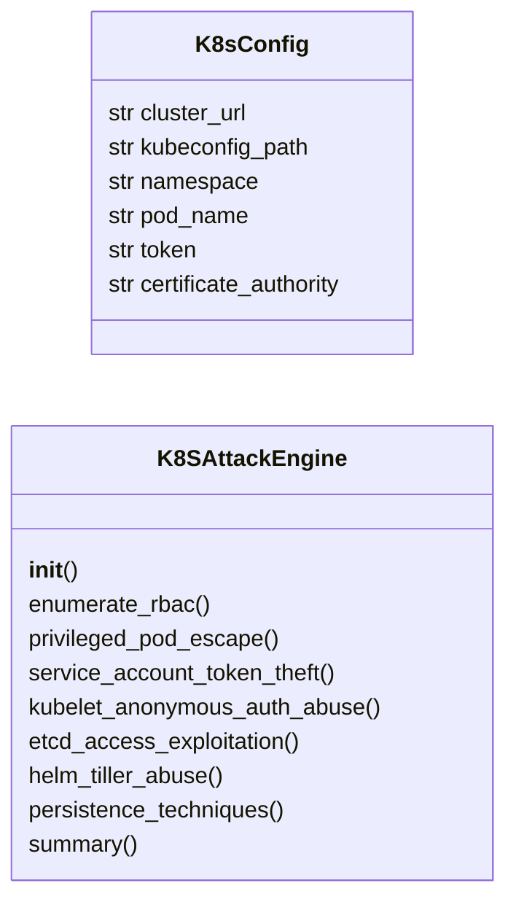
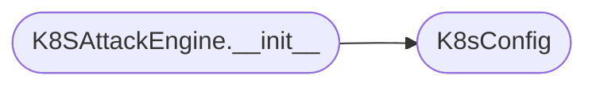

# `modules.k8s_attacks`

> Source: [modules/k8s_attacks.py:1](../../modules/k8s_attacks.py#L1) | language `py` | coverage 83.3% | [API index](../index.md)

Kubernetes attack module — RBAC enumeration, pod escape, etcd access, Helm abuse.

Provides attack primitives for Kubernetes clusters: RBAC privilege
enumeration, pod escape techniques (privileged containers, hostPath,
hostNetwork, hostPID), etcd database access, Helm Tiller exploitation,
kubelet anonymous auth abuse, service account token theft across
namespaces, and admission controller bypass.

All techniques are organized by threat matrix category with detection
notes for blue team awareness.

## Contents

- **Classes:** [`K8sConfig`](#k8sconfig), [`K8SAttackEngine`](#k8sattackengine)
- **Constants:** [`K8S_PRIVESC_METHODS`](#k8s_privesc_methods), [`K8S_SENSITIVE_CAPABILITIES`](#k8s_sensitive_capabilities)

## Type Diagram



## Call Graph

Solid arrows stay in this module, dashed arrows leave it.



## Classes

<a id="k8sconfig"></a>

### `K8sConfig`

`class` `dataclass` | [modules/k8s_attacks.py:57](../../modules/k8s_attacks.py#L57)

Decorators: `@dataclass`

```python
class K8sConfig
```

Configuration for Kubernetes attack operations.

**Attributes**

| Name | Type | Default | Description |
|---|---|---|---|
| [`cluster_url`](#k8sconfig-cluster_url) | `str` | `''` | Kubernetes API server URL. |
| [`kubeconfig_path`](#k8sconfig-kubeconfig_path) | `str` | `''` | Path to kubeconfig file. |
| [`namespace`](#k8sconfig-namespace) | `str` | `'default'` | Target namespace. |
| [`pod_name`](#k8sconfig-pod_name) | `str` | `''` | Target pod name. |
| [`token`](#k8sconfig-token) | `str` | `''` | Service account token. |
| [`certificate_authority`](#k8sconfig-certificate_authority) | `str` | `''` | CA certificate for verification. |

---

<a id="k8sattackengine"></a>

### `K8SAttackEngine`

`class` | [modules/k8s_attacks.py:77](../../modules/k8s_attacks.py#L77)

```python
class K8SAttackEngine
```

Execute Kubernetes privilege escalation and enumeration attacks.

Provides RBAC enumeration, pod escape vectors, etcd exploitation,
and service account token abuse across namespaces.

**Members**

| Member | Kind | Summary |
|---|---|---|
| [`__init__`](#k8sattackengine-__init__) | constructor |  |
| [`enumerate_rbac`](#k8sattackengine-enumerate_rbac) | method | Enumerate RBAC permissions for the current identity. |
| [`privileged_pod_escape`](#k8sattackengine-privileged_pod_escape) | method | Plan a privileged pod escape. |
| [`service_account_token_theft`](#k8sattackengine-service_account_token_theft) | method | Steal service account tokens across namespaces for lateral movement. |
| [`kubelet_anonymous_auth_abuse`](#k8sattackengine-kubelet_anonymous_auth_abuse) | method | Exploit kubelet anonymous authentication. |
| [`etcd_access_exploitation`](#k8sattackengine-etcd_access_exploitation) | method | Exploit etcd database access for complete cluster compromise. |
| [`helm_tiller_abuse`](#k8sattackengine-helm_tiller_abuse) | method | Abuse Helm (v2 Tiller or v3 RBAC) for privilege escalation. |
| [`persistence_techniques`](#k8sattackengine-persistence_techniques) | method | Kubernetes persistence techniques for long-term access. |
| [`summary`](#k8sattackengine-summary) | method |  |

<a id="k8sattackengine-__init__"></a>

#### `K8SAttackEngine.__init__`

`constructor` | [modules/k8s_attacks.py:87](../../modules/k8s_attacks.py#L87)

```python
def __init__(self, config: K8sConfig | None = None)
```

**Parameters**

| Name | Type | Default | Description |
|---|---|---|---|
| `config` | `K8sConfig \| None` | `None` |  |

*Calls:* [`K8sConfig`](#k8sconfig)

*Called by:* [`CloudAttackCommandSet.do_k8s_attack`](cli.commands.cloud_attacks.py.md#cloudattackcommandset-do_k8s_attack)

<a id="k8sattackengine-enumerate_rbac"></a>

#### `K8SAttackEngine.enumerate_rbac`

`method` | [modules/k8s_attacks.py:90](../../modules/k8s_attacks.py#L90)

```python
def enumerate_rbac(self) -> dict[str, Any]
```

Enumerate RBAC permissions for the current identity.

Maps ClusterRoles, Roles, RoleBindings, and ClusterRoleBindings
to identify privilege escalation paths.

**Returns:** `dict[str, Any]` - Dict with RBAC enumeration commands and findings.

*Called by:* [`CloudAttackCommandSet.do_k8s_attack`](cli.commands.cloud_attacks.py.md#cloudattackcommandset-do_k8s_attack)

<a id="k8sattackengine-privileged_pod_escape"></a>

#### `K8SAttackEngine.privileged_pod_escape`

`method` | [modules/k8s_attacks.py:118](../../modules/k8s_attacks.py#L118)

```python
def privileged_pod_escape(self) -> dict[str, Any]
```

Plan a privileged pod escape.

If the user can create pods with privileged:true, hostPath mounts,
hostPID, or hostNetwork, they can escape to the underlying node.

**Returns:** `dict[str, Any]` - Dict with pod manifest and escape commands.

*Called by:* [`CloudAttackCommandSet.do_k8s_attack`](cli.commands.cloud_attacks.py.md#cloudattackcommandset-do_k8s_attack)

<a id="k8sattackengine-service_account_token_theft"></a>

#### `K8SAttackEngine.service_account_token_theft`

`method` | [modules/k8s_attacks.py:173](../../modules/k8s_attacks.py#L173)

```python
def service_account_token_theft(self) -> dict[str, Any]
```

Steal service account tokens across namespaces for lateral movement.

If the attacker has list/get secrets access, they can extract
service account tokens from any namespace.

**Returns:** `dict[str, Any]` - Dict with token theft techniques.

*Called by:* [`CloudAttackCommandSet.do_k8s_attack`](cli.commands.cloud_attacks.py.md#cloudattackcommandset-do_k8s_attack)

<a id="k8sattackengine-kubelet_anonymous_auth_abuse"></a>

#### `K8SAttackEngine.kubelet_anonymous_auth_abuse`

`method` | [modules/k8s_attacks.py:198](../../modules/k8s_attacks.py#L198)

```python
def kubelet_anonymous_auth_abuse(self) -> dict[str, Any]
```

Exploit kubelet anonymous authentication.

If the kubelet has anonymous access enabled (--anonymous-auth=true),
attackers can execute commands on pods and nodes directly.

**Returns:** `dict[str, Any]` - Dict with kubelet exploitation commands.

*Called by:* [`CloudAttackCommandSet.do_k8s_attack`](cli.commands.cloud_attacks.py.md#cloudattackcommandset-do_k8s_attack)

<a id="k8sattackengine-etcd_access_exploitation"></a>

#### `K8SAttackEngine.etcd_access_exploitation`

`method` | [modules/k8s_attacks.py:222](../../modules/k8s_attacks.py#L222)

```python
def etcd_access_exploitation(self) -> dict[str, Any]
```

Exploit etcd database access for complete cluster compromise.

etcd stores all Kubernetes objects including Secrets, ServiceAccount
tokens, and certificates. Direct etcd access bypasses all RBAC.

**Returns:** `dict[str, Any]` - Dict with etcd exploitation commands.

*Called by:* [`CloudAttackCommandSet.do_k8s_attack`](cli.commands.cloud_attacks.py.md#cloudattackcommandset-do_k8s_attack)

<a id="k8sattackengine-helm_tiller_abuse"></a>

#### `K8SAttackEngine.helm_tiller_abuse`

`method` | [modules/k8s_attacks.py:250](../../modules/k8s_attacks.py#L250)

```python
def helm_tiller_abuse(self) -> dict[str, Any]
```

Abuse Helm (v2 Tiller or v3 RBAC) for privilege escalation.

Helm v2's Tiller component runs with cluster-admin by default.
Helm v3 uses the user's kubeconfig but still needs extensive RBAC.

**Returns:** `dict[str, Any]` - Dict with Helm abuse techniques.

*Called by:* [`CloudAttackCommandSet.do_k8s_attack`](cli.commands.cloud_attacks.py.md#cloudattackcommandset-do_k8s_attack)

<a id="k8sattackengine-persistence_techniques"></a>

#### `K8SAttackEngine.persistence_techniques`

`method` | [modules/k8s_attacks.py:278](../../modules/k8s_attacks.py#L278)

```python
def persistence_techniques(self) -> dict[str, Any]
```

Kubernetes persistence techniques for long-term access.

**Returns:** `dict[str, Any]` - Dict with persistence methods and their manifests.

*Called by:* [`CloudAttackCommandSet.do_k8s_attack`](cli.commands.cloud_attacks.py.md#cloudattackcommandset-do_k8s_attack)

<a id="k8sattackengine-summary"></a>

#### `K8SAttackEngine.summary`

`method` | [modules/k8s_attacks.py:318](../../modules/k8s_attacks.py#L318)

```python
def summary(self) -> dict[str, Any]
```

**Returns:** `dict[str, Any]`

---

## Constants

<a id="k8s_privesc_methods"></a>

### `K8S_PRIVESC_METHODS`

`constant` | [modules/k8s_attacks.py:18](../../modules/k8s_attacks.py#L18)

```python
K8S_PRIVESC_METHODS
```

---

<a id="k8s_sensitive_capabilities"></a>

### `K8S_SENSITIVE_CAPABILITIES`

`constant` | [modules/k8s_attacks.py:41](../../modules/k8s_attacks.py#L41)

```python
K8S_SENSITIVE_CAPABILITIES
```

---
