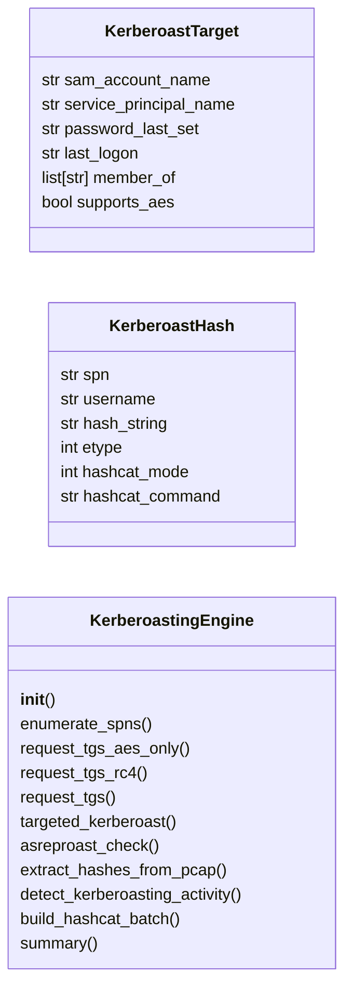
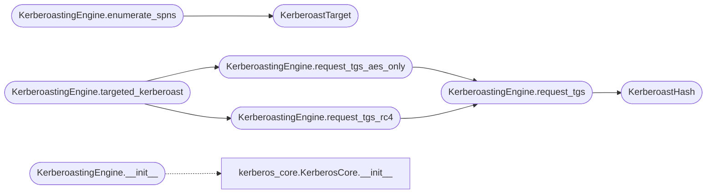

# `modules.kerberoasting`

> Source: [modules/kerberoasting.py:1](../../modules/kerberoasting.py#L1) | language `py` | coverage 93.3% | [API index](../index.md)

Advanced Kerberoasting — targeted SPN enumeration, AES-only attacks, hashcat integration.

Provides enhanced Kerberoasting capabilities beyond impacket GetNPUsers:
targeted SPN list generation, AES-only Kerberoasting (avoids weak RC4
detection rules), automatic hashcat mode selection, and TGS-REP parsing
for offline cracking optimization.

Integrates with KerberosCore for native ticket requests and hash extraction.

## Contents

- **Classes:** [`KerberoastTarget`](#kerberoasttarget), [`KerberoastHash`](#kerberoasthash), [`KerberoastingEngine`](#kerberoastingengine)
- **Constants:** [`HASHCAT_MODES`](#hashcat_modes), [`JOHN_MODES`](#john_modes)

## Type Diagram



## Call Graph

Solid arrows stay in this module, dashed arrows leave it.



## Classes

<a id="kerberoasttarget"></a>

### `KerberoastTarget`

`class` `dataclass` | [modules/kerberoasting.py:38](../../modules/kerberoasting.py#L38)

Decorators: `@dataclass`

```python
class KerberoastTarget
```

A kerberoastable service principal.

**Attributes**

| Name | Type | Default | Description |
|---|---|---|---|
| [`sam_account_name`](#kerberoasttarget-sam_account_name) | `str` | `''` | Service account sAMAccountName. |
| [`service_principal_name`](#kerberoasttarget-service_principal_name) | `str` | `''` | SPN string. |
| [`password_last_set`](#kerberoasttarget-password_last_set) | `str` | `''` | When the password was last changed. |
| [`last_logon`](#kerberoasttarget-last_logon) | `str` | `''` | Last interactive logon timestamp. |
| [`member_of`](#kerberoasttarget-member_of) | `list[str]` | `field(default_factory=list)` | Group memberships (check for high-value groups). |
| [`supports_aes`](#kerberoasttarget-supports_aes) | `bool` | `True` | Whether AES encryption was observed. |

---

<a id="kerberoasthash"></a>

### `KerberoastHash`

`class` `dataclass` | [modules/kerberoasting.py:59](../../modules/kerberoasting.py#L59)

Decorators: `@dataclass`

```python
class KerberoastHash
```

Extracted Kerberoast hash ready for cracking.

**Attributes**

| Name | Type | Default | Description |
|---|---|---|---|
| [`spn`](#kerberoasthash-spn) | `str` | `''` | Service principal name. |
| [`username`](#kerberoasthash-username) | `str` | `''` | Service account name. |
| [`hash_string`](#kerberoasthash-hash_string) | `str` | `''` | Hash in Hashcat format (mode 13100/19600/19700). |
| [`etype`](#kerberoasthash-etype) | `int` | `23` | Encryption type used. |
| [`hashcat_mode`](#kerberoasthash-hashcat_mode) | `int` | `13100` | Hashcat mode number. |
| [`hashcat_command`](#kerberoasthash-hashcat_command) | `str` | `''` | Ready-to-use hashcat command. |

---

<a id="kerberoastingengine"></a>

### `KerberoastingEngine`

`class` | [modules/kerberoasting.py:79](../../modules/kerberoasting.py#L79)

```python
class KerberoastingEngine
```

Advanced Kerberoasting — enumeration, ticket requesting, and hash extraction.

Performs targeted Kerberoasting by enumerating SPNs from Active Directory,
requesting TGS tickets with configurable encryption types, and extracting
hashes in Hashcat/John-compatible formats for offline cracking.

**Members**

| Member | Kind | Summary |
|---|---|---|
| [`__init__`](#kerberoastingengine-__init__) | constructor |  |
| [`enumerate_spns`](#kerberoastingengine-enumerate_spns) | method | Enumerate kerberoastable service principals. |
| [`request_tgs_aes_only`](#kerberoastingengine-request_tgs_aes_only) | method | Request a TGS ticket using only AES encryption (evades RC4 detection). |
| [`request_tgs_rc4`](#kerberoastingengine-request_tgs_rc4) | method | Request a TGS ticket using RC4-HMAC (mode 13100 for Hashcat). |
| [`request_tgs`](#kerberoastingengine-request_tgs) | method | Request a TGS service ticket for kerberoasting. |
| [`targeted_kerberoast`](#kerberoastingengine-targeted_kerberoast) | method | Perform targeted Kerberoasting on enumerated SPNs. |
| [`asreproast_check`](#kerberoastingengine-asreproast_check) | method | Check which users do NOT require Kerberos pre-authentication (AS-REP roastable). |
| [`extract_hashes_from_pcap`](#kerberoastingengine-extract_hashes_from_pcap) | method | Extract Kerberoast hashes from a PCAP/PCAPNG network capture. |
| [`detect_kerberoasting_activity`](#kerberoastingengine-detect_kerberoasting_activity) | method | Analyze Windows Event Logs for signs of Kerberoasting attacks. |
| [`build_hashcat_batch`](#kerberoastingengine-build_hashcat_batch) | method | Build a batch file with all extracted hashes for Hashcat cracking. |
| [`summary`](#kerberoastingengine-summary) | method | Return a summary of kerberoasting operations. |

<a id="kerberoastingengine-__init__"></a>

#### `KerberoastingEngine.__init__`

`constructor` | [modules/kerberoasting.py:95](../../modules/kerberoasting.py#L95)

```python
def __init__(self, domain: str = '', dc_ip: str = '', username: str = '', password: str = '', hash: str = '')
```

**Parameters**

| Name | Type | Default | Description |
|---|---|---|---|
| `domain` | `str` | `''` |  |
| `dc_ip` | `str` | `''` |  |
| `username` | `str` | `''` |  |
| `password` | `str` | `''` |  |
| `hash` | `str` | `''` |  |

*Calls:* [`KerberosCore.__init__`](modules.kerberos_core.py.md#kerberoscore-__init__)

*Called by:* [`ActiveDirectoryCommandSet.do_kerberoast`](cli.commands.active_directory.py.md#activedirectorycommandset-do_kerberoast)

<a id="kerberoastingengine-enumerate_spns"></a>

#### `KerberoastingEngine.enumerate_spns`

`method` | [modules/kerberoasting.py:112](../../modules/kerberoasting.py#L112)

```python
def enumerate_spns(self, ldap_output: str = '', bloodhound_data: list[dict[str, Any]] = None) -> list[KerberoastTarget]
```

Enumerate kerberoastable service principals.

Parses LDAP queries or BloodHound data to identify service accounts
with SPNs. Prioritizes high-value targets (Domain Admins, service
accounts with weak passwords).

**Parameters**

| Name | Type | Default | Description |
|---|---|---|---|
| `ldap_output` | `str` | `''` | Raw LDAP search results text. |
| `bloodhound_data` | `list[dict[str, Any]]` | `None` | BloodHound user node dicts. |

**Returns:** `list[KerberoastTarget]` - Sorted list of KerberoastTarget (high-value first).

*Calls:* [`KerberoastTarget`](#kerberoasttarget)

<a id="kerberoastingengine-request_tgs_aes_only"></a>

#### `KerberoastingEngine.request_tgs_aes_only`

`method` | [modules/kerberoasting.py:187](../../modules/kerberoasting.py#L187)

```python
def request_tgs_aes_only(self, user_spn: str) -> KerberoastHash | None
```

Request a TGS ticket using only AES encryption (evades RC4 detection).

AES-only Kerberoasting avoids triggering detection rules that
monitor for RC4-HMAC ticket requests.

**Parameters**

| Name | Type | Default | Description |
|---|---|---|---|
| `user_spn` | `str` |  | Target service principal name. |

**Returns:** `KerberoastHash | None` - KerberoastHash with AES256 hash, or None if request fails.

*Calls:* [`KerberoastingEngine.request_tgs`](#kerberoastingengine-request_tgs)

*Called by:* [`KerberoastingEngine.targeted_kerberoast`](#kerberoastingengine-targeted_kerberoast)

<a id="kerberoastingengine-request_tgs_rc4"></a>

#### `KerberoastingEngine.request_tgs_rc4`

`method` | [modules/kerberoasting.py:208](../../modules/kerberoasting.py#L208)

```python
def request_tgs_rc4(self, user_spn: str) -> KerberoastHash | None
```

Request a TGS ticket using RC4-HMAC (mode 13100 for Hashcat).

**Parameters**

| Name | Type | Default | Description |
|---|---|---|---|
| `user_spn` | `str` |  | Target service principal name. |

**Returns:** `KerberoastHash | None` - KerberoastHash with RC4 hash.

*Calls:* [`KerberoastingEngine.request_tgs`](#kerberoastingengine-request_tgs)

*Called by:* [`KerberoastingEngine.targeted_kerberoast`](#kerberoastingengine-targeted_kerberoast)

<a id="kerberoastingengine-request_tgs"></a>

#### `KerberoastingEngine.request_tgs`

`method` | [modules/kerberoasting.py:219](../../modules/kerberoasting.py#L219)

```python
def request_tgs(self, user_spn: str, etype: int = 23) -> KerberoastHash | None
```

Request a TGS service ticket for kerberoasting.

**Parameters**

| Name | Type | Default | Description |
|---|---|---|---|
| `user_spn` | `str` |  | Service principal name (e.g. 'MSSQLSvc/db01.domain.local'). |
| `etype` | `int` | `23` | Requested encryption type (23=RC4, 18=AES256, 17=AES128). |

**Returns:** `KerberoastHash | None` - KerberoastHash with the extracted hash for offline cracking.

*Calls:* [`KerberoastHash`](#kerberoasthash)

*Called by:* [`KerberoastingEngine.request_tgs_aes_only`](#kerberoastingengine-request_tgs_aes_only), [`KerberoastingEngine.request_tgs_rc4`](#kerberoastingengine-request_tgs_rc4)

<a id="kerberoastingengine-targeted_kerberoast"></a>

#### `KerberoastingEngine.targeted_kerberoast`

`method` | [modules/kerberoasting.py:271](../../modules/kerberoasting.py#L271)

```python
def targeted_kerberoast(self, high_value_only: bool = True) -> list[KerberoastHash]
```

Perform targeted Kerberoasting on enumerated SPNs.

Requests tickets for all discovered targets, prioritizing high-value
accounts. Supports both AES-only and RC4 modes.

**Parameters**

| Name | Type | Default | Description |
|---|---|---|---|
| `high_value_only` | `bool` | `True` | Only roast high-value targets (domain admins, etc.). |

**Returns:** `list[KerberoastHash]` - List of extracted KerberoastHash objects for cracking.

*Calls:* [`KerberoastingEngine.request_tgs_aes_only`](#kerberoastingengine-request_tgs_aes_only), [`KerberoastingEngine.request_tgs_rc4`](#kerberoastingengine-request_tgs_rc4)

<a id="kerberoastingengine-asreproast_check"></a>

#### `KerberoastingEngine.asreproast_check`

`method` | [modules/kerberoasting.py:306](../../modules/kerberoasting.py#L306)

```python
def asreproast_check(self, usernames: list[str]) -> list[str]
```

Check which users do NOT require Kerberos pre-authentication (AS-REP roastable).

Users without pre-auth can have their AS-REP encrypted with their
password hash, allowing offline cracking without any authentication.

**Parameters**

| Name | Type | Default | Description |
|---|---|---|---|
| `usernames` | `list[str]` |  | List of usernames to check. |

**Returns:** `list[str]` - List of usernames that do not require pre-authentication.

<a id="kerberoastingengine-extract_hashes_from_pcap"></a>

#### `KerberoastingEngine.extract_hashes_from_pcap`

`method` | [modules/kerberoasting.py:321](../../modules/kerberoasting.py#L321)

```python
def extract_hashes_from_pcap(self, pcap_path: str) -> list[KerberoastHash]
```

Extract Kerberoast hashes from a PCAP/PCAPNG network capture.

Parses TGS-REP packets from network traffic to extract ticket
hashes without performing active Kerberoasting.

**Parameters**

| Name | Type | Default | Description |
|---|---|---|---|
| `pcap_path` | `str` |  | Path to the PCAP file. |

**Returns:** `list[KerberoastHash]` - List of extracted KerberoastHash objects.

<a id="kerberoastingengine-detect_kerberoasting_activity"></a>

#### `KerberoastingEngine.detect_kerberoasting_activity`

`method` | [modules/kerberoasting.py:336](../../modules/kerberoasting.py#L336)

```python
def detect_kerberoasting_activity(self, event_log: str = '') -> dict[str, Any]
```

Analyze Windows Event Logs for signs of Kerberoasting attacks.

Event ID 4769 (service ticket request) with Ticket Encryption 0x17
(RC4-HMAC) is a strong indicator of Kerberoasting.

**Parameters**

| Name | Type | Default | Description |
|---|---|---|---|
| `event_log` | `str` | `''` | Raw Windows security event log text. |

**Returns:** `dict[str, Any]` - Dict with detected indicators and risk assessment.

<a id="kerberoastingengine-build_hashcat_batch"></a>

#### `KerberoastingEngine.build_hashcat_batch`

`method` | [modules/kerberoasting.py:379](../../modules/kerberoasting.py#L379)

```python
def build_hashcat_batch(self, output_path: str) -> str
```

Build a batch file with all extracted hashes for Hashcat cracking.

**Parameters**

| Name | Type | Default | Description |
|---|---|---|---|
| `output_path` | `str` |  | File path to write the hash file. |

**Returns:** `str` - Hashcat command for batch cracking.

<a id="kerberoastingengine-summary"></a>

#### `KerberoastingEngine.summary`

`method` | [modules/kerberoasting.py:401](../../modules/kerberoasting.py#L401)

```python
def summary(self) -> dict[str, Any]
```

Return a summary of kerberoasting operations.

**Returns:** `dict[str, Any]` - Dict with target count, hash count, hashcat modes, and SPN list.

---

## Constants

<a id="hashcat_modes"></a>

### `HASHCAT_MODES`

`constant` | [modules/kerberoasting.py:22](../../modules/kerberoasting.py#L22)

```python
HASHCAT_MODES = {23: 13100, 18: 19700, 17: 19600, 3: 14000, 1: 7500}
```

---

<a id="john_modes"></a>

### `JOHN_MODES`

`constant` | [modules/kerberoasting.py:30](../../modules/kerberoasting.py#L30)

```python
JOHN_MODES = {23: 'krb5tgs', 18: 'krb5tgs', 17: 'krb5tgs'}
```

---
