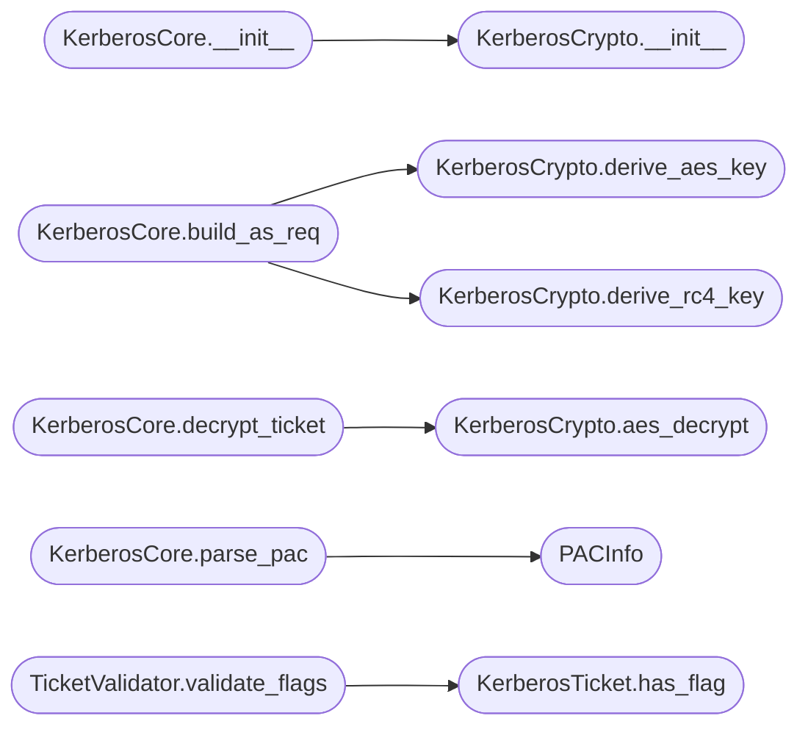

# `modules.kerberos_core`

> Source: [modules/kerberos_core.py:1](../../modules/kerberos_core.py#L1) | language `py` | coverage 87.1% | [API index](../index.md)

Native Kerberos protocol library — AS-REQ, TGS-REQ, ticket parsing, encryption.

Provides a pure-Python Kerberos implementation for Active Directory attacks
without depending on impacket or external tools. Implements the KDC message
exchange protocol (AS-REQ/AS-REP, TGS-REQ/TGS-REP), ticket decryption with
known keys, PAC parsing, and service ticket manipulation.

Requires pyasn1 and cryptography for ASN.1 handling and crypto operations.

## Contents

- **Classes:** [`KerberosPrincipal`](#kerberosprincipal), [`EncryptedData`](#encrypteddata), [`KerberosTicket`](#kerberosticket), [`PACSignature`](#pacsignature), [`PACInfo`](#pacinfo), [`TGSRequest`](#tgsrequest), [`KerberosCrypto`](#kerberoscrypto), [`KerberosCore`](#kerberoscore), [`KerberosErrorParser`](#kerberoserrorparser), [`TicketValidator`](#ticketvalidator)
- **Constants:** [`KERBEROS_PORT`](#kerberos_port), [`KDC_PORT`](#kdc_port), [`ENCRYPTION_TYPES`](#encryption_types), [`CHECKSUM_TYPES`](#checksum_types), [`PA_DATA_TYPES`](#pa_data_types), [`KERB_ERROR_CODES`](#kerb_error_codes), [`KERB_TICKET_FLAGS`](#kerb_ticket_flags), [`PAC_SIGNATURE_TYPES`](#pac_signature_types)

## Type Diagram

```mermaid
classDiagram
    direction LR
    class KerberosPrincipal
    KerberosPrincipal : str name
    KerberosPrincipal : str realm
    KerberosPrincipal : int name_type
    KerberosPrincipal : to_string()
    class EncryptedData
    EncryptedData : int etype
    EncryptedData : int kvno
    EncryptedData : bytes cipher
    class KerberosTicket
    KerberosTicket : int tkt_vno
    KerberosTicket : str realm
    KerberosTicket : str sname
    KerberosTicket : int flags
    KerberosTicket : EncryptedData  None key
    KerberosTicket : str crealm
    KerberosTicket : str cname
    KerberosTicket : bytes transited
    KerberosTicket : int authtime
    KerberosTicket : int starttime
    KerberosTicket : int endtime
    KerberosTicket : int renew_till
    KerberosTicket : list[dict[str, Any]] authorization_data
    KerberosTicket : EncryptedData  None enc_part
    KerberosTicket : has_flag()
    class PACSignature
    PACSignature : str type
    PACSignature : bytes signature
    PACSignature : int rodc_identifier
    class PACInfo
    PACInfo : dict[str, Any] logon_info
    PACInfo : dict[str, Any] client_info
    PACInfo : PACSignature  None server_checksum
    PACInfo : PACSignature  None privsvr_checksum
    PACInfo : dict[str, Any] upn_dns_info
    PACInfo : dict[str, Any] attributes
    class TGSRequest
    TGSRequest : str target_service
    TGSRequest : str realm
    TGSRequest : bytes tgt
    TGSRequest : bytes session_key
    TGSRequest : int etype
    TGSRequest : list[bytes] additional_tickets
    TGSRequest : bool include_pac
    class KerberosCrypto
    KerberosCrypto : __init__()
    KerberosCrypto : derive_aes_key()
    KerberosCrypto : derive_rc4_key()
    KerberosCrypto : aes_encrypt()
    KerberosCrypto : aes_decrypt()
    KerberosCrypto : compute_checksum()
    class KerberosCore
    KerberosCore : __init__()
    KerberosCore : get_supported_etypes()
    KerberosCore : build_as_req()
    KerberosCore : build_tgs_req()
    KerberosCore : parse_as_rep()
    KerberosCore : parse_tgs_rep()
    KerberosCore : decrypt_ticket()
    KerberosCore : parse_pac()
    class KerberosErrorParser
    KerberosErrorParser : parse_error()
    class TicketValidator
    TicketValidator : is_expired()
    TicketValidator : validate_flags()
    TicketValidator : validate_pac_checksums()
```



## Call Graph

Solid arrows stay in this module, dashed arrows leave it.



## Classes

<a id="kerberosprincipal"></a>

### `KerberosPrincipal`

`class` `dataclass` | [modules/kerberos_core.py:139](../../modules/kerberos_core.py#L139)

Decorators: `@dataclass`

```python
class KerberosPrincipal
```

Kerberos principal name (user, service, or host).

**Attributes**

| Name | Type | Default | Description |
|---|---|---|---|
| [`name`](#kerberosprincipal-name) | `str` | `''` | Principal name component (e.g. 'Administrator', 'cifs'). |
| [`realm`](#kerberosprincipal-realm) | `str` | `''` | Kerberos realm (domain name uppercase). |
| [`name_type`](#kerberosprincipal-name_type) | `int` | `1` | NT_PRINCIPAL (1), NT_SRV_INST (2), etc. |

**Members**

| Member | Kind | Summary |
|---|---|---|
| [`to_string`](#kerberosprincipal-to_string) | method |  |

<a id="kerberosprincipal-to_string"></a>

#### `KerberosPrincipal.to_string`

`method` | [modules/kerberos_core.py:152](../../modules/kerberos_core.py#L152)

```python
def to_string(self) -> str
```

**Returns:** `str`

---

<a id="encrypteddata"></a>

### `EncryptedData`

`class` `dataclass` | [modules/kerberos_core.py:157](../../modules/kerberos_core.py#L157)

Decorators: `@dataclass`

```python
class EncryptedData
```

Kerberos EncryptedData structure.

**Attributes**

| Name | Type | Default | Description |
|---|---|---|---|
| [`etype`](#encrypteddata-etype) | `int` | `18` | Encryption type. |
| [`kvno`](#encrypteddata-kvno) | `int` | `0` | Key version number. |
| [`cipher`](#encrypteddata-cipher) | `bytes` | `b''` | Encrypted ciphertext bytes. |

---

<a id="kerberosticket"></a>

### `KerberosTicket`

`class` `dataclass` | [modules/kerberos_core.py:172](../../modules/kerberos_core.py#L172)

Decorators: `@dataclass`

```python
class KerberosTicket
```

Parsed Kerberos service ticket.

**Attributes**

| Name | Type | Default | Description |
|---|---|---|---|
| [`tkt_vno`](#kerberosticket-tkt_vno) | `int` | `5` | Ticket version number (5). |
| [`realm`](#kerberosticket-realm) | `str` | `''` | Realm that issued the ticket. |
| [`sname`](#kerberosticket-sname) | `str` | `''` | Service principal name. |
| [`flags`](#kerberosticket-flags) | `int` | `0` | Ticket flags bitmask. |
| [`key`](#kerberosticket-key) | `EncryptedData \| None` | `None` | Session key encrypted data. |
| [`crealm`](#kerberosticket-crealm) | `str` | `''` | Client realm. |
| [`cname`](#kerberosticket-cname) | `str` | `''` | Client principal name. |
| [`transited`](#kerberosticket-transited) | `bytes` | `b''` | Transited realms. |
| [`authtime`](#kerberosticket-authtime) | `int` | `0` | Authentication timestamp. |
| [`starttime`](#kerberosticket-starttime) | `int` | `0` | Validity start time. |
| [`endtime`](#kerberosticket-endtime) | `int` | `0` | Expiration time. |
| [`renew_till`](#kerberosticket-renew_till) | `int` | `0` | Renewable until time. |
| [`authorization_data`](#kerberosticket-authorization_data) | `list[dict[str, Any]]` | `field(default_factory=list)` | PAC and other authz data. |
| [`enc_part`](#kerberosticket-enc_part) | `EncryptedData \| None` | `None` | Encrypted portion of the ticket. |

**Members**

| Member | Kind | Summary |
|---|---|---|
| [`has_flag`](#kerberosticket-has_flag) | method |  |

<a id="kerberosticket-has_flag"></a>

#### `KerberosTicket.has_flag`

`method` | [modules/kerberos_core.py:207](../../modules/kerberos_core.py#L207)

```python
def has_flag(self, flag_name: str) -> bool
```

**Parameters**

| Name | Type | Default | Description |
|---|---|---|---|
| `flag_name` | `str` |  |  |

**Returns:** `bool`

*Called by:* [`TicketValidator.validate_flags`](#ticketvalidator-validate_flags)

---

<a id="pacsignature"></a>

### `PACSignature`

`class` `dataclass` | [modules/kerberos_core.py:213](../../modules/kerberos_core.py#L213)

Decorators: `@dataclass`

```python
class PACSignature
```

PAC signature data for validation.

**Attributes**

| Name | Type | Default | Description |
|---|---|---|---|
| [`type`](#pacsignature-type) | `str` | `''` | Signature type (kdc, server, privilege server). |
| [`signature`](#pacsignature-signature) | `bytes` | `b''` | Raw signature bytes. |
| [`rodc_identifier`](#pacsignature-rodc_identifier) | `int` | `0` | RODC identifier if present. |

---

<a id="pacinfo"></a>

### `PACInfo`

`class` `dataclass` | [modules/kerberos_core.py:228](../../modules/kerberos_core.py#L228)

Decorators: `@dataclass`

```python
class PACInfo
```

Parsed Privilege Attribute Certificate (PAC).

**Attributes**

| Name | Type | Default | Description |
|---|---|---|---|
| [`logon_info`](#pacinfo-logon_info) | `dict[str, Any]` | `field(default_factory=dict)` | User SID, groups, domain info. |
| [`client_info`](#pacinfo-client_info) | `dict[str, Any]` | `field(default_factory=dict)` | Client name and ID. |
| [`server_checksum`](#pacinfo-server_checksum) | `PACSignature \| None` | `None` | Server signature. |
| [`privsvr_checksum`](#pacinfo-privsvr_checksum) | `PACSignature \| None` | `None` | Privilege server signature. |
| [`upn_dns_info`](#pacinfo-upn_dns_info) | `dict[str, Any]` | `field(default_factory=dict)` | UPN and DNS info. |
| [`attributes`](#pacinfo-attributes) | `dict[str, Any]` | `field(default_factory=dict)` | Extra PAC attributes. |

---

<a id="tgsrequest"></a>

### `TGSRequest`

`class` `dataclass` | [modules/kerberos_core.py:249](../../modules/kerberos_core.py#L249)

Decorators: `@dataclass`

```python
class TGSRequest
```

Parameters for a TGS-REQ service ticket request.

**Attributes**

| Name | Type | Default | Description |
|---|---|---|---|
| [`target_service`](#tgsrequest-target_service) | `str` | `''` | Service name (e.g. 'cifs/DC01.domain.com'). |
| [`realm`](#tgsrequest-realm) | `str` | `''` | Domain realm. |
| [`tgt`](#tgsrequest-tgt) | `bytes` | `b''` | Encrypted TGT ticket bytes. |
| [`session_key`](#tgsrequest-session_key) | `bytes` | `b''` | TGT session key bytes. |
| [`etype`](#tgsrequest-etype) | `int` | `18` | Requested encryption type. |
| [`additional_tickets`](#tgsrequest-additional_tickets) | `list[bytes]` | `field(default_factory=list)` | Additional tickets for S4U. |
| [`include_pac`](#tgsrequest-include_pac) | `bool` | `True` | Request PAC in the response. |

---

<a id="kerberoscrypto"></a>

### `KerberosCrypto`

`class` | [modules/kerberos_core.py:271](../../modules/kerberos_core.py#L271)

```python
class KerberosCrypto
```

Kerberos cryptographic operations — key derivation, encryption, checksums.

Implements RFC 3961 and RFC 3962 for AES encryption types.

**Members**

| Member | Kind | Summary |
|---|---|---|
| [`__init__`](#kerberoscrypto-__init__) | constructor |  |
| [`derive_aes_key`](#kerberoscrypto-derive_aes_key) | staticmethod | Derive an AES Kerberos key from a password using string-to-key. |
| [`derive_rc4_key`](#kerberoscrypto-derive_rc4_key) | staticmethod | Derive RC4-HMAC Kerberos key from password (hash = MD4(UTF16LE(password))). |
| [`aes_encrypt`](#kerberoscrypto-aes_encrypt) | method | AES encrypt with Kerberos ciphertext stealing (CTS) mode. |
| [`aes_decrypt`](#kerberoscrypto-aes_decrypt) | method | AES decrypt with Kerberos CTS mode. |
| [`compute_checksum`](#kerberoscrypto-compute_checksum) | staticmethod | Compute a Kerberos checksum using HMAC-SHA1-96-AES. |

<a id="kerberoscrypto-__init__"></a>

#### `KerberosCrypto.__init__`

`constructor` | [modules/kerberos_core.py:277](../../modules/kerberos_core.py#L277)

```python
def __init__(self)
```

**Raises**

- `ImportError`: (raised in the body, not documented)

*Called by:* [`KerberosCore.__init__`](#kerberoscore-__init__), [`GoldenTicketForger.__init__`](modules.kerberos_tickets.py.md#goldenticketforger-__init__), [`SilverTicketForger.__init__`](modules.kerberos_tickets.py.md#silverticketforger-__init__)

<a id="kerberoscrypto-derive_aes_key"></a>

#### `KerberosCrypto.derive_aes_key`

`staticmethod` | [modules/kerberos_core.py:282](../../modules/kerberos_core.py#L282)

Decorators: `@staticmethod`

```python
def derive_aes_key(password: str, salt: str, etype: int = 18) -> bytes
```

Derive an AES Kerberos key from a password using string-to-key.

**Parameters**

| Name | Type | Default | Description |
|---|---|---|---|
| `password` | `str` |  | User's plaintext password. |
| `salt` | `str` |  | Kerberos salt (realm + username). |
| `etype` | `int` | `18` | Encryption type (17 = AES128, 18 = AES256). |

**Returns:** `bytes` - Derived key bytes.

*Called by:* [`KerberosCore.build_as_req`](#kerberoscore-build_as_req)

<a id="kerberoscrypto-derive_rc4_key"></a>

#### `KerberosCrypto.derive_rc4_key`

`staticmethod` | [modules/kerberos_core.py:318](../../modules/kerberos_core.py#L318)

Decorators: `@staticmethod`

```python
def derive_rc4_key(password: str) -> bytes
```

Derive RC4-HMAC Kerberos key from password (hash = MD4(UTF16LE(password))).

**Parameters**

| Name | Type | Default | Description |
|---|---|---|---|
| `password` | `str` |  | Plaintext password. |

**Returns:** `bytes` - 16-byte RC4 key (NT hash).

*Called by:* [`KerberosCore.build_as_req`](#kerberoscore-build_as_req)

<a id="kerberoscrypto-aes_encrypt"></a>

#### `KerberosCrypto.aes_encrypt`

`method` | [modules/kerberos_core.py:329](../../modules/kerberos_core.py#L329)

```python
def aes_encrypt(self, key: bytes, plaintext: bytes, usage: int) -> bytes
```

AES encrypt with Kerberos ciphertext stealing (CTS) mode.

**Parameters**

| Name | Type | Default | Description |
|---|---|---|---|
| `key` | `bytes` |  | AES encryption key. |
| `plaintext` | `bytes` |  | Data to encrypt. |
| `usage` | `int` |  | Kerberos key usage number. |

**Returns:** `bytes` - Encrypted ciphertext.

<a id="kerberoscrypto-aes_decrypt"></a>

#### `KerberosCrypto.aes_decrypt`

`method` | [modules/kerberos_core.py:361](../../modules/kerberos_core.py#L361)

```python
def aes_decrypt(self, key: bytes, ciphertext: bytes, usage: int) -> bytes
```

AES decrypt with Kerberos CTS mode.

**Parameters**

| Name | Type | Default | Description |
|---|---|---|---|
| `key` | `bytes` |  | AES decryption key. |
| `ciphertext` | `bytes` |  | Encrypted data. |
| `usage` | `int` |  | Key usage number. |

**Returns:** `bytes` - Decrypted plaintext.

**Raises**

- `ValueError`: (raised in the body, not documented)

*Called by:* [`KerberosCore.decrypt_ticket`](#kerberoscore-decrypt_ticket)

<a id="kerberoscrypto-compute_checksum"></a>

#### `KerberosCrypto.compute_checksum`

`staticmethod` | [modules/kerberos_core.py:389](../../modules/kerberos_core.py#L389)

Decorators: `@staticmethod`

```python
def compute_checksum(key: bytes, data: bytes, etype: int = 18) -> bytes
```

Compute a Kerberos checksum using HMAC-SHA1-96-AES.

**Parameters**

| Name | Type | Default | Description |
|---|---|---|---|
| `key` | `bytes` |  | Checksum key. |
| `data` | `bytes` |  | Data to checksum. |
| `etype` | `int` | `18` | Encryption type. |

**Returns:** `bytes` - Checksum bytes.

---

<a id="kerberoscore"></a>

### `KerberosCore`

`class` | [modules/kerberos_core.py:407](../../modules/kerberos_core.py#L407)

```python
class KerberosCore
```

Native Kerberos protocol client for Active Directory operations.

Handles AS-REQ/AS-REP for TGT retrieval, TGS-REQ/TGS-REP for service
tickets, ticket parsing, and PAC extraction. Works standalone without
impacket — uses pyasn1 for DER encoding and cryptography for crypto.

**Members**

| Member | Kind | Summary |
|---|---|---|
| [`__init__`](#kerberoscore-__init__) | constructor |  |
| [`get_supported_etypes`](#kerberoscore-get_supported_etypes) | method | Return encryption types supported by this implementation. |
| [`build_as_req`](#kerberoscore-build_as_req) | method | Build an AS-REQ message for TGT retrieval. |
| [`build_tgs_req`](#kerberoscore-build_tgs_req) | method | Build a TGS-REQ message for service ticket retrieval. |
| [`parse_as_rep`](#kerberoscore-parse_as_rep) | method | Parse an AS-REP response and extract the TGT and session key. |
| [`parse_tgs_rep`](#kerberoscore-parse_tgs_rep) | method | Parse a TGS-REP response and extract the service ticket. |
| [`decrypt_ticket`](#kerberoscore-decrypt_ticket) | method | Decrypt the encrypted portion of a Kerberos ticket. |
| [`parse_pac`](#kerberoscore-parse_pac) | method | Parse a Privilege Attribute Certificate (PAC) from decrypted auth data. |

<a id="kerberoscore-__init__"></a>

#### `KerberosCore.__init__`

`constructor` | [modules/kerberos_core.py:421](../../modules/kerberos_core.py#L421)

```python
def __init__(self, domain: str = '', dc_host: str = '', dc_ip: str = '')
```

**Parameters**

| Name | Type | Default | Description |
|---|---|---|---|
| `domain` | `str` | `''` |  |
| `dc_host` | `str` | `''` |  |
| `dc_ip` | `str` | `''` |  |

*Calls:* [`KerberosCrypto.__init__`](#kerberoscrypto-__init__)

*Called by:* [`KerberoastingEngine.__init__`](modules.kerberoasting.py.md#kerberoastingengine-__init__), [`SapphireTicketForger.__init__`](modules.kerberos_tickets.py.md#sapphireticketforger-__init__)

<a id="kerberoscore-get_supported_etypes"></a>

#### `KerberosCore.get_supported_etypes`

`method` | [modules/kerberos_core.py:427](../../modules/kerberos_core.py#L427)

```python
def get_supported_etypes(self) -> list[int]
```

Return encryption types supported by this implementation.

**Returns:** `list[int]` - List of etype integers.

<a id="kerberoscore-build_as_req"></a>

#### `KerberosCore.build_as_req`

`method` | [modules/kerberos_core.py:435](../../modules/kerberos_core.py#L435)

```python
def build_as_req(self, username: str, domain: str, password: str, etype: int = 23) -> dict[str, Any]
```

Build an AS-REQ message for TGT retrieval.

Constructs a KRB_AS_REQ with PA-ENC-TIMESTAMP pre-authentication
using the user's password-derived key.

**Parameters**

| Name | Type | Default | Description |
|---|---|---|---|
| `username` | `str` |  | SAM account name. |
| `domain` | `str` |  | Domain FQDN (use domain.realm). |
| `password` | `str` |  | User plaintext password. |
| `etype` | `int` | `23` | Encryption type (23=RC4, 18=AES256). |

**Returns:** `dict[str, Any]` - Dict with pvno, msg_type, padata, req_body, and derived_key.

*Calls:* [`KerberosCrypto.derive_aes_key`](#kerberoscrypto-derive_aes_key), [`KerberosCrypto.derive_rc4_key`](#kerberoscrypto-derive_rc4_key)

<a id="kerberoscore-build_tgs_req"></a>

#### `KerberosCore.build_tgs_req`

`method` | [modules/kerberos_core.py:489](../../modules/kerberos_core.py#L489)

```python
def build_tgs_req(self, params: TGSRequest) -> dict[str, Any]
```

Build a TGS-REQ message for service ticket retrieval.

**Parameters**

| Name | Type | Default | Description |
|---|---|---|---|
| `params` | `TGSRequest` |  | TGSRequest with target service and TGT. |

**Returns:** `dict[str, Any]` - Dict with msg_type, padata, req_body, and authenticator.

<a id="kerberoscore-parse_as_rep"></a>

#### `KerberosCore.parse_as_rep`

`method` | [modules/kerberos_core.py:534](../../modules/kerberos_core.py#L534)

```python
def parse_as_rep(self, as_rep_data: bytes, key: bytes, etype: int) -> dict[str, Any]
```

Parse an AS-REP response and extract the TGT and session key.

**Parameters**

| Name | Type | Default | Description |
|---|---|---|---|
| `as_rep_data` | `bytes` |  | Raw AS-REP bytes from the KDC. |
| `key` | `bytes` |  | Pre-authentication key. |
| `etype` | `int` |  | Encryption type. |

**Returns:** `dict[str, Any]` - Dict with tgt, session_key, enc_part, flags, endtime.

**Raises**

- `ValueError`: If decryption fails or error code present.

<a id="kerberoscore-parse_tgs_rep"></a>

#### `KerberosCore.parse_tgs_rep`

`method` | [modules/kerberos_core.py:550](../../modules/kerberos_core.py#L550)

```python
def parse_tgs_rep(self, tgs_rep_data: bytes, session_key: bytes, etype: int) -> dict[str, Any]
```

Parse a TGS-REP response and extract the service ticket.

**Parameters**

| Name | Type | Default | Description |
|---|---|---|---|
| `tgs_rep_data` | `bytes` |  | Raw TGS-REP bytes from the KDC. |
| `session_key` | `bytes` |  | TGT session key. |
| `etype` | `int` |  | Encryption type. |

**Returns:** `dict[str, Any]` - Dict with ticket, enc_part, service_session_key, pac.

<a id="kerberoscore-decrypt_ticket"></a>

#### `KerberosCore.decrypt_ticket`

`method` | [modules/kerberos_core.py:563](../../modules/kerberos_core.py#L563)

```python
def decrypt_ticket(self, ticket_data: bytes, key: bytes, etype: int) -> dict[str, Any]
```

Decrypt the encrypted portion of a Kerberos ticket.

Used for silver ticket forgery — requires the service account's
password hash or machine account hash.

**Parameters**

| Name | Type | Default | Description |
|---|---|---|---|
| `ticket_data` | `bytes` |  | Raw ticket bytes. |
| `key` | `bytes` |  | Service account key (NT hash or AES key). |
| `etype` | `int` |  | Encryption type. |

**Returns:** `dict[str, Any]` - Dict with decrypted ticket fields.

*Calls:* [`KerberosCrypto.aes_decrypt`](#kerberoscrypto-aes_decrypt)

<a id="kerberoscore-parse_pac"></a>

#### `KerberosCore.parse_pac`

`method` | [modules/kerberos_core.py:588](../../modules/kerberos_core.py#L588)

```python
def parse_pac(self, pac_data: bytes) -> PACInfo
```

Parse a Privilege Attribute Certificate (PAC) from decrypted auth data.

**Parameters**

| Name | Type | Default | Description |
|---|---|---|---|
| `pac_data` | `bytes` |  | Raw PAC bytes from the authorization data. |

**Returns:** `PACInfo` - PACInfo with extracted PAC components.

*Calls:* [`PACInfo`](#pacinfo)

---

<a id="kerberoserrorparser"></a>

### `KerberosErrorParser`

`class` | [modules/kerberos_core.py:683](../../modules/kerberos_core.py#L683)

```python
class KerberosErrorParser
```

Parse KRB-ERROR messages from KDC responses.

**Members**

| Member | Kind | Summary |
|---|---|---|
| [`parse_error`](#kerberoserrorparser-parse_error) | staticmethod | Extract error code, message, and client/server realm from a KRB-ERROR. |

<a id="kerberoserrorparser-parse_error"></a>

#### `KerberosErrorParser.parse_error`

`staticmethod` | [modules/kerberos_core.py:687](../../modules/kerberos_core.py#L687)

Decorators: `@staticmethod`

```python
def parse_error(error_data: bytes) -> dict[str, Any]
```

Extract error code, message, and client/server realm from a KRB-ERROR.

**Parameters**

| Name | Type | Default | Description |
|---|---|---|---|
| `error_data` | `bytes` |  | Raw KRB-ERROR bytes. |

**Returns:** `dict[str, Any]` - Dict with error_code, error_name, ctime, crealm, srealm, e_data.

---

<a id="ticketvalidator"></a>

### `TicketValidator`

`class` | [modules/kerberos_core.py:702](../../modules/kerberos_core.py#L702)

```python
class TicketValidator
```

Validate Kerberos tickets — expiration, flags, PAC signatures.

**Members**

| Member | Kind | Summary |
|---|---|---|
| [`is_expired`](#ticketvalidator-is_expired) | staticmethod | Check if a ticket has expired. |
| [`validate_flags`](#ticketvalidator-validate_flags) | staticmethod | Check that a ticket has all required flags. |
| [`validate_pac_checksums`](#ticketvalidator-validate_pac_checksums) | staticmethod | Validate PAC server and KDC checksums. |

<a id="ticketvalidator-is_expired"></a>

#### `TicketValidator.is_expired`

`staticmethod` | [modules/kerberos_core.py:706](../../modules/kerberos_core.py#L706)

Decorators: `@staticmethod`

```python
def is_expired(endtime: int, grace_period: int = 300) -> bool
```

Check if a ticket has expired.

**Parameters**

| Name | Type | Default | Description |
|---|---|---|---|
| `endtime` | `int` |  | Ticket endtime as unix timestamp. |
| `grace_period` | `int` | `300` | Grace period in seconds after expiration. |

**Returns:** `bool` - True if the ticket has expired.

<a id="ticketvalidator-validate_flags"></a>

#### `TicketValidator.validate_flags`

`staticmethod` | [modules/kerberos_core.py:719](../../modules/kerberos_core.py#L719)

Decorators: `@staticmethod`

```python
def validate_flags(ticket: KerberosTicket, required_flags: list[str]) -> bool
```

Check that a ticket has all required flags.

**Parameters**

| Name | Type | Default | Description |
|---|---|---|---|
| `ticket` | `KerberosTicket` |  | Parsed KerberosTicket. |
| `required_flags` | `list[str]` |  | List of flag names that must be set. |

**Returns:** `bool` - True if all required flags are present.

*Calls:* [`KerberosTicket.has_flag`](#kerberosticket-has_flag)

<a id="ticketvalidator-validate_pac_checksums"></a>

#### `TicketValidator.validate_pac_checksums`

`staticmethod` | [modules/kerberos_core.py:735](../../modules/kerberos_core.py#L735)

Decorators: `@staticmethod`

```python
def validate_pac_checksums(pac: PACInfo) -> bool
```

Validate PAC server and KDC checksums.

**Parameters**

| Name | Type | Default | Description |
|---|---|---|---|
| `pac` | `PACInfo` |  | Parsed PACInfo with checksum data. |

**Returns:** `bool` - True if checksums are present (structural validation only).

---

## Constants

<a id="kerberos_port"></a>

### `KERBEROS_PORT`

`constant` | [modules/kerberos_core.py:39](../../modules/kerberos_core.py#L39)

```python
KERBEROS_PORT = 88
```

---

<a id="kdc_port"></a>

### `KDC_PORT`

`constant` | [modules/kerberos_core.py:40](../../modules/kerberos_core.py#L40)

```python
KDC_PORT = 88
```

---

<a id="encryption_types"></a>

### `ENCRYPTION_TYPES`

`constant` | [modules/kerberos_core.py:42](../../modules/kerberos_core.py#L42)

```python
ENCRYPTION_TYPES
```

---

<a id="checksum_types"></a>

### `CHECKSUM_TYPES`

`constant` | [modules/kerberos_core.py:54](../../modules/kerberos_core.py#L54)

```python
CHECKSUM_TYPES
```

---

<a id="pa_data_types"></a>

### `PA_DATA_TYPES`

`constant` | [modules/kerberos_core.py:72](../../modules/kerberos_core.py#L72)

```python
PA_DATA_TYPES
```

---

<a id="kerb_error_codes"></a>

### `KERB_ERROR_CODES`

`constant` | [modules/kerberos_core.py:86](../../modules/kerberos_core.py#L86)

```python
KERB_ERROR_CODES
```

---

<a id="kerb_ticket_flags"></a>

### `KERB_TICKET_FLAGS`

`constant` | [modules/kerberos_core.py:111](../../modules/kerberos_core.py#L111)

```python
KERB_TICKET_FLAGS
```

---

<a id="pac_signature_types"></a>

### `PAC_SIGNATURE_TYPES`

`constant` | [modules/kerberos_core.py:129](../../modules/kerberos_core.py#L129)

```python
PAC_SIGNATURE_TYPES
```

---
