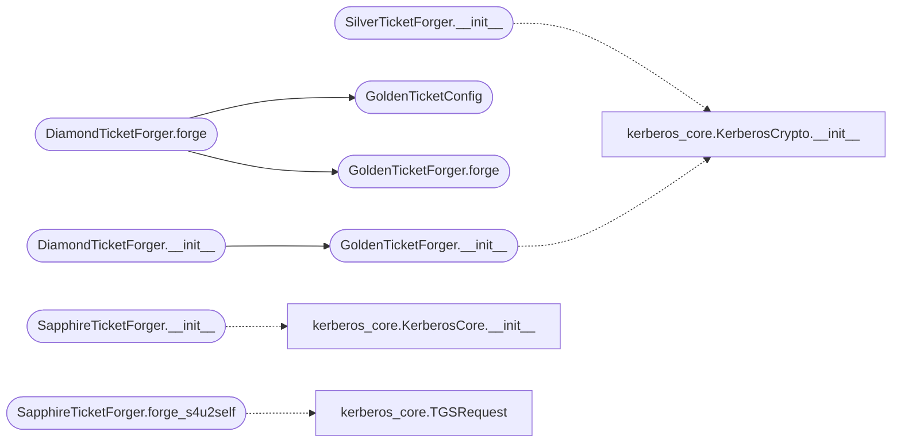

# `modules.kerberos_tickets`

> Source: [modules/kerberos_tickets.py:1](../../modules/kerberos_tickets.py#L1) | language `py` | coverage 81.0% | [API index](../index.md)

Kerberos ticket forgery attacks — silver, golden, diamond, sapphire tickets.

Implements ticket forging techniques for persistence and privilege escalation
in Active Directory environments. Requires the KerberosCore library.

Silver ticket: Forge a service ticket using the service account's NT hash.
Golden ticket: Forge a TGT using the krbtgt account's NT hash.
Diamond ticket: Golden ticket variant with forged PAC containing arbitrary group SIDs.
Sapphire ticket: S4U2self-based ticket forgery for resource-based constrained delegation.
Skeleton key: Patch LSASS to accept a master password for any account (via mimikatz wrapper).

## Contents

- **Classes:** [`SilverTicketConfig`](#silverticketconfig), [`GoldenTicketConfig`](#goldenticketconfig), [`DiamondTicketConfig`](#diamondticketconfig), [`SilverTicketForger`](#silverticketforger), [`GoldenTicketForger`](#goldenticketforger), [`DiamondTicketForger`](#diamondticketforger), [`SapphireTicketForger`](#sapphireticketforger), [`SkeletonKeyInjector`](#skeletonkeyinjector)
- **Constants:** [`TICKET_FLAG_FORWARDABLE`](#ticket_flag_forwardable), [`TICKET_FLAG_FORWARDED`](#ticket_flag_forwarded), [`TICKET_FLAG_PROXIABLE`](#ticket_flag_proxiable), [`TICKET_FLAG_RENEWABLE`](#ticket_flag_renewable), [`TICKET_FLAG_INITIAL`](#ticket_flag_initial), [`TICKET_FLAG_PRE_AUTHENT`](#ticket_flag_pre_authent), [`TICKET_FLAG_OK_AS_DELEGATE`](#ticket_flag_ok_as_delegate)

## Type Diagram

```mermaid
classDiagram
    direction LR
    class SilverTicketConfig
    SilverTicketConfig : str target_service
    SilverTicketConfig : str domain
    SilverTicketConfig : str domain_sid
    SilverTicketConfig : str username
    SilverTicketConfig : int user_rid
    SilverTicketConfig : str service_key_hex
    SilverTicketConfig : bytes service_key_bytes
    SilverTicketConfig : list[str] extra_sids
    SilverTicketConfig : int etype
    SilverTicketConfig : int lifetime_hours
    class GoldenTicketConfig
    GoldenTicketConfig : str domain
    GoldenTicketConfig : str domain_sid
    GoldenTicketConfig : str username
    GoldenTicketConfig : int user_rid
    GoldenTicketConfig : str krbtgt_hash_hex
    GoldenTicketConfig : bytes krbtgt_hash_bytes
    GoldenTicketConfig : str krbtgt_aes_key_hex
    GoldenTicketConfig : list[int] groups
    GoldenTicketConfig : int etype
    GoldenTicketConfig : int lifetime_hours
    class DiamondTicketConfig
    DiamondTicketConfig : str domain
    DiamondTicketConfig : str domain_sid
    DiamondTicketConfig : str username
    DiamondTicketConfig : int user_rid
    DiamondTicketConfig : str krbtgt_hash_hex
    DiamondTicketConfig : list[int] target_groups
    DiamondTicketConfig : list[str] extra_sids
    DiamondTicketConfig : int etype
    DiamondTicketConfig : int lifetime_hours
    class SilverTicketForger
    SilverTicketForger : __init__()
    SilverTicketForger : forge()
    class GoldenTicketForger
    GoldenTicketForger : __init__()
    GoldenTicketForger : forge()
    class DiamondTicketForger
    DiamondTicketForger : __init__()
    DiamondTicketForger : forge()
    class SapphireTicketForger
    SapphireTicketForger : __init__()
    SapphireTicketForger : forge_s4u2self()
    SapphireTicketForger : forge_rbcd()
    class SkeletonKeyInjector
    SkeletonKeyInjector : MASTER_PASSWORD
    SkeletonKeyInjector : detect_skeleton_key()
    SkeletonKeyInjector : inject_command()
    SkeletonKeyInjector : cleanup_command()
```



## Call Graph

Solid arrows stay in this module, dashed arrows leave it.



## Classes

<a id="silverticketconfig"></a>

### `SilverTicketConfig`

`class` `dataclass` | [modules/kerberos_tickets.py:36](../../modules/kerberos_tickets.py#L36)

Decorators: `@dataclass`

```python
class SilverTicketConfig
```

Silver ticket forgery parameters.

**Attributes**

| Name | Type | Default | Description |
|---|---|---|---|
| [`target_service`](#silverticketconfig-target_service) | `str` | `''` | Service SPN (e.g. 'cifs/DC01.domain.local'). |
| [`domain`](#silverticketconfig-domain) | `str` | `''` | Domain FQDN. |
| [`domain_sid`](#silverticketconfig-domain_sid) | `str` | `''` | Domain SID (e.g. 'S-1-5-21-...'). |
| [`username`](#silverticketconfig-username) | `str` | `'Administrator'` | Username to impersonate (default: Administrator). |
| [`user_rid`](#silverticketconfig-user_rid) | `int` | `500` | RID of the impersonated user (default: 500). |
| [`service_key_hex`](#silverticketconfig-service_key_hex) | `str` | `''` | NT hash of the service account in hex. |
| [`service_key_bytes`](#silverticketconfig-service_key_bytes) | `bytes` | `b''` | NT hash bytes (alternative to hex). |
| [`extra_sids`](#silverticketconfig-extra_sids) | `list[str]` | `field(default_factory=list)` | Additional group SIDs for the forged PAC. |
| [`etype`](#silverticketconfig-etype) | `int` | `23` | Encryption type (23=RC4, 18=AES256). |
| [`lifetime_hours`](#silverticketconfig-lifetime_hours) | `int` | `10` | Ticket lifetime in hours. |

---

<a id="goldenticketconfig"></a>

### `GoldenTicketConfig`

`class` `dataclass` | [modules/kerberos_tickets.py:65](../../modules/kerberos_tickets.py#L65)

Decorators: `@dataclass`

```python
class GoldenTicketConfig
```

Golden ticket forgery parameters.

**Attributes**

| Name | Type | Default | Description |
|---|---|---|---|
| [`domain`](#goldenticketconfig-domain) | `str` | `''` | Domain FQDN. |
| [`domain_sid`](#goldenticketconfig-domain_sid) | `str` | `''` | Domain SID. |
| [`username`](#goldenticketconfig-username) | `str` | `'Administrator'` | Username to impersonate (default: Administrator). |
| [`user_rid`](#goldenticketconfig-user_rid) | `int` | `500` | RID of the impersonated user. |
| [`krbtgt_hash_hex`](#goldenticketconfig-krbtgt_hash_hex) | `str` | `''` | NT hash of krbtgt account in hex. |
| [`krbtgt_hash_bytes`](#goldenticketconfig-krbtgt_hash_bytes) | `bytes` | `b''` | NT hash bytes (alternative to hex). |
| [`krbtgt_aes_key_hex`](#goldenticketconfig-krbtgt_aes_key_hex) | `str` | `''` | AES256 key of krbtgt account in hex. |
| [`groups`](#goldenticketconfig-groups) | `list[int]` | `field(default_factory=lambda: [513, 512, 520, 518, 519])` | Group RIDs to include in the PAC (default: 513, 512, 520, 518, 519). |
| [`etype`](#goldenticketconfig-etype) | `int` | `23` | Encryption type. |
| [`lifetime_hours`](#goldenticketconfig-lifetime_hours) | `int` | `10` | Ticket lifetime in hours. |

---

<a id="diamondticketconfig"></a>

### `DiamondTicketConfig`

`class` `dataclass` | [modules/kerberos_tickets.py:94](../../modules/kerberos_tickets.py#L94)

Decorators: `@dataclass`

```python
class DiamondTicketConfig
```

Diamond ticket forgery parameters (PAC-enhanced golden ticket).

Builds on GoldenTicketConfig with additional PAC manipulation:
the forged PAC includes arbitrary group SIDs and the user is marked
as a domain admin.

**Attributes**

| Name | Type | Default | Description |
|---|---|---|---|
| [`domain`](#diamondticketconfig-domain) | `str` | `''` | Domain FQDN. |
| [`domain_sid`](#diamondticketconfig-domain_sid) | `str` | `''` | Domain SID. |
| [`username`](#diamondticketconfig-username) | `str` | `'Administrator'` | Target username. |
| [`user_rid`](#diamondticketconfig-user_rid) | `int` | `500` | User RID. |
| [`krbtgt_hash_hex`](#diamondticketconfig-krbtgt_hash_hex) | `str` | `''` | krbtgt NT hash hex. |
| [`target_groups`](#diamondticketconfig-target_groups) | `list[int]` | `field(default_factory=lambda: [513, 512, 520, 518, 519])` | RIDs to embed in the PAC. |
| [`extra_sids`](#diamondticketconfig-extra_sids) | `list[str]` | `field(default_factory=list)` | Arbitrary extra SIDs to add. |
| [`etype`](#diamondticketconfig-etype) | `int` | `23` | Encryption type. |
| [`lifetime_hours`](#diamondticketconfig-lifetime_hours) | `int` | `10` | Ticket lifetime. |

---

<a id="silverticketforger"></a>

### `SilverTicketForger`

`class` | [modules/kerberos_tickets.py:124](../../modules/kerberos_tickets.py#L124)

```python
class SilverTicketForger
```

Forge service tickets (silver tickets) for lateral movement and persistence.

Silver tickets allow authentication to a specific service without
contacting the domain controller. Requires the service account's NT hash.

**Members**

| Member | Kind | Summary |
|---|---|---|
| [`__init__`](#silverticketforger-__init__) | constructor |  |
| [`forge`](#silverticketforger-forge) | method | Forge a silver ticket for the specified service. |

<a id="silverticketforger-__init__"></a>

#### `SilverTicketForger.__init__`

`constructor` | [modules/kerberos_tickets.py:131](../../modules/kerberos_tickets.py#L131)

```python
def __init__(self)
```

*Calls:* [`KerberosCrypto.__init__`](modules.kerberos_core.py.md#kerberoscrypto-__init__)

*Called by:* [`ActiveDirectoryCommandSet.do_kerberos_ticket`](cli.commands.active_directory.py.md#activedirectorycommandset-do_kerberos_ticket)

<a id="silverticketforger-forge"></a>

#### `SilverTicketForger.forge`

`method` | [modules/kerberos_tickets.py:134](../../modules/kerberos_tickets.py#L134)

```python
def forge(self, config: SilverTicketConfig) -> dict[str, Any]
```

Forge a silver ticket for the specified service.

**Parameters**

| Name | Type | Default | Description |
|---|---|---|---|
| `config` | `SilverTicketConfig` |  | SilverTicketConfig with target service and keys. |

**Returns:** `dict[str, Any]` - Dict with raw_ticket bytes, kirbi data, and metadata.

**Raises**

- `ValueError`: If required parameters are missing.

*Called by:* [`ActiveDirectoryCommandSet.do_kerberos_ticket`](cli.commands.active_directory.py.md#activedirectorycommandset-do_kerberos_ticket)

---

<a id="goldenticketforger"></a>

### `GoldenTicketForger`

`class` | [modules/kerberos_tickets.py:265](../../modules/kerberos_tickets.py#L265)

```python
class GoldenTicketForger
```

Forge TGTs (golden tickets) for full domain compromise persistence.

Golden tickets provide Kerberos authentication to any service in the
domain without time or access restrictions. Requires the krbtgt hash.

**Members**

| Member | Kind | Summary |
|---|---|---|
| [`__init__`](#goldenticketforger-__init__) | constructor |  |
| [`forge`](#goldenticketforger-forge) | method | Forge a golden ticket TGT. |

<a id="goldenticketforger-__init__"></a>

#### `GoldenTicketForger.__init__`

`constructor` | [modules/kerberos_tickets.py:272](../../modules/kerberos_tickets.py#L272)

```python
def __init__(self)
```

*Calls:* [`KerberosCrypto.__init__`](modules.kerberos_core.py.md#kerberoscrypto-__init__)

*Called by:* [`ActiveDirectoryCommandSet.do_kerberos_ticket`](cli.commands.active_directory.py.md#activedirectorycommandset-do_kerberos_ticket), [`DiamondTicketForger.__init__`](#diamondticketforger-__init__)

<a id="goldenticketforger-forge"></a>

#### `GoldenTicketForger.forge`

`method` | [modules/kerberos_tickets.py:275](../../modules/kerberos_tickets.py#L275)

```python
def forge(self, config: GoldenTicketConfig) -> dict[str, Any]
```

Forge a golden ticket TGT.

**Parameters**

| Name | Type | Default | Description |
|---|---|---|---|
| `config` | `GoldenTicketConfig` |  | GoldenTicketConfig with krbtgt hash and domain info. |

**Returns:** `dict[str, Any]` - Dict with raw TGT, KIRBI format, and operational metadata.

**Raises**

- `ValueError`: (raised in the body, not documented)

*Called by:* [`ActiveDirectoryCommandSet.do_kerberos_ticket`](cli.commands.active_directory.py.md#activedirectorycommandset-do_kerberos_ticket), [`DiamondTicketForger.forge`](#diamondticketforger-forge)

---

<a id="diamondticketforger"></a>

### `DiamondTicketForger`

`class` | [modules/kerberos_tickets.py:397](../../modules/kerberos_tickets.py#L397)

```python
class DiamondTicketForger
```

Forge diamond tickets with enhanced PAC manipulation.

Diamond tickets extend golden tickets by embedding a properly
constructed PAC with privileged group SIDs, making the ticket
appear legitimate to PAC validation.

**Members**

| Member | Kind | Summary |
|---|---|---|
| [`__init__`](#diamondticketforger-__init__) | constructor |  |
| [`forge`](#diamondticketforger-forge) | method | Forge a diamond ticket with PAC enhancement. |

<a id="diamondticketforger-__init__"></a>

#### `DiamondTicketForger.__init__`

`constructor` | [modules/kerberos_tickets.py:405](../../modules/kerberos_tickets.py#L405)

```python
def __init__(self)
```

*Calls:* [`GoldenTicketForger.__init__`](#goldenticketforger-__init__)

*Called by:* [`ActiveDirectoryCommandSet.do_kerberos_ticket`](cli.commands.active_directory.py.md#activedirectorycommandset-do_kerberos_ticket)

<a id="diamondticketforger-forge"></a>

#### `DiamondTicketForger.forge`

`method` | [modules/kerberos_tickets.py:408](../../modules/kerberos_tickets.py#L408)

```python
def forge(self, config: DiamondTicketConfig) -> dict[str, Any]
```

Forge a diamond ticket with PAC enhancement.

**Parameters**

| Name | Type | Default | Description |
|---|---|---|---|
| `config` | `DiamondTicketConfig` |  | DiamondTicketConfig with PAC manipulation parameters. |

**Returns:** `dict[str, Any]` - Dict with forged TGT data and operational notes.

*Calls:* [`GoldenTicketConfig`](#goldenticketconfig), [`GoldenTicketForger.forge`](#goldenticketforger-forge)

*Called by:* [`ActiveDirectoryCommandSet.do_kerberos_ticket`](cli.commands.active_directory.py.md#activedirectorycommandset-do_kerberos_ticket)

---

<a id="sapphireticketforger"></a>

### `SapphireTicketForger`

`class` | [modules/kerberos_tickets.py:462](../../modules/kerberos_tickets.py#L462)

```python
class SapphireTicketForger
```

S4U2self-based ticket forgery for resource-based constrained delegation.

Sapphire tickets exploit RBCD by using S4U2self to obtain a service
ticket for any user to a service where RBCD is configured.

**Members**

| Member | Kind | Summary |
|---|---|---|
| [`__init__`](#sapphireticketforger-__init__) | constructor |  |
| [`forge_s4u2self`](#sapphireticketforger-forge_s4u2self) | method | Generate a TGS-REQ for S4U2self service ticket. |
| [`forge_rbcd`](#sapphireticketforger-forge_rbcd) | method | Generate exploit instructions for resource-based constrained delegation. |

<a id="sapphireticketforger-__init__"></a>

#### `SapphireTicketForger.__init__`

`constructor` | [modules/kerberos_tickets.py:469](../../modules/kerberos_tickets.py#L469)

```python
def __init__(self, kerberos_core: KerberosCore | None = None)
```

**Parameters**

| Name | Type | Default | Description |
|---|---|---|---|
| `kerberos_core` | `KerberosCore \| None` | `None` |  |

*Calls:* [`KerberosCore.__init__`](modules.kerberos_core.py.md#kerberoscore-__init__)

<a id="sapphireticketforger-forge_s4u2self"></a>

#### `SapphireTicketForger.forge_s4u2self`

`method` | [modules/kerberos_tickets.py:472](../../modules/kerberos_tickets.py#L472)

```python
def forge_s4u2self(self, tgt: bytes, session_key: bytes, target_user: str, target_service: str, domain: str) -> dict[str, Any]
```

Generate a TGS-REQ for S4U2self service ticket.

**Parameters**

| Name | Type | Default | Description |
|---|---|---|---|
| `tgt` | `bytes` |  | TGT bytes. |
| `session_key` | `bytes` |  | TGT session key. |
| `target_user` | `str` |  | User to impersonate. |
| `target_service` | `str` |  | Target service SPN. |
| `domain` | `str` |  | Domain FQDN. |

**Returns:** `dict[str, Any]` - Dict with S4U2self TGS-REQ parameters.

*Calls:* [`TGSRequest`](modules.kerberos_core.py.md#tgsrequest)

<a id="sapphireticketforger-forge_rbcd"></a>

#### `SapphireTicketForger.forge_rbcd`

`method` | [modules/kerberos_tickets.py:530](../../modules/kerberos_tickets.py#L530)

```python
def forge_rbcd(self, machine_account_hash: str, target_service: str, domain: str, username: str = 'Administrator') -> dict[str, Any]
```

Generate exploit instructions for resource-based constrained delegation.

**Parameters**

| Name | Type | Default | Description |
|---|---|---|---|
| `machine_account_hash` | `str` |  | NT hash of a machine account with an SPN. |
| `target_service` | `str` |  | Target service to delegate to. |
| `domain` | `str` |  | Domain FQDN. |
| `username` | `str` | `'Administrator'` | User to impersonate. |

**Returns:** `dict[str, Any]` - Dict with RBCD attack steps and commands.

---

<a id="skeletonkeyinjector"></a>

### `SkeletonKeyInjector`

`class` | [modules/kerberos_tickets.py:567](../../modules/kerberos_tickets.py#L567)

```python
class SkeletonKeyInjector
```

Skeleton key attack — patch LSASS to accept a master password.

After running mimikatz skeleton key, any domain user can authenticate
with the master password 'mimikatz'. This module provides operational
wrappers for executing and detecting skeleton key attacks.

**Attributes**

| Name | Type | Default | Description |
|---|---|---|---|
| [`MASTER_PASSWORD`](#skeletonkeyinjector-master_password) |  | `'mimikatz'` |  |

**Members**

| Member | Kind | Summary |
|---|---|---|
| [`detect_skeleton_key`](#skeletonkeyinjector-detect_skeleton_key) | staticmethod | Check if skeleton key is active on a DC. |
| [`inject_command`](#skeletonkeyinjector-inject_command) | staticmethod | Generate mimikatz command for skeleton key injection on a DC. |
| [`cleanup_command`](#skeletonkeyinjector-cleanup_command) | staticmethod | Generate LSASS restart command to remove skeleton key patch. |

<a id="skeletonkeyinjector-detect_skeleton_key"></a>

#### `SkeletonKeyInjector.detect_skeleton_key`

`staticmethod` | [modules/kerberos_tickets.py:578](../../modules/kerberos_tickets.py#L578)

Decorators: `@staticmethod`

```python
def detect_skeleton_key(target_host: str, domain: str, dc_ip: str = '') -> dict[str, Any]
```

Check if skeleton key is active on a DC.

Attempts authentication with the skeleton key master password.

**Parameters**

| Name | Type | Default | Description |
|---|---|---|---|
| `target_host` | `str` |  | Domain controller hostname. |
| `domain` | `str` |  | Domain FQDN. |
| `dc_ip` | `str` | `''` | DC IP address. |

**Returns:** `dict[str, Any]` - Dict with detection results.

<a id="skeletonkeyinjector-inject_command"></a>

#### `SkeletonKeyInjector.inject_command`

`staticmethod` | [modules/kerberos_tickets.py:600](../../modules/kerberos_tickets.py#L600)

Decorators: `@staticmethod`

```python
def inject_command(target_host: str) -> str
```

Generate mimikatz command for skeleton key injection on a DC.

**Parameters**

| Name | Type | Default | Description |
|---|---|---|---|
| `target_host` | `str` |  | Target domain controller. |

**Returns:** `str` - mimikatz command string.

<a id="skeletonkeyinjector-cleanup_command"></a>

#### `SkeletonKeyInjector.cleanup_command`

`staticmethod` | [modules/kerberos_tickets.py:612](../../modules/kerberos_tickets.py#L612)

Decorators: `@staticmethod`

```python
def cleanup_command() -> str
```

Generate LSASS restart command to remove skeleton key patch.

**Returns:** `str` - Command to restart LSASS (force DC reboot).

---

## Constants

<a id="ticket_flag_forwardable"></a>

### `TICKET_FLAG_FORWARDABLE`

`constant` | [modules/kerberos_tickets.py:26](../../modules/kerberos_tickets.py#L26)

```python
TICKET_FLAG_FORWARDABLE = 1073741824
```

---

<a id="ticket_flag_forwarded"></a>

### `TICKET_FLAG_FORWARDED`

`constant` | [modules/kerberos_tickets.py:27](../../modules/kerberos_tickets.py#L27)

```python
TICKET_FLAG_FORWARDED = 536870912
```

---

<a id="ticket_flag_proxiable"></a>

### `TICKET_FLAG_PROXIABLE`

`constant` | [modules/kerberos_tickets.py:28](../../modules/kerberos_tickets.py#L28)

```python
TICKET_FLAG_PROXIABLE = 268435456
```

---

<a id="ticket_flag_renewable"></a>

### `TICKET_FLAG_RENEWABLE`

`constant` | [modules/kerberos_tickets.py:29](../../modules/kerberos_tickets.py#L29)

```python
TICKET_FLAG_RENEWABLE = 8388608
```

---

<a id="ticket_flag_initial"></a>

### `TICKET_FLAG_INITIAL`

`constant` | [modules/kerberos_tickets.py:30](../../modules/kerberos_tickets.py#L30)

```python
TICKET_FLAG_INITIAL = 4194304
```

---

<a id="ticket_flag_pre_authent"></a>

### `TICKET_FLAG_PRE_AUTHENT`

`constant` | [modules/kerberos_tickets.py:31](../../modules/kerberos_tickets.py#L31)

```python
TICKET_FLAG_PRE_AUTHENT = 2097152
```

---

<a id="ticket_flag_ok_as_delegate"></a>

### `TICKET_FLAG_OK_AS_DELEGATE`

`constant` | [modules/kerberos_tickets.py:32](../../modules/kerberos_tickets.py#L32)

```python
TICKET_FLAG_OK_AS_DELEGATE = 262144
```

---
