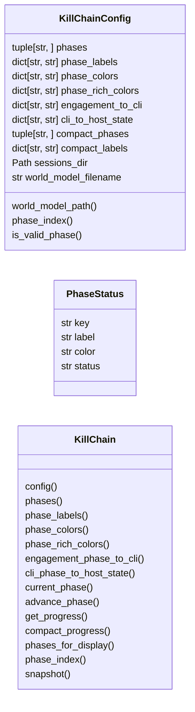
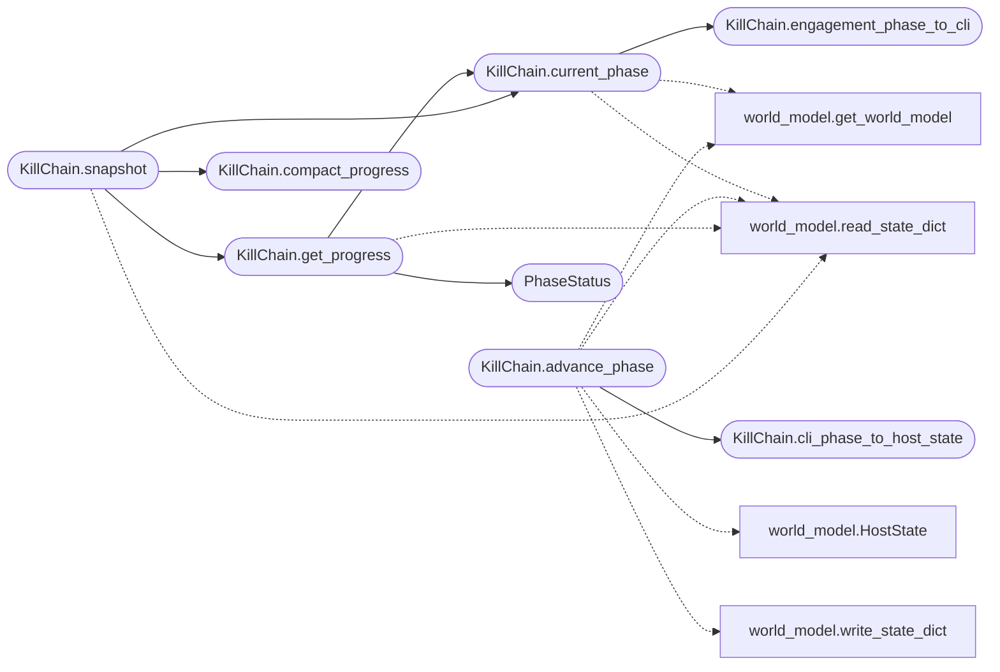

# `modules.killchain`

> Source: [modules/killchain.py:1](../../modules/killchain.py#L1) | language `py` | coverage 100.0% | [API index](../index.md)

Unified kill-chain — single source of truth consumed by all surfaces.

This module is the canonical authority for kill-chain phases, progress
derivation, phase mapping, and atomic updates. Every kill-chain display
(CLI, Flask dashboard, GUI2, Textual TUI, tips engine, recommendation
signals, MCP) imports from here. There is exactly one phase definition,
one mapping table, and one update path.

Contracts:
    - `[`KillChainConfig`](#killchainconfig)` holds all definitions (phases, colors, labels, maps).
    - `[`KillChain`](#killchain)` reads from the [`WorldModel`](modules.world_model.py.md#worldmodel) singleton as the primary
      source and falls back to raw ``world_model.json`` keys for operator
      overrides.
    - `[`KillChain.advance_phase`](#killchain-advance_phase)` is the only function that writes
      `[`current_phase`](#killchain-current_phase)` / ``completed_phases`` / ``phase`` into the raw
      JSON. Every other module that needs to change the kill-chain phase
      must call this function.

## Contents

- **Classes:** [`KillChainConfig`](#killchainconfig), [`PhaseStatus`](#phasestatus), [`KillChain`](#killchain)
- **Functions:** [`get_killchain`](#get_killchain)

## Type Diagram



## Call Graph

Solid arrows stay in this module, dashed arrows leave it.



## Classes

<a id="killchainconfig"></a>

### `KillChainConfig`

`class` `dataclass` | [modules/killchain.py:38](../../modules/killchain.py#L38)

Decorators: `@dataclass(frozen=True, slots=True)`

```python
class KillChainConfig
```

Centralised constants for the unified kill-chain.

Every colour, label, and mapping lives here. No magic values anywhere.

**Attributes**

| Name | Type | Default | Description |
|---|---|---|---|
| [`phases`](#killchainconfig-phases) | `tuple[str, ...]` | `field(default=('recon', 'scan', 'enum', 'exploit', 'privesc', 'lateral', 'exfil', 'report'))` |  |
| [`phase_labels`](#killchainconfig-phase_labels) | `dict[str, str]` | `field(default_factory=lambda: {'recon': 'Reconnaissance', 'scan': 'Scanning', 'enum': 'Enumeration', 'exploit': 'Exploitation', 'privesc': 'Privilege Escalation', 'lateral': 'Lateral Movement', 'exfil': 'Exfiltration', 'report': 'Reporting'})` |  |
| [`phase_colors`](#killchainconfig-phase_colors) | `dict[str, str]` | `field(default_factory=lambda: {'recon': '#a371f7', 'scan': '#58a6ff', 'enum': '#56d364', 'exploit': '#f85149', 'privesc': '#d2991d', 'lateral': '#db61a2', 'exfil': '#7c3aed', 'report': '#3fb950'})` |  |
| [`phase_rich_colors`](#killchainconfig-phase_rich_colors) | `dict[str, str]` | `field(default_factory=lambda: {'recon': 'cyan', 'scan': 'blue', 'enum': 'magenta', 'exploit': 'bold red', 'privesc': 'bold yellow', 'lateral': 'orange3', 'exfil': 'dark_orange', 'report': 'green'})` |  |
| [`engagement_to_cli`](#killchainconfig-engagement_to_cli) | `dict[str, str]` | `field(default_factory=lambda: {'recon': 'recon', 'scanning': 'scan', 'enumeration': 'enum', 'exploitation': 'exploit', 'post_exploitation': 'privesc', 'complete': 'report'})` |  |
| [`cli_to_host_state`](#killchainconfig-cli_to_host_state) | `dict[str, str]` | `field(default_factory=lambda: {'recon': '', 'scan': 'scanned', 'enum': 'enumerated', 'exploit': 'exploited', 'privesc': 'owned', 'lateral': 'owned', 'exfil': 'owned', 'report': 'owned', 'cred': 'owned', 'postexp': 'owned', 'persist': 'owned', 'c2': 'owned'})` |  |
| [`compact_phases`](#killchainconfig-compact_phases) | `tuple[str, ...]` | `field(default=('recon', 'enum', 'exploit', 'privesc', 'lateral'))` |  |
| [`compact_labels`](#killchainconfig-compact_labels) | `dict[str, str]` | `field(default_factory=lambda: {'recon': 'R', 'enum': 'E', 'exploit': 'X', 'privesc': 'P', 'lateral': 'L'})` |  |
| [`sessions_dir`](#killchainconfig-sessions_dir) | `Path` | `field(default=_SESSIONS_DIR)` |  |
| [`world_model_filename`](#killchainconfig-world_model_filename) | `str` | `field(default='world_model.json')` |  |

**Members**

| Member | Kind | Summary |
|---|---|---|
| [`world_model_path`](#killchainconfig-world_model_path) | method | Return the resolved path to world_model.json. |
| [`phase_index`](#killchainconfig-phase_index) | method | Return the positional index of a canonical phase in the kill chain. |
| [`is_valid_phase`](#killchainconfig-is_valid_phase) | method | Return True when ``phase`` is a recognised canonical phase. |

<a id="killchainconfig-world_model_path"></a>

#### `KillChainConfig.world_model_path`

`method` | [modules/killchain.py:116](../../modules/killchain.py#L116)

```python
def world_model_path(self) -> Path
```

Return the resolved path to world_model.json.

**Returns:** `Path`

<a id="killchainconfig-phase_index"></a>

#### `KillChainConfig.phase_index`

`method` | [modules/killchain.py:120](../../modules/killchain.py#L120)

```python
def phase_index(self, phase: str) -> int
```

Return the positional index of a canonical phase in the kill chain.

**Parameters**

| Name | Type | Default | Description |
|---|---|---|---|
| `phase` | `str` |  |  |

**Returns:** `int`

<a id="killchainconfig-is_valid_phase"></a>

#### `KillChainConfig.is_valid_phase`

`method` | [modules/killchain.py:127](../../modules/killchain.py#L127)

```python
def is_valid_phase(self, phase: str) -> bool
```

Return True when ``phase`` is a recognised canonical phase.

**Parameters**

| Name | Type | Default | Description |
|---|---|---|---|
| `phase` | `str` |  |  |

**Returns:** `bool`

---

<a id="phasestatus"></a>

### `PhaseStatus`

`class` `dataclass` | [modules/killchain.py:136](../../modules/killchain.py#L136)

Decorators: `@dataclass(frozen=True, slots=True)`

```python
class PhaseStatus
```

Progress for a single kill-chain phase.

**Attributes**

| Name | Type | Default | Description |
|---|---|---|---|
| [`key`](#phasestatus-key) | `str` |  |  |
| [`label`](#phasestatus-label) | `str` |  |  |
| [`color`](#phasestatus-color) | `str` |  |  |
| [`status`](#phasestatus-status) | `str` |  |  |

---

<a id="killchain"></a>

### `KillChain`

`class` | [modules/killchain.py:145](../../modules/killchain.py#L145)

```python
class KillChain
```

Unified kill-chain operations consumed by every display surface.

All methods are static or classmethods so no instantiation is needed.
The [`WorldModel`](modules.world_model.py.md#worldmodel) singleton is read as the primary source; raw JSON
keys in ``world_model.json`` provide operator overrides.

**Members**

| Member | Kind | Summary |
|---|---|---|
| [`config`](#killchain-config) | staticmethod | Return the centralised configuration. |
| [`phases`](#killchain-phases) | staticmethod | Return the canonical 8-phase tuple. |
| [`phase_labels`](#killchain-phase_labels) | staticmethod | Return the canonical phase label mapping. |
| [`phase_colors`](#killchain-phase_colors) | staticmethod | Return the canonical phase hex-color mapping. |
| [`phase_rich_colors`](#killchain-phase_rich_colors) | staticmethod | Return the canonical phase rich-terminal color mapping. |
| [`engagement_phase_to_cli`](#killchain-engagement_phase_to_cli) | staticmethod | Map a ``WorldModel.EngagementPhase`` value to the CLI phase key. |
| [`cli_phase_to_host_state`](#killchain-cli_phase_to_host_state) | staticmethod | Map a CLI phase to a ``WorldModel.HostState`` value. |
| [`current_phase`](#killchain-current_phase) | staticmethod | Derive the current kill-chain phase. |
| [`advance_phase`](#killchain-advance_phase) | staticmethod | Advance the kill-chain phase for connected surfaces. |
| [`get_progress`](#killchain-get_progress) | staticmethod | Return the current kill-chain progress as a list of status objects. |
| [`compact_progress`](#killchain-compact_progress) | staticmethod | Return a compact single-line progress indicator ``[R>E>X>P>L]``. |
| [`phases_for_display`](#killchain-phases_for_display) | staticmethod | Return an ordered ``(key, label, hex_color)`` triple for every phase. |
| [`phase_index`](#killchain-phase_index) | staticmethod | Return the zero-based index of a canonical phase. |
| [`snapshot`](#killchain-snapshot) | staticmethod | Return a single, render-agnostic snapshot of the whole kill-chain. |

<a id="killchain-config"></a>

#### `KillChain.config`

`staticmethod` | [modules/killchain.py:154](../../modules/killchain.py#L154)

Decorators: `@staticmethod`

```python
def config() -> KillChainConfig
```

Return the centralised configuration.

**Returns:** `KillChainConfig`

<a id="killchain-phases"></a>

#### `KillChain.phases`

`staticmethod` | [modules/killchain.py:159](../../modules/killchain.py#L159)

Decorators: `@staticmethod`

```python
def phases() -> tuple[str, ...]
```

Return the canonical 8-phase tuple.

**Returns:** `tuple[str, ...]`

*Called by:* [`PhaseMapper.canonical_kill_chain_order`](modules.lazyown_bridge.py.md#phasemapper-canonical_kill_chain_order)

<a id="killchain-phase_labels"></a>

#### `KillChain.phase_labels`

`staticmethod` | [modules/killchain.py:164](../../modules/killchain.py#L164)

Decorators: `@staticmethod`

```python
def phase_labels() -> dict[str, str]
```

Return the canonical phase label mapping.

**Returns:** `dict[str, str]`

<a id="killchain-phase_colors"></a>

#### `KillChain.phase_colors`

`staticmethod` | [modules/killchain.py:169](../../modules/killchain.py#L169)

Decorators: `@staticmethod`

```python
def phase_colors() -> dict[str, str]
```

Return the canonical phase hex-color mapping.

**Returns:** `dict[str, str]`

<a id="killchain-phase_rich_colors"></a>

#### `KillChain.phase_rich_colors`

`staticmethod` | [modules/killchain.py:174](../../modules/killchain.py#L174)

Decorators: `@staticmethod`

```python
def phase_rich_colors() -> dict[str, str]
```

Return the canonical phase rich-terminal color mapping.

**Returns:** `dict[str, str]`

<a id="killchain-engagement_phase_to_cli"></a>

#### `KillChain.engagement_phase_to_cli`

`staticmethod` | [modules/killchain.py:179](../../modules/killchain.py#L179)

Decorators: `@staticmethod`

```python
def engagement_phase_to_cli(engagement_value: str) -> str
```

Map a ``WorldModel.EngagementPhase`` value to the CLI phase key.

**Parameters**

| Name | Type | Default | Description |
|---|---|---|---|
| `engagement_value` | `str` |  | An `[`EngagementPhase`](modules.world_model.py.md#engagementphase)` value string. |

**Returns:** `str` - The corresponding CLI phase or ``"recon"`` as the safe default.

*Called by:* [`KillChain.current_phase`](#killchain-current_phase), [`PhaseMapper.to_bridge_phase`](modules.lazyown_bridge.py.md#phasemapper-to_bridge_phase)

<a id="killchain-cli_phase_to_host_state"></a>

#### `KillChain.cli_phase_to_host_state`

`staticmethod` | [modules/killchain.py:191](../../modules/killchain.py#L191)

Decorators: `@staticmethod`

```python
def cli_phase_to_host_state(phase: str) -> str
```

Map a CLI phase to a ``WorldModel.HostState`` value.

**Parameters**

| Name | Type | Default | Description |
|---|---|---|---|
| `phase` | `str` |  | A canonical CLI phase key. |

**Returns:** `str` - The corresponding ``HostState.value``, or empty string when no
state advancement is warranted.

*Called by:* [`KillChain.advance_phase`](#killchain-advance_phase)

<a id="killchain-current_phase"></a>

#### `KillChain.current_phase`

`staticmethod` | [modules/killchain.py:204](../../modules/killchain.py#L204)

Decorators: `@staticmethod`

```python
def current_phase(world_model_path: Path | None = None) -> str
```

Derive the current kill-chain phase.

Resolution order:
1. `[`WorldModel.get_phase`](modules.world_model.py.md#worldmodel-get_phase)` (derived from host states).
2. Raw ``world_model.json`` `[`current_phase`](#killchain-current_phase)` key (operator override).
3. Raw ``world_model.json`` ``phase`` key (legacy).
4. ``"recon"`` as the safe fallback.

**Parameters**

| Name | Type | Default | Description |
|---|---|---|---|
| `world_model_path` | `Path \| None` | `None` | Optional override path for the world model file. |

**Returns:** `str` - A canonical CLI phase key.

*Calls:* [`KillChain.engagement_phase_to_cli`](#killchain-engagement_phase_to_cli), [`get_world_model`](modules.world_model.py.md#get_world_model), [`read_state_dict`](modules.world_model.py.md#read_state_dict)

*Called by:* [`AiCommandSet.do_ask`](cli.commands.ai.py.md#aicommandset-do_ask), [`KillChain.get_progress`](#killchain-get_progress), [`KillChain.snapshot`](#killchain-snapshot), [`call_tool`](skills.lazyown_mcp.py.md#call_tool)

<a id="killchain-advance_phase"></a>

#### `KillChain.advance_phase`

`staticmethod` | [modules/killchain.py:251](../../modules/killchain.py#L251)

Decorators: `@staticmethod`

```python
def advance_phase(new_phase: str, world_model_path: Path | None = None, host: str | None = None) -> bool
```

Advance the kill-chain phase for connected surfaces.

Persists `[`current_phase`](#killchain-current_phase)`, ``phase``, and ``completed_phases``
in the raw ``world_model.json`` AND advances the host that proved
the phase. When ``host`` is empty (manual operator phase changes
and legacy callers) every tracked host is advanced for backward
compatibility; outcome-driven callers must pass the event host so
unrelated or stale hosts are never marked ``exploited``/``owned``.
An empty string advances no host (used by report-only outcomes).

**Parameters**

| Name | Type | Default | Description |
|---|---|---|---|
| `new_phase` | `str` |  | A valid canonical phase key. |
| `world_model_path` | `Path \| None` | `None` | Optional override path for the world model file. |
| `host` | `str \| None` | `None` | Host that produced the outcome; ``None`` advances all hosts and ``""`` advances none. |

**Returns:** `bool` - True when the write succeeded, False otherwise.

*Calls:* [`KillChain.cli_phase_to_host_state`](#killchain-cli_phase_to_host_state), [`HostState`](modules.world_model.py.md#hoststate), [`get_world_model`](modules.world_model.py.md#get_world_model), [`read_state_dict`](modules.world_model.py.md#read_state_dict), [`write_state_dict`](modules.world_model.py.md#write_state_dict)

*Called by:* [`apply`](modules.sinks.killchain.py.md#apply)

<a id="killchain-get_progress"></a>

#### `KillChain.get_progress`

`staticmethod` | [modules/killchain.py:328](../../modules/killchain.py#L328)

Decorators: `@staticmethod`

```python
def get_progress(world_model_path: Path | None = None) -> list[PhaseStatus]
```

Return the current kill-chain progress as a list of status objects.

Each phase is tagged as ``"done"``, ``"active"``, or ``"pending"``.
Suitable for rendering in any UI (CLI, web, GUI, TUI).

**Parameters**

| Name | Type | Default | Description |
|---|---|---|---|
| `world_model_path` | `Path \| None` | `None` | Optional override path for the world model file. |

**Returns:** `list[PhaseStatus]` - A list of `[`PhaseStatus`](#phasestatus)` named tuples in kill-chain order.

*Calls:* [`KillChain.current_phase`](#killchain-current_phase), [`PhaseStatus`](#phasestatus), [`read_state_dict`](modules.world_model.py.md#read_state_dict)

*Called by:* [`KillChain.snapshot`](#killchain-snapshot)

<a id="killchain-compact_progress"></a>

#### `KillChain.compact_progress`

`staticmethod` | [modules/killchain.py:377](../../modules/killchain.py#L377)

Decorators: `@staticmethod`

```python
def compact_progress(current_phase: str, phases_entered: list[str] | None = None) -> str
```

Return a compact single-line progress indicator ``[R>E>X>P>L]``.

**Parameters**

| Name | Type | Default | Description |
|---|---|---|---|
| `current_phase` | `str` |  | The active phase key. |
| `phases_entered` | `list[str] \| None` | `None` | Optional list of phases the operator has entered. |

**Returns:** `str` - A string suitable for inline display (e.g., below the prompt).

*Called by:* [`KillChain.snapshot`](#killchain-snapshot)

<a id="killchain-phases_for_display"></a>

#### `KillChain.phases_for_display`

`staticmethod` | [modules/killchain.py:397](../../modules/killchain.py#L397)

Decorators: `@staticmethod`

```python
def phases_for_display() -> tuple[tuple[str, str, str], ...]
```

Return an ordered ``(key, label, hex_color)`` triple for every phase.

Convenience for UI builders that need to render every phase.

**Returns:** `tuple[tuple[str, str, str], ...]`

<a id="killchain-phase_index"></a>

#### `KillChain.phase_index`

`staticmethod` | [modules/killchain.py:408](../../modules/killchain.py#L408)

Decorators: `@staticmethod`

```python
def phase_index(phase: str) -> int
```

Return the zero-based index of a canonical phase.

**Parameters**

| Name | Type | Default | Description |
|---|---|---|---|
| `phase` | `str` |  |  |

**Returns:** `int`

<a id="killchain-snapshot"></a>

#### `KillChain.snapshot`

`staticmethod` | [modules/killchain.py:413](../../modules/killchain.py#L413)

Decorators: `@staticmethod`

```python
def snapshot(world_model_path: Path | None = None) -> dict
```

Return a single, render-agnostic snapshot of the whole kill-chain.

This is the one payload every surface (CLI, Flask dashboard, GUI2,
Textual TUI, tips engine, REST API) consumes. It centralises the
current phase, the completed set, per-phase progress, host states and
a compact progress glyph so surfaces cannot diverge.

**Parameters**

| Name | Type | Default | Description |
|---|---|---|---|
| `world_model_path` | `Path \| None` | `None` | Optional override path for the world model file. |

**Returns:** `dict` - A JSON-serialisable dict with keys: `[`current_phase`](#killchain-current_phase)`,
``completed_phases``, `[`progress`](modules.lazy_runner.py.md#looprunconfig-progress)`, ``host_states``,
``compact`` and ``updated_at``.

*Calls:* [`KillChain.compact_progress`](#killchain-compact_progress), [`KillChain.current_phase`](#killchain-current_phase), [`KillChain.get_progress`](#killchain-get_progress), [`read_state_dict`](modules.world_model.py.md#read_state_dict)

*Called by:* [`check_calls`](scripts.devtools.core_smoke.py.md#check_calls)

---

## Functions

<a id="get_killchain"></a>

### `get_killchain`

`function` | [modules/killchain.py:453](../../modules/killchain.py#L453)

```python
def get_killchain() -> type[KillChain]
```

Return the `[`KillChain`](#killchain)` class as a module-level entry point.

**Returns:** `type[KillChain]`

---
