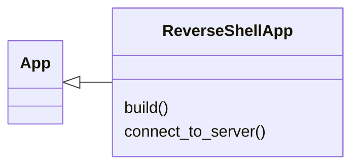

# `modules.kivi`

> Source: [modules/kivi.py:1](../../modules/kivi.py#L1) | language `py` | coverage 0.0% | [API index](../index.md)

## Contents

- **Classes:** [`ReverseShellApp`](#reverseshellapp)

## Type Diagram



## Classes

<a id="reverseshellapp"></a>

### `ReverseShellApp`

`class` | [modules/kivi.py:11](../../modules/kivi.py#L11)

```python
class ReverseShellApp(App)
```

Bases: [`App`](lazy_sentinel4.py.md#app)

**Members**

| Member | Kind | Summary |
|---|---|---|
| [`build`](#reverseshellapp-build) | method |  |
| [`connect_to_server`](#reverseshellapp-connect_to_server) | method |  |

<a id="reverseshellapp-build"></a>

#### `ReverseShellApp.build`

`method` | [modules/kivi.py:12](../../modules/kivi.py#L12)

```python
def build(self)
```

<a id="reverseshellapp-connect_to_server"></a>

#### `ReverseShellApp.connect_to_server`

`method` | [modules/kivi.py:27](../../modules/kivi.py#L27)

```python
def connect_to_server(self, instance)
```

**Parameters**

| Name | Type | Default | Description |
|---|---|---|---|
| `instance` |  |  |  |

---
