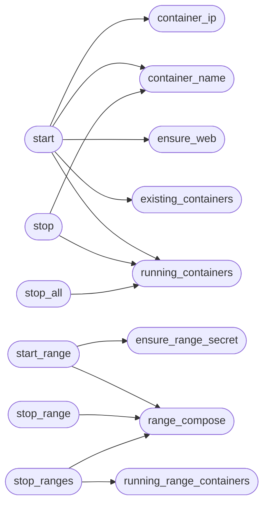

# `modules.lab_runtime`

> Source: [modules/lab_runtime.py:1](../../modules/lab_runtime.py#L1) | language `py` | coverage 100.0% | [API index](../index.md)

Lab runtime: Docker lifecycle for practice targets and cyber ranges.

Pure subprocess-free-of-shell lifecycle helpers shared by the ``lab``
command set, the gym challenge starter and the exit cleanup hook. Every
command runs in argv list form (``shell=False`` semantics) with bounded
timeouts; nothing here talks to a shell.

Scenarios live in [`LAB_SCENARIOS`](#lab_scenarios); cyber range profiles in
[`RANGE_PROFILES`](#range_profiles). Containers are named ``lazyown-lab-<scenario>``
so the cleanup pass can find every machine the framework launched.

## Contents

- **Functions:** [`docker_available`](#docker_available), [`running_containers`](#running_containers), [`existing_containers`](#existing_containers), [`running_range_containers`](#running_range_containers), [`container_name`](#container_name), [`container_ip`](#container_ip), [`ensure_web`](#ensure_web), [`apply_gym_migrations`](#apply_gym_migrations), [`start`](#start), [`stop`](#stop), [`stop_all`](#stop_all), [`range_compose`](#range_compose), [`start_range`](#start_range), [`stop_range`](#stop_range), [`stop_ranges`](#stop_ranges), [`ensure_range_secret`](#ensure_range_secret)
- **Constants:** [`BASE_DIR`](#base_dir), [`LAB_COMPOSE`](#lab_compose), [`RANGE_DIR`](#range_dir), [`REGISTRY_PREFIX`](#registry_prefix), [`RANGE_PREFIX`](#range_prefix), [`LAB_SCENARIOS`](#lab_scenarios), [`RANGE_PROFILES`](#range_profiles)

## Call Graph

Solid arrows stay in this module, dashed arrows leave it.



## Functions

<a id="docker_available"></a>

### `docker_available`

`function` | [modules/lab_runtime.py:81](../../modules/lab_runtime.py#L81)

```python
def docker_available() -> bool
```

Return whether the Docker daemon is reachable.

**Returns:** `bool`

---

<a id="running_containers"></a>

### `running_containers`

`function` | [modules/lab_runtime.py:103](../../modules/lab_runtime.py#L103)

```python
def running_containers() -> list[str]
```

Return the running lab container names.

**Returns:** `list[str]`

*Called by:* [`start`](#start), [`stop`](#stop), [`stop_all`](#stop_all)

---

<a id="existing_containers"></a>

### `existing_containers`

`function` | [modules/lab_runtime.py:119](../../modules/lab_runtime.py#L119)

```python
def existing_containers() -> list[str]
```

Return every lab container name including stopped ones.

**Returns:** `list[str]`

*Called by:* [`start`](#start)

---

<a id="running_range_containers"></a>

### `running_range_containers`

`function` | [modules/lab_runtime.py:136](../../modules/lab_runtime.py#L136)

```python
def running_range_containers() -> list[str]
```

Return the running cyber range container names.

**Returns:** `list[str]`

*Called by:* [`stop_ranges`](#stop_ranges)

---

<a id="container_name"></a>

### `container_name`

`function` | [modules/lab_runtime.py:152](../../modules/lab_runtime.py#L152)

```python
def container_name(scenario: str) -> str
```

Return the container name for one lab scenario.

**Parameters**

| Name | Type | Default | Description |
|---|---|---|---|
| `scenario` | `str` |  |  |

**Returns:** `str`

*Called by:* [`start`](#start), [`stop`](#stop)

---

<a id="container_ip"></a>

### `container_ip`

`function` | [modules/lab_runtime.py:157](../../modules/lab_runtime.py#L157)

```python
def container_ip(container_name: str) -> str
```

Resolve one container's IPv4 on its Docker network.

**Parameters**

| Name | Type | Default | Description |
|---|---|---|---|
| `container_name` | `str` |  |  |

**Returns:** `str`

*Called by:* [`start`](#start)

---

<a id="ensure_web"></a>

### `ensure_web`

`function` | [modules/lab_runtime.py:171](../../modules/lab_runtime.py#L171)

```python
def ensure_web(scenario: str, name: str) -> None
```

Start Apache inside a metasploitable container that booted without it.

**Parameters**

| Name | Type | Default | Description |
|---|---|---|---|
| `scenario` | `str` |  |  |
| `name` | `str` |  |  |

*Called by:* [`start`](#start)

---

<a id="apply_gym_migrations"></a>

### `apply_gym_migrations`

`function` | [modules/lab_runtime.py:185](../../modules/lab_runtime.py#L185)

```python
def apply_gym_migrations(name: str) -> dict
```

Apply the metasploitable gym migrations, returning the report.

**Parameters**

| Name | Type | Default | Description |
|---|---|---|---|
| `name` | `str` |  |  |

**Returns:** `dict`

---

<a id="start"></a>

### `start`

`function` | [modules/lab_runtime.py:193](../../modules/lab_runtime.py#L193)

```python
def start(scenario: str) -> dict
```

Spin up one lab scenario container.

**Parameters**

| Name | Type | Default | Description |
|---|---|---|---|
| `scenario` | `str` |  | Scenario key from [`LAB_SCENARIOS`](#lab_scenarios). |

**Returns:** `dict` - Mapping with ``success``, ``already``, ``container``, ``ip``,
`[`ports`](modules.enrich.py.md#enrichresult-ports)` and ``error`` keys.

*Calls:* [`container_ip`](#container_ip), [`container_name`](#container_name), [`ensure_web`](#ensure_web), [`existing_containers`](#existing_containers), [`running_containers`](#running_containers)

---

<a id="stop"></a>

### `stop`

`function` | [modules/lab_runtime.py:241](../../modules/lab_runtime.py#L241)

```python
def stop(scenario: str) -> dict
```

Stop one lab scenario container.

**Parameters**

| Name | Type | Default | Description |
|---|---|---|---|
| `scenario` | `str` |  | Scenario key from [`LAB_SCENARIOS`](#lab_scenarios). |

**Returns:** `dict` - Mapping with ``success`` and ``error`` keys.

*Calls:* [`container_name`](#container_name), [`running_containers`](#running_containers)

---

<a id="stop_all"></a>

### `stop_all`

`function` | [modules/lab_runtime.py:259](../../modules/lab_runtime.py#L259)

```python
def stop_all() -> dict
```

Stop every running lab container.

**Returns:** `dict` - Mapping with ``stopped`` (container name list) and ``failed``
(name to error) keys.

*Calls:* [`running_containers`](#running_containers)

---

<a id="range_compose"></a>

### `range_compose`

`function` | [modules/lab_runtime.py:277](../../modules/lab_runtime.py#L277)

```python
def range_compose(profile: str) -> Path | None
```

Return the compose file path for one range profile, or None.

**Parameters**

| Name | Type | Default | Description |
|---|---|---|---|
| `profile` | `str` |  |  |

**Returns:** `Path | None`

*Called by:* [`start_range`](#start_range), [`stop_range`](#stop_range), [`stop_ranges`](#stop_ranges)

---

<a id="start_range"></a>

### `start_range`

`function` | [modules/lab_runtime.py:286](../../modules/lab_runtime.py#L286)

```python
def start_range(profile: str) -> dict
```

Start one cyber range profile via Docker Compose.

**Parameters**

| Name | Type | Default | Description |
|---|---|---|---|
| `profile` | `str` |  | Range profile key from [`RANGE_PROFILES`](#range_profiles). |

**Returns:** `dict` - Mapping with ``success``, ``compose`` and ``error`` keys.

*Calls:* [`ensure_range_secret`](#ensure_range_secret), [`range_compose`](#range_compose)

---

<a id="stop_range"></a>

### `stop_range`

`function` | [modules/lab_runtime.py:305](../../modules/lab_runtime.py#L305)

```python
def stop_range(profile: str) -> dict
```

Stop one cyber range profile (compose down).

**Parameters**

| Name | Type | Default | Description |
|---|---|---|---|
| `profile` | `str` |  |  |

**Returns:** `dict`

*Calls:* [`range_compose`](#range_compose)

---

<a id="stop_ranges"></a>

### `stop_ranges`

`function` | [modules/lab_runtime.py:316](../../modules/lab_runtime.py#L316)

```python
def stop_ranges() -> dict
```

Stop every running cyber range.

Tries ``docker compose down`` for declared profiles first; any
remaining ``lazyown-range-*`` containers fall back to ``docker stop``.

**Returns:** `dict` - Mapping with ``stopped`` and ``failed`` keys.

*Calls:* [`range_compose`](#range_compose), [`running_range_containers`](#running_range_containers)

*Called by:* [`cleanup_gym_machines`](modules.gym_cleanup.py.md#cleanup_gym_machines)

---

<a id="ensure_range_secret"></a>

### `ensure_range_secret`

`function` | [modules/lab_runtime.py:357](../../modules/lab_runtime.py#L357)

```python
def ensure_range_secret(profile_dir: Path) -> str
```

Generate the DC admin secret file when missing.

**Parameters**

| Name | Type | Default | Description |
|---|---|---|---|
| `profile_dir` | `Path` |  | Range profile directory holding the compose file. |

**Returns:** `str` - The Administrator password string, or empty on failure.

*Called by:* [`start_range`](#start_range)

---

## Constants

<a id="base_dir"></a>

### `BASE_DIR`

`constant` | [modules/lab_runtime.py:21](../../modules/lab_runtime.py#L21)

```python
BASE_DIR = Path(__file__).resolve().parent.parent
```

---

<a id="lab_compose"></a>

### `LAB_COMPOSE`

`constant` | [modules/lab_runtime.py:22](../../modules/lab_runtime.py#L22)

```python
LAB_COMPOSE = BASE_DIR / 'deploy' / 'lab' / 'docker-compose.yml'
```

---

<a id="range_dir"></a>

### `RANGE_DIR`

`constant` | [modules/lab_runtime.py:23](../../modules/lab_runtime.py#L23)

```python
RANGE_DIR = BASE_DIR / 'deploy' / 'range'
```

---

<a id="registry_prefix"></a>

### `REGISTRY_PREFIX`

`constant` | [modules/lab_runtime.py:25](../../modules/lab_runtime.py#L25)

```python
REGISTRY_PREFIX = 'lazyown-lab-'
```

---

<a id="range_prefix"></a>

### `RANGE_PREFIX`

`constant` | [modules/lab_runtime.py:26](../../modules/lab_runtime.py#L26)

```python
RANGE_PREFIX = 'lazyown-range-'
```

---

<a id="lab_scenarios"></a>

### `LAB_SCENARIOS`

`constant` | [modules/lab_runtime.py:32](../../modules/lab_runtime.py#L32)

```python
LAB_SCENARIOS: dict[str, dict]
```

---

<a id="range_profiles"></a>

### `RANGE_PROFILES`

`constant` | [modules/lab_runtime.py:71](../../modules/lab_runtime.py#L71)

```python
RANGE_PROFILES: dict[str, dict]
```

---
