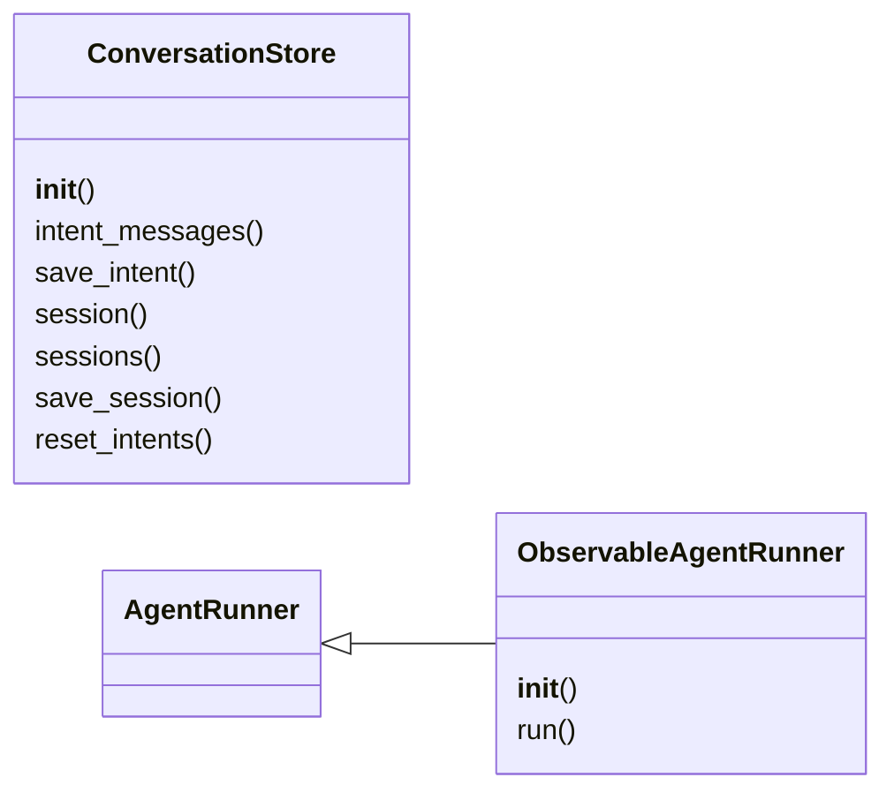
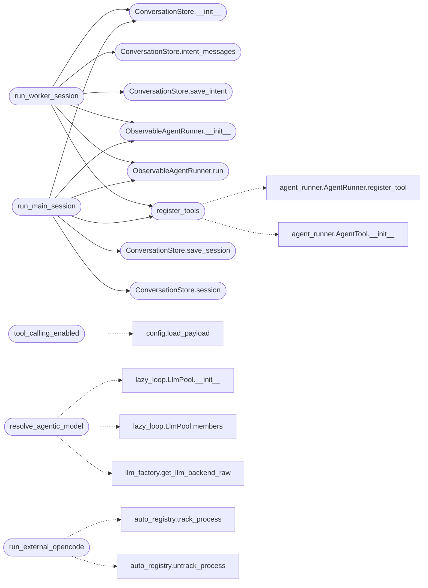

# `modules.lazy_agent`

> Source: [modules/lazy_agent.py:1](../../modules/lazy_agent.py#L1) | language `py` | coverage 100.0% | [API index](../index.md)

Agentic tool-calling bridge for the loop and the main agent.

The loop's planner/worker use one-shot completions by default. This
module upgrades them to real tool calling through the existing
OpenAI-compatible backends (groq/openai/deepseek): [`AgentRunner`](modules.agent_runner.py.md#agentrunner)
already speaks the function-calling protocol, so here we add

- tool registration for loop operations (the worker builds the guarded
  executors; this module only wires schemas and the agent loop),
- per-intent and per-session conversation persistence, so a resumed
  intent continues the same model conversation instead of replaying,
- an external ``opencode run`` backend for the main agent (full MCP
  tooling through that CLI) with best-effort session capture.

Native mode keeps guard/scope/audit parity because every tool call is
executed by the worker's guarded runner.

## Contents

- **Classes:** [`ObservableAgentRunner`](#observableagentrunner), [`ConversationStore`](#conversationstore)
- **Functions:** [`tool_calling_enabled`](#tool_calling_enabled), [`resolve_agentic_model`](#resolve_agentic_model), [`register_tools`](#register_tools), [`run_worker_session`](#run_worker_session), [`run_main_session`](#run_main_session), [`run_external_opencode`](#run_external_opencode)
- **Constants:** [`CLIENT_BACKENDS`](#client_backends)

## Type Diagram



## Call Graph

Solid arrows stay in this module, dashed arrows leave it.



## Classes

<a id="observableagentrunner"></a>

### `ObservableAgentRunner`

`class` | [modules/lazy_agent.py:128](../../modules/lazy_agent.py#L128)

```python
class ObservableAgentRunner(AgentRunner)
```

Bases: [`AgentRunner`](modules.agent_runner.py.md#agentrunner)

AgentRunner that reports every tool call and result to a sink.

**Members**

| Member | Kind | Summary |
|---|---|---|
| [`__init__`](#observableagentrunner-__init__) | constructor | Bind the model and the optional event sink (kind, name, text). |
| [`run`](#observableagentrunner-run) | method | Base loop plus final-turn persistence for true resume. |

<a id="observableagentrunner-__init__"></a>

#### `ObservableAgentRunner.__init__`

`constructor` | [modules/lazy_agent.py:131](../../modules/lazy_agent.py#L131)

```python
def __init__(self, model, system_prompt: str = '', max_iterations: int = DEFAULT_MAX_ITERATIONS, on_event: Callable[[str, str, str], None] | None = None) -> None
```

Bind the model and the optional event sink (kind, name, text).

**Parameters**

| Name | Type | Default | Description |
|---|---|---|---|
| `model` |  |  |  |
| `system_prompt` | `str` | `''` |  |
| `max_iterations` | `int` | `DEFAULT_MAX_ITERATIONS` |  |
| `on_event` | `Callable[[str, str, str], None] \| None` | `None` |  |

*Called by:* [`run_main_session`](#run_main_session), [`run_worker_session`](#run_worker_session)

<a id="observableagentrunner-run"></a>

#### `ObservableAgentRunner.run`

`method` | [modules/lazy_agent.py:151](../../modules/lazy_agent.py#L151)

```python
def run(self, user_input: str) -> str
```

Base loop plus final-turn persistence for true resume.

**Parameters**

| Name | Type | Default | Description |
|---|---|---|---|
| `user_input` | `str` |  |  |

**Returns:** `str`

*Called by:* [`run_main_session`](#run_main_session), [`run_worker_session`](#run_worker_session)

---

<a id="conversationstore"></a>

### `ConversationStore`

`class` | [modules/lazy_agent.py:207](../../modules/lazy_agent.py#L207)

```python
class ConversationStore
```

Per-task persistence of agent conversations (intents and sessions).

**Members**

| Member | Kind | Summary |
|---|---|---|
| [`__init__`](#conversationstore-__init__) | constructor | Bind the conversation store for one task (``main`` when empty). |
| [`intent_messages`](#conversationstore-intent_messages) | method | Return the stored messages for one intent (resume seed). |
| [`save_intent`](#conversationstore-save_intent) | method | Persist the tail of one intent conversation. |
| [`session`](#conversationstore-session) | method | Return one main-agent session payload (empty when unknown). |
| [`sessions`](#conversationstore-sessions) | method | List main-agent sessions with title, message count and age. |
| [`save_session`](#conversationstore-save_session) | method | Persist one main-agent session conversation tail. |
| [`reset_intents`](#conversationstore-reset_intents) | method | Drop every stored intent conversation (fresh agent start). |

<a id="conversationstore-__init__"></a>

#### `ConversationStore.__init__`

`constructor` | [modules/lazy_agent.py:210](../../modules/lazy_agent.py#L210)

```python
def __init__(self, task_id: str = '') -> None
```

Bind the conversation store for one task (``main`` when empty).

**Parameters**

| Name | Type | Default | Description |
|---|---|---|---|
| `task_id` | `str` | `''` |  |

*Called by:* [`LazyCommandSet.do_lazy_agent`](cli.commands.lazyops.py.md#lazycommandset-do_lazy_agent), [`run_main_session`](#run_main_session), [`run_worker_session`](#run_worker_session)

<a id="conversationstore-intent_messages"></a>

#### `ConversationStore.intent_messages`

`method` | [modules/lazy_agent.py:219](../../modules/lazy_agent.py#L219)

```python
def intent_messages(self, intent_id: int) -> list[dict]
```

Return the stored messages for one intent (resume seed).

**Parameters**

| Name | Type | Default | Description |
|---|---|---|---|
| `intent_id` | `int` |  |  |

**Returns:** `list[dict]`

*Called by:* [`run_worker_session`](#run_worker_session)

<a id="conversationstore-save_intent"></a>

#### `ConversationStore.save_intent`

`method` | [modules/lazy_agent.py:224](../../modules/lazy_agent.py#L224)

```python
def save_intent(self, intent_id: int, messages: Iterable[dict]) -> None
```

Persist the tail of one intent conversation.

**Parameters**

| Name | Type | Default | Description |
|---|---|---|---|
| `intent_id` | `int` |  |  |
| `messages` | `Iterable[dict]` |  |  |

*Called by:* [`run_worker_session`](#run_worker_session)

<a id="conversationstore-session"></a>

#### `ConversationStore.session`

`method` | [modules/lazy_agent.py:233](../../modules/lazy_agent.py#L233)

```python
def session(self, session_id: str) -> dict
```

Return one main-agent session payload (empty when unknown).

**Parameters**

| Name | Type | Default | Description |
|---|---|---|---|
| `session_id` | `str` |  |  |

**Returns:** `dict`

*Called by:* [`LazyCommandSet.do_lazy_agent`](cli.commands.lazyops.py.md#lazycommandset-do_lazy_agent), [`run_main_session`](#run_main_session)

<a id="conversationstore-sessions"></a>

#### `ConversationStore.sessions`

`method` | [modules/lazy_agent.py:237](../../modules/lazy_agent.py#L237)

```python
def sessions(self) -> list[dict]
```

List main-agent sessions with title, message count and age.

**Returns:** `list[dict]`

*Called by:* [`LazyCommandSet.do_lazy_agent`](cli.commands.lazyops.py.md#lazycommandset-do_lazy_agent)

<a id="conversationstore-save_session"></a>

#### `ConversationStore.save_session`

`method` | [modules/lazy_agent.py:251](../../modules/lazy_agent.py#L251)

```python
def save_session(self, session_id: str, messages: Iterable[dict], title: str = '') -> None
```

Persist one main-agent session conversation tail.

**Parameters**

| Name | Type | Default | Description |
|---|---|---|---|
| `session_id` | `str` |  |  |
| `messages` | `Iterable[dict]` |  |  |
| `title` | `str` | `''` |  |

*Called by:* [`LazyCommandSet.do_lazy_agent`](cli.commands.lazyops.py.md#lazycommandset-do_lazy_agent), [`run_main_session`](#run_main_session)

<a id="conversationstore-reset_intents"></a>

#### `ConversationStore.reset_intents`

`method` | [modules/lazy_agent.py:261](../../modules/lazy_agent.py#L261)

```python
def reset_intents(self) -> None
```

Drop every stored intent conversation (fresh agent start).

---

## Functions

<a id="tool_calling_enabled"></a>

### `tool_calling_enabled`

`function` | [modules/lazy_agent.py:40](../../modules/lazy_agent.py#L40)

```python
def tool_calling_enabled() -> bool
```

Return whether agentic tool calling is enabled by configuration.

``payload.json`` key ``agent_tool_calling`` disables it explicitly;
absent means enabled whenever a compatible backend resolves.

**Returns:** `bool`

*Calls:* [`load_payload`](core.config.py.md#load_payload)

---

<a id="resolve_agentic_model"></a>

### `resolve_agentic_model`

`function` | [modules/lazy_agent.py:66](../../modules/lazy_agent.py#L66)

```python
def resolve_agentic_model(exclude: set[str] | None = None)
```

Return a raw tool-calling backend for the best pool member, or None.

Members are tried by priority; only the openai-compatible legs can
speak function calling here. Ollama/Anthropic/toposwarm members are
skipped so the loop degrades to the deterministic path instead of
erroring mid-intent. ``exclude`` holds model names already tried
this intent so a failing member cannot pin the whole attempt.

**Parameters**

| Name | Type | Default | Description |
|---|---|---|---|
| `exclude` | `set[str] \| None` | `None` |  |

*Calls:* [`LlmPool.__init__`](modules.lazy_loop.py.md#llmpool-__init__), [`LlmPool.members`](modules.lazy_loop.py.md#llmpool-members), [`get_llm_backend_raw`](modules.llm_factory.py.md#get_llm_backend_raw)

*Called by:* [`LazyCommandSet.do_lazy_agent`](cli.commands.lazyops.py.md#lazycommandset-do_lazy_agent)

---

<a id="register_tools"></a>

### `register_tools`

`function` | [modules/lazy_agent.py:268](../../modules/lazy_agent.py#L268)

```python
def register_tools(runner: ObservableAgentRunner, specs: Iterable[dict]) -> None
```

Register tool specs (name, description, func, parameters, required).

**Parameters**

| Name | Type | Default | Description |
|---|---|---|---|
| `runner` | `ObservableAgentRunner` |  |  |
| `specs` | `Iterable[dict]` |  |  |

*Calls:* [`AgentRunner.register_tool`](modules.agent_runner.py.md#agentrunner-register_tool), [`AgentTool.__init__`](modules.agent_runner.py.md#agenttool-__init__)

*Called by:* [`run_main_session`](#run_main_session), [`run_worker_session`](#run_worker_session)

---

<a id="run_worker_session"></a>

### `run_worker_session`

`function` | [modules/lazy_agent.py:281](../../modules/lazy_agent.py#L281)

```python
def run_worker_session(model, task_id: str, intent_id: int, system_prompt: str, launch_prompt: str, tools: Iterable[dict], on_event: Callable[[str, str, str], None] | None = None) -> dict
```

Run one agentic intent attempt with resume seeding.

**Parameters**

| Name | Type | Default | Description |
|---|---|---|---|
| `model` |  |  | Raw tool-calling backend. |
| `task_id` | `str` |  | Task whose conversation store persists the session. |
| `intent_id` | `int` |  | Intent the conversation belongs to. |
| `system_prompt` | `str` |  | Invariant contract (goal, intent, scope, rules). |
| `launch_prompt` | `str` |  | The user turn for this attempt. |
| `tools` | `Iterable[dict]` |  | Tool specs registered on the runner. |
| `on_event` | `Callable[[str, str, str], None] \| None` | `None` | Optional (kind, name, text) observer. |

**Returns:** `dict` - Dict with reply, tool usage and persisted message count.

*Calls:* [`ConversationStore.__init__`](#conversationstore-__init__), [`ConversationStore.intent_messages`](#conversationstore-intent_messages), [`ConversationStore.save_intent`](#conversationstore-save_intent), [`ObservableAgentRunner.__init__`](#observableagentrunner-__init__), [`ObservableAgentRunner.run`](#observableagentrunner-run), [`register_tools`](#register_tools)

---

<a id="run_main_session"></a>

### `run_main_session`

`function` | [modules/lazy_agent.py:320](../../modules/lazy_agent.py#L320)

```python
def run_main_session(model, session_id: str, system_prompt: str, prompt: str, tools: Iterable[dict], on_event: Callable[[str, str, str], None] | None = None) -> dict
```

Run one main-agent turn, resuming the stored session conversation.

**Parameters**

| Name | Type | Default | Description |
|---|---|---|---|
| `model` |  |  |  |
| `session_id` | `str` |  |  |
| `system_prompt` | `str` |  |  |
| `prompt` | `str` |  |  |
| `tools` | `Iterable[dict]` |  |  |
| `on_event` | `Callable[[str, str, str], None] \| None` | `None` |  |

**Returns:** `dict`

*Calls:* [`ConversationStore.__init__`](#conversationstore-__init__), [`ConversationStore.save_session`](#conversationstore-save_session), [`ConversationStore.session`](#conversationstore-session), [`ObservableAgentRunner.__init__`](#observableagentrunner-__init__), [`ObservableAgentRunner.run`](#observableagentrunner-run), [`register_tools`](#register_tools)

*Called by:* [`LazyCommandSet.do_lazy_agent`](cli.commands.lazyops.py.md#lazycommandset-do_lazy_agent)

---

<a id="run_external_opencode"></a>

### `run_external_opencode`

`function` | [modules/lazy_agent.py:342](../../modules/lazy_agent.py#L342)

```python
def run_external_opencode(prompt: str, session_id: str = '', agent: str = '', cwd: str = '', timeout_sec: float = EXTERNAL_TIMEOUT_SEC) -> dict
```

Run one headless ``opencode run`` task with MCP tooling.

Best-effort session capture: when the JSON stream carries a session
id it is returned so the next call can resume with ``--session``.

**Parameters**

| Name | Type | Default | Description |
|---|---|---|---|
| `prompt` | `str` |  | Task text handed to the external agent. |
| `session_id` | `str` | `''` | Existing session to continue, when known. |
| `agent` | `str` | `''` | Optional opencode agent name (``--agent``). |
| `cwd` | `str` | `''` | Working directory for the agent. |
| `timeout_sec` | `float` | `EXTERNAL_TIMEOUT_SEC` | Hard timeout for the child process. |

**Returns:** `dict` - Dict with reply, captured session id and return code; never raises.

*Calls:* [`track_process`](modules.auto_registry.py.md#track_process), [`untrack_process`](modules.auto_registry.py.md#untrack_process)

*Called by:* [`LazyCommandSet.do_lazy_agent`](cli.commands.lazyops.py.md#lazycommandset-do_lazy_agent)

---

## Constants

<a id="client_backends"></a>

### `CLIENT_BACKENDS`

`constant` | [modules/lazy_agent.py:32](../../modules/lazy_agent.py#L32)

```python
CLIENT_BACKENDS = ('groq', 'openai', 'deepseek')
```

---
