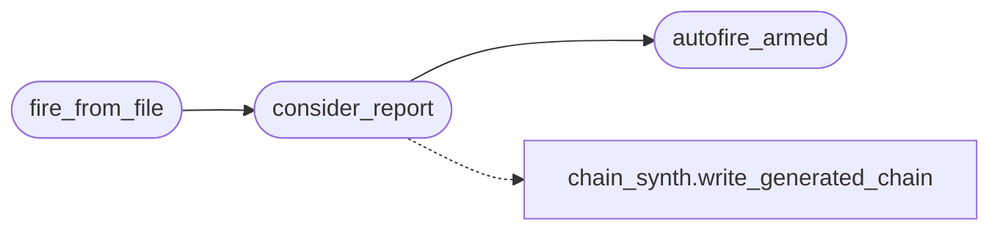

# `modules.lazy_autofire`

> Source: [modules/lazy_autofire.py:1](../../modules/lazy_autofire.py#L1) | language `py` | coverage 100.0% | [API index](../index.md)

Lazy autofire: exploit intelligence closing the loop into chains.

When an exposure report carries fire-tier matches with bounded evidence,
this contract turns them into a validated read-only confirmation chain:
``assign target`` plus one probe step per match (inline nmap version probe
with a ``verify`` token), capped, deduped and cooled down per
``(target, cve_id)``, finished by a ``lazyintel`` re-evaluation step.

Arming is operator-owned: autofire only writes a chain file when
``payload.json`` says ``"autofire": true``; without it, the chain data is
returned as a proposal and nothing is written. Chain generation rides the
existing contract [`modules.chain_synth.write_generated_chain`](modules.chain_synth.py.md#write_generated_chain), so an
invalid chain is never persisted.

## Contents

- **Functions:** [`autofire_armed`](#autofire_armed), [`consider_report`](#consider_report), [`fire_from_file`](#fire_from_file), [`sweep_state`](#sweep_state)
- **Constants:** [`STATE_FILE`](#state_file), [`CHAINS_DIR`](#chains_dir), [`CHAIN_PREFIX`](#chain_prefix), [`COOLDOWN_SECONDS`](#cooldown_seconds), [`MAX_FIRE_STEPS`](#max_fire_steps), [`TARGET_TOKEN`](#target_token)

## Call Graph

Solid arrows stay in this module, dashed arrows leave it.



## Functions

<a id="autofire_armed"></a>

### `autofire_armed`

`function` | [modules/lazy_autofire.py:41](../../modules/lazy_autofire.py#L41)

```python
def autofire_armed(payload: dict | None) -> bool
```

Whether the operator armed autofire in ``payload.json``.

**Parameters**

| Name | Type | Default | Description |
|---|---|---|---|
| `payload` | `dict \| None` |  | The loaded payload configuration. |

**Returns:** `bool` - True only for an explicit ``"autofire": true``.

*Called by:* [`consider_report`](#consider_report)

---

<a id="consider_report"></a>

### `consider_report`

`function` | [modules/lazy_autofire.py:53](../../modules/lazy_autofire.py#L53)

```python
def consider_report(report: dict, chains_dir: Path | str | None = None, state_path: Path | str | None = None, armed: bool | None = None, now: float | None = None) -> dict
```

Turn fire-tier bounded matches into a confirmation chain.

**Parameters**

| Name | Type | Default | Description |
|---|---|---|---|
| `report` | `dict` |  | Exposure report from [`modules.lazy_exposure.generate_report`](modules.lazy_exposure.py.md#generate_report). |
| `chains_dir` | `Path \| str \| None` | `None` | Optional chains directory override. |
| `state_path` | `Path \| str \| None` | `None` | Optional cooldown state file override. |
| `armed` | `bool \| None` | `None` | Explicit arm override; the default None keeps the write side off so only an explicit True may persist a chain file. |
| `now` | `float \| None` | `None` | Optional clock override for cooldown maths and tests. |

**Returns:** `dict` - ``{"action": "generated"|"proposed"|"skipped", "path", "errors",
"reason", "cves", "chain"}``.

*Calls:* [`write_generated_chain`](modules.chain_synth.py.md#write_generated_chain), [`autofire_armed`](#autofire_armed)

*Called by:* [`fire_from_file`](#fire_from_file)

---

<a id="fire_from_file"></a>

### `fire_from_file`

`function` | [modules/lazy_autofire.py:105](../../modules/lazy_autofire.py#L105)

```python
def fire_from_file(target: str, feed_path: str | Path | None = None, **kwargs) -> dict
```

Consider the saved exposure report of one target.

**Parameters**

| Name | Type | Default | Description |
|---|---|---|---|
| `target` | `str` |  | Host the report was generated for. |
| `feed_path` | `str \| Path \| None` | `None` | Optional exploit feed used to regenerate when the saved artefact lacks checks context (unused for reading). |
| `**kwargs` |  |  | Forwarded to [`consider_report`](#consider_report). |

**Returns:** `dict` - The [`consider_report`](#consider_report) result; a skip dict when the report
artefact is missing or unreadable.

*Calls:* [`consider_report`](#consider_report)

---

<a id="sweep_state"></a>

### `sweep_state`

`function` | [modules/lazy_autofire.py:127](../../modules/lazy_autofire.py#L127)

```python
def sweep_state(state_path: Path | str | None = None, now: float | None = None) -> int
```

Drop expired cooldown entries to keep the state file small.

**Parameters**

| Name | Type | Default | Description |
|---|---|---|---|
| `state_path` | `Path \| str \| None` | `None` | Optional state file override. |
| `now` | `float \| None` | `None` | Optional clock override. |

**Returns:** `int` - How many entries were pruned.

---

## Constants

<a id="state_file"></a>

### `STATE_FILE`

`constant` | [modules/lazy_autofire.py:30](../../modules/lazy_autofire.py#L30)

```python
STATE_FILE = STATE_DIR / 'state.json'
```

---

<a id="chains_dir"></a>

### `CHAINS_DIR`

`constant` | [modules/lazy_autofire.py:31](../../modules/lazy_autofire.py#L31)

```python
CHAINS_DIR = BASE_DIR / 'chains'
```

---

<a id="chain_prefix"></a>

### `CHAIN_PREFIX`

`constant` | [modules/lazy_autofire.py:32](../../modules/lazy_autofire.py#L32)

```python
CHAIN_PREFIX = 'lazy_autofire_'
```

---

<a id="cooldown_seconds"></a>

### `COOLDOWN_SECONDS`

`constant` | [modules/lazy_autofire.py:34](../../modules/lazy_autofire.py#L34)

```python
COOLDOWN_SECONDS = 86400
```

---

<a id="max_fire_steps"></a>

### `MAX_FIRE_STEPS`

`constant` | [modules/lazy_autofire.py:35](../../modules/lazy_autofire.py#L35)

```python
MAX_FIRE_STEPS = 3
```

---

<a id="target_token"></a>

### `TARGET_TOKEN`

`constant` | [modules/lazy_autofire.py:37](../../modules/lazy_autofire.py#L37)

```python
TARGET_TOKEN = '<TARGET>'
```

---
