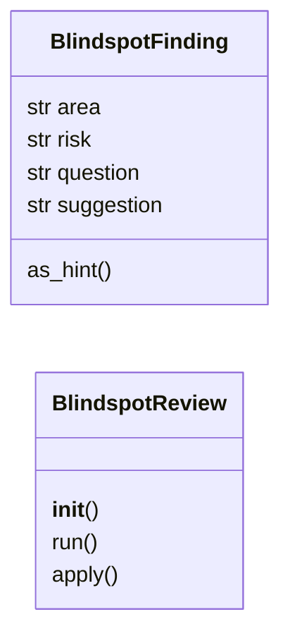
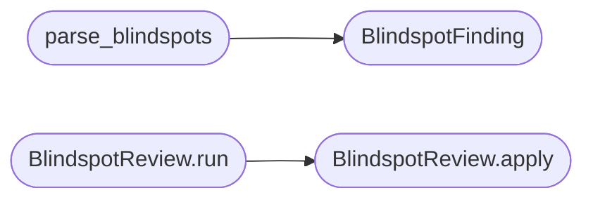

# `modules.lazy_blindspot`

> Source: [modules/lazy_blindspot.py:1](../../modules/lazy_blindspot.py#L1) | language `py` | coverage 100.0% | [API index](../index.md)

Blindspot review contract for the lazy autonomous loop.

Mined from sapper-v2's blindspot dispatch and reimplemented LazyOwn-native:
one LLM pass over the task graph that asks what the campaign is
overlooking — unvalidated assumptions, knowledge gaps, untested risks —
and turns every finding into a hint the planner already consumes.

One contract per file (SOLID): this module owns blindspot parsing,
prompt fencing and review application. LLM access and hint storage are
injected, so `[`modules.lazy_loop`](modules.lazy_loop.py.md)` stays the only orchestrator and no
import cycle appears.

State model:
    graph content -> UNTRUSTED data fenced in the prompt
    review result -> hints (``[blindspot/<risk>] area: question``)

Blindspot reviews never mutate goals or intents: they only add hints,
the same lever an operator uses with ``lazy_hint``.

## Contents

- **Classes:** [`BlindspotFinding`](#blindspotfinding), [`BlindspotReview`](#blindspotreview)
- **Functions:** [`parse_blindspots`](#parse_blindspots), [`build_blindspot_prompt`](#build_blindspot_prompt)
- **Constants:** [`BLINDSPOT_MAX_FINDINGS`](#blindspot_max_findings), [`BLINDSPOT_PROMPT`](#blindspot_prompt)

## Type Diagram



## Call Graph

Solid arrows stay in this module, dashed arrows leave it.



## Classes

<a id="blindspotfinding"></a>

### `BlindspotFinding`

`class` `dataclass` | [modules/lazy_blindspot.py:55](../../modules/lazy_blindspot.py#L55)

Decorators: `@dataclass(frozen=True)`

```python
class BlindspotFinding
```

One identified blindspot.

**Attributes**

| Name | Type | Default | Description |
|---|---|---|---|
| [`area`](#blindspotfinding-area) | `str` |  | Short label of the overlooked area. |
| [`risk`](#blindspotfinding-risk) | `str` |  | ``high``, ``medium`` or ``low``. |
| [`question`](#blindspotfinding-question) | `str` |  | The specific question the campaign should answer. |
| [`suggestion`](#blindspotfinding-suggestion) | `str` | `''` | How to resolve the blindspot, may be empty. |

**Members**

| Member | Kind | Summary |
|---|---|---|
| [`as_hint`](#blindspotfinding-as_hint) | method | Render the finding as a hint line the planner consumes. |

<a id="blindspotfinding-as_hint"></a>

#### `BlindspotFinding.as_hint`

`method` | [modules/lazy_blindspot.py:70](../../modules/lazy_blindspot.py#L70)

```python
def as_hint(self) -> str
```

Render the finding as a hint line the planner consumes.

**Returns:** `str` - ``[blindspot/<risk>] <area>: <question> - suggestion``.

---

<a id="blindspotreview"></a>

### `BlindspotReview`

`class` | [modules/lazy_blindspot.py:159](../../modules/lazy_blindspot.py#L159)

```python
class BlindspotReview
```

Run one blindspot review and apply findings as hints.

The review is a single LLM call over the task context; findings
become hints through the injected `[`add_hint`](modules.lazy_loop.py.md#lazyloopengine-add_hint)` callable so the loop
keeps its single hint-writing path.

**Parameters**

| Name | Type | Default | Description |
|---|---|---|---|
| `complete` |  |  | Callable ``(prompt, max_tokens) -> reply text``. |
| `add_hint` |  |  | Callable ``(hint_text) -> hint node or None``. |

**Members**

| Member | Kind | Summary |
|---|---|---|
| [`__init__`](#blindspotreview-__init__) | constructor | Bind the LLM callable and the hint sink. |
| [`run`](#blindspotreview-run) | method | Review the task and write one hint per finding. |
| [`apply`](#blindspotreview-apply) | method | Write hints for the findings already parsed. |

<a id="blindspotreview-__init__"></a>

#### `BlindspotReview.__init__`

`constructor` | [modules/lazy_blindspot.py:171](../../modules/lazy_blindspot.py#L171)

```python
def __init__(self, complete, add_hint) -> None
```

Bind the LLM callable and the hint sink.

**Parameters**

| Name | Type | Default | Description |
|---|---|---|---|
| `complete` |  |  |  |
| `add_hint` |  |  |  |

<a id="blindspotreview-run"></a>

#### `BlindspotReview.run`

`method` | [modules/lazy_blindspot.py:176](../../modules/lazy_blindspot.py#L176)

```python
def run(self, goal: str, context: str) -> list[BlindspotFinding]
```

Review the task and write one hint per finding.

**Parameters**

| Name | Type | Default | Description |
|---|---|---|---|
| `goal` | `str` |  | Task goal text. |
| `context` | `str` |  | Bounded graph and activity context. |

**Returns:** `list[BlindspotFinding]` - The applied findings; empty when the reviewer is unavailable,
the reply does not parse or nothing is missing.

*Calls:* [`BlindspotReview.apply`](#blindspotreview-apply)

<a id="blindspotreview-apply"></a>

#### `BlindspotReview.apply`

`method` | [modules/lazy_blindspot.py:200](../../modules/lazy_blindspot.py#L200)

```python
def apply(self, findings: list[BlindspotFinding]) -> list[BlindspotFinding]
```

Write hints for the findings already parsed.

A hint counts as applied when the sink accepts the write without
raising; the sink's return value is irrelevant so any storage
callable (a list append, an engine method) works.

**Parameters**

| Name | Type | Default | Description |
|---|---|---|---|
| `findings` | `list[BlindspotFinding]` |  | Findings to surface; capped at the module limit. |

**Returns:** `list[BlindspotFinding]` - The findings whose hint write succeeded.

*Called by:* [`BlindspotReview.run`](#blindspotreview-run)

---

## Functions

<a id="parse_blindspots"></a>

### `parse_blindspots`

`function` | [modules/lazy_blindspot.py:82](../../modules/lazy_blindspot.py#L82)

```python
def parse_blindspots(raw: str) -> list[BlindspotFinding]
```

Parse blindspot findings from a model reply.

Accepts a fenced or bare JSON object with ``data.blindspots`` (or a
bare list). Invalid entries are dropped instead of failing the whole
review; ``accepted: false`` yields no findings.

**Parameters**

| Name | Type | Default | Description |
|---|---|---|---|
| `raw` | `str` |  | Raw model output. |

**Returns:** `list[BlindspotFinding]` - Findings capped at `[`BLINDSPOT_MAX_FINDINGS`](#blindspot_max_findings)`, area/question
trimmed, risk normalized (unknown values become ``medium``).

*Calls:* [`BlindspotFinding`](#blindspotfinding)

---

<a id="build_blindspot_prompt"></a>

### `build_blindspot_prompt`

`function` | [modules/lazy_blindspot.py:145](../../modules/lazy_blindspot.py#L145)

```python
def build_blindspot_prompt(goal: str, context: str) -> str
```

Render the blindspot prompt with fenced untrusted content.

**Parameters**

| Name | Type | Default | Description |
|---|---|---|---|
| `goal` | `str` |  | Task goal text, truncated to the prompt limit. |
| `context` | `str` |  | Bounded graph/activity context, truncated to the limit. |

**Returns:** `str` - Prompt text with both blocks fenced so model JSON or target
content cannot terminate the data block early.

---

## Constants

<a id="blindspot_max_findings"></a>

### `BLINDSPOT_MAX_FINDINGS`

`constant` | [modules/lazy_blindspot.py:29](../../modules/lazy_blindspot.py#L29)

```python
BLINDSPOT_MAX_FINDINGS = 7
```

---

<a id="blindspot_prompt"></a>

### `BLINDSPOT_PROMPT`

`constant` | [modules/lazy_blindspot.py:32](../../modules/lazy_blindspot.py#L32)

```python
BLINDSPOT_PROMPT
```

---
