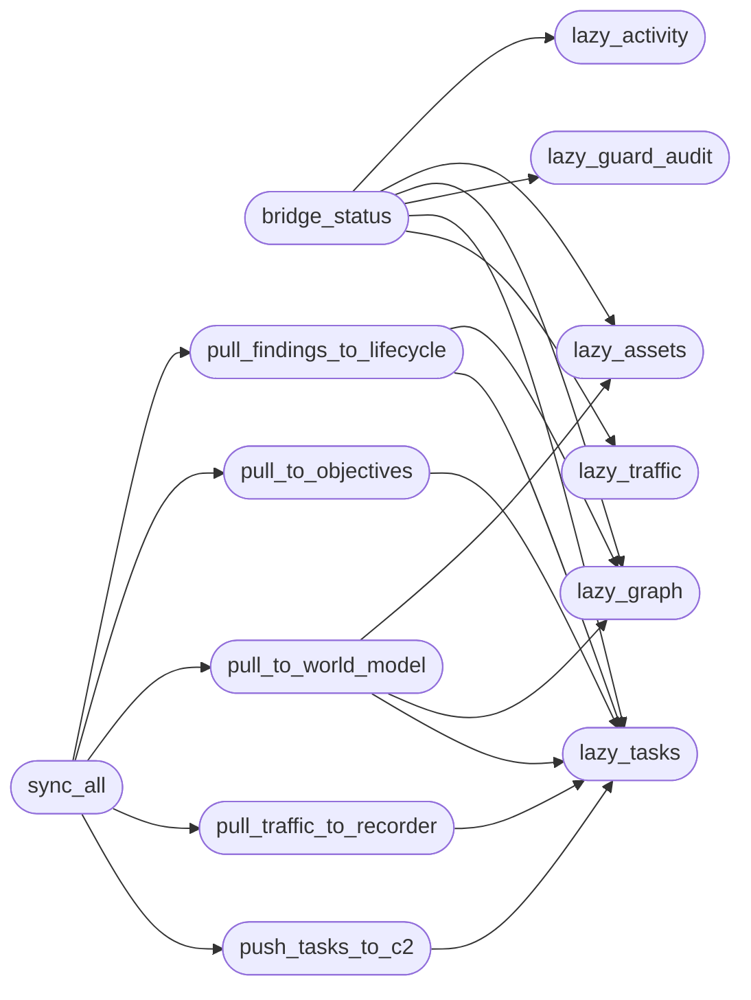

# `modules.lazy_bridge`

> Source: [modules/lazy_bridge.py:1](../../modules/lazy_bridge.py#L1) | language `py` | coverage 100.0% | [API index](../index.md)

Bidirectional LAZY <-> LazyOwn bridge.

LAZY runs standalone under sessions/lazy with its own tasks, assets,
experiment graphs, activity transcripts, traffic logs and guard audits.
This bridge syncs that universe with LazyOwn world_model, objectives,
evidence vault, traffic recorder, finding lifecycle and campaign DB in
both directions without touching LAZY runtime files.

## Contents

- **Functions:** [`lazy_tasks`](#lazy_tasks), [`lazy_assets`](#lazy_assets), [`lazy_graph`](#lazy_graph), [`lazy_activity`](#lazy_activity), [`lazy_traffic`](#lazy_traffic), [`lazy_guard_audit`](#lazy_guard_audit), [`bridge_status`](#bridge_status), [`pull_to_world_model`](#pull_to_world_model), [`pull_to_objectives`](#pull_to_objectives), [`pull_findings_to_lifecycle`](#pull_findings_to_lifecycle), [`pull_traffic_to_recorder`](#pull_traffic_to_recorder), [`push_objective_to_lazy`](#push_objective_to_lazy), [`push_tasks_to_c2`](#push_tasks_to_c2), [`sync_all`](#sync_all)

## Call Graph

Solid arrows stay in this module, dashed arrows leave it.



## Functions

<a id="lazy_tasks"></a>

### `lazy_tasks`

`function` | [modules/lazy_bridge.py:88](../../modules/lazy_bridge.py#L88)

```python
def lazy_tasks() -> dict
```

Load LAZY task registry.

**Returns:** `dict` - Task map keyed by task id.

*Called by:* [`bridge_status`](#bridge_status), [`pull_findings_to_lifecycle`](#pull_findings_to_lifecycle), [`pull_to_objectives`](#pull_to_objectives), [`pull_to_world_model`](#pull_to_world_model), [`pull_traffic_to_recorder`](#pull_traffic_to_recorder), [`push_tasks_to_c2`](#push_tasks_to_c2)

---

<a id="lazy_assets"></a>

### `lazy_assets`

`function` | [modules/lazy_bridge.py:99](../../modules/lazy_bridge.py#L99)

```python
def lazy_assets() -> list[dict]
```

Load LAZY asset nodes.

**Returns:** `list[dict]` - Asset node list.

*Called by:* [`bridge_status`](#bridge_status), [`pull_to_world_model`](#pull_to_world_model)

---

<a id="lazy_graph"></a>

### `lazy_graph`

`function` | [modules/lazy_bridge.py:110](../../modules/lazy_bridge.py#L110)

```python
def lazy_graph(task_id: str) -> dict
```

Load experiment graph for a task.

**Parameters**

| Name | Type | Default | Description |
|---|---|---|---|
| `task_id` | `str` |  | LAZY task id. |

**Returns:** `dict` - Graph dict with nodes, edges and anchors.

*Called by:* [`bridge_status`](#bridge_status), [`pull_findings_to_lifecycle`](#pull_findings_to_lifecycle), [`pull_to_world_model`](#pull_to_world_model)

---

<a id="lazy_activity"></a>

### `lazy_activity`

`function` | [modules/lazy_bridge.py:123](../../modules/lazy_bridge.py#L123)

```python
def lazy_activity(task_id: str) -> list[dict]
```

Load activity transcript for a task.

**Parameters**

| Name | Type | Default | Description |
|---|---|---|---|
| `task_id` | `str` |  | LAZY task id. |

**Returns:** `list[dict]` - Activity row list.

*Called by:* [`bridge_status`](#bridge_status)

---

<a id="lazy_traffic"></a>

### `lazy_traffic`

`function` | [modules/lazy_bridge.py:135](../../modules/lazy_bridge.py#L135)

```python
def lazy_traffic(task_id: str) -> list[dict]
```

Load traffic log for a task.

**Parameters**

| Name | Type | Default | Description |
|---|---|---|---|
| `task_id` | `str` |  | LAZY task id. |

**Returns:** `list[dict]` - Traffic row list.

*Called by:* [`bridge_status`](#bridge_status)

---

<a id="lazy_guard_audit"></a>

### `lazy_guard_audit`

`function` | [modules/lazy_bridge.py:147](../../modules/lazy_bridge.py#L147)

```python
def lazy_guard_audit(task_id: str) -> list[dict]
```

Load guard audit for a task.

**Parameters**

| Name | Type | Default | Description |
|---|---|---|---|
| `task_id` | `str` |  | LAZY task id. |

**Returns:** `list[dict]` - Guard audit row list.

*Called by:* [`bridge_status`](#bridge_status)

---

<a id="bridge_status"></a>

### `bridge_status`

`function` | [modules/lazy_bridge.py:159](../../modules/lazy_bridge.py#L159)

```python
def bridge_status() -> dict
```

Summarize LAZY universe and last sync cursor.

**Returns:** `dict` - Status dict with counts per task.

*Calls:* [`lazy_activity`](#lazy_activity), [`lazy_assets`](#lazy_assets), [`lazy_graph`](#lazy_graph), [`lazy_guard_audit`](#lazy_guard_audit), [`lazy_tasks`](#lazy_tasks), [`lazy_traffic`](#lazy_traffic)

---

<a id="pull_to_world_model"></a>

### `pull_to_world_model`

`function` | [modules/lazy_bridge.py:206](../../modules/lazy_bridge.py#L206)

```python
def pull_to_world_model() -> dict
```

Sync LAZY graphs and assets into LazyOwn world model.

**Returns:** `dict` - Summary with hosts, services and facts synced.

*Calls:* [`lazy_assets`](#lazy_assets), [`lazy_graph`](#lazy_graph), [`lazy_tasks`](#lazy_tasks)

*Called by:* [`sync_all`](#sync_all)

---

<a id="pull_to_objectives"></a>

### `pull_to_objectives`

`function` | [modules/lazy_bridge.py:251](../../modules/lazy_bridge.py#L251)

```python
def pull_to_objectives() -> dict
```

Inject open LAZY tasks as LazyOwn objectives without duplicates.

**Returns:** `dict` - Summary with injected count.

*Calls:* [`lazy_tasks`](#lazy_tasks)

*Called by:* [`sync_all`](#sync_all)

---

<a id="pull_findings_to_lifecycle"></a>

### `pull_findings_to_lifecycle`

`function` | [modules/lazy_bridge.py:286](../../modules/lazy_bridge.py#L286)

```python
def pull_findings_to_lifecycle() -> dict
```

Confirm LAZY finding nodes in LazyOwn finding lifecycle.

**Returns:** `dict` - Summary with confirmed count.

*Calls:* [`lazy_graph`](#lazy_graph), [`lazy_tasks`](#lazy_tasks)

*Called by:* [`sync_all`](#sync_all)

---

<a id="pull_traffic_to_recorder"></a>

### `pull_traffic_to_recorder`

`function` | [modules/lazy_bridge.py:361](../../modules/lazy_bridge.py#L361)

```python
def pull_traffic_to_recorder(progress=None) -> dict
```

Mirror new LAZY traffic rows into the LazyOwn recorder index.

The byte offset per task is persisted in ``lazy_bridge_sync.json`` so
repeated syncs stay proportional to new activity instead of replaying
the whole transcript (which used to stall the loop watchdog).

**Parameters**

| Name | Type | Default | Description |
|---|---|---|---|
| `progress` |  | `None` | Optional callback receiving short progress strings. |

**Returns:** `dict` - Summary with mirrored count and byte offsets committed.

*Calls:* [`lazy_tasks`](#lazy_tasks)

*Called by:* [`sync_all`](#sync_all)

---

<a id="push_objective_to_lazy"></a>

### `push_objective_to_lazy`

`function` | [modules/lazy_bridge.py:429](../../modules/lazy_bridge.py#L429)

```python
def push_objective_to_lazy(goal: str, scope: list[str] | None = None) -> dict
```

Export a LazyOwn objective as an LAZY-compatible task draft.

**Parameters**

| Name | Type | Default | Description |
|---|---|---|---|
| `goal` | `str` |  | Objective text. |
| `scope` | `list[str] \| None` | `None` | Scope ip list. |

**Returns:** `dict` - Draft task record written under sessions/lazy_drafts/.

---

<a id="push_tasks_to_c2"></a>

### `push_tasks_to_c2`

`function` | [modules/lazy_bridge.py:454](../../modules/lazy_bridge.py#L454)

```python
def push_tasks_to_c2(only: list[str] | None = None) -> dict
```

Mirror loop tasks into the lazyc2 Kanban board (sessions/tasks.json).

One C2 card per loop task, upserted through a persisted id map so
repeated syncs update the card instead of duplicating it. Statuses
follow the C2 vocabulary (New/Started/Blocked/Review/Done).

**Parameters**

| Name | Type | Default | Description |
|---|---|---|---|
| `only` | `list[str] \| None` | `None` | Optional task id subset to sync. |

**Returns:** `dict` - Dict with created/updated counts.

*Calls:* [`lazy_tasks`](#lazy_tasks)

*Called by:* [`sync_all`](#sync_all)

---

<a id="sync_all"></a>

### `sync_all`

`function` | [modules/lazy_bridge.py:519](../../modules/lazy_bridge.py#L519)

```python
def sync_all(progress=None) -> dict
```

Run full bidirectional pull plus lifecycle, traffic and board mirror.

**Parameters**

| Name | Type | Default | Description |
|---|---|---|---|
| `progress` |  | `None` | Optional callback receiving one short string before each stage and during traffic mirroring so the loop watchdog sees progress on large stores. |

**Returns:** `dict` - Combined sync summary.

*Calls:* [`pull_findings_to_lifecycle`](#pull_findings_to_lifecycle), [`pull_to_objectives`](#pull_to_objectives), [`pull_to_world_model`](#pull_to_world_model), [`pull_traffic_to_recorder`](#pull_traffic_to_recorder), [`push_tasks_to_c2`](#push_tasks_to_c2)

*Called by:* [`LazyQueueCommandSet.do_lazy_sync`](cli.commands.lazyloop.py.md#lazyqueuecommandset-do_lazy_sync)

---
