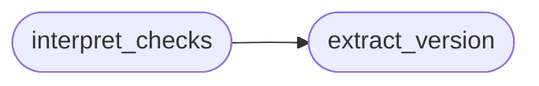

# `modules.lazy_checks`

> Source: [modules/lazy_checks.py:1](../../modules/lazy_checks.py#L1) | language `py` | coverage 100.0% | [API index](../index.md)

Validation plans as data: re-read observed checks through version math.

The retest engine ([`modules.lazy_verify`](modules.lazy_verify.py.md)) already replays read-only
checks; this module adds the interpretation layer: version strings seen
in check evidence are re-read through `lazy_heat.version_in_range`
against the stored OSV range, so a retest verdict states
``reaffirmed``/``version_changed``/``inconclusive`` instead of a grep
lane. A check that fails to reproduce never lowers a hardened finding.

Stdlib only; every entry point degrades to ``inconclusive``.

## Contents

- **Functions:** [`extract_version`](#extract_version), [`extract_cve`](#extract_cve), [`interpret_checks`](#interpret_checks)
- **Constants:** [`REAFFIRMED`](#reaffirmed), [`VERSION_CHANGED`](#version_changed), [`INCONCLUSIVE`](#inconclusive)

## Call Graph

Solid arrows stay in this module, dashed arrows leave it.



## Functions

<a id="extract_version"></a>

### `extract_version`

`function` | [modules/lazy_checks.py:30](../../modules/lazy_checks.py#L30)

```python
def extract_version(text: str) -> str
```

Pull the most version-like token from check output.

The token starts with a digit, tolerates patch tails (``9.9p1``,
``1.0.2k``) and rejects four-octet shapes so IPv4 addresses never
read as versions.

**Parameters**

| Name | Type | Default | Description |
|---|---|---|---|
| `text` | `str` |  | Combined check evidence. |

**Returns:** `str` - Version string, or '' when absent.

*Called by:* [`interpret_checks`](#interpret_checks)

---

<a id="extract_cve"></a>

### `extract_cve`

`function` | [modules/lazy_checks.py:51](../../modules/lazy_checks.py#L51)

```python
def extract_cve(text: str) -> str
```

Pull the uppercased CVE id from a finding text, or ''.

**Parameters**

| Name | Type | Default | Description |
|---|---|---|---|
| `text` | `str` |  |  |

**Returns:** `str`

---

<a id="interpret_checks"></a>

### `interpret_checks`

`function` | [modules/lazy_checks.py:57](../../modules/lazy_checks.py#L57)

```python
def interpret_checks(checks: list[dict], cve: str = '', stored_version: str = '', ranges: dict | None = None) -> dict[str, Any]
```

Re-read check results through the stored version range.

**Parameters**

| Name | Type | Default | Description |
|---|---|---|---|
| `checks` | `list[dict]` |  | Results shaped like `lazy_verify.run_check` rows (kind/verdict/evidence). |
| `cve` | `str` | `''` | Finding CVE id; '' pins the generic lane. |
| `stored_version` | `str` | `''` | Version the finding was recorded with. |
| `ranges` | `dict \| None` | `None` | Stored OSV range dict; ''-safe. |

**Returns:** `dict[str, Any]` - ``{verdict, observed_version, stored_version, cve, evidence}`
verdict is REAFFIRMED, VERSION_CHANGED or INCONCLUSIVE.

*Calls:* [`extract_version`](#extract_version)

---

## Constants

<a id="reaffirmed"></a>

### `REAFFIRMED`

`constant` | [modules/lazy_checks.py:20](../../modules/lazy_checks.py#L20)

```python
REAFFIRMED = 'reaffirmed'
```

---

<a id="version_changed"></a>

### `VERSION_CHANGED`

`constant` | [modules/lazy_checks.py:21](../../modules/lazy_checks.py#L21)

```python
VERSION_CHANGED = 'version_changed'
```

---

<a id="inconclusive"></a>

### `INCONCLUSIVE`

`constant` | [modules/lazy_checks.py:22](../../modules/lazy_checks.py#L22)

```python
INCONCLUSIVE = 'inconclusive'
```

---
