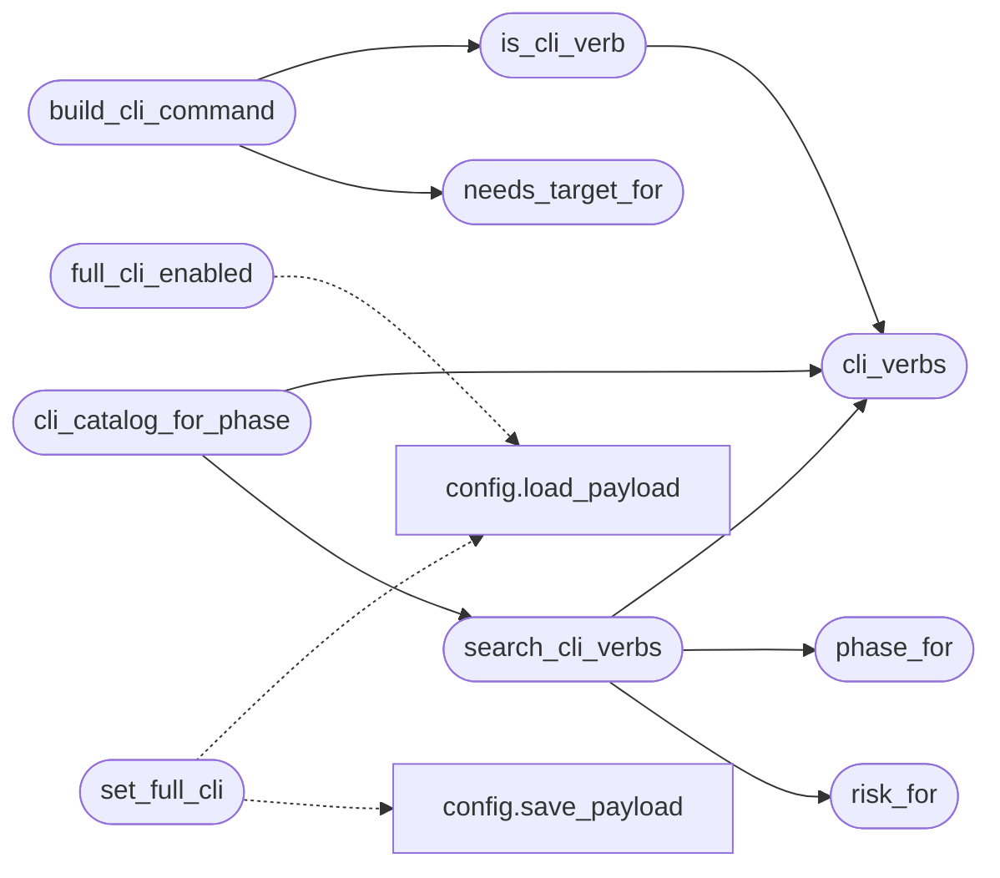

# `modules.lazy_cli_bridge`

> Source: [modules/lazy_cli_bridge.py:1](../../modules/lazy_cli_bridge.py#L1) | language `py` | coverage 100.0% | [API index](../index.md)

Full CLI catalog for the Lazy autonomous loop.

The loop historically routed only seven ``auto_*`` verbs plus a handful of
hardcoded probes. This module discovers every ``do_<verb>`` command of the
cmd2 shell (``cli/commands/*.py`` plus ``lazyown.py``) so the planner and
the workers can propose and execute any of the 800+ Lazy commands through
the same Guard and scope path as the built-in verbs.

Stdlib only. Lazy imports keep ``auto_registry`` cycle-free.

## Contents

- **Functions:** [`cli_verbs`](#cli_verbs), [`is_cli_verb`](#is_cli_verb), [`phase_for`](#phase_for), [`risk_for`](#risk_for), [`needs_target_for`](#needs_target_for), [`build_cli_command`](#build_cli_command), [`search_cli_verbs`](#search_cli_verbs), [`cli_catalog_for_phase`](#cli_catalog_for_phase), [`full_cli_enabled`](#full_cli_enabled), [`set_full_cli`](#set_full_cli)
- **Constants:** [`FULL_CLI_DEFAULT`](#full_cli_default)

## Call Graph

Solid arrows stay in this module, dashed arrows leave it.



## Functions

<a id="cli_verbs"></a>

### `cli_verbs`

`function` | [modules/lazy_cli_bridge.py:106](../../modules/lazy_cli_bridge.py#L106)

```python
def cli_verbs() -> tuple[str, ...]
```

Return every discovered shell verb, cached by source mtime.

**Returns:** `tuple[str, ...]`

*Called by:* [`LazyCommandSet.do_lazy_verb`](cli.commands.lazyops.py.md#lazycommandset-do_lazy_verb), [`cli_catalog_for_phase`](#cli_catalog_for_phase), [`is_cli_verb`](#is_cli_verb), [`search_cli_verbs`](#search_cli_verbs), [`index_commands`](modules.verb_catalog.py.md#index_commands)

---

<a id="is_cli_verb"></a>

### `is_cli_verb`

`function` | [modules/lazy_cli_bridge.py:125](../../modules/lazy_cli_bridge.py#L125)

```python
def is_cli_verb(name: str) -> bool
```

Return True when name is a real shell command.

**Parameters**

| Name | Type | Default | Description |
|---|---|---|---|
| `name` | `str` |  |  |

**Returns:** `bool`

*Calls:* [`cli_verbs`](#cli_verbs)

*Called by:* [`LazyCommandSet.do_lazy_verb`](cli.commands.lazyops.py.md#lazycommandset-do_lazy_verb), [`is_routable_command`](modules.auto_registry.py.md#is_routable_command), [`is_shell_verb`](modules.auto_registry.py.md#is_shell_verb), [`steps_for`](modules.auto_registry.py.md#steps_for), [`build_cli_command`](#build_cli_command), [`infer_source`](modules.lazy_intel.py.md#infer_source)

---

<a id="phase_for"></a>

### `phase_for`

`function` | [modules/lazy_cli_bridge.py:131](../../modules/lazy_cli_bridge.py#L131)

```python
def phase_for(verb: str) -> str
```

Map a verb to its kill-chain phase via keyword affinity.

**Parameters**

| Name | Type | Default | Description |
|---|---|---|---|
| `verb` | `str` |  |  |

**Returns:** `str`

*Called by:* [`search_cli_verbs`](#search_cli_verbs), [`describe_command`](modules.lazy_intel.py.md#describe_command)

---

<a id="risk_for"></a>

### `risk_for`

`function` | [modules/lazy_cli_bridge.py:140](../../modules/lazy_cli_bridge.py#L140)

```python
def risk_for(verb: str) -> str
```

Classify a verb as safe, exploit or high risk.

**Parameters**

| Name | Type | Default | Description |
|---|---|---|---|
| `verb` | `str` |  |  |

**Returns:** `str`

*Called by:* [`search_cli_verbs`](#search_cli_verbs), [`describe_command`](modules.lazy_intel.py.md#describe_command)

---

<a id="needs_target_for"></a>

### `needs_target_for`

`function` | [modules/lazy_cli_bridge.py:150](../../modules/lazy_cli_bridge.py#L150)

```python
def needs_target_for(verb: str) -> bool
```

Return whether the verb usually carries a target argument.

**Parameters**

| Name | Type | Default | Description |
|---|---|---|---|
| `verb` | `str` |  |  |

**Returns:** `bool`

*Called by:* [`build_cli_command`](#build_cli_command)

---

<a id="build_cli_command"></a>

### `build_cli_command`

`function` | [modules/lazy_cli_bridge.py:158](../../modules/lazy_cli_bridge.py#L158)

```python
def build_cli_command(verb: str, target: str = '') -> str
```

Build a shell line for any CLI verb bound to target.

**Parameters**

| Name | Type | Default | Description |
|---|---|---|---|
| `verb` | `str` |  | Canonical shell verb without parameters. |
| `target` | `str` | `''` | Optional target appended when the verb takes one. |

**Returns:** `str` - Command line ready for the shell executor.

**Raises**

- `KeyError`: Unknown verb.
- `ValueError`: Empty verb name.

*Calls:* [`is_cli_verb`](#is_cli_verb), [`needs_target_for`](#needs_target_for)

*Called by:* [`steps_for`](modules.auto_registry.py.md#steps_for)

---

<a id="search_cli_verbs"></a>

### `search_cli_verbs`

`function` | [modules/lazy_cli_bridge.py:185](../../modules/lazy_cli_bridge.py#L185)

```python
def search_cli_verbs(query: str = '', phase: str = '', limit: int = 30) -> list[dict]
```

Search the full CLI catalog by keyword and phase.

**Parameters**

| Name | Type | Default | Description |
|---|---|---|---|
| `query` | `str` | `''` | Substring filter over verb names. |
| `phase` | `str` | `''` | Optional kill-chain phase filter. |
| `limit` | `int` | `30` | Max entries returned. |

**Returns:** `list[dict]` - List of verb descriptors with name, phase and risk.

*Calls:* [`cli_verbs`](#cli_verbs), [`phase_for`](#phase_for), [`risk_for`](#risk_for)

*Called by:* [`cli_catalog_for_phase`](#cli_catalog_for_phase)

---

<a id="cli_catalog_for_phase"></a>

### `cli_catalog_for_phase`

`function` | [modules/lazy_cli_bridge.py:211](../../modules/lazy_cli_bridge.py#L211)

```python
def cli_catalog_for_phase(phase: str, limit: int = 40) -> str
```

Return a compact verb list for LLM prompt injection.

**Parameters**

| Name | Type | Default | Description |
|---|---|---|---|
| `phase` | `str` |  |  |
| `limit` | `int` | `40` |  |

**Returns:** `str`

*Calls:* [`cli_verbs`](#cli_verbs), [`search_cli_verbs`](#search_cli_verbs)

---

<a id="full_cli_enabled"></a>

### `full_cli_enabled`

`function` | [modules/lazy_cli_bridge.py:253](../../modules/lazy_cli_bridge.py#L253)

```python
def full_cli_enabled() -> bool
```

Return whether the loop may route any CLI verb.

Reads ``payload.json`` -> ``orchestrator`` -> ``full_cli``. Any load
failure falls back to the default so a broken payload never widens
the loop silently in the wrong direction.

**Returns:** `bool`

*Calls:* [`load_payload`](core.config.py.md#load_payload)

*Called by:* [`LazyCommandSet.do_lazy_verb`](cli.commands.lazyops.py.md#lazycommandset-do_lazy_verb), [`is_routable_command`](modules.auto_registry.py.md#is_routable_command), [`is_shell_verb`](modules.auto_registry.py.md#is_shell_verb), [`steps_for`](modules.auto_registry.py.md#steps_for)

---

<a id="set_full_cli"></a>

### `set_full_cli`

`function` | [modules/lazy_cli_bridge.py:276](../../modules/lazy_cli_bridge.py#L276)

```python
def set_full_cli(enabled: bool) -> bool
```

Persist the full-CLI routing flag and return the new value.

**Parameters**

| Name | Type | Default | Description |
|---|---|---|---|
| `enabled` | `bool` |  | New flag value. |

**Returns:** `bool` - Stored value after persisting.

*Calls:* [`load_payload`](core.config.py.md#load_payload), [`save_payload`](core.config.py.md#save_payload)

*Called by:* [`LazyCommandSet.do_lazy_verb`](cli.commands.lazyops.py.md#lazycommandset-do_lazy_verb)

---

## Constants

<a id="full_cli_default"></a>

### `FULL_CLI_DEFAULT`

`constant` | [modules/lazy_cli_bridge.py:29](../../modules/lazy_cli_bridge.py#L29)

```python
FULL_CLI_DEFAULT = True
```

---
