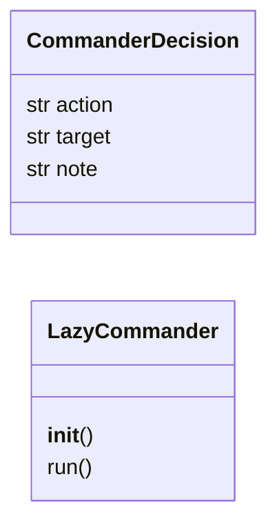
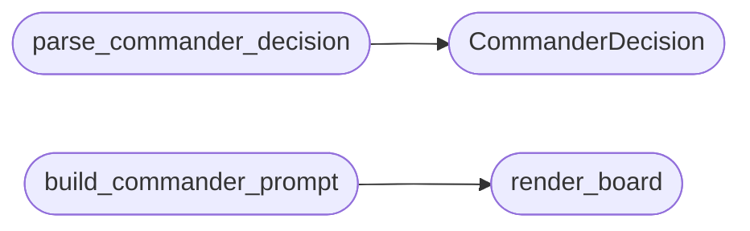

# `modules.lazy_commander`

> Source: [modules/lazy_commander.py:1](../../modules/lazy_commander.py#L1) | language `py` | coverage 100.0% | [API index](../index.md)

Fleet commander: allocate the next work slice across loop tasks.

Mined from sapper-v2's field commander and reimplemented LazyOwn-native.
When several loop tasks are alive at once, a slot-clock loop reads the
multi-task board, asks one LLM pass which task gets the next slice
(``work``, ``hire``, `[`fire`](modules.conditional_hooks.py.md#hookengine-fire)` or ``stop``) and falls back to
least-worked-first fairness when the model is unavailable or answers
nonsense. This is the operator-side coordination layer (keep the agent
fleet alive and productive); victim-side beaconing stays in `[`lazyc2`](lazyc2.__init__.py.md)`.

One contract per file (SOLID): decision parsing, board rendering, prompt
fencing and the allocation loop live here. Engine I/O is injected so
`[`modules.lazy_loop`](modules.lazy_loop.py.md)` stays the only orchestrator and no import cycle
appears:

- ``board_fn`` -> the task board (engine `[`list_tasks`](modules.exploitgym_gym.py.md#list_tasks)`).
- ``complete_fn`` -> ``(prompt, max_tokens) -> reply`` (`[`LlmPool`](modules.lazy_loop.py.md#llmpool)`).
- ``work_fn`` -> ``(task_id, workers) -> run result`` (engine ``run``).
- ``pause_fn`` -> ``(task_id, reason) -> bool`` (engine `[`pause_task`](modules.lazy_loop.py.md#lazyloopengine-pause_task)`).

The commander never edits tasks, goals or scope: it only spends slices
and pauses stalled work, exactly the levers an operator has by hand.

## Contents

- **Classes:** [`CommanderDecision`](#commanderdecision), [`LazyCommander`](#lazycommander)
- **Functions:** [`parse_commander_decision`](#parse_commander_decision), [`render_board`](#render_board), [`build_commander_prompt`](#build_commander_prompt), [`format_commander_budget`](#format_commander_budget)
- **Constants:** [`COMMANDER_ACTIONS`](#commander_actions), [`DEFAULT_COMMANDER_MINUTES`](#default_commander_minutes), [`DEFAULT_COMMANDER_SLICES`](#default_commander_slices), [`DEFAULT_COMMANDER_WORKERS`](#default_commander_workers), [`COMMANDER_HIRE_WORKERS`](#commander_hire_workers), [`COMMANDER_NOOP_LIMIT`](#commander_noop_limit)

## Type Diagram



## Call Graph

Solid arrows stay in this module, dashed arrows leave it.



## Classes

<a id="commanderdecision"></a>

### `CommanderDecision`

`class` `dataclass` | [modules/lazy_commander.py:63](../../modules/lazy_commander.py#L63)

Decorators: `@dataclass(frozen=True)`

```python
class CommanderDecision
```

One parsed commander decision.

**Attributes**

| Name | Type | Default | Description |
|---|---|---|---|
| [`action`](#commanderdecision-action) | `str` |  | ``work``, ``hire``, `[`fire`](modules.conditional_hooks.py.md#hookengine-fire)` or ``stop``. |
| [`target`](#commanderdecision-target) | `str` | `''` | Task id the action applies to (empty for ``stop``). |
| [`note`](#commanderdecision-note) | `str` | `''` | One-line rationale from the model or the fallback. |

---

<a id="lazycommander"></a>

### `LazyCommander`

`class` | [modules/lazy_commander.py:177](../../modules/lazy_commander.py#L177)

```python
class LazyCommander
```

Slot-clock commander over the loop task fleet.

**Parameters**

| Name | Type | Default | Description |
|---|---|---|---|
| `board_fn` |  |  | Callable returning `[`list_tasks`](modules.exploitgym_gym.py.md#list_tasks)` rows. |
| `complete_fn` |  |  | Optional LLM callable ``(prompt, max_tokens) -> text``; None forces the least-worked-first fallback. |
| `work_fn` |  |  | Callable ``(task_id, workers) -> run result``. |
| `pause_fn` |  |  | Callable ``(task_id, reason) -> bool``. |
| `clock` |  |  | Epoch-seconds callable (tests). |
| `sleep` |  |  | Seconds-sleeper callable (tests). |

**Members**

| Member | Kind | Summary |
|---|---|---|
| [`__init__`](#lazycommander-__init__) | constructor | Bind the injected engine callables and the clock. |
| [`run`](#lazycommander-run) | method | Allocate slices until the deadline, the slice cap or a stop. |

<a id="lazycommander-__init__"></a>

#### `LazyCommander.__init__`

`constructor` | [modules/lazy_commander.py:190](../../modules/lazy_commander.py#L190)

```python
def __init__(self, board_fn: Callable[[], list[dict]], complete_fn: Callable[[str, int], str] | None, work_fn: Callable[[str, int], dict], pause_fn: Callable[[str, str], bool], clock: Callable[[], float] = time.time, sleep: Callable[[float], None] = time.sleep) -> None
```

Bind the injected engine callables and the clock.

**Parameters**

| Name | Type | Default | Description |
|---|---|---|---|
| `board_fn` | `Callable[[], list[dict]]` |  |  |
| `complete_fn` | `Callable[[str, int], str] \| None` |  |  |
| `work_fn` | `Callable[[str, int], dict]` |  |  |
| `pause_fn` | `Callable[[str, str], bool]` |  |  |
| `clock` | `Callable[[], float]` | `time.time` |  |
| `sleep` | `Callable[[float], None]` | `time.sleep` |  |

*Called by:* [`LazyCommandSet.do_lazy_commander`](cli.commands.lazyops.py.md#lazycommandset-do_lazy_commander)

<a id="lazycommander-run"></a>

#### `LazyCommander.run`

`method` | [modules/lazy_commander.py:207](../../modules/lazy_commander.py#L207)

```python
def run(self, minutes: float = DEFAULT_COMMANDER_MINUTES, max_slices: int = DEFAULT_COMMANDER_SLICES, base_workers: int = DEFAULT_COMMANDER_WORKERS) -> dict
```

Allocate slices until the deadline, the slice cap or a stop.

Each slice: read the board, ask the model (fallback
least-worked-first), execute the decision. Unknown targets and
unusable replies count toward `[`COMMANDER_NOOP_LIMIT`](#commander_noop_limit)` no-ops and
abort the round; `[`fire`](modules.conditional_hooks.py.md#hookengine-fire)` pauses the target out of the candidate
pool; ``stop`` ends immediately.

**Parameters**

| Name | Type | Default | Description |
|---|---|---|---|
| `minutes` | `float` | `DEFAULT_COMMANDER_MINUTES` | Wall-clock budget for the whole allocation round. |
| `max_slices` | `int` | `DEFAULT_COMMANDER_SLICES` | Maximum work/hire slices this round. |
| `base_workers` | `int` | `DEFAULT_COMMANDER_WORKERS` | Worker count for plain ``work`` slices; ``hire`` slices run with `[`COMMANDER_HIRE_WORKERS`](#commander_hire_workers)`. |

**Returns:** `dict` - Summary dict with ``decisions`` (executed log), ``worked``
(slices per task), ``slices`` count and a ``reason`` line.
Targets paused this session stay out of the pool even when
the board still lists them.

*Called by:* [`LazyCommandSet.do_lazy_commander`](cli.commands.lazyops.py.md#lazycommandset-do_lazy_commander)

---

## Functions

<a id="parse_commander_decision"></a>

### `parse_commander_decision`

`function` | [modules/lazy_commander.py:77](../../modules/lazy_commander.py#L77)

```python
def parse_commander_decision(raw: str) -> CommanderDecision | None
```

Parse one commander decision from a model reply.

Accepts a fenced or bare JSON object with ``data.action``. Unknown
actions, missing targets for directed actions and unparseable output
yield None so the caller falls back to fairness instead of trusting
them. An explicit ``accepted: false`` yields a `[`reject`](modules.finding_lifecycle.py.md#reject)` decision
the caller counts toward its no-op streak (sapper semantics: the
model deliberately refused the board).

**Parameters**

| Name | Type | Default | Description |
|---|---|---|---|
| `raw` | `str` |  | Raw model output. |

**Returns:** `CommanderDecision | None` - The parsed decision, or None when the reply is unusable.

*Calls:* [`CommanderDecision`](#commanderdecision)

---

<a id="render_board"></a>

### `render_board`

`function` | [modules/lazy_commander.py:119](../../modules/lazy_commander.py#L119)

```python
def render_board(rows: list[dict], worked: dict[str, int] | None = None) -> str
```

Render the task board as a compact fenced block body.

**Parameters**

| Name | Type | Default | Description |
|---|---|---|---|
| `rows` | `list[dict]` |  | `[`list_tasks`](modules.exploitgym_gym.py.md#list_tasks)` rows (task_id, status, goal, intents_pending, facts, findings, updated). |
| `worked` | `dict[str, int] \| None` | `None` | Slices already spent per task this commander session. |

**Returns:** `str` - One ``|``-separated line per task, long goals truncated.

*Called by:* [`build_commander_prompt`](#build_commander_prompt)

---

<a id="build_commander_prompt"></a>

### `build_commander_prompt`

`function` | [modules/lazy_commander.py:145](../../modules/lazy_commander.py#L145)

```python
def build_commander_prompt(board_rows: list[dict], time_budget: str, worked: dict[str, int] | None = None) -> str
```

Render the commander prompt with fenced untrusted board content.

**Parameters**

| Name | Type | Default | Description |
|---|---|---|---|
| `board_rows` | `list[dict]` |  | Task board rows. |
| `time_budget` | `str` |  | Human-readable remaining time line. |
| `worked` | `dict[str, int] \| None` | `None` | Slices already spent per task. |

**Returns:** `str` - Prompt text; backticks inside board content are neutralized so a
hostile row cannot terminate the data block early.

*Calls:* [`render_board`](#render_board)

---

<a id="format_commander_budget"></a>

### `format_commander_budget`

`function` | [modules/lazy_commander.py:161](../../modules/lazy_commander.py#L161)

```python
def format_commander_budget(deadline: float, now: float | None = None) -> str
```

Human-readable remaining slot-clock time for the prompt.

**Parameters**

| Name | Type | Default | Description |
|---|---|---|---|
| `deadline` | `float` |  | Epoch seconds when the commander must stop. |
| `now` | `float \| None` | `None` | Override for the current epoch (tests). |

**Returns:** `str` - ``"12m remaining until 13:40 deadline"`` style line.

---

## Constants

<a id="commander_actions"></a>

### `COMMANDER_ACTIONS`

`constant` | [modules/lazy_commander.py:34](../../modules/lazy_commander.py#L34)

```python
COMMANDER_ACTIONS = ('work', 'hire', 'fire', 'stop')
```

---

<a id="default_commander_minutes"></a>

### `DEFAULT_COMMANDER_MINUTES`

`constant` | [modules/lazy_commander.py:36](../../modules/lazy_commander.py#L36)

```python
DEFAULT_COMMANDER_MINUTES = 40.0
```

---

<a id="default_commander_slices"></a>

### `DEFAULT_COMMANDER_SLICES`

`constant` | [modules/lazy_commander.py:37](../../modules/lazy_commander.py#L37)

```python
DEFAULT_COMMANDER_SLICES = 6
```

---

<a id="default_commander_workers"></a>

### `DEFAULT_COMMANDER_WORKERS`

`constant` | [modules/lazy_commander.py:38](../../modules/lazy_commander.py#L38)

```python
DEFAULT_COMMANDER_WORKERS = 3
```

---

<a id="commander_hire_workers"></a>

### `COMMANDER_HIRE_WORKERS`

`constant` | [modules/lazy_commander.py:39](../../modules/lazy_commander.py#L39)

```python
COMMANDER_HIRE_WORKERS = 5
```

---

<a id="commander_noop_limit"></a>

### `COMMANDER_NOOP_LIMIT`

`constant` | [modules/lazy_commander.py:40](../../modules/lazy_commander.py#L40)

```python
COMMANDER_NOOP_LIMIT = 3
```

---
