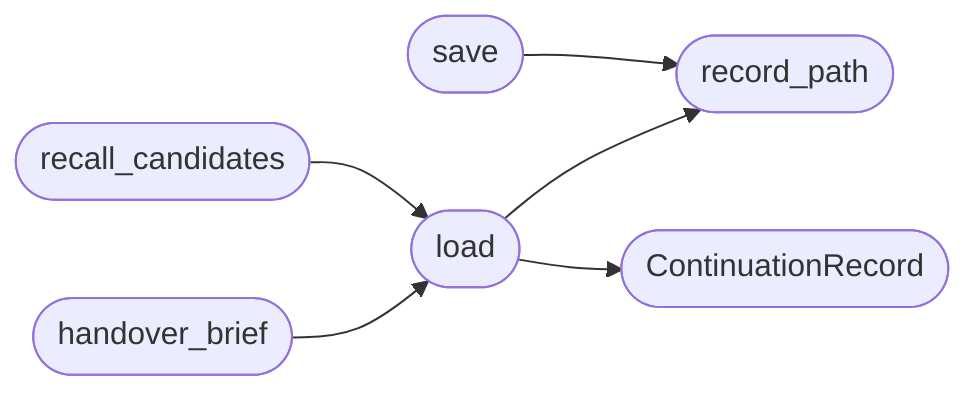

# `modules.lazy_continuation`

> Source: [modules/lazy_continuation.py:1](../../modules/lazy_continuation.py#L1) | language `py` | coverage 100.0% | [API index](../index.md)

Task continuation records: campaign memory that survives loop restarts.

A finished loop task writes its settlement context to a per-target
continuation record under ``sessions/continuations/<target>.json``: goal,
terminal status, the wrap-up settlement text, confirmed findings and the
open next steps. The next task bound to the same target reads it back as
planner wake candidates, so a restarted loop (operator restart, daemon
recycle, C2 loop respawn) continues where the previous run stopped
instead of re-running the same recon.

This is the campaign blackboard pattern: the record is a working summary,
not a verified fact — proven findings still live in the graph, world
model and finding lifecycle; the continuation only steers the next task
toward the unfinished work.

## Contents

- **Classes:** [`ContinuationRecord`](#continuationrecord)
- **Functions:** [`record_path`](#record_path), [`save`](#save), [`load`](#load), [`handover_brief`](#handover_brief), [`recall_candidates`](#recall_candidates)

## Call Graph

Solid arrows stay in this module, dashed arrows leave it.



## Classes

<a id="continuationrecord"></a>

### `ContinuationRecord`

`class` `dataclass` | [modules/lazy_continuation.py:36](../../modules/lazy_continuation.py#L36)

Decorators: `@dataclass`

```python
class ContinuationRecord
```

One target's campaign continuation state.

**Attributes**

| Name | Type | Default | Description |
|---|---|---|---|
| [`target`](#continuationrecord-target) | `str` |  | Host the record is bound to (slug key). |
| [`task_id`](#continuationrecord-task_id) | `str` | `''` | Loop task that last wrote the record. |
| [`goal`](#continuationrecord-goal) | `str` | `''` | Goal of that task. |
| [`status`](#continuationrecord-status) | `str` | `''` | Terminal status of that task. |
| [`settlement`](#continuationrecord-settlement) | `str` | `''` | Wrap-up settlement text. |
| [`findings`](#continuationrecord-findings) | `list[str]` | `field(default_factory=list)` | Confirmed finding texts. |
| [`next_steps`](#continuationrecord-next_steps) | `list[str]` | `field(default_factory=list)` | Unfinished work the next task should try. |
| [`credentials`](#continuationrecord-credentials) | `list[str]` | `field(default_factory=list)` | Reusable ``user:pass`` or hash hints for the successor. |
| [`deviations`](#continuationrecord-deviations) | `list[str]` | `field(default_factory=list)` | Planned-versus-actual notes the successor must honor. |
| [`updated`](#continuationrecord-updated) | `str` | `''` | ISO timestamp of the last write. |

---

## Functions

<a id="record_path"></a>

### `record_path`

`function` | [modules/lazy_continuation.py:77](../../modules/lazy_continuation.py#L77)

```python
def record_path(target: str) -> Path
```

Return the continuation record path for one target.

**Parameters**

| Name | Type | Default | Description |
|---|---|---|---|
| `target` | `str` |  | Host address or scope name. |

**Returns:** `Path` - The JSON record path (may not exist yet).

*Called by:* [`load`](#load), [`save`](#save)

---

<a id="save"></a>

### `save`

`function` | [modules/lazy_continuation.py:89](../../modules/lazy_continuation.py#L89)

```python
def save(target: str, task_id: str = '', goal: str = '', status: str = '', settlement: str = '', findings: list[str] | None = None, next_steps: list[str] | None = None, credentials: list[str] | None = None, deviations: list[str] | None = None) -> bool
```

Write one target's continuation record atomically.

**Parameters**

| Name | Type | Default | Description |
|---|---|---|---|
| `target` | `str` |  | Host the record belongs to. |
| `task_id` | `str` | `''` | Loop task writing the record. |
| `goal` | `str` | `''` | Task goal text. |
| `status` | `str` | `''` | Terminal task status. |
| `settlement` | `str` | `''` | Wrap-up settlement summary. |
| `findings` | `list[str] \| None` | `None` | Confirmed finding texts. |
| `next_steps` | `list[str] \| None` | `None` | Unfinished next steps for the follow-up task. |
| `credentials` | `list[str] \| None` | `None` | Reusable ``user:pass`` or hash hints for the successor. |
| `deviations` | `list[str] \| None` | `None` | Planned-versus-actual notes for the successor. |

**Returns:** `bool` - True when persisted; False on I/O failure.

*Calls:* [`record_path`](#record_path)

---

<a id="load"></a>

### `load`

`function` | [modules/lazy_continuation.py:144](../../modules/lazy_continuation.py#L144)

```python
def load(target: str) -> ContinuationRecord | None
```

Read one target's continuation record.

**Parameters**

| Name | Type | Default | Description |
|---|---|---|---|
| `target` | `str` |  | Host address. |

**Returns:** `ContinuationRecord | None` - The [`ContinuationRecord`](#continuationrecord), or None when absent/unreadable.

*Calls:* [`ContinuationRecord`](#continuationrecord), [`record_path`](#record_path)

*Called by:* [`handover_brief`](#handover_brief), [`recall_candidates`](#recall_candidates)

---

<a id="handover_brief"></a>

### `handover_brief`

`function` | [modules/lazy_continuation.py:173](../../modules/lazy_continuation.py#L173)

```python
def handover_brief(target: str) -> str
```

Render a target's continuation record as a successor-ready playbook.

sapper-v2 has a saturating worker leave a written playbook for its
replacement. This renders the same handover from the persisted record:
goal, terminal status, the wrap-up settlement, confirmed findings, the
open next steps and any reusable credentials, so a fresh worker resumes
with knowledge instead of a cold graph.

**Parameters**

| Name | Type | Default | Description |
|---|---|---|---|
| `target` | `str` |  | Host whose record is rendered. |

**Returns:** `str` - A formatted multi-line brief, or an empty string when no record
exists for the target.

*Calls:* [`load`](#load)

---

<a id="recall_candidates"></a>

### `recall_candidates`

`function` | [modules/lazy_continuation.py:214](../../modules/lazy_continuation.py#L214)

```python
def recall_candidates(target: str, limit: int = 3) -> list[tuple[str, str]]
```

Return ``(intent_summary, reason)`` wake candidates for one target.

**Parameters**

| Name | Type | Default | Description |
|---|---|---|---|
| `target` | `str` |  | Host the next task is scoped to. |
| `limit` | `int` | `3` | Maximum candidates returned. |

**Returns:** `list[tuple[str, str]]` - Continuation wake candidates built from the record's next steps
and open findings; empty when no record exists.

*Calls:* [`load`](#load)

---
