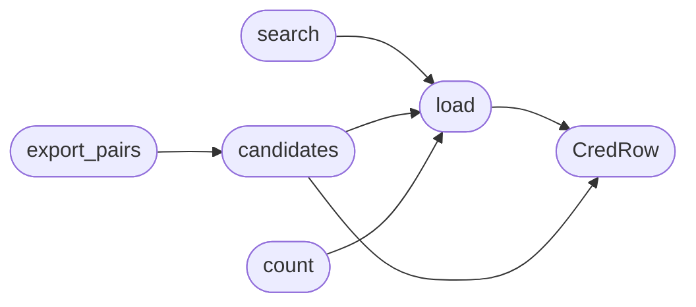

# `modules.lazy_creds`

> Source: [modules/lazy_creds.py:1](../../modules/lazy_creds.py#L1) | language `py` | coverage 100.0% | [API index](../index.md)

Default-credential knowledge base for LazyOwn.

Loads ``modules/data/default_creds.csv`` (vendor, username, password
triples sourced from the open DefaultCreds-Cheat-Sheet, MIT) and exposes
case-insensitive lookups for operators and gym chains. Pure file reads:
no network, no shell.

**Example**

```pycon
>>> from modules import lazy_creds
>>> rows = lazy_creds.search("apache")
>>> rows[0]["vendor"]
'Apache'
```

## Contents

- **Classes:** [`CredRow`](#credrow)
- **Functions:** [`load`](#load), [`search`](#search), [`candidates`](#candidates), [`count`](#count), [`as_lines`](#as_lines), [`export_pairs`](#export_pairs)
- **Constants:** [`BASE_DIR`](#base_dir), [`DEFAULT_CREDS_PATH`](#default_creds_path), [`MAX_OUTPUT_ROWS`](#max_output_rows), [`MAX_SEED_ROWS`](#max_seed_rows), [`MAX_FILE_BYTES`](#max_file_bytes)

## Call Graph

Solid arrows stay in this module, dashed arrows leave it.



## Classes

<a id="credrow"></a>

### `CredRow`

`class` `dataclass` | [modules/lazy_creds.py:30](../../modules/lazy_creds.py#L30)

Decorators: `@dataclass(frozen=True)`

```python
class CredRow
```

One default-credential triple from the knowledge base.

**Attributes**

| Name | Type | Default | Description |
|---|---|---|---|
| [`vendor`](#credrow-vendor) | `str` |  |  |
| [`username`](#credrow-username) | `str` |  |  |
| [`password`](#credrow-password) | `str` |  |  |

---

## Functions

<a id="load"></a>

### `load`

`function` | [modules/lazy_creds.py:39](../../modules/lazy_creds.py#L39)

Decorators: `@lru_cache(maxsize=1)`

```python
def load() -> tuple[CredRow, ...]
```

Load the CSV knowledge base once per process.

**Returns:** `tuple[CredRow, ...]` - Immutable tuple of cred rows; empty when the file is missing,
oversized or malformed (defensive, never raises).

*Calls:* [`CredRow`](#credrow)

*Called by:* [`candidates`](#candidates), [`count`](#count), [`search`](#search)

---

<a id="search"></a>

### `search`

`function` | [modules/lazy_creds.py:63](../../modules/lazy_creds.py#L63)

```python
def search(query: str) -> list[CredRow]
```

Return rows whose vendor or username contains the query.

**Parameters**

| Name | Type | Default | Description |
|---|---|---|---|
| `query` | `str` |  | Case-insensitive substring (empty returns nothing). |

**Returns:** `list[CredRow]` - Matching rows capped at `[`MAX_OUTPUT_ROWS`](#max_output_rows)`.

*Calls:* [`load`](#load)

---

<a id="candidates"></a>

### `candidates`

`function` | [modules/lazy_creds.py:79](../../modules/lazy_creds.py#L79)

```python
def candidates(limit: int = MAX_OUTPUT_ROWS) -> list[CredRow]
```

Return the most repeated (username, password) pairs for spraying.

**Parameters**

| Name | Type | Default | Description |
|---|---|---|---|
| `limit` | `int` | `MAX_OUTPUT_ROWS` | Maximum pairs to return. |

**Returns:** `list[CredRow]` - Distinct credential pairs ordered by frequency.

*Calls:* [`CredRow`](#credrow), [`load`](#load)

*Called by:* [`LazyCredsCommandSet.do_lazycreds`](cli.commands.lazy_creds.py.md#lazycredscommandset-do_lazycreds), [`export_pairs`](#export_pairs)

---

<a id="count"></a>

### `count`

`function` | [modules/lazy_creds.py:96](../../modules/lazy_creds.py#L96)

```python
def count() -> int
```

Return the total number of knowledge-base rows.

**Returns:** `int`

*Calls:* [`load`](#load)

---

<a id="as_lines"></a>

### `as_lines`

`function` | [modules/lazy_creds.py:101](../../modules/lazy_creds.py#L101)

```python
def as_lines(rows: list[CredRow]) -> list[str]
```

Render rows as aligned ``vendor,username,password`` lines.

**Parameters**

| Name | Type | Default | Description |
|---|---|---|---|
| `rows` | `list[CredRow]` |  |  |

**Returns:** `list[str]`

*Called by:* [`LazyCredsCommandSet.do_lazycreds`](cli.commands.lazy_creds.py.md#lazycredscommandset-do_lazycreds)

---

<a id="export_pairs"></a>

### `export_pairs`

`function` | [modules/lazy_creds.py:106](../../modules/lazy_creds.py#L106)

```python
def export_pairs(path: Path | str, limit: int = MAX_SEED_ROWS) -> dict[str, Any]
```

Export ``username:password`` pairs for spray tools.

**Parameters**

| Name | Type | Default | Description |
|---|---|---|---|
| `path` | `Path \| str` |  | Destination file (created/overwritten). |
| `limit` | `int` | `MAX_SEED_ROWS` | Export cap. |

**Returns:** `dict[str, Any]` - Mapping with ``written`` and ``error``.

*Calls:* [`candidates`](#candidates)

*Called by:* [`LazyCredsCommandSet.do_lazycreds`](cli.commands.lazy_creds.py.md#lazycredscommandset-do_lazycreds)

---

## Constants

<a id="base_dir"></a>

### `BASE_DIR`

`constant` | [modules/lazy_creds.py:22](../../modules/lazy_creds.py#L22)

```python
BASE_DIR = Path(__file__).resolve().parent.parent
```

---

<a id="default_creds_path"></a>

### `DEFAULT_CREDS_PATH`

`constant` | [modules/lazy_creds.py:23](../../modules/lazy_creds.py#L23)

```python
DEFAULT_CREDS_PATH = BASE_DIR / 'modules' / 'data' / 'default_creds.csv'
```

---

<a id="max_output_rows"></a>

### `MAX_OUTPUT_ROWS`

`constant` | [modules/lazy_creds.py:24](../../modules/lazy_creds.py#L24)

```python
MAX_OUTPUT_ROWS = 40
```

---

<a id="max_seed_rows"></a>

### `MAX_SEED_ROWS`

`constant` | [modules/lazy_creds.py:25](../../modules/lazy_creds.py#L25)

```python
MAX_SEED_ROWS = 5000
```

---

<a id="max_file_bytes"></a>

### `MAX_FILE_BYTES`

`constant` | [modules/lazy_creds.py:26](../../modules/lazy_creds.py#L26)

```python
MAX_FILE_BYTES = 5000000
```

---
