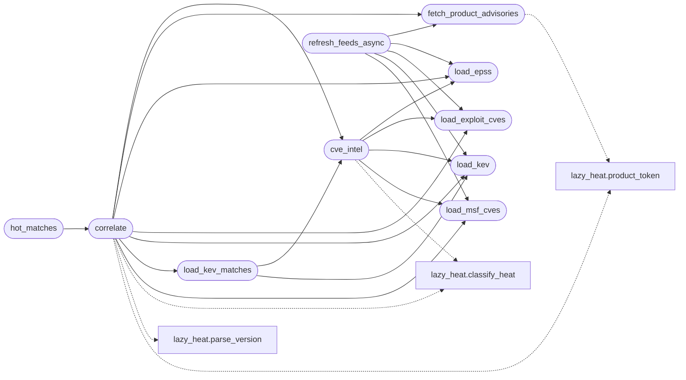

# `modules.lazy_cve_feed`

> Source: [modules/lazy_cve_feed.py:1](../../modules/lazy_cve_feed.py#L1) | language `py` | coverage 100.0% | [API index](../index.md)

Keyless CVE intelligence feeds and version-aware service correlation.

Correlates discovered services against public exploit intelligence with
no account and no API key, then grades every candidate with a
deterministic heat tier (see [`modules.lazy_heat`](modules.lazy_heat.py.md)):

  cisa_kev    CISA Known Exploited Vulnerabilities catalog (JSON)
  epss        FIRST EPSS probability scores (daily CSV, gzipped)
  exploit_db  Exploit-DB public exploit index (CSV)
  metasploit  Metasploit module metadata (JSON)
  osv         OSV.dev advisories for version ranges (per-product, cached)

A source only ever adds evidence: being absent from one source never
clears what another reported. Every download is bounded, cached on disk
under ``sessions/cve_feed/`` with its own TTL, and every entry point
degrades to empty results when the network or the feed is unavailable,
so the autonomous loop never stalls on intelligence.

Stdlib only.

## Contents

- **Functions:** [`load_kev`](#load_kev), [`load_epss`](#load_epss), [`load_exploit_cves`](#load_exploit_cves), [`load_msf_cves`](#load_msf_cves), [`fetch_product_advisories`](#fetch_product_advisories), [`cve_intel`](#cve_intel), [`correlate`](#correlate), [`load_kev_matches`](#load_kev_matches), [`hot_matches`](#hot_matches), [`refresh_feeds_async`](#refresh_feeds_async)
- **Constants:** [`CACHE_DIR`](#cache_dir)

## Call Graph

Solid arrows stay in this module, dashed arrows leave it.



## Functions

<a id="load_kev"></a>

### `load_kev`

`function` | [modules/lazy_cve_feed.py:158](../../modules/lazy_cve_feed.py#L158)

```python
def load_kev(force: bool = False) -> dict[str, dict]
```

Return ``{cve_id: {product, vendor}}`` from the CISA KEV catalog.

**Parameters**

| Name | Type | Default | Description |
|---|---|---|---|
| `force` | `bool` | `False` | Re-download even when the cache is fresh. |

**Returns:** `dict[str, dict]` - Mapping keyed by upper CVE id; empty when offline.

*Called by:* [`correlate`](#correlate), [`cve_intel`](#cve_intel), [`load_kev_matches`](#load_kev_matches), [`refresh_feeds_async`](#refresh_feeds_async)

---

<a id="load_epss"></a>

### `load_epss`

`function` | [modules/lazy_cve_feed.py:192](../../modules/lazy_cve_feed.py#L192)

```python
def load_epss(force: bool = False) -> dict[str, float]
```

Return ``{cve_id: epss}`` from the FIRST daily EPSS scores.

**Parameters**

| Name | Type | Default | Description |
|---|---|---|---|
| `force` | `bool` | `False` | Re-download even when the cache is fresh. |

**Returns:** `dict[str, float]` - Mapping keyed by upper CVE id; empty when offline.

*Called by:* [`correlate`](#correlate), [`cve_intel`](#cve_intel), [`refresh_feeds_async`](#refresh_feeds_async)

---

<a id="load_exploit_cves"></a>

### `load_exploit_cves`

`function` | [modules/lazy_cve_feed.py:233](../../modules/lazy_cve_feed.py#L233)

```python
def load_exploit_cves(force: bool = False) -> set[str]
```

Return CVE ids with public exploit code (Exploit-DB index).

**Parameters**

| Name | Type | Default | Description |
|---|---|---|---|
| `force` | `bool` | `False` | Re-download even when the cache is fresh. |

**Returns:** `set[str]` - Set of upper CVE ids; empty when offline.

*Called by:* [`correlate`](#correlate), [`cve_intel`](#cve_intel), [`refresh_feeds_async`](#refresh_feeds_async)

---

<a id="load_msf_cves"></a>

### `load_msf_cves`

`function` | [modules/lazy_cve_feed.py:257](../../modules/lazy_cve_feed.py#L257)

```python
def load_msf_cves(force: bool = False) -> set[str]
```

Return CVE ids weaponized as Metasploit modules.

**Parameters**

| Name | Type | Default | Description |
|---|---|---|---|
| `force` | `bool` | `False` | Re-download even when the cache is fresh. |

**Returns:** `set[str]` - Set of upper CVE ids; empty when offline.

*Called by:* [`correlate`](#correlate), [`cve_intel`](#cve_intel), [`refresh_feeds_async`](#refresh_feeds_async)

---

<a id="fetch_product_advisories"></a>

### `fetch_product_advisories`

`function` | [modules/lazy_cve_feed.py:291](../../modules/lazy_cve_feed.py#L291)

```python
def fetch_product_advisories(product: str, force: bool = False) -> list[dict]
```

Fetch OSV advisories naming one product.

The query endpoint requires an ecosystem, so candidate package
names (each banner word plus the joined token) are tried against
each candidate distro ecosystem and the answers merged; the merged
set is cached per product with the OSV TTL.

**Parameters**

| Name | Type | Default | Description |
|---|---|---|---|
| `product` | `str` |  | Product text as found on a banner (``Samba smbd 3.0.20``). |
| `force` | `bool` | `False` | Re-query even when the cache is fresh. |

**Returns:** `list[dict]` - List of advisory dicts with ``affected`` ranges; [] offline.

*Calls:* [`product_token`](modules.lazy_heat.py.md#product_token)

*Called by:* [`correlate`](#correlate), [`refresh_feeds_async`](#refresh_feeds_async)

---

<a id="cve_intel"></a>

### `cve_intel`

`function` | [modules/lazy_cve_feed.py:360](../../modules/lazy_cve_feed.py#L360)

```python
def cve_intel(cve_id: str, feeds: dict | None = None, allow_network: bool = True) -> dict
```

Assemble exploitation signals and the heat tier for one CVE.

**Parameters**

| Name | Type | Default | Description |
|---|---|---|---|
| `cve_id` | `str` |  | CVE id (``CVE-2021-41773``). |
| `feeds` | `dict \| None` | `None` | Preloaded feeds (``kev``/``epss``/``exploit``/``msf``); loaded lazily when None. |
| `allow_network` | `bool` | `True` | Allow feed downloads on a cold cache. |

**Returns:** `dict` - ``{"cve", "kev", "epss", "exploit", "msf", "cvss", "heat"}``.

*Calls:* [`load_epss`](#load_epss), [`load_exploit_cves`](#load_exploit_cves), [`load_kev`](#load_kev), [`load_msf_cves`](#load_msf_cves), [`classify_heat`](modules.lazy_heat.py.md#classify_heat)

*Called by:* [`correlate`](#correlate), [`load_kev_matches`](#load_kev_matches)

---

<a id="correlate"></a>

### `correlate`

`function` | [modules/lazy_cve_feed.py:438](../../modules/lazy_cve_feed.py#L438)

```python
def correlate(product: str, version: str = '', allow_network: bool = True) -> list[dict]
```

Version-aware CVE candidates for one service product.

Candidates come from OSV advisories (which carry affected version
ranges) filtered by [`version_in_range`](modules.lazy_heat.py.md#version_in_range), plus KEV product
matches KEV lists under the same vendor product. Every candidate is
heat-graded; a match inside the affected range reads as affected.

**Parameters**

| Name | Type | Default | Description |
|---|---|---|---|
| `product` | `str` |  | Product name from a banner (``vsftpd``, ``OpenSSH``). |
| `version` | `str` | `''` | Product version when known. |
| `allow_network` | `bool` | `True` | Allow OSV queries on a cold cache. |

**Returns:** `list[dict]` - List of ``{"cve", "heat", "cvss", "kev", "epss", "exploit",
"in_range", "confidence", "severity"}`` sorted hottest first,
capped at `CORRELATE_CAP`.

*Calls:* [`cve_intel`](#cve_intel), [`fetch_product_advisories`](#fetch_product_advisories), [`load_epss`](#load_epss), [`load_exploit_cves`](#load_exploit_cves), [`load_kev`](#load_kev), [`load_kev_matches`](#load_kev_matches), [`load_msf_cves`](#load_msf_cves), [`classify_heat`](modules.lazy_heat.py.md#classify_heat), [`parse_version`](modules.lazy_heat.py.md#parse_version), [`product_token`](modules.lazy_heat.py.md#product_token), [`version_in_range`](modules.lazy_heat.py.md#version_in_range)

*Called by:* [`hot_matches`](#hot_matches), [`rescore`](modules.lazy_hostscore.py.md#rescore)

---

<a id="load_kev_matches"></a>

### `load_kev_matches`

`function` | [modules/lazy_cve_feed.py:594](../../modules/lazy_cve_feed.py#L594)

```python
def load_kev_matches(product: str, feeds: dict | None = None) -> list[tuple[str, dict]]
```

KEV entries whose vendor/product names match one service product.

Matching is word-level: a banner like ``Samba smbd 3.0.20`` matches
the KEV product ``Samba`` without demanding the whole banner token.

**Parameters**

| Name | Type | Default | Description |
|---|---|---|---|
| `product` | `str` |  | Banner product/version text (not a normalised token). |
| `feeds` | `dict \| None` | `None` | Preloaded KEV mapping; loaded when None. |

**Returns:** `list[tuple[str, dict]]` - List of ``(cve, intel)`` pairs, hottest first.

*Calls:* [`cve_intel`](#cve_intel), [`load_kev`](#load_kev), [`product_token`](modules.lazy_heat.py.md#product_token), [`token_matches`](modules.lazy_heat.py.md#token_matches)

*Called by:* [`correlate`](#correlate)

---

<a id="hot_matches"></a>

### `hot_matches`

`function` | [modules/lazy_cve_feed.py:636](../../modules/lazy_cve_feed.py#L636)

```python
def hot_matches(services: list[dict], allow_network: bool = False) -> list[dict]
```

Hot/warm CVE candidates matching discovered services.

Built for the loop's ``cve_hot`` trigger: each service row carries
``name``/``product``/``version`` and every returned row carries the
service context so the planner can target verification intents.

**Parameters**

| Name | Type | Default | Description |
|---|---|---|---|
| `services` | `list[dict]` |  | ``[{"name", "product", "version", "host", "port"}]``. |
| `allow_network` | `bool` | `False` | Allow OSV queries on a cold cache. |

**Returns:** `list[dict]` - Match rows ``{"cve", "heat", "product", "version", "host",
"port", "confidence"}`` hottest first.

*Calls:* [`correlate`](#correlate)

*Called by:* [`TriggerStore.due`](modules.loop_triggers.py.md#triggerstore-due)

---

<a id="refresh_feeds_async"></a>

### `refresh_feeds_async`

`function` | [modules/lazy_cve_feed.py:680](../../modules/lazy_cve_feed.py#L680)

```python
def refresh_feeds_async(products: list[str] | None = None) -> None
```

Refresh bulk feeds in one background daemon thread.

Call once per process (idempotent): KEV, EPSS, Exploit-DB and
Metasploit re-download only when their TTL expired, and each
product gets one OSV prefetch so later cache-only correlations
find candidates without blocking the pipeline on network.

**Parameters**

| Name | Type | Default | Description |
|---|---|---|---|
| `products` | `list[str] \| None` | `None` | Banner strings to prefetch OSV advisories for. |

*Calls:* [`fetch_product_advisories`](#fetch_product_advisories), [`load_epss`](#load_epss), [`load_exploit_cves`](#load_exploit_cves), [`load_kev`](#load_kev), [`load_msf_cves`](#load_msf_cves)

---

## Constants

<a id="cache_dir"></a>

### `CACHE_DIR`

`constant` | [modules/lazy_cve_feed.py:51](../../modules/lazy_cve_feed.py#L51)

```python
CACHE_DIR = SESSIONS_DIR / 'cve_feed'
```

---
