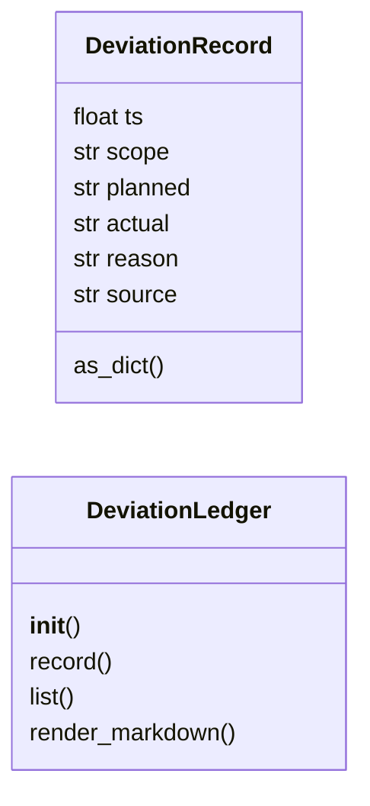
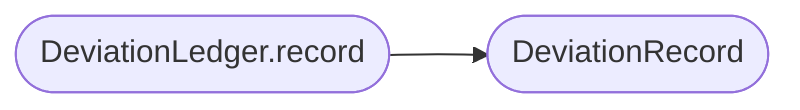

# `modules.lazy_deviations`

> Source: [modules/lazy_deviations.py:1](../../modules/lazy_deviations.py#L1) | language `py` | coverage 100.0% | [API index](../index.md)

Planned-versus-actual deviation ledger for loop and chain runs.

Mined from sapper-v2's explore deviations section and reimplemented
LazyOwn-native as one shared append-only ledger. Whenever the system
changes a plan on purpose — the loop sanitizer rewrites a model-proposed
command, an apt_chain replanner inserts steps or binds variables — the
planned value, the actual value and the reason land here, so handoffs
and reports can show not just what ran but why it differed from what
was planned.

One contract per file (SOLID): this module owns the ledger record
model, storage and rendering. Callers (loop sanitizer, chain replanner)
inject their own scope keys; the ledger never interprets them.

Storage: ``sessions/lazy/deviations.jsonl``, one JSON object per line,
capped at `[`DEVIATIONS_MAX_RECORDS`](#deviations_max_records)` rows (oldest dropped). Never
raises on read; write errors are swallowed because a lost deviation
note must never kill a step that already succeeded.

## Contents

- **Classes:** [`DeviationRecord`](#deviationrecord), [`DeviationLedger`](#deviationledger)
- **Constants:** [`DEFAULT_LEDGER_PATH`](#default_ledger_path), [`DEVIATIONS_MAX_RECORDS`](#deviations_max_records), [`DEVIATIONS_TEXT_LIMIT`](#deviations_text_limit)

## Type Diagram



## Call Graph

Solid arrows stay in this module, dashed arrows leave it.



## Classes

<a id="deviationrecord"></a>

### `DeviationRecord`

`class` `dataclass` | [modules/lazy_deviations.py:35](../../modules/lazy_deviations.py#L35)

Decorators: `@dataclass(frozen=True)`

```python
class DeviationRecord
```

One recorded planned-versus-actual deviation.

**Attributes**

| Name | Type | Default | Description |
|---|---|---|---|
| [`ts`](#deviationrecord-ts) | `float` |  | Unix timestamp of the record. |
| [`scope`](#deviationrecord-scope) | `str` |  | Free-form grouping key (``loop:<task_id>``, ``chain:<name>:<run_id>``). |
| [`planned`](#deviationrecord-planned) | `str` |  | What the plan said before the change. |
| [`actual`](#deviationrecord-actual) | `str` |  | What actually ran or was inserted. |
| [`reason`](#deviationrecord-reason) | `str` |  | Why the plan changed. |
| [`source`](#deviationrecord-source) | `str` |  | Subsystem that recorded the deviation. |

**Members**

| Member | Kind | Summary |
|---|---|---|
| [`as_dict`](#deviationrecord-as_dict) | method | Return the record as a JSON-ready dict. |

<a id="deviationrecord-as_dict"></a>

#### `DeviationRecord.as_dict`

`method` | [modules/lazy_deviations.py:55](../../modules/lazy_deviations.py#L55)

```python
def as_dict(self) -> dict
```

Return the record as a JSON-ready dict.

**Returns:** `dict`

---

<a id="deviationledger"></a>

### `DeviationLedger`

`class` | [modules/lazy_deviations.py:72](../../modules/lazy_deviations.py#L72)

```python
class DeviationLedger
```

Append-only planned-versus-actual ledger shared by loop and chain.

**Parameters**

| Name | Type | Default | Description |
|---|---|---|---|
| `path` |  |  | Ledger file override (tests); defaults to ``sessions/lazy/deviations.jsonl``. |

**Members**

| Member | Kind | Summary |
|---|---|---|
| [`__init__`](#deviationledger-__init__) | constructor | Bind the ledger file path. |
| [`record`](#deviationledger-record) | method | Record one deviation when the plan actually changed. |
| [`list`](#deviationledger-list) | method | Return deviations, newest first, optionally scoped. |
| [`render_markdown`](#deviationledger-render_markdown) | method | Render records as the sapper-style deviations block. |

<a id="deviationledger-__init__"></a>

#### `DeviationLedger.__init__`

`constructor` | [modules/lazy_deviations.py:80](../../modules/lazy_deviations.py#L80)

```python
def __init__(self, path: Path | None = None) -> None
```

Bind the ledger file path.

**Parameters**

| Name | Type | Default | Description |
|---|---|---|---|
| `path` | `Path \| None` | `None` |  |

*Called by:* [`LazyCommandSet.do_lazy_deviations`](cli.commands.lazyops.py.md#lazycommandset-do_lazy_deviations)

<a id="deviationledger-record"></a>

#### `DeviationLedger.record`

`method` | [modules/lazy_deviations.py:84](../../modules/lazy_deviations.py#L84)

```python
def record(self, scope: str, planned: str, actual: str, reason: str, source: str = '') -> DeviationRecord | None
```

Record one deviation when the plan actually changed.

**Parameters**

| Name | Type | Default | Description |
|---|---|---|---|
| `scope` | `str` |  | Grouping key, e.g. ``loop:t0001``. |
| `planned` | `str` |  | Planned command, step or value. |
| `actual` | `str` |  | What replaced it. |
| `reason` | `str` |  | Why it was replaced; empty suppresses the record. |
| `source` | `str` | `''` | Recording subsystem name. |

**Returns:** `DeviationRecord | None` - The stored record, or None when there is no deviation
(planned equals actual, or the reason is empty) or the write
failed.

*Calls:* [`DeviationRecord`](#deviationrecord)

<a id="deviationledger-list"></a>

#### `DeviationLedger.list`

`method` | [modules/lazy_deviations.py:124](../../modules/lazy_deviations.py#L124)

```python
def list(self, scope: str = '', limit: int = 50) -> list[DeviationRecord]
```

Return deviations, newest first, optionally scoped.

**Parameters**

| Name | Type | Default | Description |
|---|---|---|---|
| `scope` | `str` | `''` | Grouping key filter; empty returns every scope. |
| `limit` | `int` | `50` | Maximum rows to return. |

**Returns:** `list[DeviationRecord]` - Deviation records, newest first.

<a id="deviationledger-render_markdown"></a>

#### `DeviationLedger.render_markdown`

`method` | [modules/lazy_deviations.py:140](../../modules/lazy_deviations.py#L140)

```python
def render_markdown(self, records: list[DeviationRecord], title: str = 'Deviations') -> str
```

Render records as the sapper-style deviations block.

**Parameters**

| Name | Type | Default | Description |
|---|---|---|---|
| `records` | `list[DeviationRecord]` |  | Records in display order. |
| `title` | `str` | `'Deviations'` | Section title. |

**Returns:** `str` - Markdown lines; empty string when no records exist.

*Called by:* [`LazyCommandSet.do_lazy_deviations`](cli.commands.lazyops.py.md#lazycommandset-do_lazy_deviations)

---

## Constants

<a id="default_ledger_path"></a>

### `DEFAULT_LEDGER_PATH`

`constant` | [modules/lazy_deviations.py:29](../../modules/lazy_deviations.py#L29)

```python
DEFAULT_LEDGER_PATH = BASE_DIR / 'sessions' / 'lazy' / 'deviations.jsonl'
```

---

<a id="deviations_max_records"></a>

### `DEVIATIONS_MAX_RECORDS`

`constant` | [modules/lazy_deviations.py:30](../../modules/lazy_deviations.py#L30)

```python
DEVIATIONS_MAX_RECORDS = 500
```

---

<a id="deviations_text_limit"></a>

### `DEVIATIONS_TEXT_LIMIT`

`constant` | [modules/lazy_deviations.py:31](../../modules/lazy_deviations.py#L31)

```python
DEVIATIONS_TEXT_LIMIT = 400
```

---
