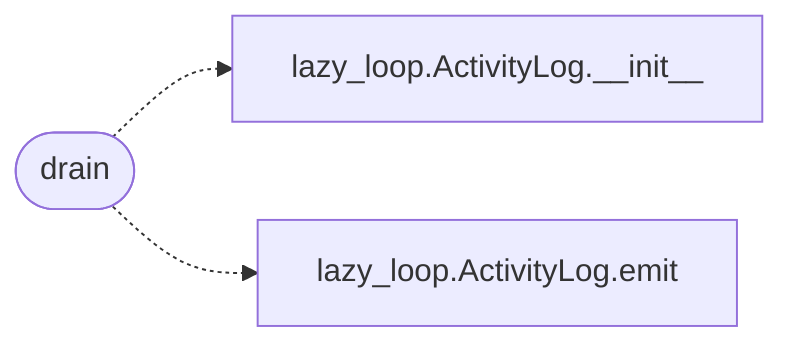

# `modules.lazy_drafts`

> Source: [modules/lazy_drafts.py:1](../../modules/lazy_drafts.py#L1) | language `py` | coverage 100.0% | [API index](../index.md)

Injected objective drafts: close the lazy_drafts handoff loop.

`[`modules.lazy_bridge.push_objective_to_lazy`](modules.lazy_bridge.py.md#push_objective_to_lazy)` writes task drafts under
``sessions/lazy_drafts/`` whenever an objective reaches the cross-engine
sync, but nothing read them back: Hermes/MCP-injected objectives vanished
from the loop's task board. This module is the read side. One function,
`[`drain`](#drain)`: every ``pending`` draft becomes a queued loop task (goal +
scope pre-seeded) and the draft is marked ``imported`` so one injection
never spawns two tasks, even across loop restarts.

## Contents

- **Functions:** [`drain`](#drain)

## Call Graph

Solid arrows stay in this module, dashed arrows leave it.



## Functions

<a id="drain"></a>

### `drain`

`function` | [modules/lazy_drafts.py:34](../../modules/lazy_drafts.py#L34)

```python
def drain(engine) -> list[str]
```

Import every pending draft into the loop task board.

**Parameters**

| Name | Type | Default | Description |
|---|---|---|---|
| `engine` |  |  | LazyLoopEngine owning ``create_task``/`[`ensure_target`](modules.lazy_loop.py.md#lazyloopengine-ensure_target)`. |

**Returns:** `list[str]` - The imported task ids (queued for admission, not run).

*Calls:* [`ActivityLog.__init__`](modules.lazy_loop.py.md#activitylog-__init__), [`ActivityLog.emit`](modules.lazy_loop.py.md#activitylog-emit)

---
