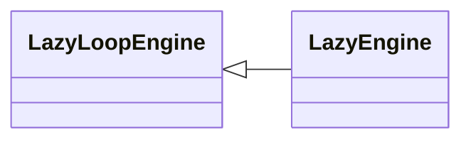

# `modules.lazy_engine`

> Source: [modules/lazy_engine.py:1](../../modules/lazy_engine.py#L1) | language `py` | coverage 100.0% | [API index](../index.md)

Lazy autonomous loop engine: single orchestrator for lazy_* commands.

Every subsystem keeps exact behavior under operator-facing ``lazy_*``
names. Storage lives under ``sessions/lazy/``.

## Contents

- **Classes:** [`LazyEngine`](#lazyengine)

## Type Diagram



## Classes

<a id="lazyengine"></a>

### `LazyEngine`

`class` | [modules/lazy_engine.py:55](../../modules/lazy_engine.py#L55)

```python
class LazyEngine(LazyLoopEngine)
```

Bases: [`LazyLoopEngine`](modules.lazy_loop.py.md#lazyloopengine)

Single orchestrator exposed under the lazy_* command surface.

---
