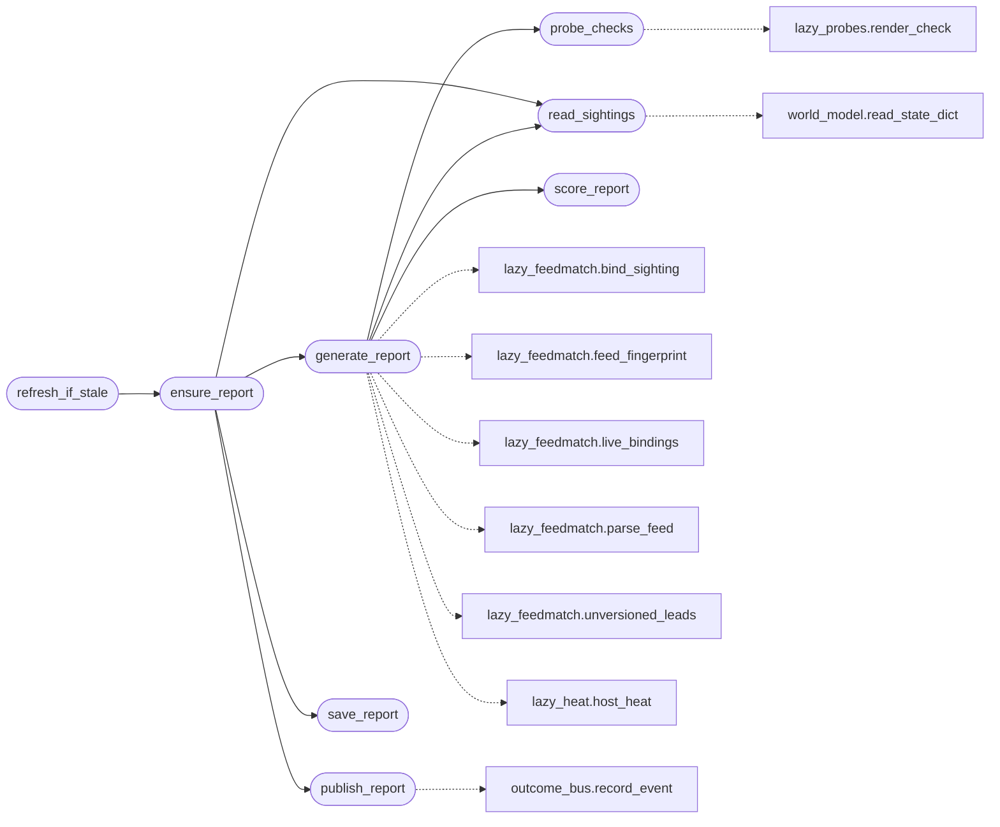

# `modules.lazy_exposure`

> Source: [modules/lazy_exposure.py:1](../../modules/lazy_exposure.py#L1) | language `py` | coverage 100.0% | [API index](../index.md)

Target exposure report for LazyOwn.

Binds the discovered world-model services to a local exploit feed with
hard-evidence policy, ranks the result by exploitation heat, scores the
host 0-100 and renders read-only validation commands for the top matches.

Report artefact lives at ``sessions/lazy_intel_<target>.json``; every
generation also publishes one ``lazy_intel`` event through
[`modules.outcome_bus`](modules.outcome_bus.py.md) so the world model, C2 surfaces, intel graph
and reports stay consistent with the fan-out contract; the deduped
store sink `[`modules.sinks.lazy_intel`](modules.sinks.lazy_intel.py.md)` mirrors bounded matches into
the world model and the SQLite workspace.

Feed rows come from [`modules.lazy_feedmatch`](modules.lazy_feedmatch.py.md); heat tiers from
[`modules.lazy_heat`](modules.lazy_heat.py.md) (the single vocabulary); probe rendering from
[`modules.lazy_probes`](modules.lazy_probes.py.md).

## Contents

- **Functions:** [`ensure_report`](#ensure_report), [`read_sightings`](#read_sightings), [`generate_report`](#generate_report), [`score_report`](#score_report), [`probe_checks`](#probe_checks), [`save_report`](#save_report), [`publish_report`](#publish_report), [`refresh_if_stale`](#refresh_if_stale)
- **Constants:** [`SESSIONS_DIR`](#sessions_dir), [`SCORE_UNBOUNDED_CAP`](#score_unbounded_cap), [`SCORE_SURFACE_CAP`](#score_surface_cap), [`MAX_CHECKS`](#max_checks)

## Call Graph

Solid arrows stay in this module, dashed arrows leave it.



## Functions

<a id="ensure_report"></a>

### `ensure_report`

`function` | [modules/lazy_exposure.py:56](../../modules/lazy_exposure.py#L56)

```python
def ensure_report(target: str, entries: list[dict] | dict | None = None, refresh: bool = False) -> Path | None
```

Create the target exposure report if absent (loop bootstrap path).

Generates one report through [`generate_report`](#generate_report) with the saved
file reused when present (pass ``refresh`` to re-run anyway), then
persists and publishes it, so the fire-pending selector and the
loop share one artefact path: ``sessions/lazy_intel_<target>.json``.

**Parameters**

| Name | Type | Default | Description |
|---|---|---|---|
| `target` | `str` |  | Host address. |
| `entries` | `list[dict] \| dict \| None` | `None` | Optional live feed rows override; empty falls back to the local feed then the keyless live bundle. |
| `refresh` | `bool` | `False` | Regenerate even when a report already exists. |

**Returns:** `Path | None` - The report path, or None when the target is empty or nothing
could be written.

*Calls:* [`generate_report`](#generate_report), [`publish_report`](#publish_report), [`read_sightings`](#read_sightings), [`save_report`](#save_report)

*Called by:* [`refresh_if_stale`](#refresh_if_stale)

---

<a id="read_sightings"></a>

### `read_sightings`

`function` | [modules/lazy_exposure.py:97](../../modules/lazy_exposure.py#L97)

```python
def read_sightings(target: str | None = None, state_path: str | Path | None = None) -> list[Sighting]
```

Extract observed service sightings from the encrypted world model.

**Parameters**

| Name | Type | Default | Description |
|---|---|---|---|
| `target` | `str \| None` | `None` | Optional host key prefix filter; all hosts when empty. |
| `state_path` | `str \| Path \| None` | `None` | Optional world-model state path override. |

**Returns:** `list[Sighting]` - [`Sighting`](modules.lazy_feedmatch.py.md#sighting) rows for services with a product-ish name or a
known version; unusable rows are skipped. Never raises.

*Calls:* [`read_state_dict`](modules.world_model.py.md#read_state_dict)

*Called by:* [`ensure_report`](#ensure_report), [`generate_report`](#generate_report)

---

<a id="generate_report"></a>

### `generate_report`

`function` | [modules/lazy_exposure.py:129](../../modules/lazy_exposure.py#L129)

```python
def generate_report(target: str, entries: list[dict] | dict | None, sightings: list | None = None) -> dict
```

Build the exposure report for one target.

**Parameters**

| Name | Type | Default | Description |
|---|---|---|---|
| `target` | `str` |  | Target host address, echoed into the report. |
| `entries` | `list[dict] \| dict \| None` |  | Road exploit feed rows (or a feed-shaped dict); when empty the report falls back to the live keyless feed bundle ([`modules.lazy_cve_feed`](modules.lazy_cve_feed.py.md), bounded by LAZYOWN_CVE_FEEDS env). |
| `sightings` | `list \| None` | `None` | Explicit sightings override; when omitted the world model is consulted. |

**Returns:** `dict` - The report dict with score, matches, leads and rendered checks.

*Calls:* [`probe_checks`](#probe_checks), [`read_sightings`](#read_sightings), [`score_report`](#score_report), [`bind_sighting`](modules.lazy_feedmatch.py.md#bind_sighting), [`feed_fingerprint`](modules.lazy_feedmatch.py.md#feed_fingerprint), [`live_bindings`](modules.lazy_feedmatch.py.md#live_bindings), [`parse_feed`](modules.lazy_feedmatch.py.md#parse_feed), [`unversioned_leads`](modules.lazy_feedmatch.py.md#unversioned_leads), [`host_heat`](modules.lazy_heat.py.md#host_heat)

*Called by:* [`LazyIntelCommandSet.do_lazyintel`](cli.commands.exposure_intel.py.md#lazyintelcommandset-do_lazyintel), [`ensure_report`](#ensure_report)

---

<a id="score_report"></a>

### `score_report`

`function` | [modules/lazy_exposure.py:219](../../modules/lazy_exposure.py#L219)

```python
def score_report(entries: list[dict], bounded_unknown: list[dict], services: int) -> tuple[int, list[dict]]
```

Score a host 0-100 with an audited point breakdown.

**Parameters**

| Name | Type | Default | Description |
|---|---|---|---|
| `entries` | `list[dict]` |  | Live in-range matches. |
| `bounded_unknown` | `list[dict]` |  | Actively-exploited-but-unbounded review rows. |
| `services` | `int` |  | Number of discovered network services. |

**Returns:** `tuple[int, list[dict]]` - ``(score, detail)`` where detail is the ordered
``{"label", "points"}`` breakdown, capped at 100 points.

*Called by:* [`generate_report`](#generate_report)

---

<a id="probe_checks"></a>

### `probe_checks`

`function` | [modules/lazy_exposure.py:257](../../modules/lazy_exposure.py#L257)

```python
def probe_checks(matches: list[dict], feed: list[lazy_feedmatch.FeedEntry]) -> list[dict]
```

Render read-only validation checks for the hottest matches.

**Parameters**

| Name | Type | Default | Description |
|---|---|---|---|
| `matches` | `list[dict]` |  | In-range match rows from [`generate_report`](#generate_report). |
| `feed` | `list[lazy_feedmatch.FeedEntry]` |  | Parsed feed entries carrying the affected ranges. |

**Returns:** `list[dict]` - Up to [`MAX_CHECKS`](#max_checks) rendered check dicts ready to paste into
a chain step or a beacon session.

*Calls:* [`render_check`](modules.lazy_probes.py.md#render_check)

*Called by:* [`generate_report`](#generate_report)

---

<a id="save_report"></a>

### `save_report`

`function` | [modules/lazy_exposure.py:291](../../modules/lazy_exposure.py#L291)

```python
def save_report(report: dict, path: str | Path | None = None) -> Path | None
```

Atomically persist the report for downstream surfaces.

**Parameters**

| Name | Type | Default | Description |
|---|---|---|---|
| `report` | `dict` |  | Report dict from [`generate_report`](#generate_report). |
| `path` | `str \| Path \| None` | `None` | Optional path override. |

**Returns:** `Path | None` - The written path, or None on failure. Never raises.

*Called by:* [`LazyIntelCommandSet.do_lazyintel`](cli.commands.exposure_intel.py.md#lazyintelcommandset-do_lazyintel), [`ensure_report`](#ensure_report)

---

<a id="publish_report"></a>

### `publish_report`

`function` | [modules/lazy_exposure.py:314](../../modules/lazy_exposure.py#L314)

```python
def publish_report(report: dict) -> dict
```

Publish one outcome event for the whole report.

**Parameters**

| Name | Type | Default | Description |
|---|---|---|---|
| `report` | `dict` |  | Report dict from [`generate_report`](#generate_report). |

**Returns:** `dict` - The ``{sink: ok}`` fan-out map from [`modules.outcome_bus`](modules.outcome_bus.py.md).

*Calls:* [`record_event`](modules.outcome_bus.py.md#record_event)

*Called by:* [`LazyIntelCommandSet.do_lazyintel`](cli.commands.exposure_intel.py.md#lazyintelcommandset-do_lazyintel), [`ensure_report`](#ensure_report)

---

<a id="refresh_if_stale"></a>

### `refresh_if_stale`

`function` | [modules/lazy_exposure.py:418](../../modules/lazy_exposure.py#L418)

```python
def refresh_if_stale(target: str, entries: list[dict] | dict | None = None) -> Path | None
```

Regenerate the report only when newer evidence exists.

The report is stale when the nmap XML ingest is newer than the saved
exposition artefact (a fresh scan happened after the last intel
pass); the engine calls this from the intel sync stage so the
fire-pending selector never reads outdated intelligence.

**Parameters**

| Name | Type | Default | Description |
|---|---|---|---|
| `target` | `str` |  | Host address. |
| `entries` | `list[dict] \| dict \| None` | `None` | Optional feed rows forwarded to [`ensure_report`](#ensure_report). |

**Returns:** `Path | None` - The refreshed report path, or None when nothing was stale.

*Calls:* [`ensure_report`](#ensure_report)

---

## Constants

<a id="sessions_dir"></a>

### `SESSIONS_DIR`

`constant` | [modules/lazy_exposure.py:46](../../modules/lazy_exposure.py#L46)

```python
SESSIONS_DIR = BASE_DIR / 'sessions'
```

---

<a id="score_unbounded_cap"></a>

### `SCORE_UNBOUNDED_CAP`

`constant` | [modules/lazy_exposure.py:51](../../modules/lazy_exposure.py#L51)

```python
SCORE_UNBOUNDED_CAP = 2
```

---

<a id="score_surface_cap"></a>

### `SCORE_SURFACE_CAP`

`constant` | [modules/lazy_exposure.py:52](../../modules/lazy_exposure.py#L52)

```python
SCORE_SURFACE_CAP = 10
```

---

<a id="max_checks"></a>

### `MAX_CHECKS`

`constant` | [modules/lazy_exposure.py:53](../../modules/lazy_exposure.py#L53)

```python
MAX_CHECKS = 3
```

---
