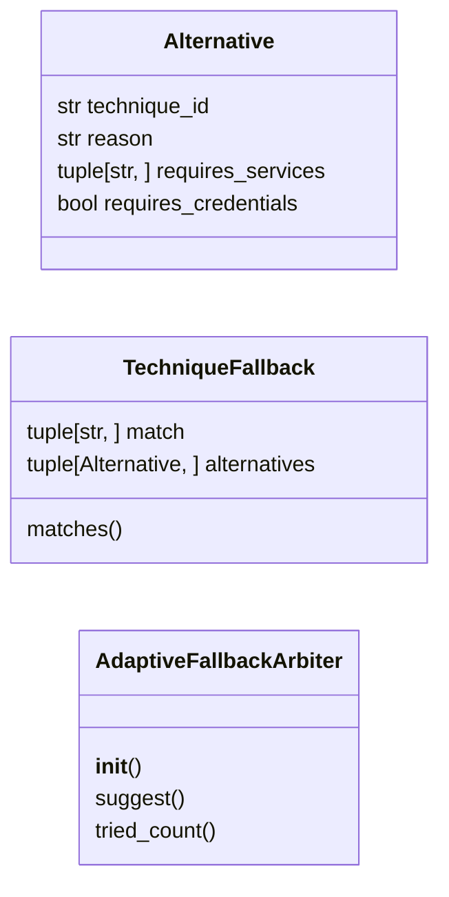

# `modules.lazy_fallback`

> Source: [modules/lazy_fallback.py:1](../../modules/lazy_fallback.py#L1) | language `py` | coverage 100.0% | [API index](../index.md)

Adaptive fallback alternatives for failed chain techniques.

When a chain step fails with a fallback-eligible verdict, the arbiter
proposes the next untried alternative from a curated graph over the
LazyOwn Atomic technique catalogue (``exploits/*.yaml``). A proposal is
only ever an option: the runner stays in control and the operator flag
arms the behaviour. Three invariants hold:

1. A lockout verdict never gets an alternative: spraying past a locked
   account is how engagements turn noisy and die loud.
2. Service prerequisites must be observable before an alternative is
   proposed: no SMB technique fires without SMB evidence.
3. One alternative per (failed family, technique) per arbiter lifetime:
   the arbiter never proposes the same attempt twice.

## Contents

- **Classes:** [`Alternative`](#alternative), [`TechniqueFallback`](#techniquefallback), [`AdaptiveFallbackArbiter`](#adaptivefallbackarbiter)
- **Functions:** [`catalogue_ids`](#catalogue_ids)
- **Constants:** [`FALLBACK_GRAPH`](#fallback_graph)

## Type Diagram



## Call Graph

Solid arrows stay in this module, dashed arrows leave it.


## Classes

<a id="alternative"></a>

### `Alternative`

`class` `dataclass` | [modules/lazy_fallback.py:29](../../modules/lazy_fallback.py#L29)

Decorators: `@dataclass(frozen=True)`

```python
class Alternative
```

One fallback technique candidate.

**Parameters**

| Name | Type | Default | Description |
|---|---|---|---|
| `technique_id` | `str` |  | Atomic catalogue id (``exploits/<id>.yaml``). |
| `reason` | `str` |  | One-line rationale shown to the operator. |
| `requires_services` | `tuple[str, ...]` | `()` | Service-name tokens that must be observable on the target before the alternative is proposed. |
| `requires_credentials` | `bool` | `False` | True when captured credentials must exist. |

**Attributes**

| Name | Type | Default | Description |
|---|---|---|---|
| [`technique_id`](#alternative-technique_id) | `str` |  |  |
| [`reason`](#alternative-reason) | `str` |  |  |
| [`requires_services`](#alternative-requires_services) | `tuple[str, ...]` | `()` |  |
| [`requires_credentials`](#alternative-requires_credentials) | `bool` | `False` |  |

---

<a id="techniquefallback"></a>

### `TechniqueFallback`

`class` `dataclass` | [modules/lazy_fallback.py:47](../../modules/lazy_fallback.py#L47)

Decorators: `@dataclass(frozen=True)`

```python
class TechniqueFallback
```

One failed-technique family with its ordered alternatives.

**Parameters**

| Name | Type | Default | Description |
|---|---|---|---|
| `match` | `tuple[str, ...]` |  | Lowercase keywords; any keyword found in the failed command line binds the failure to this family (first family declared wins). |
| `alternatives` | `tuple[Alternative, ...]` |  | Ordered candidates; the arbiter returns the first one not yet tried whose prerequisites hold. |

**Attributes**

| Name | Type | Default | Description |
|---|---|---|---|
| [`match`](#techniquefallback-match) | `tuple[str, ...]` |  |  |
| [`alternatives`](#techniquefallback-alternatives) | `tuple[Alternative, ...]` |  |  |

**Members**

| Member | Kind | Summary |
|---|---|---|
| [`matches`](#techniquefallback-matches) | method | Return True when the failed command line binds this family. |

<a id="techniquefallback-matches"></a>

#### `TechniqueFallback.matches`

`method` | [modules/lazy_fallback.py:61](../../modules/lazy_fallback.py#L61)

```python
def matches(self, command: str) -> bool
```

Return True when the failed command line binds this family.

**Parameters**

| Name | Type | Default | Description |
|---|---|---|---|
| `command` | `str` |  |  |

**Returns:** `bool`

---

<a id="adaptivefallbackarbiter"></a>

### `AdaptiveFallbackArbiter`

`class` | [modules/lazy_fallback.py:185](../../modules/lazy_fallback.py#L185)

```python
class AdaptiveFallbackArbiter
```

Turn one failed step into at most one adaptive alternative.

Thread-safe: reentrancy only records attempts and never blocks the
caller, so a runner paying attention to outcome order still sees a
consistent tried-set.

**Members**

| Member | Kind | Summary |
|---|---|---|
| [`__init__`](#adaptivefallbackarbiter-__init__) | constructor | Bind the fallback graph; the shared graph is the default. |
| [`suggest`](#adaptivefallbackarbiter-suggest) | method | Return the first viable untried alternative for one failure. |
| [`tried_count`](#adaptivefallbackarbiter-tried_count) | method | Return how many alternatives this arbiter already proposed. |

<a id="adaptivefallbackarbiter-__init__"></a>

#### `AdaptiveFallbackArbiter.__init__`

`constructor` | [modules/lazy_fallback.py:193](../../modules/lazy_fallback.py#L193)

```python
def __init__(self, graph: tuple[TechniqueFallback, ...] = FALLBACK_GRAPH) -> None
```

Bind the fallback graph; the shared graph is the default.

**Parameters**

| Name | Type | Default | Description |
|---|---|---|---|
| `graph` | `tuple[TechniqueFallback, ...]` | `FALLBACK_GRAPH` | Ordered families; first-declared wins on overlap. |

*Called by:* [`build_adaptive_replanner`](cli.apt_chain_support.py.md#build_adaptive_replanner)

<a id="adaptivefallbackarbiter-suggest"></a>

#### `AdaptiveFallbackArbiter.suggest`

`method` | [modules/lazy_fallback.py:203](../../modules/lazy_fallback.py#L203)

```python
def suggest(self, command: str, verdict: FailureVerdict, services: frozenset[str] | None = None, has_credentials: bool | None = None, catalogue: Any | None = None) -> Alternative | None
```

Return the first viable untried alternative for one failure.

**Parameters**

| Name | Type | Default | Description |
|---|---|---|---|
| `command` | `str` |  | Failed command line; bound to a family by keywords. |
| `verdict` | `FailureVerdict` |  | Verdict from `[`modules.failure_verdict`](modules.failure_verdict.py.md)` gating whether alternatives are allowed at all. |
| `services` | `frozenset[str] \| None` | `None` | Observable lowercase service names; None fails all service-gated candidates closed. |
| `has_credentials` | `bool \| None` | `None` | Whether captured credentials exist; None fails credential-gated candidates closed. |
| `catalogue` | `Any \| None` | `None` | Mapping of technique ids the catalogue actually exposes (optional; unknown checks skip when absent). |

**Returns:** `Alternative | None` - One [`Alternative`](#alternative) or None when no family matches, the
verdict forbids alternatives, everything was already tried
or no prerequisite holds. The candidate is recorded.

<a id="adaptivefallbackarbiter-tried_count"></a>

#### `AdaptiveFallbackArbiter.tried_count`

`method` | [modules/lazy_fallback.py:246](../../modules/lazy_fallback.py#L246)

```python
def tried_count(self) -> int
```

Return how many alternatives this arbiter already proposed.

**Returns:** `int`

---

## Functions

<a id="catalogue_ids"></a>

### `catalogue_ids`

`function` | [modules/lazy_fallback.py:261](../../modules/lazy_fallback.py#L261)

```python
def catalogue_ids() -> frozenset[str] | None
```

Return every Atomic technique id actually loadable right now.

**Returns:** `frozenset[str] | None` - Lowercase-id-aware frozenset of catalogue ids, or None when the
bridge is unavailable (PyYAML missing, unreadable directory) so
candidates keep the benefit of the doubt.

*Calls:* [`load_all`](modules.atomic_exploit_bridge.py.md#load_all)

---

## Constants

<a id="fallback_graph"></a>

### `FALLBACK_GRAPH`

`constant` | [modules/lazy_fallback.py:67](../../modules/lazy_fallback.py#L67)

```python
FALLBACK_GRAPH: tuple[TechniqueFallback, ...]
```

---
