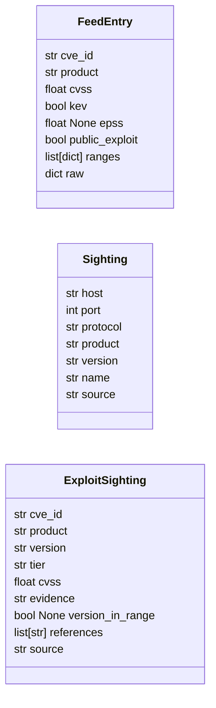
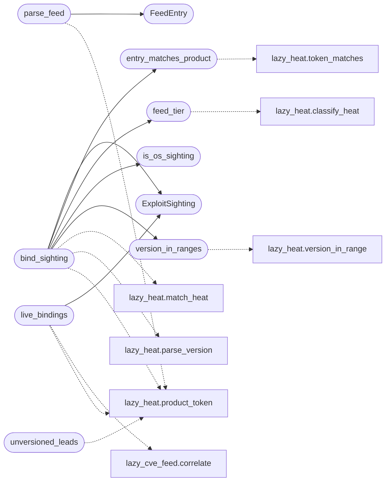

# `modules.lazy_feedmatch`

> Source: [modules/lazy_feedmatch.py:1](../../modules/lazy_feedmatch.py#L1) | language `py` | coverage 100.0% | [API index](../index.md)

Exploit feed matching for LazyOwn.

Turns a local exploit-intelligence feed into per-product evidence decisions
for the services the engagement has already discovered. A product name alone
is never evidence: only a version inside a bounded affected range of the same
product counts, with one deliberate exception for actively exploited
advisories that publish no usable range (kept as low-confidence review
candidates, never counted as heat). Products seen with no version stay as
unversioned leads so a later banner, probe or host report can promote them.

Tier maths live in [`modules.lazy_heat`](modules.lazy_heat.py.md) (the one vocabulary: hot/warm/
cold); this file adds the feed schema, the sighting binding and the live
adapter to [`modules.lazy_cve_feed`](modules.lazy_cve_feed.py.md). Feed schema (JSON file, default
``sessions/intel/exploit_feed.json``)::

    {"entries": [
        {"cve_id": "CVE-2024-0001", "product": "apache tomcat",
         "cvss": 9.8, "kev": true, "epss": 0.42, "public_exploit": true,
         "ranges": [{"introduced": "10.0.0", "fixed": "10.0.20"}],
         "references": ["https://..."]},
        ...
    ]}

Stdlib only, pure functions on plain input, never raises on bad data.

## Contents

- **Classes:** [`FeedEntry`](#feedentry), [`Sighting`](#sighting), [`ExploitSighting`](#exploitsighting)
- **Functions:** [`load_feed`](#load_feed), [`parse_feed`](#parse_feed), [`is_os_sighting`](#is_os_sighting), [`entry_matches_product`](#entry_matches_product), [`version_in_ranges`](#version_in_ranges), [`feed_tier`](#feed_tier), [`bind_sighting`](#bind_sighting), [`unversioned_leads`](#unversioned_leads), [`live_bindings`](#live_bindings), [`feed_fingerprint`](#feed_fingerprint)
- **Constants:** [`DEFAULT_FEED_PATH`](#default_feed_path), [`EVIDENCE_IN_RANGE`](#evidence_in_range), [`EVIDENCE_UNBOUNDED`](#evidence_unbounded), [`EVIDENCE_NONE`](#evidence_none), [`RANGE_KEYS`](#range_keys)

## Type Diagram



## Call Graph

Solid arrows stay in this module, dashed arrows leave it.



## Classes

<a id="feedentry"></a>

### `FeedEntry`

`class` `dataclass` | [modules/lazy_feedmatch.py:73](../../modules/lazy_feedmatch.py#L73)

Decorators: `@dataclass`

```python
class FeedEntry
```

One normalized exploit-intelligence entry.

**Attributes**

| Name | Type | Default | Description |
|---|---|---|---|
| [`cve_id`](#feedentry-cve_id) | `str` |  | Advisory identifier. |
| [`product`](#feedentry-product) | `str` |  | Normalized product token the advisory names. |
| [`cvss`](#feedentry-cvss) | `float` | `0.0` | CVSS score when published. |
| [`kev`](#feedentry-kev) | `bool` | `False` | Known-exploited catalog membership. |
| [`epss`](#feedentry-epss) | `float \| None` | `None` | EPSS probability (0..1) when published, else None. |
| [`public_exploit`](#feedentry-public_exploit) | `bool` | `False` | A public exploit or working module exists. |
| [`ranges`](#feedentry-ranges) | `list[dict]` | `field(default_factory=list)` | Affected version ranges as plain dicts. |
| [`raw`](#feedentry-raw) | `dict` | `field(default_factory=dict)` | The original feed entry row. |

---

<a id="sighting"></a>

### `Sighting`

`class` `dataclass` | [modules/lazy_feedmatch.py:98](../../modules/lazy_feedmatch.py#L98)

Decorators: `@dataclass`

```python
class Sighting
```

One observed service on one host.

**Attributes**

| Name | Type | Default | Description |
|---|---|---|---|
| [`host`](#sighting-host) | `str` | `''` | Host address. |
| [`port`](#sighting-port) | `int` | `0` | Service port. |
| [`protocol`](#sighting-protocol) | `str` | `'tcp'` | Transport protocol. |
| [`product`](#sighting-product) | `str` | `''` | Product name reported by the scanner or fingerprint. |
| [`version`](#sighting-version) | `str` | `''` | Version string when known, else empty. |
| [`name`](#sighting-name) | `str` | `''` | Raw service label when not a product string. |
| [`source`](#sighting-source) | `str` | `'scanner'` | `[`scanner`](contrib.legacy.lazycam.py.md#rtspscanner-scanner)` for a fingerprint endpoint sighting, `[`host`](#sighting-host)` when the admission came from a host-reported inventory (packages the host says it runs). |

---

<a id="exploitsighting"></a>

### `ExploitSighting`

`class` `dataclass` | [modules/lazy_feedmatch.py:123](../../modules/lazy_feedmatch.py#L123)

Decorators: `@dataclass`

```python
class ExploitSighting
```

One exploit advisory bound to one sighting with its evidence state.

**Attributes**

| Name | Type | Default | Description |
|---|---|---|---|
| [`cve_id`](#exploitsighting-cve_id) | `str` |  | Advisory identifier. |
| [`product`](#exploitsighting-product) | `str` |  | Product the advisory named. |
| [`version`](#exploitsighting-version) | `str` | `''` | Target version string when the sighting had one. |
| [`tier`](#exploitsighting-tier) | `str` | `''` | Match heat tier (HOT/WARM/COLD from [`modules.lazy_heat`](modules.lazy_heat.py.md)). |
| [`cvss`](#exploitsighting-cvss) | `float` | `0.0` | Advisory CVSS score. |
| [`evidence`](#exploitsighting-evidence) | `str` | `EVIDENCE_NONE` | [`EVIDENCE_IN_RANGE`](#evidence_in_range), [`EVIDENCE_UNBOUNDED`](#evidence_unbounded) (actively exploited with no bound, review only) or [`EVIDENCE_NONE`](#evidence_none). |
| [`version_in_range`](#exploitsighting-version_in_range) | `bool \| None` | `None` | True, False or None when untestable. |
| [`references`](#exploitsighting-references) | `list[str]` | `field(default_factory=list)` | Advisory reference links. |
| [`source`](#exploitsighting-source) | `str` | `'scanner'` | Sighting provenance (`[`scanner`](contrib.legacy.lazycam.py.md#rtspscanner-scanner)`/`[`host`](#sighting-host)`). |

---

## Functions

<a id="load_feed"></a>

### `load_feed`

`function` | [modules/lazy_feedmatch.py:151](../../modules/lazy_feedmatch.py#L151)

```python
def load_feed(path: str | Path | None = None) -> list[dict]
```

Load raw feed rows from a JSON file.

**Parameters**

| Name | Type | Default | Description |
|---|---|---|---|
| `path` | `str \| Path \| None` | `None` | Optional feed path override; falls back to [`DEFAULT_FEED_PATH`](#default_feed_path). Supports CISA KEV-style dumps where rows may live under ``vulnerabilities``. |

**Returns:** `list[dict]` - A list of raw entry dicts; empty when the file is missing or bad.

*Called by:* [`LazyIntelCommandSet.do_lazyintel`](cli.commands.exposure_intel.py.md#lazyintelcommandset-do_lazyintel)

---

<a id="parse_feed"></a>

### `parse_feed`

`function` | [modules/lazy_feedmatch.py:210](../../modules/lazy_feedmatch.py#L210)

```python
def parse_feed(entries: list[dict]) -> list[FeedEntry]
```

Normalize raw feed rows into [`FeedEntry`](#feedentry) objects.

**Parameters**

| Name | Type | Default | Description |
|---|---|---|---|
| `entries` | `list[dict]` |  | Raw dicts from [`load_feed`](#load_feed). |

**Returns:** `list[FeedEntry]` - Valid entries with a product name and identifier; malformed rows
are dropped.

*Calls:* [`FeedEntry`](#feedentry), [`product_token`](modules.lazy_heat.py.md#product_token)

*Called by:* [`generate_report`](modules.lazy_exposure.py.md#generate_report)

---

<a id="is_os_sighting"></a>

### `is_os_sighting`

`function` | [modules/lazy_feedmatch.py:248](../../modules/lazy_feedmatch.py#L248)

```python
def is_os_sighting(name: str) -> bool
```

Whether a scanner label names an operating system, never an application.

**Parameters**

| Name | Type | Default | Description |
|---|---|---|---|
| `name` | `str` |  | Raw scanner product string. |

**Returns:** `bool` - True for operating-system fingerprints, which do not match
advisories by name.

*Called by:* [`bind_sighting`](#bind_sighting)

---

<a id="entry_matches_product"></a>

### `entry_matches_product`

`function` | [modules/lazy_feedmatch.py:262](../../modules/lazy_feedmatch.py#L262)

```python
def entry_matches_product(entry: FeedEntry, product: str) -> bool
```

Whether an advisory and a sighting name the same product.

**Parameters**

| Name | Type | Default | Description |
|---|---|---|---|
| `entry` | `FeedEntry` |  | Normalized feed entry (lazy_heat token space). |
| `product` | `str` |  | Normalized sighting product token. |

**Returns:** `bool` - True on whole-token containment either way, so a scanner's
``openssh 3.0.2`` still matches an advisory naming ``openssh``.

*Calls:* [`token_matches`](modules.lazy_heat.py.md#token_matches)

*Called by:* [`bind_sighting`](#bind_sighting)

---

<a id="version_in_ranges"></a>

### `version_in_ranges`

`function` | [modules/lazy_feedmatch.py:280](../../modules/lazy_feedmatch.py#L280)

```python
def version_in_ranges(version: tuple | None, ranges: list[dict]) -> bool | None
```

Test a parsed version against an advisory's affected ranges.

Delegates each range to [`modules.lazy_heat.version_in_range`](modules.lazy_heat.py.md#version_in_range)
(the one version-range implementation), mapping the feed's
``last_affected`` key to the canonical ``lastAffected``.

**Parameters**

| Name | Type | Default | Description |
|---|---|---|---|
| `version` | `tuple \| None` |  | Parsed target version, or None when the sighting has one. |
| `ranges` | `list[dict]` |  | Range dicts with ``introduced``, ``fixed`` and ``last_affected`` bounds. |

**Returns:** `bool | None` - True inside any range, False outside every bounded range, None
when every range is unbounded and the version cannot be tested.

*Calls:* [`version_in_range`](modules.lazy_heat.py.md#version_in_range)

*Called by:* [`bind_sighting`](#bind_sighting)

---

<a id="feed_tier"></a>

### `feed_tier`

`function` | [modules/lazy_feedmatch.py:325](../../modules/lazy_feedmatch.py#L325)

```python
def feed_tier(entry: FeedEntry) -> str
```

Feed-level heat tier of one advisory via [`modules.lazy_heat`](modules.lazy_heat.py.md).

**Parameters**

| Name | Type | Default | Description |
|---|---|---|---|
| `entry` | `FeedEntry` |  | Normalized feed entry. |

**Returns:** `str` - HOT, WARM or COLD.

*Calls:* [`classify_heat`](modules.lazy_heat.py.md#classify_heat)

*Called by:* [`bind_sighting`](#bind_sighting)

---

<a id="bind_sighting"></a>

### `bind_sighting`

`function` | [modules/lazy_feedmatch.py:337](../../modules/lazy_feedmatch.py#L337)

```python
def bind_sighting(sighting: Sighting, entries: list[FeedEntry]) -> list[ExploitSighting]
```

Bind one service sighting to every advisory that names its product.

**Parameters**

| Name | Type | Default | Description |
|---|---|---|---|
| `sighting` | `Sighting` |  | One observed service. |
| `entries` | `list[FeedEntry]` |  | Normalized feed entries from [`parse_feed`](#parse_feed). |

**Returns:** `list[ExploitSighting]` - Evidence-graded [`ExploitSighting`](#exploitsighting) bindings, hottest first.
A version-less sighting yields no bindings, by policy.

*Calls:* [`ExploitSighting`](#exploitsighting), [`entry_matches_product`](#entry_matches_product), [`feed_tier`](#feed_tier), [`is_os_sighting`](#is_os_sighting), [`version_in_ranges`](#version_in_ranges), [`match_heat`](modules.lazy_heat.py.md#match_heat), [`parse_version`](modules.lazy_heat.py.md#parse_version), [`product_token`](modules.lazy_heat.py.md#product_token)

*Called by:* [`generate_report`](modules.lazy_exposure.py.md#generate_report)

---

<a id="unversioned_leads"></a>

### `unversioned_leads`

`function` | [modules/lazy_feedmatch.py:388](../../modules/lazy_feedmatch.py#L388)

```python
def unversioned_leads(sightings: list[Sighting]) -> list[Sighting]
```

Products seen with no version, as leads for later promotion.

**Parameters**

| Name | Type | Default | Description |
|---|---|---|---|
| `sightings` | `list[Sighting]` |  | Observed services. |

**Returns:** `list[Sighting]` - One lead per distinct unversioned product that no sibling sighting
already reports with a version.

*Calls:* [`product_token`](modules.lazy_heat.py.md#product_token)

*Called by:* [`generate_report`](modules.lazy_exposure.py.md#generate_report)

---

<a id="live_bindings"></a>

### `live_bindings`

`function` | [modules/lazy_feedmatch.py:411](../../modules/lazy_feedmatch.py#L411)

```python
def live_bindings(sighting: Sighting, allow_network: bool = True) -> list[ExploitSighting]
```

Correlate one sighting through the live keyless feed bundle.

Delegates to [`modules.lazy_cve_feed.correlate`](modules.lazy_cve_feed.py.md#correlate) (KEV, EPSS,
Exploit-DB, Metasploit, OSV with disk cache and offline degradation)
and projects its heat rows onto the evidence-graded sighting shape,
keeping the lazy_heat vocabulary untouched.

**Parameters**

| Name | Type | Default | Description |
|---|---|---|---|
| `sighting` | `Sighting` |  | One observed service with product and version. |
| `allow_network` | `bool` | `True` | Forwarded to the feed bundle; False keeps it cache-only. |

**Returns:** `list[ExploitSighting]` - Evidence-graded bindings, hottest first.

*Calls:* [`correlate`](modules.lazy_cve_feed.py.md#correlate), [`ExploitSighting`](#exploitsighting), [`product_token`](modules.lazy_heat.py.md#product_token)

*Called by:* [`generate_report`](modules.lazy_exposure.py.md#generate_report)

---

<a id="feed_fingerprint"></a>

### `feed_fingerprint`

`function` | [modules/lazy_feedmatch.py:486](../../modules/lazy_feedmatch.py#L486)

```python
def feed_fingerprint(entries: list[dict]) -> str
```

Return a size/mtime fingerprint for feed provenance in reports.

**Parameters**

| Name | Type | Default | Description |
|---|---|---|---|
| `entries` | `list[dict]` |  | Raw loaded rows (unused for path resolution, kept for signature stability). |

**Returns:** `str` - ``rows=<n> file=<path> sha16=<prefix>`` of the feed file contents.

*Called by:* [`generate_report`](modules.lazy_exposure.py.md#generate_report)

---

## Constants

<a id="default_feed_path"></a>

### `DEFAULT_FEED_PATH`

`constant` | [modules/lazy_feedmatch.py:47](../../modules/lazy_feedmatch.py#L47)

```python
DEFAULT_FEED_PATH = BASE_DIR / 'sessions' / 'intel' / FEED_FILENAME
```

---

<a id="evidence_in_range"></a>

### `EVIDENCE_IN_RANGE`

`constant` | [modules/lazy_feedmatch.py:49](../../modules/lazy_feedmatch.py#L49)

```python
EVIDENCE_IN_RANGE = 'in_range'
```

---

<a id="evidence_unbounded"></a>

### `EVIDENCE_UNBOUNDED`

`constant` | [modules/lazy_feedmatch.py:50](../../modules/lazy_feedmatch.py#L50)

```python
EVIDENCE_UNBOUNDED = 'unbounded_kev'
```

---

<a id="evidence_none"></a>

### `EVIDENCE_NONE`

`constant` | [modules/lazy_feedmatch.py:51](../../modules/lazy_feedmatch.py#L51)

```python
EVIDENCE_NONE = 'none'
```

---

<a id="range_keys"></a>

### `RANGE_KEYS`

`constant` | [modules/lazy_feedmatch.py:53](../../modules/lazy_feedmatch.py#L53)

```python
RANGE_KEYS = frozenset({'introduced', 'fixed', 'last_affected'})
```

---
