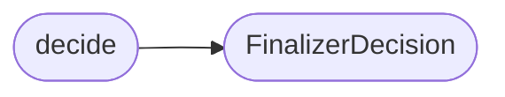

# `modules.lazy_finalizer`

> Source: [modules/lazy_finalizer.py:1](../../modules/lazy_finalizer.py#L1) | language `py` | coverage 100.0% | [API index](../index.md)

Evidence-gated finalization for the autonomous loop and apt_chain.

A task or chain run may report `[`done`](modules.planner.py.md#todoitem-done)` while nothing was actually executed and
no evidence was captured: a worker self-report, an empty LLM turn, or a chain
whose steps all abstained. This module is the single gate that decides whether a
run may be promoted to a verified, user-facing conclusion. Natural-language or
status-level claims are only candidates until [`decide`](#decide) confirms the run is
backed by real execution evidence.

The contract is pure (no I/O): the caller passes the evidence counts it already
has and receives a [`FinalizerDecision`](#finalizerdecision). Both autonomous runtimes consume
it so ``achieved`` never rests on a bare status flag, mirroring the chain
runner's per-step ``evidence_observed`` verdict at task scope.

## Contents

- **Classes:** [`FinalizerDecision`](#finalizerdecision)
- **Functions:** [`decide`](#decide)
- **Constants:** [`REASON_VERIFIED`](#reason_verified), [`REASON_MISSING_EVIDENCE`](#reason_missing_evidence), [`REASON_PARTIAL`](#reason_partial), [`REASON_UNFINISHED`](#reason_unfinished), [`REASON_PENDING_APPROVALS`](#reason_pending_approvals), [`REASON_PENDING_STEPS`](#reason_pending_steps), [`VERDICT_ACHIEVED`](#verdict_achieved), [`VERDICT_PARTIAL`](#verdict_partial), [`VERDICT_FAILED`](#verdict_failed)

## Call Graph

Solid arrows stay in this module, dashed arrows leave it.



## Classes

<a id="finalizerdecision"></a>

### `FinalizerDecision`

`class` `dataclass` | [modules/lazy_finalizer.py:35](../../modules/lazy_finalizer.py#L35)

Decorators: `@dataclass(frozen=True)`

```python
class FinalizerDecision
```

The single verdict on whether a run is a verified conclusion.

**Attributes**

| Name | Type | Default | Description |
|---|---|---|---|
| [`verdict`](#finalizerdecision-verdict) | `str` |  | Evidence-adjusted outcome (``achieved``/``partial``/``failed``). |
| [`finalizable`](#finalizerdecision-finalizable) | `bool` |  | Whether the run may be promoted to a user-facing answer. |
| [`evidence_verified`](#finalizerdecision-evidence_verified) | `bool` |  | Whether real execution evidence backs the claim. |
| [`completion_reason`](#finalizerdecision-completion_reason) | `str` |  | Machine-readable reason for the decision. |
| [`evidence_refs`](#finalizerdecision-evidence_refs) | `list[str]` | `field(default_factory=list)` | Short human-readable evidence tokens that were counted. |
| [`missing_checks`](#finalizerdecision-missing_checks) | `list[str]` | `field(default_factory=list)` | Evidence classes that were expected but absent. |
| [`pending_approvals`](#finalizerdecision-pending_approvals) | `list[str]` | `field(default_factory=list)` | Human-approval requests still undecided. |
| [`pending_plan_steps`](#finalizerdecision-pending_plan_steps) | `list[str]` | `field(default_factory=list)` | Plan steps still open when the run stopped. |

**Members**

| Member | Kind | Summary |
|---|---|---|
| [`to_dict`](#finalizerdecision-to_dict) | method | Return the decision as a JSON-serialisable dict for the verdict map. |

<a id="finalizerdecision-to_dict"></a>

#### `FinalizerDecision.to_dict`

`method` | [modules/lazy_finalizer.py:58](../../modules/lazy_finalizer.py#L58)

```python
def to_dict(self) -> dict
```

Return the decision as a JSON-serialisable dict for the verdict map.

**Returns:** `dict`

---

## Functions

<a id="decide"></a>

### `decide`

`function` | [modules/lazy_finalizer.py:72](../../modules/lazy_finalizer.py#L72)

```python
def decide(status: str, candidate_verdict: str, facts: int, findings: int, confirmed: int, tested: int, pending_approvals: list[str] | None = None, pending_plan_steps: list[str] | None = None) -> FinalizerDecision
```

Return the evidence-gated finalization decision for a run.

A run is evidence-verified when it produced confirmed findings, or findings
plus tested coverage, or facts plus tested coverage. A run that claims
`[`done`](modules.planner.py.md#todoitem-done)` with none of these is downgraded: the status is a self-report the
evidence does not support, so the verdict cannot stay ``achieved``.

Hard blocking rule (finalization contract): any undecided human approval
or any still-open plan step prevents ``achieved`` regardless of evidence,
because the run is not actually finished; the verdict degrades to
``partial`` with the blocking reason named.

**Parameters**

| Name | Type | Default | Description |
|---|---|---|---|
| `status` | `str` |  | Engine status of the run (`[`done`](modules.planner.py.md#todoitem-done)` is the only promotable one). |
| `candidate_verdict` | `str` |  | The verdict the caller would assign before gating. |
| `facts` | `int` |  | Count of non-cold facts recorded. |
| `findings` | `int` |  | Count of findings recorded. |
| `confirmed` | `int` |  | Count of confirmed or reproduced findings. |
| `tested` | `int` |  | Count of assets with at least one completed probe. |
| `pending_approvals` | `list[str] \| None` | `None` | Undecided approval request ids. |
| `pending_plan_steps` | `list[str] \| None` | `None` | Open plan step identifiers. |

**Returns:** `FinalizerDecision` - A [`FinalizerDecision`](#finalizerdecision) whose `[`verdict`](#finalizerdecision-verdict)` never exceeds what the
evidence and the pending-work state support.

*Calls:* [`FinalizerDecision`](#finalizerdecision)

---

## Constants

<a id="reason_verified"></a>

### `REASON_VERIFIED`

`constant` | [modules/lazy_finalizer.py:22](../../modules/lazy_finalizer.py#L22)

```python
REASON_VERIFIED = 'verified'
```

---

<a id="reason_missing_evidence"></a>

### `REASON_MISSING_EVIDENCE`

`constant` | [modules/lazy_finalizer.py:23](../../modules/lazy_finalizer.py#L23)

```python
REASON_MISSING_EVIDENCE = 'missing_execution_evidence'
```

---

<a id="reason_partial"></a>

### `REASON_PARTIAL`

`constant` | [modules/lazy_finalizer.py:24](../../modules/lazy_finalizer.py#L24)

```python
REASON_PARTIAL = 'partial_evidence'
```

---

<a id="reason_unfinished"></a>

### `REASON_UNFINISHED`

`constant` | [modules/lazy_finalizer.py:25](../../modules/lazy_finalizer.py#L25)

```python
REASON_UNFINISHED = 'unfinished'
```

---

<a id="reason_pending_approvals"></a>

### `REASON_PENDING_APPROVALS`

`constant` | [modules/lazy_finalizer.py:26](../../modules/lazy_finalizer.py#L26)

```python
REASON_PENDING_APPROVALS = 'pending_approvals'
```

---

<a id="reason_pending_steps"></a>

### `REASON_PENDING_STEPS`

`constant` | [modules/lazy_finalizer.py:27](../../modules/lazy_finalizer.py#L27)

```python
REASON_PENDING_STEPS = 'pending_plan_steps'
```

---

<a id="verdict_achieved"></a>

### `VERDICT_ACHIEVED`

`constant` | [modules/lazy_finalizer.py:29](../../modules/lazy_finalizer.py#L29)

```python
VERDICT_ACHIEVED = 'achieved'
```

---

<a id="verdict_partial"></a>

### `VERDICT_PARTIAL`

`constant` | [modules/lazy_finalizer.py:30](../../modules/lazy_finalizer.py#L30)

```python
VERDICT_PARTIAL = 'partial'
```

---

<a id="verdict_failed"></a>

### `VERDICT_FAILED`

`constant` | [modules/lazy_finalizer.py:31](../../modules/lazy_finalizer.py#L31)

```python
VERDICT_FAILED = 'failed'
```

---
