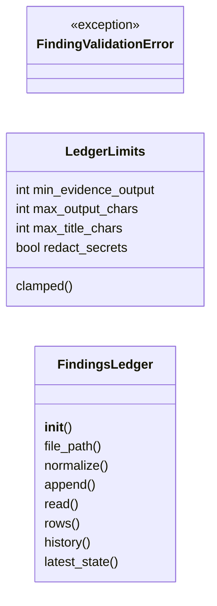
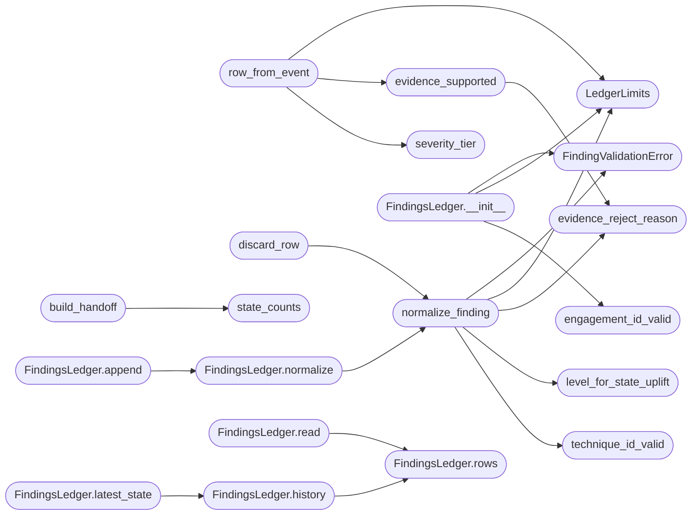

# `modules.lazy_findings`

> Source: [modules/lazy_findings.py:1](../../modules/lazy_findings.py#L1) | language `py` | coverage 100.0% | [API index](../index.md)

Engagement findings ledger: state machine plus reproducible evidence.

Contract: one JSONL ledger per engagement records finding transitions
(hypothesis -> partial -> confirmed / discarded) with verbatim, re-executable
evidence. A finding can only reach `[`confirmed`](modules.world_model.py.md#credentialentry-confirmed)` when the row carries an
exact ``evidence.command`` plus ``evidence.output`` verbatim (or an
``artifact_ref`` into the evidence plane), enforced fail-closed here so no
caller can stamp an unverified exploit as confirmed. Evidence is redacted
through `[`core.hardening.redact_text`](core.hardening.py.md#redact_text)` by default; redaction is an operator
decision because sealed credential stores remain the only home for secrets.

Standard library only. Sinks, CLI and the loop engine consume this module;
the validation-to-persistence path stays in one place so every caller shares
one audit surface.

## Contents

- **Classes:** [`LedgerLimits`](#ledgerlimits), [`FindingsLedger`](#findingsledger)
- **Exceptions:** [`FindingValidationError`](#findingvalidationerror)
- **Functions:** [`engagement_id_valid`](#engagement_id_valid), [`technique_id_valid`](#technique_id_valid), [`severity_tier`](#severity_tier), [`level_for_state_uplift`](#level_for_state_uplift), [`evidence_reject_reason`](#evidence_reject_reason), [`state_counts`](#state_counts), [`row_from_event`](#row_from_event), [`evidence_supported`](#evidence_supported), [`discard_row`](#discard_row), [`normalize_finding`](#normalize_finding), [`build_handoff`](#build_handoff)
- **Constants:** [`STATES`](#states), [`LEVELS`](#levels), [`DEFAULT_MIN_EVIDENCE_OUTPUT`](#default_min_evidence_output), [`DEFAULT_MAX_OUTPUT_CHARS`](#default_max_output_chars), [`DEFAULT_MAX_TITLE_CHARS`](#default_max_title_chars), [`FINDINGS_DIRNAME`](#findings_dirname), [`ENGAGEMENT_PATTERN`](#engagement_pattern), [`TECHNIQUE_PATTERN`](#technique_pattern), [`TACTIC_PATTERN`](#tactic_pattern), [`CONFIRMED_REQUIRES_EVIDENCE`](#confirmed_requires_evidence), [`VERDICT_TO_TRANSITION`](#verdict_to_transition)

## Type Diagram



## Call Graph

Solid arrows stay in this module, dashed arrows leave it.



## Classes

<a id="ledgerlimits"></a>

### `LedgerLimits`

`class` `dataclass` | [modules/lazy_findings.py:65](../../modules/lazy_findings.py#L65)

Decorators: `@dataclass(frozen=True)`

```python
class LedgerLimits
```

Numeric knobs of one ledger, injected by the caller.

**Attributes**

| Name | Type | Default | Description |
|---|---|---|---|
| [`min_evidence_output`](#ledgerlimits-min_evidence_output) | `int` | `DEFAULT_MIN_EVIDENCE_OUTPUT` | Minimum verbatim ``evidence.output`` length that can support a `[`confirmed`](modules.world_model.py.md#credentialentry-confirmed)` state. |
| [`max_output_chars`](#ledgerlimits-max_output_chars) | `int` | `DEFAULT_MAX_OUTPUT_CHARS` | Cap applied to stored verbatim output and command. |
| [`max_title_chars`](#ledgerlimits-max_title_chars) | `int` | `DEFAULT_MAX_TITLE_CHARS` | Cap applied to the human title. |
| [`redact_secrets`](#ledgerlimits-redact_secrets) | `bool` | `True` | Mask credential-like material before persistence. |

**Members**

| Member | Kind | Summary |
|---|---|---|
| [`clamped`](#ledgerlimits-clamped) | method | Return a copy with every knob forced into its valid range. |

<a id="ledgerlimits-clamped"></a>

#### `LedgerLimits.clamped`

`method` | [modules/lazy_findings.py:81](../../modules/lazy_findings.py#L81)

```python
def clamped(self) -> LedgerLimits
```

Return a copy with every knob forced into its valid range.

**Returns:** `LedgerLimits`

---

<a id="findingsledger"></a>

### `FindingsLedger`

`class` | [modules/lazy_findings.py:539](../../modules/lazy_findings.py#L539)

```python
class FindingsLedger
```

Append-only JSONL ledger of finding transitions for one engagement.

**Members**

| Member | Kind | Summary |
|---|---|---|
| [`__init__`](#findingsledger-__init__) | constructor | Bind the ledger to one engagement path with injected limits. |
| [`file_path`](#findingsledger-file_path) | property | Return the ledger JSONL file path. |
| [`normalize`](#findingsledger-normalize) | method | Validate and normalize one row before persistence. |
| [`append`](#findingsledger-append) | method | Append one normalized row atomically and return it. |
| [`read`](#findingsledger-read) | method | Read rows paginated by line index. |
| [`rows`](#findingsledger-rows) | method | Return every well-formed row in append order. |
| [`history`](#findingsledger-history) | method | Return every transition recorded for one finding reference. |
| [`latest_state`](#findingsledger-latest_state) | method | Return the newest known state of one finding reference. |

<a id="findingsledger-__init__"></a>

#### `FindingsLedger.__init__`

`constructor` | [modules/lazy_findings.py:542](../../modules/lazy_findings.py#L542)

```python
def __init__(self, engagement_id: str, base_dir: str | os.PathLike[str], limits: LedgerLimits | None = None, scrub: Callable[[str], str] | None = None) -> None
```

Bind the ledger to one engagement path with injected limits.

**Parameters**

| Name | Type | Default | Description |
|---|---|---|---|
| `engagement_id` | `str` |  | Engagement identifier (safe path segment). |
| `base_dir` | `str \| os.PathLike[str]` |  | Root directory holding the ``findings`` folder. |
| `limits` | `LedgerLimits \| None` | `None` | Validation caps for this ledger. |
| `scrub` | `Callable[[str], str] \| None` | `None` | Redaction callable; defaults to `[`redact_text`](core.hardening.py.md#redact_text)`. |

**Raises**

- [`FindingValidationError`](#findingvalidationerror): Unknown engagement id.

*Calls:* [`FindingValidationError`](#findingvalidationerror), [`LedgerLimits`](#ledgerlimits), [`engagement_id_valid`](#engagement_id_valid)

*Called by:* [`ledger_for`](modules.sinks.findings.py.md#ledger_for)

<a id="findingsledger-file_path"></a>

#### `FindingsLedger.file_path`

`property` | [modules/lazy_findings.py:569](../../modules/lazy_findings.py#L569)

Decorators: `@property`

```python
def file_path(self) -> Path
```

Return the ledger JSONL file path.

**Returns:** `Path`

<a id="findingsledger-normalize"></a>

#### `FindingsLedger.normalize`

`method` | [modules/lazy_findings.py:573](../../modules/lazy_findings.py#L573)

```python
def normalize(self, row: dict[str, Any]) -> dict[str, Any]
```

Validate and normalize one row before persistence.

Behaves like [`normalize_finding`](#normalize_finding); additionally applies the
redaction scrub to title and string evidence so the store never
holds masked-off secrets, then caps command/output lengths.

**Parameters**

| Name | Type | Default | Description |
|---|---|---|---|
| `row` | `dict[str, Any]` |  | Candidate row mapping. |

**Returns:** `dict[str, Any]` - The normalized row ready to append.

**Raises**

- [`FindingValidationError`](#findingvalidationerror): Any contract violation.

*Calls:* [`normalize_finding`](#normalize_finding)

*Called by:* [`FindingsLedger.append`](#findingsledger-append), [`same_remote`](modules.nuclei_templates_sync.py.md#same_remote)

<a id="findingsledger-append"></a>

#### `FindingsLedger.append`

`method` | [modules/lazy_findings.py:606](../../modules/lazy_findings.py#L606)

```python
def append(self, row: dict[str, Any]) -> dict[str, Any]
```

Append one normalized row atomically and return it.

A single ``O_APPEND`` write per row keeps concurrent producers from
interleaving lines; nothing is stored when normalization fails.

**Parameters**

| Name | Type | Default | Description |
|---|---|---|---|
| `row` | `dict[str, Any]` |  | Candidate row mapping. |

**Returns:** `dict[str, Any]` - The persisted row.

**Raises**

- [`FindingValidationError`](#findingvalidationerror): Invalid row; nothing is written.

*Calls:* [`FindingsLedger.normalize`](#findingsledger-normalize)

<a id="findingsledger-read"></a>

#### `FindingsLedger.read`

`method` | [modules/lazy_findings.py:636](../../modules/lazy_findings.py#L636)

```python
def read(self, cursor: int = 0, limit: int | None = None) -> dict[str, Any]
```

Read rows paginated by line index.

Corrupt lines are skipped without failing the read; the ledger is
best-effort outbound and strict inbound.

**Parameters**

| Name | Type | Default | Description |
|---|---|---|---|
| `cursor` | `int` | `0` | Zero-based index of the first row to return. |
| `limit` | `int \| None` | `None` | Maximum rows to return, None for all remaining. |

**Returns:** `dict[str, Any]` - Mapping with ``findings``/`[`next_cursor`](modules.lazy_mentions.py.md#lazymentionpage-next_cursor)`/`[`done`](modules.planner.py.md#todoitem-done)`/``total``.

*Calls:* [`FindingsLedger.rows`](#findingsledger-rows)

<a id="findingsledger-rows"></a>

#### `FindingsLedger.rows`

`method` | [modules/lazy_findings.py:660](../../modules/lazy_findings.py#L660)

```python
def rows(self) -> list[dict[str, Any]]
```

Return every well-formed row in append order.

**Returns:** `list[dict[str, Any]]` - Parsed rows; unreadable ledger content yields an empty list.

*Called by:* [`FindingsLedger.history`](#findingsledger-history), [`FindingsLedger.read`](#findingsledger-read)

<a id="findingsledger-history"></a>

#### `FindingsLedger.history`

`method` | [modules/lazy_findings.py:684](../../modules/lazy_findings.py#L684)

```python
def history(self, finding_ref: str) -> list[dict[str, Any]]
```

Return every transition recorded for one finding reference.

**Parameters**

| Name | Type | Default | Description |
|---|---|---|---|
| `finding_ref` | `str` |  | Leaf identifier of the finding series. |

**Returns:** `list[dict[str, Any]]` - Rows for that reference in append order.

*Calls:* [`FindingsLedger.rows`](#findingsledger-rows)

*Called by:* [`FindingsLedger.latest_state`](#findingsledger-latest_state)

<a id="findingsledger-latest_state"></a>

#### `FindingsLedger.latest_state`

`method` | [modules/lazy_findings.py:696](../../modules/lazy_findings.py#L696)

```python
def latest_state(self, finding_ref: str) -> str
```

Return the newest known state of one finding reference.

**Parameters**

| Name | Type | Default | Description |
|---|---|---|---|
| `finding_ref` | `str` |  | Leaf identifier of the finding series. |

**Returns:** `str` - State string, empty when the reference is unknown.

*Calls:* [`FindingsLedger.history`](#findingsledger-history)

---

## Exceptions

<a id="findingvalidationerror"></a>

### `FindingValidationError`

`exception` | [modules/lazy_findings.py:60](../../modules/lazy_findings.py#L60)

```python
class FindingValidationError(ValueError)
```

Bases: `ValueError`

A finding row failed fail-closed validation and nothing is persisted.

---

## Functions

<a id="engagement_id_valid"></a>

### `engagement_id_valid`

`function` | [modules/lazy_findings.py:91](../../modules/lazy_findings.py#L91)

```python
def engagement_id_valid(value: str) -> bool
```

Return True when the engagement id is safe as a path segment.

**Parameters**

| Name | Type | Default | Description |
|---|---|---|---|
| `value` | `str` |  | Engagement identifier supplied by any caller. |

**Returns:** `bool` - True for ids carrying no traversal or separator characters.

*Called by:* [`FindingsLedger.__init__`](#findingsledger-__init__), [`apply`](modules.sinks.findings.py.md#apply)

---

<a id="technique_id_valid"></a>

### `technique_id_valid`

`function` | [modules/lazy_findings.py:103](../../modules/lazy_findings.py#L103)

```python
def technique_id_valid(value: str) -> bool
```

Return True when a MITRE technique or tactic id is well formed.

**Parameters**

| Name | Type | Default | Description |
|---|---|---|---|
| `value` | `str` |  | Candidate ATT&CK id. |

**Returns:** `bool` - True for ``T####``/``T####.###`` techniques and ``TA####`` tactics.

*Called by:* [`normalize_finding`](#normalize_finding)

---

<a id="severity_tier"></a>

### `severity_tier`

`function` | [modules/lazy_findings.py:116](../../modules/lazy_findings.py#L116)

```python
def severity_tier(severity: str) -> tuple[str, str]
```

Map a severity to a starting state and evidence level.

High/critical observables start partial until reproduced; lower
severities stay identified hypotheses until retest decides.

**Parameters**

| Name | Type | Default | Description |
|---|---|---|---|
| `severity` | `str` |  | Severity string from the finding event. |

**Returns:** `tuple[str, str]` - ``(state, level)`` pair from [`STATES`](#states) / [`LEVELS`](#levels).

*Called by:* [`row_from_event`](#row_from_event)

---

<a id="level_for_state_uplift"></a>

### `level_for_state_uplift`

`function` | [modules/lazy_findings.py:138](../../modules/lazy_findings.py#L138)

```python
def level_for_state_uplift(level: str, state: str) -> str
```

Return the evidence level after a state transition.

Promotion to `[`confirmed`](modules.world_model.py.md#credentialentry-confirmed)` anchors the level at `[`confirmed`](modules.world_model.py.md#credentialentry-confirmed)` or above;
other transitions keep a well-formed current level.

**Parameters**

| Name | Type | Default | Description |
|---|---|---|---|
| `level` | `str` |  | Current evidence level. |
| `state` | `str` |  | New state after the transition. |

**Returns:** `str` - The adjusted evidence level.

*Called by:* [`normalize_finding`](#normalize_finding)

---

<a id="evidence_reject_reason"></a>

### `evidence_reject_reason`

`function` | [modules/lazy_findings.py:156](../../modules/lazy_findings.py#L156)

```python
def evidence_reject_reason(state: str, evidence: Any, min_output: int = DEFAULT_MIN_EVIDENCE_OUTPUT) -> str
```

Reason a `[`confirmed`](modules.world_model.py.md#credentialentry-confirmed)` state is rejected, or an empty string.

Two evidence shapes validate: a ``command`` plus verbatim ``output`` at
or above the minimum length, or an ``artifact_ref`` mapping with
``execution_id``/``name`` pointing at staged raw output.

**Parameters**

| Name | Type | Default | Description |
|---|---|---|---|
| `state` | `str` |  | Candidate row state. |
| `evidence` | `Any` |  | Evidence payload under validation. |
| `min_output` | `int` | `DEFAULT_MIN_EVIDENCE_OUTPUT` | Minimum verbatim output length required. |

**Returns:** `str` - Rejection reason string, empty when the state is admissible.

*Called by:* [`evidence_supported`](#evidence_supported), [`normalize_finding`](#normalize_finding)

---

<a id="state_counts"></a>

### `state_counts`

`function` | [modules/lazy_findings.py:191](../../modules/lazy_findings.py#L191)

```python
def state_counts(rows: list[dict]) -> dict[str, int]
```

Count the latest known state per finding reference.

The ledger is append-only, so the newest transition per ``finding_ref``
wins; rows are consumed in file order.

**Parameters**

| Name | Type | Default | Description |
|---|---|---|---|
| `rows` | `list[dict]` |  | Ledger rows in append order. |

**Returns:** `dict[str, int]` - Mapping of state name to finding count.

*Called by:* [`build_handoff`](#build_handoff)

---

<a id="row_from_event"></a>

### `row_from_event`

`function` | [modules/lazy_findings.py:230](../../modules/lazy_findings.py#L230)

```python
def row_from_event(payload: dict[str, Any], limits: LedgerLimits | None = None) -> dict[str, Any] | None
```

Map one outcome event to a ledger row, or None when unmappable.

Accepted payloads are event dicts with finding-class kinds. Retest
verdicts arrive as kind ``finding`` with ``metadata.verdict`` and append
a transition row for the same ``finding_ref``; exploitation classes
with success and evidence start at `[`confirmed`](modules.world_model.py.md#credentialentry-confirmed)` because the command
and its verbatim output are already the artifact of record.

**Parameters**

| Name | Type | Default | Description |
|---|---|---|---|
| `payload` | `dict[str, Any]` |  | Outcome event dict (`[`OutcomeEvent.to_dict`](modules.outcome_bus.py.md#outcomeevent-to_dict)` shape). |
| `limits` | `LedgerLimits \| None` | `None` | Ledger limits controlling caps and redaction. |

**Returns:** `dict[str, Any] | None` - Normalized row ready for append, or None for out-of-scope events.

*Calls:* [`LedgerLimits`](#ledgerlimits), [`evidence_supported`](#evidence_supported), [`severity_tier`](#severity_tier)

*Called by:* [`apply`](modules.sinks.findings.py.md#apply)

---

<a id="evidence_supported"></a>

### `evidence_supported`

`function` | [modules/lazy_findings.py:281](../../modules/lazy_findings.py#L281)

```python
def evidence_supported(evidence: Any, min_output: int) -> bool
```

Return True when evidence backing allows the `[`confirmed`](modules.world_model.py.md#credentialentry-confirmed)` state.

**Parameters**

| Name | Type | Default | Description |
|---|---|---|---|
| `evidence` | `Any` |  | Evidence payload (command/output/artifact_ref). |
| `min_output` | `int` |  |  |

**Returns:** `bool` - True for artifact references or verbatim output at/above minimum.

*Calls:* [`evidence_reject_reason`](#evidence_reject_reason)

*Called by:* [`row_from_event`](#row_from_event)

---

<a id="discard_row"></a>

### `discard_row`

`function` | [modules/lazy_findings.py:382](../../modules/lazy_findings.py#L382)

```python
def discard_row(reason: str, command: str = '', output: str = '', technique_id: str = '', engagement_id: str = '', target: str = '') -> dict[str, Any]
```

Build a discarded-vector row so dead routes are recorded permanently.

Ledger growth from abandoned hypotheses keeps future loops from
repeating the same failed approach after a crash or context reset.

**Parameters**

| Name | Type | Default | Description |
|---|---|---|---|
| `reason` | `str` |  | Human reason the route was abandoned. |
| `command` | `str` | `''` | Last command executed on the route, if any. |
| `output` | `str` | `''` | Output of that command, if any. |
| `technique_id` | `str` | `''` | ATT&CK id attempted, if any. |
| `engagement_id` | `str` | `''` | Engagement identifier. |
| `target` | `str` | `''` | Host the route targeted. |

**Returns:** `dict[str, Any]` - Normalized discarded row ready for append.

*Calls:* [`normalize_finding`](#normalize_finding)

*Called by:* [`ingest_discarded`](modules.sinks.findings.py.md#ingest_discarded)

---

<a id="normalize_finding"></a>

### `normalize_finding`

`function` | [modules/lazy_findings.py:429](../../modules/lazy_findings.py#L429)

```python
def normalize_finding(row: dict[str, Any], limits: LedgerLimits | None = None) -> dict[str, Any]
```

Validate and normalize one row without persisting.

Fail-closed: an invalid state, level, technique id, title or a
`[`confirmed`](modules.world_model.py.md#credentialentry-confirmed)` state without reproducible evidence raises instead of
returning a half-valid row. ``recorded_at`` is always assigned fresh
and never trusted from callers.

**Parameters**

| Name | Type | Default | Description |
|---|---|---|---|
| `row` | `dict[str, Any]` |  | Candidate row mapping. |
| `limits` | `LedgerLimits \| None` | `None` | Validation caps; module defaults when omitted. |

**Returns:** `dict[str, Any]` - The normalized row.

**Raises**

- [`FindingValidationError`](#findingvalidationerror): Any contract violation.

*Calls:* [`FindingValidationError`](#findingvalidationerror), [`LedgerLimits`](#ledgerlimits), [`evidence_reject_reason`](#evidence_reject_reason), [`level_for_state_uplift`](#level_for_state_uplift), [`technique_id_valid`](#technique_id_valid)

*Called by:* [`FindingsLedger.normalize`](#findingsledger-normalize), [`discard_row`](#discard_row)

---

<a id="build_handoff"></a>

### `build_handoff`

`function` | [modules/lazy_findings.py:481](../../modules/lazy_findings.py#L481)

```python
def build_handoff(rows: list[dict], status: str = '', rounds: int = 0) -> dict[str, Any]
```

Shape the operator handoff from durable ledger rows.

The handoff is the close-of-loop summary: state counts over the latest
transitions, the confirmed findings with their reproducible evidence,
the last discarded vectors (so the next run starts knowing what failed)
and one explicit decision line for the operator.

**Parameters**

| Name | Type | Default | Description |
|---|---|---|---|
| `rows` | `list[dict]` |  | Latest ledger rows in append order. |
| `status` | `str` | `''` | Final loop status. |
| `rounds` | `int` | `0` | Completed round count. |

**Returns:** `dict[str, Any]` - Handoff dict with states, confirmed, discarded and decision.

*Calls:* [`state_counts`](#state_counts)

*Called by:* [`handoff`](modules.sinks.findings.py.md#handoff)

---

## Constants

<a id="states"></a>

### `STATES`

`constant` | [modules/lazy_findings.py:31](../../modules/lazy_findings.py#L31)

```python
STATES: tuple[str, ...] = ('hypothesis', 'partial', 'confirmed', 'discarded')
```

---

<a id="levels"></a>

### `LEVELS`

`constant` | [modules/lazy_findings.py:33](../../modules/lazy_findings.py#L33)

```python
LEVELS: tuple[str, ...] = ('identified', 'partial', 'confirmed', 'critical')
```

---

<a id="default_min_evidence_output"></a>

### `DEFAULT_MIN_EVIDENCE_OUTPUT`

`constant` | [modules/lazy_findings.py:35](../../modules/lazy_findings.py#L35)

```python
DEFAULT_MIN_EVIDENCE_OUTPUT = 16
```

---

<a id="default_max_output_chars"></a>

### `DEFAULT_MAX_OUTPUT_CHARS`

`constant` | [modules/lazy_findings.py:37](../../modules/lazy_findings.py#L37)

```python
DEFAULT_MAX_OUTPUT_CHARS = 4000
```

---

<a id="default_max_title_chars"></a>

### `DEFAULT_MAX_TITLE_CHARS`

`constant` | [modules/lazy_findings.py:39](../../modules/lazy_findings.py#L39)

```python
DEFAULT_MAX_TITLE_CHARS = 200
```

---

<a id="findings_dirname"></a>

### `FINDINGS_DIRNAME`

`constant` | [modules/lazy_findings.py:41](../../modules/lazy_findings.py#L41)

```python
FINDINGS_DIRNAME = 'findings'
```

---

<a id="engagement_pattern"></a>

### `ENGAGEMENT_PATTERN`

`constant` | [modules/lazy_findings.py:43](../../modules/lazy_findings.py#L43)

```python
ENGAGEMENT_PATTERN = re.compile('^[A-Za-z0-9._-]{1,80}$')
```

---

<a id="technique_pattern"></a>

### `TECHNIQUE_PATTERN`

`constant` | [modules/lazy_findings.py:45](../../modules/lazy_findings.py#L45)

```python
TECHNIQUE_PATTERN = re.compile('^T\\d{4}(?:\\.\\d{3})?$')
```

---

<a id="tactic_pattern"></a>

### `TACTIC_PATTERN`

`constant` | [modules/lazy_findings.py:47](../../modules/lazy_findings.py#L47)

```python
TACTIC_PATTERN = re.compile('^TA\\d{4}$')
```

---

<a id="confirmed_requires_evidence"></a>

### `CONFIRMED_REQUIRES_EVIDENCE`

`constant` | [modules/lazy_findings.py:49](../../modules/lazy_findings.py#L49)

```python
CONFIRMED_REQUIRES_EVIDENCE
```

---

<a id="verdict_to_transition"></a>

### `VERDICT_TO_TRANSITION`

`constant` | [modules/lazy_findings.py:54](../../modules/lazy_findings.py#L54)

```python
VERDICT_TO_TRANSITION: dict[str, str] = {'reproduced': 'confirmed', 'fixed': 'discarded'}
```

---
