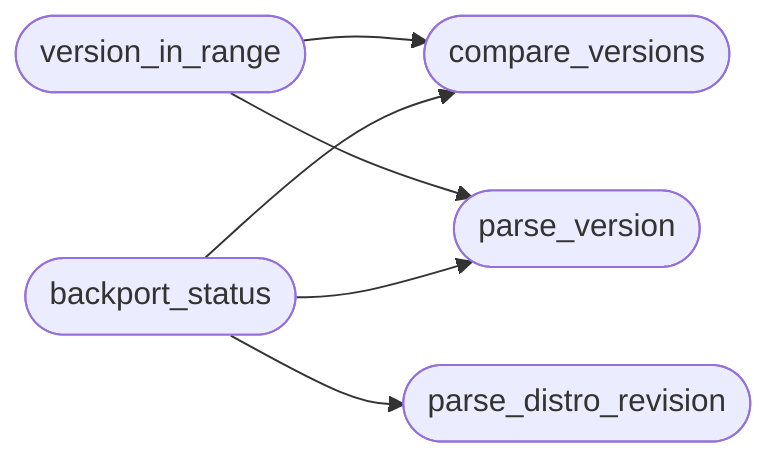

# `modules.lazy_heat`

> Source: [modules/lazy_heat.py:1](../../modules/lazy_heat.py#L1) | language `py` | coverage 100.0% | [API index](../index.md)

Heat tiers and version math for CVE correlation.

Heat is a deterministic pre-classification of a CVE from its
exploitation and severity signals so the pipeline can prioritise what
correlators and the autonomous loop look at first:

  hot   — actively dangerous now: KEV, public/weaponized exploit,
          critical CVSS (>= 9.0), or high EPSS plus high CVSS
  warm  — warning signs: high CVSS (>= 7.0) or EPSS threshold reached
  cold  — low-priority watch: everything else

A match's heat on *your* host differs from the feed heat: a match the
host's distribution already backported a fix for is cold however hot
the CVE is, and a confirmed match on a high score reads as hot.

Version helpers are pure stdlib so every rule is unit-testable without
network access. Thresholds live in one place and are easy to retune.

Stdlib only. Never raises on untrusted input; every entry point
degrades to "unknown" when data is missing.

## Contents

- **Functions:** [`classify_heat`](#classify_heat), [`match_heat`](#match_heat), [`parse_version`](#parse_version), [`compare_versions`](#compare_versions), [`version_in_range`](#version_in_range), [`cvss3_base_score`](#cvss3_base_score), [`product_token`](#product_token), [`token_matches`](#token_matches), [`parse_distro_revision`](#parse_distro_revision), [`backport_status`](#backport_status), [`label_for`](#label_for)
- **Constants:** [`HOT`](#hot), [`WARM`](#warm), [`COLD`](#cold), [`HIGH_CVSS`](#high_cvss), [`CRITICAL_CVSS`](#critical_cvss), [`EPSS_THRESHOLD`](#epss_threshold), [`HEAT_RANK`](#heat_rank), [`SEVERITY_FROM_HEAT`](#severity_from_heat), [`SEVERITY_HEAT`](#severity_heat), [`PATCHED`](#patched), [`VULNERABLE`](#vulnerable), [`UNKNOWN`](#unknown), [`NO_DATA`](#no_data)

## Call Graph

Solid arrows stay in this module, dashed arrows leave it.



## Functions

<a id="classify_heat"></a>

### `classify_heat`

`function` | [modules/lazy_heat.py:68](../../modules/lazy_heat.py#L68)

```python
def classify_heat(kev: bool = False, epss: float | None = None, exploit: bool = False, cvss: float = 0.0) -> str
```

Return the heat tier of one CVE from its exploitation signals.

**Parameters**

| Name | Type | Default | Description |
|---|---|---|---|
| `kev` | `bool` | `False` | CVE is on a known-exploited catalog. |
| `epss` | `float \| None` | `None` | EPSS probability (0..1) or None when unknown. |
| `exploit` | `bool` | `False` | Public or weaponized exploit code exists. |
| `cvss` | `float` | `0.0` | CVSS base score. |

**Returns:** `str` - One of HOT, WARM, COLD.

*Called by:* [`correlate`](modules.lazy_cve_feed.py.md#correlate), [`cve_intel`](modules.lazy_cve_feed.py.md#cve_intel)

---

<a id="match_heat"></a>

### `match_heat`

`function` | [modules/lazy_heat.py:91](../../modules/lazy_heat.py#L91)

```python
def match_heat(tier: str, cvss: float = 0.0, verdict: str = '', distro_status: str = '') -> str
```

Return the heat of one CVE *on one host*.

A backported (patched by distro) match is COLD however dangerous the
CVE is; a confirmed match on a high score reads as HOT.

**Parameters**

| Name | Type | Default | Description |
|---|---|---|---|
| `tier` | `str` |  | Feed tier from [`classify_heat`](#classify_heat). |
| `cvss` | `float` | `0.0` | CVE CVSS base score. |
| `verdict` | `str` | `''` | Correlation verdict (``affected`` / ``uncertain``). |
| `distro_status` | `str` | `''` | Distro backport status for the match. |

**Returns:** `str` - One of HOT, WARM, COLD.

---

<a id="parse_version"></a>

### `parse_version`

`function` | [modules/lazy_heat.py:118](../../modules/lazy_heat.py#L118)

```python
def parse_version(value: str, strict: bool = False) -> tuple[int, ...] | None
```

Parse a dotted version string into a comparable tuple.

A leading dpkg/rpm epoch ("1:") is dropped, a "v" prefix is ignored,
pre-release markers become negative components so ``2.0-beta9``
sorts before ``2.0``, and a git commit hash is not a version. With
``strict`` (a bound from a feed, not a banner) the text must start
with a digit so refs like ``main`` never parse as a version.

**Parameters**

| Name | Type | Default | Description |
|---|---|---|---|
| `value` | `str` |  | Raw version text. |
| `strict` | `bool` | `False` | Require the text to start with a digit. |

**Returns:** `tuple[int, ...] | None` - Tuple of ints, or None when no version can be parsed.

*Called by:* [`correlate`](modules.lazy_cve_feed.py.md#correlate), [`backport_status`](#backport_status), [`version_in_range`](#version_in_range)

---

<a id="compare_versions"></a>

### `compare_versions`

`function` | [modules/lazy_heat.py:154](../../modules/lazy_heat.py#L154)

```python
def compare_versions(a: tuple[int, ...], b: tuple[int, ...]) -> int
```

Compare two version tuples zero-padded so (1, 18) == (1, 18, 0).

**Parameters**

| Name | Type | Default | Description |
|---|---|---|---|
| `a` | `tuple[int, ...]` |  |  |
| `b` | `tuple[int, ...]` |  |  |

**Returns:** `int`

*Called by:* [`backport_status`](#backport_status), [`version_in_range`](#version_in_range)

---

<a id="version_in_range"></a>

### `version_in_range`

`function` | [modules/lazy_heat.py:162](../../modules/lazy_heat.py#L162)

```python
def version_in_range(ver: tuple[int, ...] | None, rng: dict) -> bool | None
```

Return True/False/None for ``ver`` inside one affected range.

A range with no usable bound is unknown, never "in range": only a
real bound can put a version inside it. GIT ranges are commit
hashes and can never be compared with a version.

**Parameters**

| Name | Type | Default | Description |
|---|---|---|---|
| `ver` | `tuple[int, ...] \| None` |  | Parsed version tuple or None. |
| `rng` | `dict` |  | Range dict with ``type``, ``introduced``, ``fixed``, ``lastAffected``. |

**Returns:** `bool | None` - True when in range, False when out, None when unknown.

*Calls:* [`compare_versions`](#compare_versions), [`parse_version`](#parse_version)

*Called by:* [`correlate`](modules.lazy_cve_feed.py.md#correlate)

---

<a id="cvss3_base_score"></a>

### `cvss3_base_score`

`function` | [modules/lazy_heat.py:204](../../modules/lazy_heat.py#L204)

```python
def cvss3_base_score(vector: str) -> float
```

Compute the CVSS v3 base score from an inline vector string.

**Parameters**

| Name | Type | Default | Description |
|---|---|---|---|
| `vector` | `str` |  | ``CVSS:3.x/AV:N/AC:L/PR:N/UI:N/S:U/C:H/I:H/A:H`` form. |

**Returns:** `float` - Base score rounded up to one decimal, 0.0 when unparseable.

---

<a id="product_token"></a>

### `product_token`

`function` | [modules/lazy_heat.py:246](../../modules/lazy_heat.py#L246)

```python
def product_token(value: str) -> str
```

Normalise a product name to one comparable token.

Generic infrastructure words (``cms``, ``server``, ``api``...) are
dropped first, so ``cms server`` normalises to nothing while
``Apache httpd`` normalises to ``apachehttpd``. Word boundaries
survive normalisation: callers compare the token with
[`token_matches`](#token_matches) so ``cms`` never matches inside ``datocms``.

**Parameters**

| Name | Type | Default | Description |
|---|---|---|---|
| `value` | `str` |  | Raw product/banner text. |

**Returns:** `str` - Lowercase alphanumeric token, or "" when too generic or short.

*Called by:* [`correlate`](modules.lazy_cve_feed.py.md#correlate), [`fetch_product_advisories`](modules.lazy_cve_feed.py.md#fetch_product_advisories), [`load_kev_matches`](modules.lazy_cve_feed.py.md#load_kev_matches), [`hint_fingerprint`](modules.loop_triggers.py.md#hint_fingerprint)

---

<a id="token_matches"></a>

### `token_matches`

`function` | [modules/lazy_heat.py:269](../../modules/lazy_heat.py#L269)

```python
def token_matches(haystack: str, needle: str) -> bool
```

Whole-token containment of ``needle`` inside ``haystack``.

**Parameters**

| Name | Type | Default | Description |
|---|---|---|---|
| `haystack` | `str` |  | Normalised product string. |
| `needle` | `str` |  | Normalised product token. |

**Returns:** `bool` - True when ``needle`` is a whole run of characters of
``haystack`` or equal to it.

*Called by:* [`load_kev_matches`](modules.lazy_cve_feed.py.md#load_kev_matches)

---

<a id="parse_distro_revision"></a>

### `parse_distro_revision`

`function` | [modules/lazy_heat.py:303](../../modules/lazy_heat.py#L303)

```python
def parse_distro_revision(banner: str) -> dict
```

Read the distro family and package release from a service banner.

Understands nmap's ``8.9p1 Ubuntu 3ubuntu0.6`` form, dpkg/rpm
release suffixes (``1:8.9p1-3ubuntu0.10``, ``2.4.57-2``,
``1.0.9-2.el8``) and OS CPEs.

**Parameters**

| Name | Type | Default | Description |
|---|---|---|---|
| `banner` | `str` |  | Product/version/extrainfo text a scanner captured. |

**Returns:** `dict` - ``{"family": ..., "revision": ...}`` with "" when unknown.

*Called by:* [`backport_status`](#backport_status)

---

<a id="backport_status"></a>

### `backport_status`

`function` | [modules/lazy_heat.py:342](../../modules/lazy_heat.py#L342)

```python
def backport_status(banner: str, fixed_revision: str = '') -> str
```

Classify whether a distro already backported the fix.

A revision the distro patched is recognised by comparing the
package release against the known fixed revision; without fixed
data the status is NO_DATA and correlation must never drop the
match because of it.

**Parameters**

| Name | Type | Default | Description |
|---|---|---|---|
| `banner` | `str` |  | Product/version/extrainfo text. |
| `fixed_revision` | `str` | `''` | Distro revision that carries the fix ("" = unknown). |

**Returns:** `str` - One of PATCHED, VULNERABLE, UNKNOWN, NO_DATA.

*Calls:* [`compare_versions`](#compare_versions), [`parse_distro_revision`](#parse_distro_revision), [`parse_version`](#parse_version)

---

<a id="label_for"></a>

### `label_for`

`function` | [modules/lazy_heat.py:370](../../modules/lazy_heat.py#L370)

```python
def label_for(status: str, fixed_revision: str = '') -> str
```

Human-readable label for one backport status.

**Parameters**

| Name | Type | Default | Description |
|---|---|---|---|
| `status` | `str` |  |  |
| `fixed_revision` | `str` | `''` |  |

**Returns:** `str`

---

## Constants

<a id="hot"></a>

### `HOT`

`constant` | [modules/lazy_heat.py:27](../../modules/lazy_heat.py#L27)

```python
HOT = 'hot'
```

---

<a id="warm"></a>

### `WARM`

`constant` | [modules/lazy_heat.py:28](../../modules/lazy_heat.py#L28)

```python
WARM = 'warm'
```

---

<a id="cold"></a>

### `COLD`

`constant` | [modules/lazy_heat.py:29](../../modules/lazy_heat.py#L29)

```python
COLD = 'cold'
```

---

<a id="high_cvss"></a>

### `HIGH_CVSS`

`constant` | [modules/lazy_heat.py:31](../../modules/lazy_heat.py#L31)

```python
HIGH_CVSS = 7.0
```

---

<a id="critical_cvss"></a>

### `CRITICAL_CVSS`

`constant` | [modules/lazy_heat.py:32](../../modules/lazy_heat.py#L32)

```python
CRITICAL_CVSS = 9.0
```

---

<a id="epss_threshold"></a>

### `EPSS_THRESHOLD`

`constant` | [modules/lazy_heat.py:33](../../modules/lazy_heat.py#L33)

```python
EPSS_THRESHOLD = 0.1
```

---

<a id="heat_rank"></a>

### `HEAT_RANK`

`constant` | [modules/lazy_heat.py:35](../../modules/lazy_heat.py#L35)

```python
HEAT_RANK = {HOT: 3, WARM: 2, COLD: 1}
```

---

<a id="severity_from_heat"></a>

### `SEVERITY_FROM_HEAT`

`constant` | [modules/lazy_heat.py:37](../../modules/lazy_heat.py#L37)

```python
SEVERITY_FROM_HEAT = {HOT: 'critical', WARM: 'high', COLD: 'medium'}
```

---

<a id="severity_heat"></a>

### `SEVERITY_HEAT`

`constant` | [modules/lazy_heat.py:40](../../modules/lazy_heat.py#L40)

```python
SEVERITY_HEAT = {'critical': HOT, 'high': HOT, 'medium': WARM, 'low': COLD}
```

---

<a id="patched"></a>

### `PATCHED`

`constant` | [modules/lazy_heat.py:43](../../modules/lazy_heat.py#L43)

```python
PATCHED = 'patched'
```

---

<a id="vulnerable"></a>

### `VULNERABLE`

`constant` | [modules/lazy_heat.py:44](../../modules/lazy_heat.py#L44)

```python
VULNERABLE = 'vulnerable'
```

---

<a id="unknown"></a>

### `UNKNOWN`

`constant` | [modules/lazy_heat.py:45](../../modules/lazy_heat.py#L45)

```python
UNKNOWN = 'unknown'
```

---

<a id="no_data"></a>

### `NO_DATA`

`constant` | [modules/lazy_heat.py:46](../../modules/lazy_heat.py#L46)

```python
NO_DATA = 'no_data'
```

---
