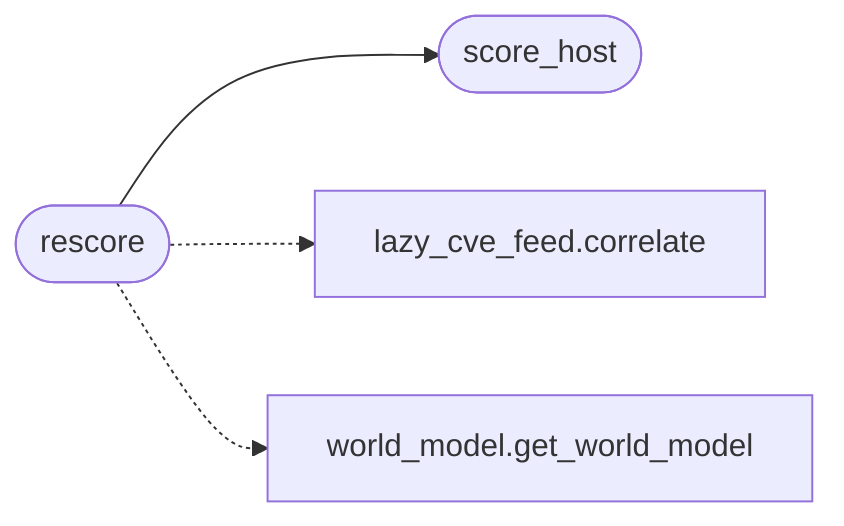

# `modules.lazy_hostscore`

> Source: [modules/lazy_hostscore.py:1](../../modules/lazy_hostscore.py#L1) | language `py` | coverage 100.0% | [API index](../index.md)

Host heat score: deterministic 0-100 priority for every known host.

Deterministic pre-classification for plan prioritisation: CVEs that
have named a service at 0.55+ EPSS or have KEV coverage are hot, warm
tiers are CVE HOTWARM; add certainty points for confirmed vulnerabilities and shell ownership; downgrade what the host already had since
the last scan; cap per category and keep the reason list so a score can
be audited. Pure function first (like the frameworks keep their scoring
auditable), persistence second, wrapper last.

Stdlib only. Never raises on untrusted snapshots; missing inputs cost
zero.

## Contents

- **Functions:** [`score_host`](#score_host), [`rescore`](#rescore), [`load_scores`](#load_scores)
- **Constants:** [`CVE_POINTS`](#cve_points), [`CVE_CAP`](#cve_cap), [`FINDING_POINTS`](#finding_points), [`FINDINGS_CAP`](#findings_cap), [`SHELL_BONUS`](#shell_bonus), [`RECENCY_CAP`](#recency_cap), [`SCORE_FILENAME`](#score_filename)

## Call Graph

Solid arrows stay in this module, dashed arrows leave it.



## Functions

<a id="score_host"></a>

### `score_host`

`function` | [modules/lazy_hostscore.py:34](../../modules/lazy_hostscore.py#L34)

```python
def score_host(inputs: dict[str, Any]) -> tuple[int, list[dict[str, Any]]]
```

Score one host from plain-dict inputs.

**Parameters**

| Name | Type | Default | Description |
|---|---|---|---|
| `inputs` | `dict[str, Any]` |  | ``{"services": [{"port","name","version"}], "findings": [{"severity","state","text"}], "shell": bool, "cves": [{"heat"}], "admin_paths": [str], "recency": float}`` |

**Returns:** `tuple[int, list[dict[str, Any]]]` - ``(score, detail)`` where detail is the ordered list of
``{label, points}`` lines.

*Called by:* [`rescore`](#rescore)

---

<a id="rescore"></a>

### `rescore`

`function` | [modules/lazy_hostscore.py:96](../../modules/lazy_hostscore.py#L96)

```python
def rescore(sessions_dir: str | Path | None = None, allow_network: bool = False, now: float | None = None) -> dict[str, dict[str, Any]]
```

Score the whole world model and persist the table result.

**Parameters**

| Name | Type | Default | Description |
|---|---|---|---|
| `sessions_dir` | `str \| Path \| None` | `None` | Sessions directory override. |
| `allow_network` | `bool` | `False` | Let CVE correlation use network feeds when a cache is cold; default stays offline-only. |
| `now` | `float \| None` | `None` | Reference epoch; defaults to current time. |

**Returns:** `dict[str, dict[str, Any]]` - ``{host: {"score", "detail"}}`` for every host the snapshot
carries, empty on any failure.

*Calls:* [`correlate`](modules.lazy_cve_feed.py.md#correlate), [`score_host`](#score_host), [`get_world_model`](modules.world_model.py.md#get_world_model)

---

<a id="load_scores"></a>

### `load_scores`

`function` | [modules/lazy_hostscore.py:193](../../modules/lazy_hostscore.py#L193)

```python
def load_scores(sessions_dir: str | Path | None = None) -> dict[str, float]
```

Return the persisted per-host scores.

**Parameters**

| Name | Type | Default | Description |
|---|---|---|---|
| `sessions_dir` | `str \| Path \| None` | `None` | Sessions directory override. |

**Returns:** `dict[str, float]` - ``{host: score}``; empty when the file is absent or stale.

*Called by:* [`load_intel_scores`](modules.lazy_loop.py.md#load_intel_scores)

---

## Constants

<a id="cve_points"></a>

### `CVE_POINTS`

`constant` | [modules/lazy_hostscore.py:22](../../modules/lazy_hostscore.py#L22)

```python
CVE_POINTS = {'hot': 40, 'warm': 20, 'cold': 5}
```

---

<a id="cve_cap"></a>

### `CVE_CAP`

`constant` | [modules/lazy_hostscore.py:23](../../modules/lazy_hostscore.py#L23)

```python
CVE_CAP = 50
```

---

<a id="finding_points"></a>

### `FINDING_POINTS`

`constant` | [modules/lazy_hostscore.py:24](../../modules/lazy_hostscore.py#L24)

```python
FINDING_POINTS = {'critical': 25, 'high': 25, 'medium': 10, 'low': 3}
```

---

<a id="findings_cap"></a>

### `FINDINGS_CAP`

`constant` | [modules/lazy_hostscore.py:25](../../modules/lazy_hostscore.py#L25)

```python
FINDINGS_CAP = 40
```

---

<a id="shell_bonus"></a>

### `SHELL_BONUS`

`constant` | [modules/lazy_hostscore.py:26](../../modules/lazy_hostscore.py#L26)

```python
SHELL_BONUS = 15
```

---

<a id="recency_cap"></a>

### `RECENCY_CAP`

`constant` | [modules/lazy_hostscore.py:28](../../modules/lazy_hostscore.py#L28)

```python
RECENCY_CAP = 10
```

---

<a id="score_filename"></a>

### `SCORE_FILENAME`

`constant` | [modules/lazy_hostscore.py:29](../../modules/lazy_hostscore.py#L29)

```python
SCORE_FILENAME = 'host_scores.json'
```

---
